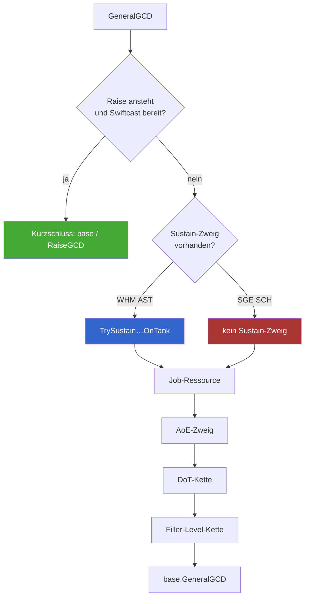
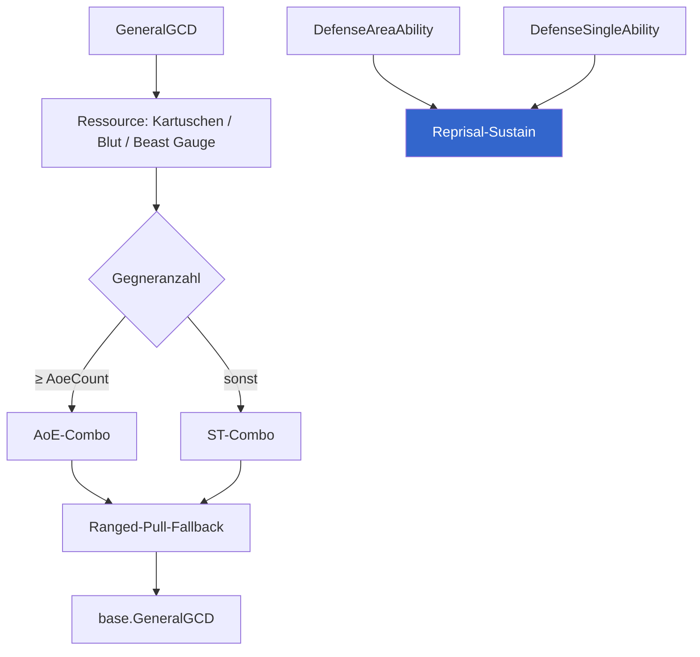
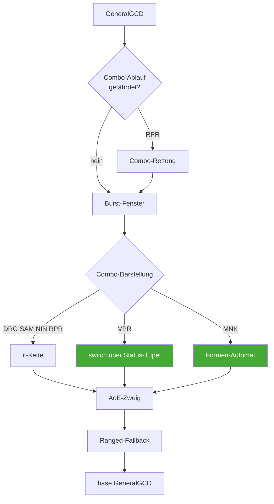
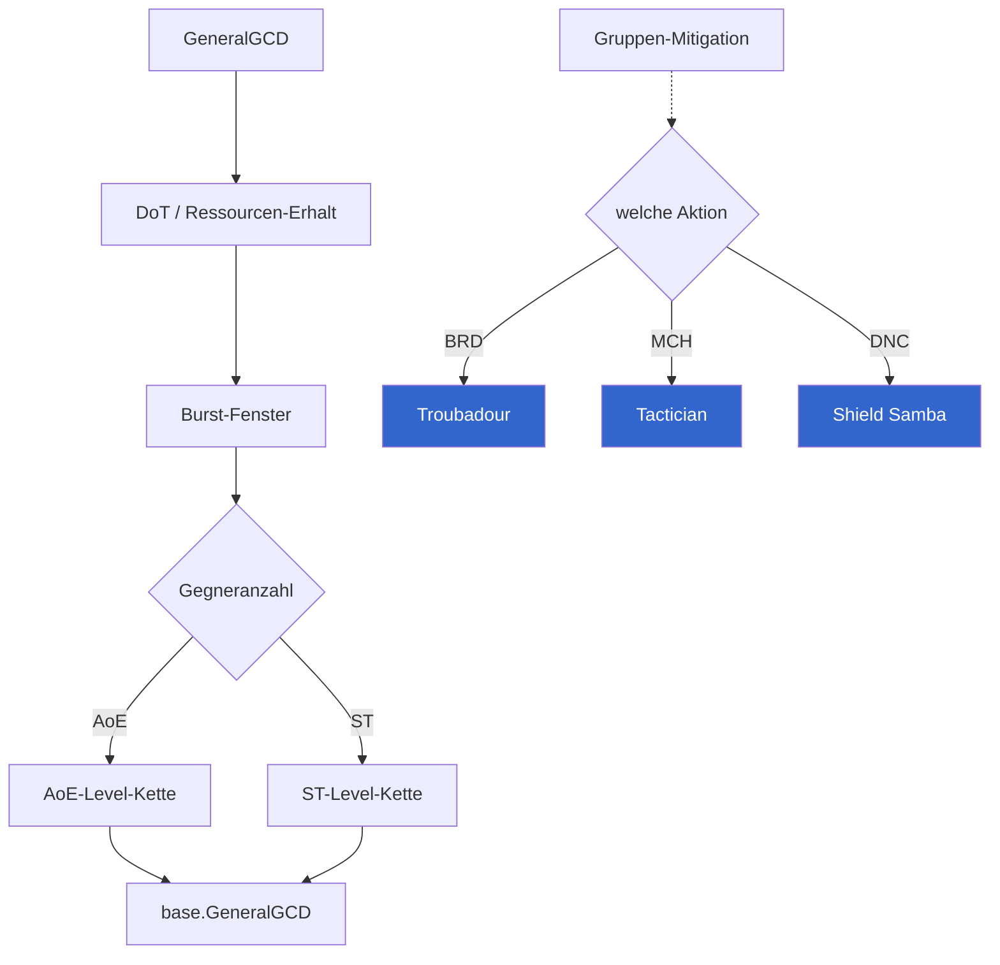
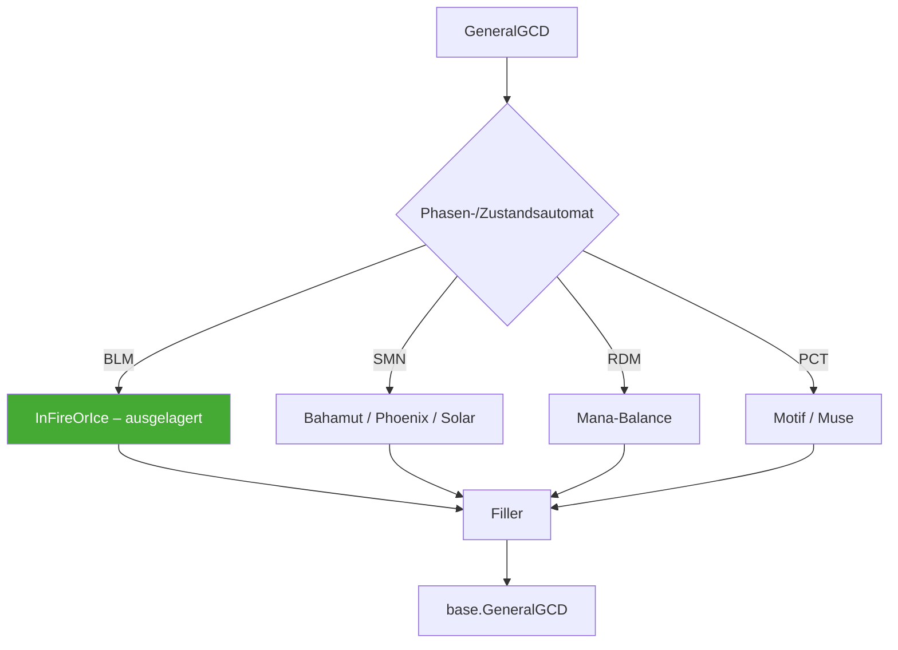

# 02 · Ablaufstruktur je Jobgruppe

Aufbauend auf `01-jobs.md`. Diese Ebene zeigt pro Gruppe, was **gleich**,
**ähnlich** und **unterschiedlich** ist. Hooks, Optionen und Voreinstellungen am 02.10.2026 aus dem Code gemessen. Farbcode in allen Diagrammen:

- durchgezogen = bei jedem Job der Gruppe vorhanden
- gestrichelt = bei einigen Jobs der Gruppe vorhanden
- Raute = Verzweigung, an der sich die Jobs unterscheiden

---

## Heiler (WHM · AST · SGE · SCH)

### Identisch in allen vier

1. **Raise-Kurzschluss ganz oben.** `SwiftRaisePending`, je Datei privat und gleichlautend, 13 Verwendungen
   (jeder Heiler hat ihn zusätzlich in `HealSingleGCD` und `HealAreaGCD`). Der einzige Zweig, der die Methode verlässt, bevor
   irgendeine Rotationsentscheidung fällt.
2. **Reihenfolge AoE → DoT → Filler.** Ohne Ausnahme.
3. **Filler ist immer eine Level-Kette** (Glare/Malefic/Dosis/Broil).
4. **`CanHealSingleSpell`/`CanHealAreaSpell`** lesen dieselbe Methode, `base && GcdHealsAllowed(GCDHeal)`: Mit
   „Use GCDs to heal" aus gehen GCD-Heilungen, wenn kein anderer Heiler lebt oder ein Mitglied in der kritischen Klasse
   steht – die universelle Schicht, der jede strategische Rückhaltung weicht (Konzept 08, A360). Paladin, Rotmagier und
   Beschwörer lesen sie ebenso; bis A360 trugen alle sieben je eine wortgleiche Kopie ohne die Gefahrenausnahme.

### Ähnlich, aber abweichend

| | WHM | AST | SGE | SCH |
|---|---|---|---|---|
| Kurzschlüsse | 1 (Swift; Thin Air entfernt, A401) | 1 | 1 | 1 |
| Sustain-Zweig in `GeneralGCD` | Regen | Aspected Benefic | **keiner** (entfernt, A5) | **keiner** |
| Pflege auf dem Tank im Pull (`TryPullUpkeepOnTank`) | Regen | Aspected Benefic | Eukr. Diagnosis | **nicht gebaut** |
| HP-Schwelle der Pflege | `RegenHeal` 0.3 | `AspectedBeneficHeal` 0.4 | keine (Konzept 15) | – |
| `GCDHeal`-Default | **true** | **true** (A433) | false | **true** |
| Ressourcenlogik in GeneralGCD | Lily | **keine** | Phlegma | MP-Schwelle |
| Zweistufiger Cast | nein | nein | **ja** (Eukrasia) | nein |
| Pet-Verwaltung | nein | nein | nein | **ja** (Eos) |

### Wo die Gruppe wirklich auseinanderläuft

Nur an drei Stellen: **Eukrasia-Vorstufe** (SGE), **Pet** (SCH) und
**Kartenlogik** (AST, komplett außerhalb `GeneralGCD`). Alles andere ist
dieselbe Leiter mit anderen Aktionsnamen.

---

## Tanks (PLD · WAR · DRK · GNB)

### Identisch in allen vier

1. **Ressource → AoE/ST-Verzweigung → Combo → Ranged-Fallback.** Gleiche
   Makrostruktur, gleiche Reihenfolge.
2. **Ranged-Pull-Fallback am Ende von `GeneralGCD`**, direkt vor `base`, nur
   durch das eigene `CanUse` gegated: Tomahawk (WAR), Lightning Shot (GNB),
   Shield Lob (PLD), Unmend (DRK). Vier strukturgleiche Zeilen.
3. **`AoeCount = 2`** für die AoE-Aggro-Aktion — bei allen vier explizit
   überschrieben (globaler Default wäre 3).
4. **Kein Raise; GCD-Heilung nur beim Paladin** (Clemency, `HealSingleGCD`).
5. **Reflexion in Flächen- und Einzelabwehr** über `ShouldSustainMitigationDebuff` (00bc9c6f), am Tankbuster mit
   `HoldReprisalForRaidwide` (A244).
6. **`HasOwnArmsLengthPullRule`**: Abtausch im Pull nach der eigenen Regel, nie auf einen Boss (A236).

### Wo die Gruppe auseinanderläuft

| | PLD | WAR | DRK | GNB |
|---|---|---|---|---|
| `EmergencyAbility` | ✓ Reborn | ✓ Basisschicht (Holmgang) | ✓ Basis + Reborn | ✓ Basis + Reborn |
| `HealSingleGCD` | ✓ Clemency | – | – | – |
| `HealSingleAbility` | – | ✓ | ✓ | ✓ |
| `MyInterruptGCD` | ✓ | – | – | – |
| Configs | 16 | 17 | 12 | **3** |

### Ausgaben in der Fläche erst, wo sie mindestens so viel bringen

**Sachstand:** Die Ausgabe-Aktionen von Krieger und Dunkelritter gehen in die Fläche erst, wo sie auf den Gegnern in
ihrer Reichweite mindestens so viel Potenz bringen wie die Einzelversion auf einem – nach den Wirktexten des laufenden
Patches (`CustomRotation.AreaWorthOver`, `ActionTooltip.AreaAtLeastSingle`; A473). Die Gegnerzahl der Aktion bleibt
die Untergrenze („Number of targets needed to use this action"). Bei Gleichstand geht die Fläche: gleicher Schaden,
Feindseligkeit auf allen. Die Flächen-Combo (Overpower, Unleash, Total Eclipse, Demon Slice) bleibt bei 2 Gegnern für
die Feindseligkeit (oben, „Identisch in allen vier").

| Paar (Wirktext, Patch 7.5) | Lohnt ab | RSR vorher |
|---|---|---|
| Krieger: Decimate 180 gegen Fell Cleave 580 | 4 | 2 |
| Krieger: Chaotic Cyclone 200 gegen Inner Chaos 700 (beide kritisch direkt) | 4 | 2 |
| Krieger: Orogeny 150 gegen Upheaval 420 | 3 | 2 |
| Krieger: Steel Cyclone 160 gegen Inner Beast 330 (unter Stufe 60) | 3 | 2 |
| Dunkelritter: Quietus 240 gegen Bloodspiller 600 | 3 | 2 |
| Dunkelritter: Flood of Shadow 160 gegen Edge of Shadow 460 (darunter Flood/Edge of Darkness 100/300) | 3 | 2 |
| Dunkelritter: Impalement 300 gegen Torcleaver 820 (der stärkste Schritt der Delirium-Combo) | 3 | 2 |

The Balance stimmt für den Krieger überein (Decimate und Chaotic Cyclone ab 4, Orogeny ab 3; Stand des Guides 7.4,
27.12.2025, an 7.5 nicht angepasst – die Rechnung aus den Wirktexten von 7.5 kommt auf dieselben Zahlen). **Im Kampf:**
Bei zwei oder drei Gegnern ging ein Teil jedes Inner Release und jeder Blut-Ausgabe in die Fläche und verlor Schaden –
bei zwei Gegnern Decimate 360 statt Fell Cleave 580, Chaotic Cyclone 400 statt Inner Chaos 700. Die Feindseligkeit auf
dem zweiten und dritten Gegner hält die Flächen-Combo. Ab der Zahl der Tabelle bleibt alles, wie es war.

**Nicht geändert:** Paladin – Holy Circle und Holy Spirit sind unter Divine Might (250/500) und Requiescat (350/700),
wo sie in der Rotation fallen, bei zwei Gegnern gleich stark; die Revolverklinge liegt seit A471 richtig (Fated Circle
300 gegen Burst Strike 420, ab 2). Die Abyssal Drain des Dunkelritters vergleicht schon so (A391).

### Feindseligkeit im Pull: die Revolverklinge gibt ihre Patronen in der Fläche aus

**Sachstand:** Im Pull wirkt die Revolverklinge ihre Einzelzielaktionen nur noch, wo die Fläche nicht mehr bringt
(A471): Eine Patrone geht auf Fated Circle statt Burst Strike, sobald dessen Gegnerzahl erreicht ist (ab Werk 2);
Gnashing Fang beginnt nicht, wenn Fated Circle drei oder mehr Gegner erreicht; Sonic Break fällt nicht bei sechs und
mehr, bei vier und fünf nur, wenn das Ziel nach seiner gemessenen Restzeit die ganze Wirkdauer des DoT lebt, bei drei
die halbe. So steht es in der Referenz (The Balance, Gunbreaker Basic Guide, abgerufen 31.10.2026: „Use Fated Circle
on 2 targets or more", „Stop using Gnashing Fang on 3 or more targets", „Use Sonic Break on up to 5 targets", bei 4
Zielen nur mit voller, bei 3 mit halber Wirkdauer).

**Der Hinweis.** Ein Bekannter, von ihm weitergegeben (31.10.2026): Unter RSR (Upstream) erzeuge die Revolverklinge
bei Flächen und bei einzelnen Gegnern weniger Feindseligkeit als die anderen Tanks. Sein Zusatz, ebenfalls ein Hinweis
(31.10.2026): „gerade bei wall to wall pulls, wenn die gunblade in die gegnergruppe rennt, dauert es gefühlt länger,
dass sie bei allen gegnern aggro hat, als bei den anderen tankklassen. und beim weiterziehen zur nächsten gegnergruppe
scheint sie schneller wieder die aggro zu verlieren, wenn die damagedealer beim laufen schaden auf die gegner machen."

**Ursache am Code.** `GNB_Reborn.GeneralGCD` prüfte Burst Strike, die Gnashing-Fang-Kette (Gnashing Fang, Savage Claw,
Wicked Talon) und Sonic Break vor Fated Circle und der Flächen-Combo, ohne die Gegner zu zählen. Unter No Mercy – im
Pull fast immer gleich zu Beginn – gingen so etwa fünf bis sechs von acht GCDs auf einen einzigen Gegner (Schluss aus
der Reihenfolge, nicht gemessen); die übrigen bekamen Feindseligkeit nur aus Double Down, Bow Shock und den
Rand-Treffern von Reign of Beasts. Eine Aktion auf ein Ziel erzeugt nur bei diesem Ziel Feindseligkeit. Die anderen
Tanks prüfen ihre Flächenversion zuerst: Krieger Chaotic Cyclone und Decimate vor Inner Chaos und Fell Cleave,
Mythril Tempest vor Storm's Path; Paladin Holy Circle vor Holy Spirit, Prominence vor Royal Authority (seine
Atonement-Kette entsteht nur aus Royal Authority, die er im Pull nicht wirkt); Dunkelritter Quietus vor Bloodspiller,
Impalement vor Scarlet Delirium, Stalwart Soul vor Souleater. Die Revolverklinge war der Einzelfall der Gruppe, deshalb
sitzt die Korrektur in ihrer Rotation, nicht in der Tankschicht.

**Im Kampf.** Im Wall-to-wall-Pull trifft jede Patrone jetzt alle Gegner im Umkreis (Fated Circle und sein Folgeangriff
Fated Brand), und ohne Gnashing-Fang-Kette bleiben die GCDs auf der Flächen-Combo: Die Gegner, an denen die Damage
Dealer ziehen, bekommen von der Revolverklinge laufend Feindseligkeit, beim Hineinlaufen wie beim Weiterziehen. Gegen
zwei Gegner bleibt Gnashing Fang; gegen einen ändert sich nichts. Schaden: nach der Referenz die bessere Wahl, also kein
Preis. *Schwäche:* Die Gegner werden über Fated Circles Reichweite um die Revolverklinge gezählt; ein Rudel, das noch
heranläuft, zählt erst, wenn es dort steht – dann beginnt Gnashing Fang womöglich auf dem ersten Gegner und läuft zu
Ende. Gezählt wird über Demon Slice; ist es in der Aktionsliste abgeschaltet oder steht „AoE type“ auf aus, zählt die
Rotation keinen Gegner und wirkt wie vorher. *Bedrohung:* Wer die Gegnerzahl von Fated Circle hochsetzt, bekommt Burst
Strike länger, wie er es einstellt. Ohne Fated Circle (unter Stufe 72) gilt die alte Reihenfolge.

Die frühere Spaltung bei Reflexion (Paladin und Krieger nur in der Einzelabwehr) ist aufgehoben (00bc9c6f).
`HasHostileCountAoeMitigation` gibt es nicht mehr: Es setzte `DefenseArea` allein auf die Gegnerzahl und
öffnete damit die ganze Abwehrkette (b8018cf0, Konzept 08).

---

## Melee (DRG · MNK · NIN · RPR · SAM · VPR)

### Identisch in allen sechs

1. **Feint-Sustain** über `ShouldSustainMitigationDebuff(StatusID.Feint)` in
   `DefenseAreaAbility` **und** `DefenseSingleAbility` — eine Zeile pro Stelle, zwölf Stellen gesamt; beim Ninja
   in der versiegelten `NinjaRotation`.
2. **Ranged-Fallback am Ende** (Piercing Talon, Writhing Snap, Harpe …); der Mönch hat keinen.
3. **`HealSingleAbility`** (Second Wind/Bloodbath) bei allen sechs.

### Wo die Gruppe auseinanderläuft

| | DRG | MNK | NIN | RPR | SAM | VPR |
|---|---|---|---|---|---|---|
| `CountDownAction` | **fehlt** | ✓ | ✓ | ✓ | ✓ | **fehlt** |
| `EmergencyAbility` | ✓ | ✓ | ✓ | **fehlt** | **fehlt** | ✓ |
| `HealAreaAbility` | – | **✓** (Earth's Reply, Mantra) | – | – | – | – |
| `HasOwnInterruptGate` | – | – | – | ✓ | – | ✓ |
| Combo-Form | if-Kette | Automat | Automat | if-Kette | if-Kette | switch |
| Trait-Duplikate | **6 Paare** | – | – | – | – | – |

Der Mönch führt Second Wind und Bloodbath seit 4b3c9412 in `HealSingleAbility`; `HealAreaAbility` trägt seine
Gruppenheilungen.

### Positionals: wo stehen, wer bewegt, wann True North

Geltender Stand (A819): RSR wählt nach Stellung, wirft True North, wenn der nächste GCD sein Positional verfehlen
würde oder der Spieler so knapp an der Grenze steht, dass das Spiel schon einmal anders geurteilt hat, und meldet die
gebrauchte Seite nur, wo ein Schritt etwas bringt. Bewegen tut BossModReborn, nicht RSR.

**Grundlagen**
- *Geometrie:* Um die Mitte des Ziels liegen vier Sektoren zu 90°, bezogen auf seine Blickrichtung: vorn, zwei
  Flanken, hinten. Die Grenze hinten/Flanke liegt 45° neben der Rückseite. Gemessen wird von der Mitte des Ziels zur
  Mitte des Spielers. Belegt in vier Werkzeugen, übereinstimmend: RSR `FindEnemyPositional` (cos 45°), BossModReborn
  `AIHints.GoalSingleTarget` und `GoToPositional`, Avarice `Util` (90–135° Flanke, 135–180° hinten), Resonant. Dazu
  Gemeinschaftsquellen: Square-Enix-Forum („epicenter" des Zielkreises), akhmorning („Position = Mitte des Modells").
  Kein Spielblatt nennt den Winkel.
- *Wer Positionals hat (7.x):* alle sechs Nahkämpfer, jeder mit beiden Seiten
  (`ConfigurationHelper.ActionPositional`; consolegameswiki, Kategorie „Positional actions"; Avarice
  `PositionalPotencies`):

  | Job | hinten | Flanke |
  |---|---|---|
  | DRG | Chaos Thrust/Chaotic Spring, Wheeling Thrust | Fang and Claw |
  | MNK | Demolish | Snap Punch/Pouncing Coeurl |
  | NIN | Aeolian Edge, Trick Attack | Armor Crush |
  | RPR | Gallows, Executioner's Gallows | Gibbet, Executioner's Gibbet |
  | SAM | Gekko | Kasha |
  | VPR | Hindsting Strike, Hindsbane Fang, Swiftskin's Coil | Flanksting Strike, Flanksbane Fang, Hunter's Coil |

  Die Regel sitzt auf der Ebene Nahkämpfer; keine Untergruppe weicht ab, Heiler, Tanks und Fernkämpfer haben keine.
  Erfasst, nicht bearbeitet: Blaumagier (Goblin Punch, vorn) und Sonderinhalte (Lost Assassination).
- *Kein Positional:* Gegner mit `IsOmnidirectional` (BNpcBase) und Gegner unter Directional Disregard (Status 3808)
  werden von überall voll getroffen. So lesen es RSR (`HasPositional`), BossModReborn (`Actor.Omnidirectional`) und
  WrathCombo (`TargetNeedsPositionals`).
  - *Sein Hinweis (15.11.2026):* Endbosse am Rand der Arena, hinter die man nicht kommt, brauchen weder Positional
    noch True North.
  - Am Blatt geprüft (xivapi v2, 15.11.2026), Stichprobe von fünf:
    - rundum markiert, alle drei am Rand: Zodiark (BNpcBase 12877), Valigarmanda (16664), Cloud of Darkness im
      Chaotic (17950);
    - nicht markiert, beide in der Mitte: Rubicante (15756), Hydaelyn (13549).
  - Für einen rundum markierten Gegner wirft RSR kein True North, wählt frei und meldet keine Seite.
- *Wann geurteilt wird:*
  - Die Aktionsanfrage trägt Blickrichtung und Richtung zum Ziel, nicht den Ort (BossMod `ClientIPC.ActionRequest`).
    Der Server urteilt also mit dem Ort, den der Client zuletzt gemeldet hat.
  - Sofortige Waffenfertigkeiten urteilen beim Drücken (akhmorning, Gemeinschaftsquelle).
  - Positionsmeldungen gehen in festen Takten; das Square-Enix-Forum nennt 0,3 s, unbestätigt.
  - Schluss (abgeleitet): Ein Schritt muss vor dem Drücken beendet und gemeldet sein.
- *Ob es traf:* Der Schadenseintrag trägt im dritten Parameter den Bonus in Prozent der Gesamtpotenz, Kombo und
  Positional zusammen (Avarice `Memory`, xivanalysis `bonusPercent`). Ein eigenes Kennzeichen für das Positional gibt
  es nicht. Avarice und xivanalysis führen die Werte je Aktion, Stufe und Buff in Tabellen von Hand.
- *Vorbilder* (Stand je Klon, 15.11.2026):
  - Avarice (PunishXIV, cbf6a9c): Stellungslinien, Trefferrückmeldung als Bild, Ton und Chat, Statistik. Liest die
    Seite aus RSRs `DesiredPositionalChanged` und aus WrathCombo.
  - Positional Assistant (VariableVixen, bbbde44): Linien um das Ziel.
  - Resonant (aulus-asina, 8a27d1a): Sektoren, Nahkampfkreise 2,1 y und 3 y, Hitbox des Spielers.
  - PixelPerfect (Haplo064, 162c07c): Hitbox und Ringe.
  - BossModReborn (35a908ad7) und BossMod (c50e67f3): Stellungshinweis in der Welt (`ShowPositionals`), Bewegung durch
    KI und Modul.
  - WrathCombo (a457838): „Dynamic True North" mit Ladungsrückhalt (`RPR_ST_TrueNorthDynamicHoldCharge`).
  - Splatoon zeichnet nur und ist kein Positionswerkzeug.
- *Was RSR tut:*
  - Wahl nach Stellung bei SAM, RPR, VPR und NIN: die Aktion, für die er gerade richtig steht, zuerst
    (`CanHitPositional`). DRG und MNK folgen ihrer festen Folge.
  - True North im letzten Webfenster, wenn der nächste GCD sein Positional verfehlen würde
    (`StateUpdater.ShouldAddPositional`, Option „AutoUseTrueNorth").
  - Die Seite des nächsten GCD geht als `DesiredPositional` über IPC hinaus.
- *Wer sie liest:*
  - BossModReborn bewegt den Spieler dorthin. Das tut ihre KI („Follow target", Schalter „Follow
    RotationSolverReborn's desired positional", ab Werk an) oder ihr Modul „Misc AI: Goes to specified positional"
    mit dem Kantenpuffer „Stand at positional edges", 0,5, 1,5 oder 3 y.
  - Ihre Navigation stellt Sicherheit vor Uptime vor Positional (`NavigationDecision`).

**Die beste Stellung**
- *Seine Frage (15.11.2026):* „wahrscheinlich hinten im 45 grad winkel".
- Bestätigt: auf der Diagonale hinten, der Grenze zwischen hinten und Flanke. Von dort liegt jede Seite einen
  Bruchteil eines Schritts entfernt.
  - Der Weg ist Abstand zur Mitte mal Winkel. Bei 5 y Abstand sind 43° bis 47° rund 0,35 y, bei 6 y/s
    Laufgeschwindigkeit 0,06 s.
  - Je näher an der Mitte, desto kürzer der Weg.
- *Grenze 1:* Dreht das Ziel – Tankwechsel, der Tank zieht es –, wandert die Grenze mit. Genau auf ihr kippt jede
  kleine Drehung die Seite.
- *Grenze 2:* Die Mechanik bestimmt den Platz (Schweif, Rückenkegel, Verteilung); Sicherheit geht vor.

**Sein Vorschlag (15.11.2026): an der Grenze minimal „zittern“, damit er für die Rotation immer richtig steht**

Optionen: N (wie heute), B1 RSR bewegt selbst, B2 BossModReborn bewegt nach RSRs Seite (besteht), B3 RSR schärft
Seite und True North und misst das Urteil des Spiels, B4 nur Anzeige. Rückbau von B3: nichts wird gespeichert; ohne
die Teile gilt N.

- *B1, RSR bewegt selbst* (die Gehrichtung ersetzen wie BossMods `MovementOverride`, oder Tasten senden):
  - Stärke: wirkt ohne BossMod.
  - Schwächen:
    - RSR hat keine Gefahrenkarte. Ein Schritt über die Grenze kann in eine Fläche führen oder unter Pyretic schaden.
    - Der Schritt bricht Zauber und Kanäle: Iaijutsu, Harpe, Communio, Ten Chi Jin, Meditate.
    - Er kämpft gegen BossMods KI und gegen seine eigene Bewegungstaste.
  - Bedrohung: seine Vorgabe, nichts zu empfehlen, was ihn für Schaden aus einer sicheren Position holt; Konzept 13,
    B6 („RSR dreht, bewegt aber nie").
  - Bilanz: verworfen. B2 leistet dasselbe mit Gefahrenkarte.
- *B2, BossModReborn bewegt:*
  - Stärke: genau sein Vorschlag. Mit „Stand at positional edges" geht BossMod nur über die Kante, und nur wo der
    Platz sicher ist.
  - Schwäche (a): Unter True North und vor einem Ziel ohne Positional meldete RSR trotzdem eine Seite.
    - BossMods KI prüft True North nicht (`AIBehaviour`, nur das Modul prüft es) und läuft umsonst.
    - Avarice zeigte eine Seite, die nichts bringt.
  - Schwäche (b): Genau an der Kante kann eine kleine Drehung des Ziels zwischen Drücken und Urteil die Seite kippen.
    Ob das vorkommt, maß niemand.
- *B3, RSR schärft Seite und True North* – beseitigt B2(a), macht B2(b) messbar und steuert nach:
  - *B3a:*
    - `DesiredPositional` meldet keine Seite, solange True North den nächsten GCD noch deckt oder das Ziel kein
      Positional hat. Der Wert wird jeden Frame neu bestimmt, nicht nur beim Wechsel des GCD.
    - `CanHitPositional` gilt unter True North für beide Seiten; die Wahl nach Stellung folgt dann der Reihenfolge der
      Rotation.
  - *B3b, Urteil des Spiels* (`PositionalWatch`):
    - Gemessen wird beim Drücken jeder positionalen Aktion, auch seiner eigenen: gebrauchte Seite, Abstand zur Grenze
      in Grad, True North.
    - Das wird mit dem Bonus aus dem Schadenseintrag verglichen.
    - Die Bonuswerte lernt RSR selbst, ohne Tabelle, je Aktion, Kombostand und Stufe:
      - Ein Wert unter True North oder tief in der richtigen Seite (näher an ihrer Mitte als an der Grenze) ist ein
        Treffer.
      - Ein Wert tief in der falschen Seite ohne True North ist ein Fehlschlag.
      - Ein Wert in beiden Mengen urteilt nicht.
  - *B3c, Unsicherheitsband:*
    - Urteilt das Spiel gegen RSRs Messung, wächst ein Band auf diesen Abstand zur Grenze. Das gilt für einen
      Fehlschlag mit richtiger Messung ebenso wie für einen Treffer mit falscher.
    - Steht der Spieler für den nächsten GCD auf der richtigen Seite, aber innerhalb des Bands, wirft RSR True North
      nur bei vollen Ladungen. Eine Ladung bleibt so für die Mechanik.
    - Das Band gilt bis zum nächsten Gebietswechsel.
  - Stärken: kein Lauf umsonst, Treffer werden messbar, die Kante wird sicherer.
  - Schwäche: B3c verbraucht eine Ladung, die sonst bis zur Aufladung stehen bliebe. Der Puffer sinkt von 2 auf 1, bis
    sie zurück ist.
  - Bedrohung: Ein Ausreißer – das Ziel dreht genau beim Drücken – weitet das Band für das Gebiet. Preis: True North
    bei vollen Ladungen öfter als nötig, nie die letzte Ladung.
- *B4, nur Anzeige:* zeigt, bewegt nicht. Avarice gibt es schon und liest RSRs Seite; RSR baut keine eigene.
- Abgleich: Sein Ziel ist „immer richtig stehen". B2 bewegt, B3 sorgt dafür, dass die Bewegung nur kommt, wo sie
  etwas bringt, und dass ein Fehlurteil an der Kante True North auslöst. Keine stille Verengung: Ohne BossMods
  Bewegung bleibt die Wahl nach Stellung, True North und B3c.

**Sein Hinweis (15.11.2026): True North, wenn der Platz durch Gefahren belegt ist**
- So wirkt die Regel schon. Steht er im letzten Webfenster nicht auf der Seite des nächsten GCD, wirft RSR True
  North, solange eine Ladung da ist – ob die Fläche dort belegt ist oder aus einem anderen Grund.
- *Gegenthese:* Ladungen für belegte Flächen aufheben und ohne Gefahr nicht werfen (wie WrathCombos Ladungsrückhalt).
  Kampfbeispiel, DRG ohne Bewegung durch die KI:
  - Ohne Rückhalt: einmal ohne Gefahr zu spät, True North geht von 2 auf 1. Dann belegt eine Fläche den Rücken 12 s
    lang; True North deckt 10 s, ein GCD verfehlt.
  - Mit Rückhalt: der erste GCD verfehlt, die Fläche wird mit zwei Ladungen gedeckt.
  - Beide Wege kosten einen Fehlschlag. Der Rückhalt gewinnt nur bei einer Gefahr, die kurz nach einem Fehlwurf kommt
    und länger dauert als eine Wirkdauer. Er verliert in jedem Fall, in dem keine Gefahr folgt.
- Bilanz: Ausgleich, kein Gewinn; nicht gebaut. Mit BossMods KI gibt es den Fall ohne Gefahr kaum, weil sie ihn vor
  dem letzten Webfenster hinstellt.

**Wechselwirkungen**
- *Bewegungssperre beim Wirken (Konzept 03):* BossMods Gehen für Positionals fällt zwischen die GCDs. Die
  Nahkämpfer wirken kaum (Iaijutsu, Harpe); dort hält BossMod über `MaxCastTime`.
- *Blickwache (Konzept 13):* Sie dreht und bewegt nicht. True North dreht nichts.
- *Avarice:* liest dasselbe Signal und zeigt unter True North jetzt keine Seite mehr.

**Falsifikation**
- *Kein Defekt:* B3a widerlegt die These am Code: Die KI lief unter True North umsonst (BossModReborn
  `AIBehaviour`). B3c ebenso: An der Kante bleibt ein Fehlurteil des Spiels ohne Antwort.
- *Option falsch:* Das Band lerne aus Zufall. Dagegen: Nur ein Urteil des Spiels gegen RSRs Messung weitet es, und es
  verbraucht nur Ladungen, die sonst stünden.
- *Ausgeliefert, nichts ändert sich – warum?* Wenn nie ein Bonuswert gelernt wird, weil er nie True North nutzt und
  nie tief in einer Seite steht. Dann bleibt das Band null und B3c wirkt nicht; B3a wirkt davon unabhängig. Die
  Spurzeile mit „unknown" zeigt den Fall.

**Messweg**
- Je positionale Aktion eine Spurzeile „positional: <Aktion> needs <Seite> …, <Abstand>° inside …, true north
  yes/no – hit/miss/unknown (bonus n%), band b°".
- Vorhersage `positional-learns` (A819): Nach einer Zeile mit True North und einem Treffer folgt für dieselbe Aktion
  eine Zeile „hit" ohne True North.

---

## Physische Fernkämpfer (BRD · MCH · DNC)

### Identisch in allen drei

1. **Gruppen-Minderung** (Troubadour/Tactician/Shield Samba) —
   dieselbe Rolle, dieselbe Dauer (15 s), dieselbe BMR-Auslösung (`BMRShouldRefreshBefore` vor Raidwide und
   Tankbuster). Die drei sind eine Familie: Die neue ersetzt die stehende, gleich von wem, und aufgefrischt wird nur,
   wenn keine der drei den angekündigten Treffer noch abdeckt (Konzept 08, „Eine fremde Minderung derselben Familie
   zählt wie die eigene", A592).
2. **Level-Ketten dominieren den Filler.**
3. **Kein Raise, keine GCD-Heilung; Second Wind in `HealSingleAbility` bei allen drei.**

### Wo die Gruppe auseinanderläuft

| | BRD | MCH | DNC |
|---|---|---|---|
| `HealAreaAbility` | – | – | **✓** (Curing Waltz, Improvisation) |
| `DispelAbility` | **✓** (Warden's Paean) | – | – |
| `MoveForwardAbility` | – | – | ✓ (En Avant) |
| `MoveBackAbility` | ✓ (Repelling Shot) | – | – |
| Level-Ketten-Glieder | 2 | **12** | 0 |

Die verbleibenden Unterschiede folgen den Aktionen, die nur ein Job hat (A7, 4b3c9412).

---

## Magische Fernkämpfer (SMN · RDM · PCT · BLM)

### Identisch in allen vier

1. **Addle-Sustain** über `ShouldSustainMitigationDebuff(StatusID.Addle)` in
   beiden Defense-Slots (beim Beschwörer über `TryAddleBeforeDamage`).
2. **Ein Zustandsautomat als Kern**, Filler nur als Rest.

### Wo die Gruppe auseinanderläuft

| | SMN | RDM | PCT | BLM |
|---|---|---|---|---|
| Automat liegt in | benannten Stufen (A4a) | `GeneralGCD` | benannten Stufen (A4a) | **privaten Methoden** |
| Top-Level-Zweige vor A4a | 24 | 22 | 33 | **7** |
| `HealSingleGCD` | ✓ | ✓ | – | – |
| `RaiseGCD` | ✓ | ✓ | – | – |
| `MoveForwardGCD` | ✓ | – | – | – |
| Configs | 13 | 9 | 8 | 5 |

BLM erreichte mit **7** Top-Level-Zweigen dieselbe fachliche Abdeckung, für die
PCT **33** brauchte. Der Unterschied ist reine Ablauforganisation, nicht
Job-Komplexität; A4a hat PCT und SMN deshalb in benannte Stufen zerlegt.

---

## Gruppenvergleich in einer Tabelle

| Gruppe | gemeinsame Makrostruktur | echte Abweichungen | unbegründete Abweichungen |
|---|---|---|---|
| Heiler | Kurzschluss → Sustain → Ressource → AoE → DoT → Filler | Eukrasia, Pet, Karten | Gelehrter ohne Pflege im Pull (kein Sofortschild, Konzept 15) |
| Tanks | Ressource → AoE/ST → Combo → Ranged-Fallback | – | Unverwundbarkeit an zwei Orten (Konzept 05) |
| Melee | Burst → Combo → AoE → Ranged-Fallback | Mudra, Formen, Positionals | DRG/VPR ohne CountDown – keine Lücke (`04`, „Countdown und Notfallslot“) |
| Phys. Ranged | DoT/Ressource → Burst → AoE/ST | Tänze (DNC) | – |
| Mag. Ranged | Automat → Filler | Elementphasen | Automat mal ausgelagert, mal inline |
