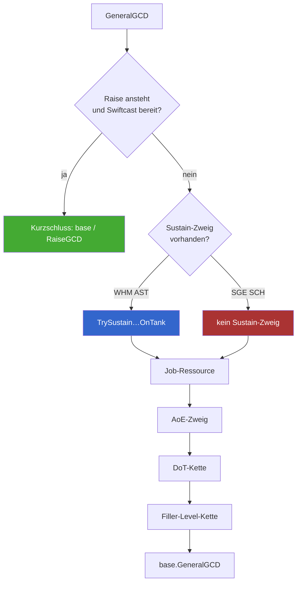
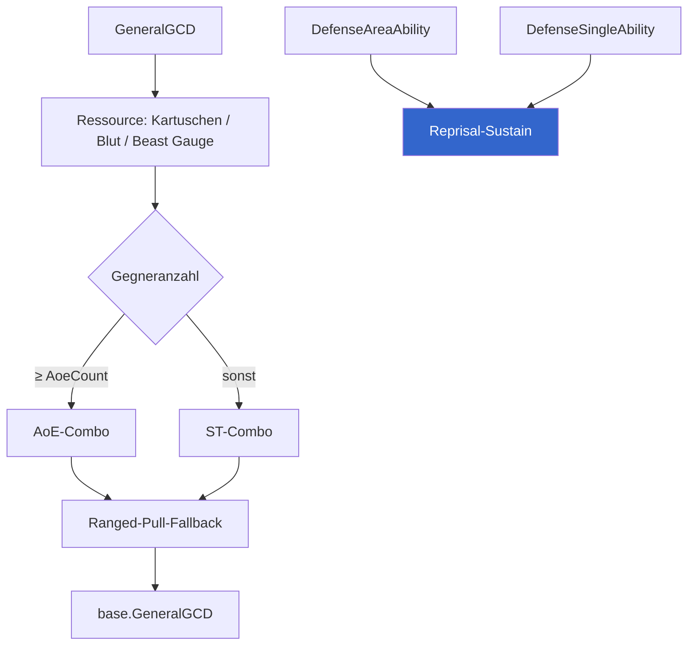
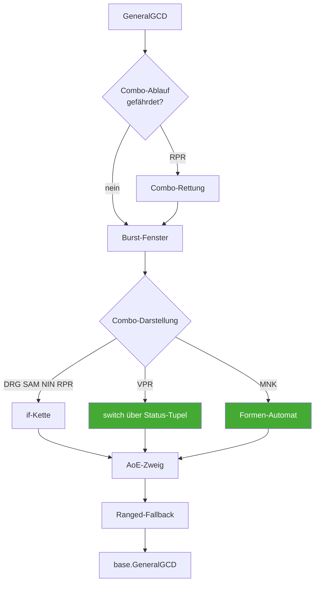
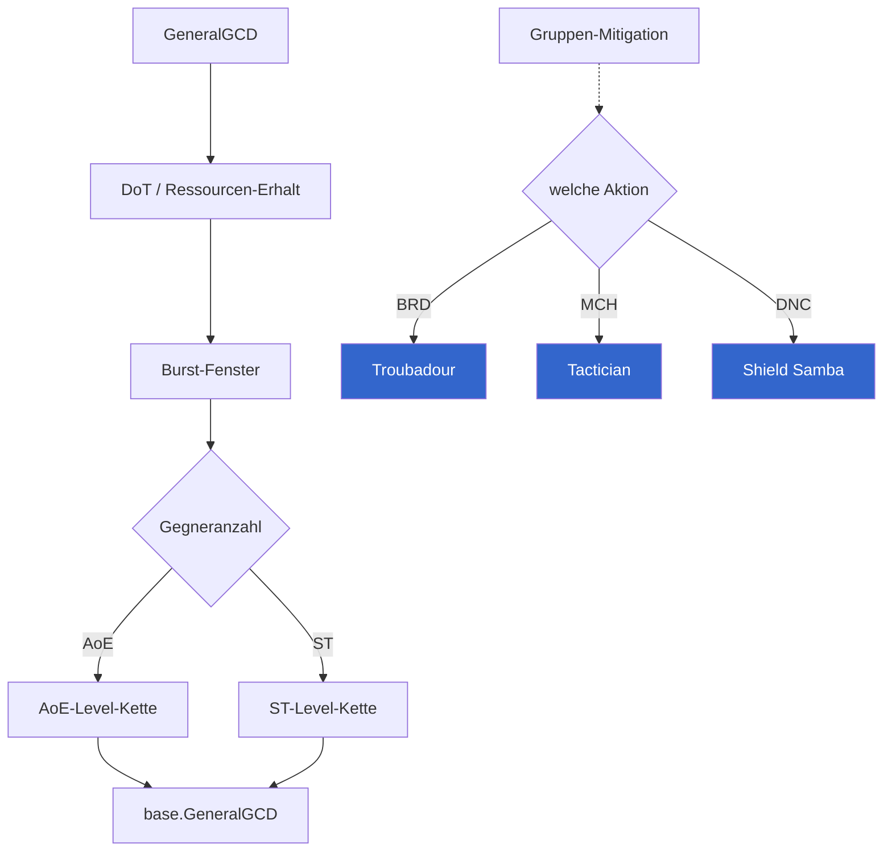
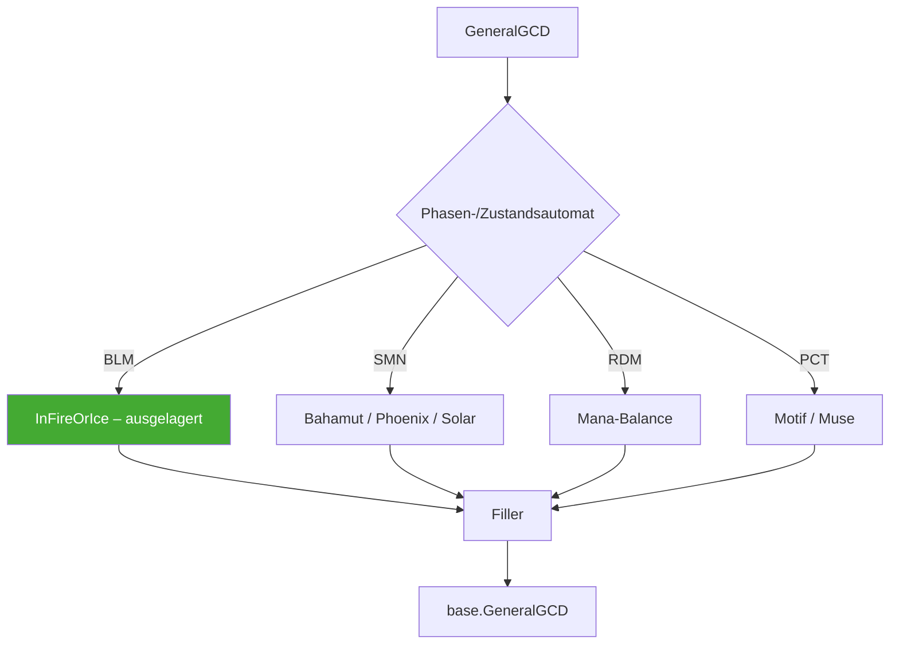

# 02 · Ablaufstruktur je Jobgruppe

Aufbauend auf `01-jobs.md`. Diese Ebene zeigt pro Gruppe, was **gleich**,
**ähnlich** und **unterschiedlich** ist. Hooks, Optionen und Voreinstellungen am 02.10.2026 aus dem Code gemessen. Farbcode in allen Diagrammen:

- durchgezogen = bei jedem Job der Gruppe vorhanden
- gestrichelt = bei einigen Jobs der Gruppe vorhanden
- Raute = Verzweigung, an der sich die Jobs unterscheiden

---

## Heiler (WHM · AST · SGE · SCH)

### Identisch in allen vier

1. **Raise-Kurzschluss ganz oben.** `SwiftRaisePending`, je Datei privat und gleichlautend, 13 Verwendungen
   (jeder Heiler hat ihn zusätzlich in `HealSingleGCD` und `HealAreaGCD`). Der einzige Zweig, der die Methode verlässt, bevor
   irgendeine Rotationsentscheidung fällt.
2. **Reihenfolge AoE → DoT → Filler.** Ohne Ausnahme.
3. **Filler ist immer eine Level-Kette** (Glare/Malefic/Dosis/Broil).
4. **`CanHealSingleSpell`/`CanHealAreaSpell`** lesen dieselbe Methode, `base && GcdHealsAllowed(GCDHeal)`: Mit
   „Use GCDs to heal" aus gehen GCD-Heilungen, wenn kein anderer Heiler lebt oder ein Mitglied in der kritischen Klasse
   steht – die universelle Schicht, der jede strategische Rückhaltung weicht (Konzept 08, A360). Paladin, Rotmagier und
   Beschwörer lesen sie ebenso; bis A360 trugen alle sieben je eine wortgleiche Kopie ohne die Gefahrenausnahme.

### Ähnlich, aber abweichend

| | WHM | AST | SGE | SCH |
|---|---|---|---|---|
| Kurzschlüsse | 1 (Swift; Thin Air entfernt, A401) | 1 | 1 | 1 |
| Sustain-Zweig in `GeneralGCD` | Regen | Aspected Benefic | **keiner** (entfernt, A5) | **keiner** |
| Pflege auf dem Tank im Pull (`TryPullUpkeepOnTank`) | Regen | Aspected Benefic | Eukr. Diagnosis | **nicht gebaut** |
| HP-Schwelle der Pflege | `RegenHeal` 0.3 | `AspectedBeneficHeal` 0.4 | keine (Konzept 15) | – |
| `GCDHeal`-Default | **true** | **true** (A433) | false | **true** |
| Ressourcenlogik in GeneralGCD | Lily | **keine** | Phlegma | MP-Schwelle |
| Zweistufiger Cast | nein | nein | **ja** (Eukrasia) | nein |
| Pet-Verwaltung | nein | nein | nein | **ja** (Eos) |

### Wo die Gruppe wirklich auseinanderläuft

Nur an drei Stellen: **Eukrasia-Vorstufe** (SGE), **Pet** (SCH) und
**Kartenlogik** (AST, komplett außerhalb `GeneralGCD`). Alles andere ist
dieselbe Leiter mit anderen Aktionsnamen.

---

## Tanks (PLD · WAR · DRK · GNB)

### Identisch in allen vier

1. **Ressource → AoE/ST-Verzweigung → Combo → Ranged-Fallback.** Gleiche
   Makrostruktur, gleiche Reihenfolge.
2. **Ranged-Pull-Fallback am Ende von `GeneralGCD`**, direkt vor `base`, nur
   durch das eigene `CanUse` gegated: Tomahawk (WAR), Lightning Shot (GNB),
   Shield Lob (PLD), Unmend (DRK). Vier strukturgleiche Zeilen.
3. **`AoeCount = 2`** für die AoE-Aggro-Aktion — bei allen vier explizit
   überschrieben (globaler Default wäre 3).
4. **Kein Raise; GCD-Heilung nur beim Paladin** (Clemency, `HealSingleGCD`).
5. **Reflexion in Flächen- und Einzelabwehr** über `ShouldSustainMitigationDebuff` (00bc9c6f), am Tankbuster mit
   `HoldReprisalForRaidwide` (A244).
6. **`HasOwnArmsLengthPullRule`**: Abtausch im Pull nach der eigenen Regel, nie auf einen Boss (A236).

### Wo die Gruppe auseinanderläuft

| | PLD | WAR | DRK | GNB |
|---|---|---|---|---|
| `EmergencyAbility` | ✓ Reborn | ✓ Basisschicht (Holmgang) | ✓ Basis + Reborn | ✓ Basis + Reborn |
| `HealSingleGCD` | ✓ Clemency | – | – | – |
| `HealSingleAbility` | – | ✓ | ✓ | ✓ |
| `MyInterruptGCD` | ✓ | – | – | – |
| Configs | 16 | 17 | 12 | **3** |

### Ausgaben in der Fläche erst, wo sie mindestens so viel bringen

**Sachstand:** Die Ausgabe-Aktionen von Krieger und Dunkelritter gehen in die Fläche erst, wo sie auf den Gegnern in
ihrer Reichweite mindestens so viel Potenz bringen wie die Einzelversion auf einem – nach den Wirktexten des laufenden
Patches (`CustomRotation.AreaWorthOver`, `ActionTooltip.AreaAtLeastSingle`; A473). Die Gegnerzahl der Aktion bleibt
die Untergrenze („Number of targets needed to use this action"). Bei Gleichstand geht die Fläche: gleicher Schaden,
Feindseligkeit auf allen. Die Flächen-Combo (Overpower, Unleash, Total Eclipse, Demon Slice) bleibt bei 2 Gegnern für
die Feindseligkeit (oben, „Identisch in allen vier").

| Paar (Wirktext, Patch 7.5) | Lohnt ab | RSR vorher |
|---|---|---|
| Krieger: Decimate 180 gegen Fell Cleave 580 | 4 | 2 |
| Krieger: Chaotic Cyclone 200 gegen Inner Chaos 700 (beide kritisch direkt) | 4 | 2 |
| Krieger: Orogeny 150 gegen Upheaval 420 | 3 | 2 |
| Krieger: Steel Cyclone 160 gegen Inner Beast 330 (unter Stufe 60) | 3 | 2 |
| Dunkelritter: Quietus 240 gegen Bloodspiller 600 | 3 | 2 |
| Dunkelritter: Flood of Shadow 160 gegen Edge of Shadow 460 (darunter Flood/Edge of Darkness 100/300) | 3 | 2 |
| Dunkelritter: Impalement 300 gegen Torcleaver 820 (der stärkste Schritt der Delirium-Combo) | 3 | 2 |

The Balance stimmt für den Krieger überein (Decimate und Chaotic Cyclone ab 4, Orogeny ab 3; Stand des Guides 7.4,
27.12.2025, an 7.5 nicht angepasst – die Rechnung aus den Wirktexten von 7.5 kommt auf dieselben Zahlen). **Im Kampf:**
Bei zwei oder drei Gegnern ging ein Teil jedes Inner Release und jeder Blut-Ausgabe in die Fläche und verlor Schaden –
bei zwei Gegnern Decimate 360 statt Fell Cleave 580, Chaotic Cyclone 400 statt Inner Chaos 700. Die Feindseligkeit auf
dem zweiten und dritten Gegner hält die Flächen-Combo. Ab der Zahl der Tabelle bleibt alles, wie es war.

**Nicht geändert:** Paladin – Holy Circle und Holy Spirit sind unter Divine Might (250/500) und Requiescat (350/700),
wo sie in der Rotation fallen, bei zwei Gegnern gleich stark; die Revolverklinge liegt seit A471 richtig (Fated Circle
300 gegen Burst Strike 420, ab 2). Die Abyssal Drain des Dunkelritters vergleicht schon so (A391).

### Feindseligkeit im Pull: die Revolverklinge gibt ihre Patronen in der Fläche aus

**Sachstand:** Im Pull wirkt die Revolverklinge ihre Einzelzielaktionen nur noch, wo die Fläche nicht mehr bringt
(A471): Eine Patrone geht auf Fated Circle statt Burst Strike, sobald dessen Gegnerzahl erreicht ist (ab Werk 2);
Gnashing Fang beginnt nicht, wenn Fated Circle drei oder mehr Gegner erreicht; Sonic Break fällt nicht bei sechs und
mehr, bei vier und fünf nur, wenn das Ziel nach seiner gemessenen Restzeit die ganze Wirkdauer des DoT lebt, bei drei
die halbe. So steht es in der Referenz (The Balance, Gunbreaker Basic Guide, abgerufen 31.10.2026: „Use Fated Circle
on 2 targets or more", „Stop using Gnashing Fang on 3 or more targets", „Use Sonic Break on up to 5 targets", bei 4
Zielen nur mit voller, bei 3 mit halber Wirkdauer).

**Der Hinweis.** Ein Bekannter, von ihm weitergegeben (31.10.2026): Unter RSR (Upstream) erzeuge die Revolverklinge
bei Flächen und bei einzelnen Gegnern weniger Feindseligkeit als die anderen Tanks. Sein Zusatz, ebenfalls ein Hinweis
(31.10.2026): „gerade bei wall to wall pulls, wenn die gunblade in die gegnergruppe rennt, dauert es gefühlt länger,
dass sie bei allen gegnern aggro hat, als bei den anderen tankklassen. und beim weiterziehen zur nächsten gegnergruppe
scheint sie schneller wieder die aggro zu verlieren, wenn die damagedealer beim laufen schaden auf die gegner machen."

**Ursache am Code.** `GNB_Reborn.GeneralGCD` prüfte Burst Strike, die Gnashing-Fang-Kette (Gnashing Fang, Savage Claw,
Wicked Talon) und Sonic Break vor Fated Circle und der Flächen-Combo, ohne die Gegner zu zählen. Unter No Mercy – im
Pull fast immer gleich zu Beginn – gingen so etwa fünf bis sechs von acht GCDs auf einen einzigen Gegner (Schluss aus
der Reihenfolge, nicht gemessen); die übrigen bekamen Feindseligkeit nur aus Double Down, Bow Shock und den
Rand-Treffern von Reign of Beasts. Eine Aktion auf ein Ziel erzeugt nur bei diesem Ziel Feindseligkeit. Die anderen
Tanks prüfen ihre Flächenversion zuerst: Krieger Chaotic Cyclone und Decimate vor Inner Chaos und Fell Cleave,
Mythril Tempest vor Storm's Path; Paladin Holy Circle vor Holy Spirit, Prominence vor Royal Authority (seine
Atonement-Kette entsteht nur aus Royal Authority, die er im Pull nicht wirkt); Dunkelritter Quietus vor Bloodspiller,
Impalement vor Scarlet Delirium, Stalwart Soul vor Souleater. Die Revolverklinge war der Einzelfall der Gruppe, deshalb
sitzt die Korrektur in ihrer Rotation, nicht in der Tankschicht.

**Im Kampf.** Im Wall-to-wall-Pull trifft jede Patrone jetzt alle Gegner im Umkreis (Fated Circle und sein Folgeangriff
Fated Brand), und ohne Gnashing-Fang-Kette bleiben die GCDs auf der Flächen-Combo: Die Gegner, an denen die Damage
Dealer ziehen, bekommen von der Revolverklinge laufend Feindseligkeit, beim Hineinlaufen wie beim Weiterziehen. Gegen
zwei Gegner bleibt Gnashing Fang; gegen einen ändert sich nichts. Schaden: nach der Referenz die bessere Wahl, also kein
Preis. *Schwäche:* Die Gegner werden über Fated Circles Reichweite um die Revolverklinge gezählt; ein Rudel, das noch
heranläuft, zählt erst, wenn es dort steht – dann beginnt Gnashing Fang womöglich auf dem ersten Gegner und läuft zu
Ende. Gezählt wird über Demon Slice; ist es in der Aktionsliste abgeschaltet oder steht „AoE type“ auf aus, zählt die
Rotation keinen Gegner und wirkt wie vorher. *Bedrohung:* Wer die Gegnerzahl von Fated Circle hochsetzt, bekommt Burst
Strike länger, wie er es einstellt. Ohne Fated Circle (unter Stufe 72) gilt die alte Reihenfolge.

Die frühere Spaltung bei Reflexion (Paladin und Krieger nur in der Einzelabwehr) ist aufgehoben (00bc9c6f).
`HasHostileCountAoeMitigation` gibt es nicht mehr: Es setzte `DefenseArea` allein auf die Gegnerzahl und
öffnete damit die ganze Abwehrkette (b8018cf0, Konzept 08).

---

## Melee (DRG · MNK · NIN · RPR · SAM · VPR)

### Identisch in allen sechs

1. **Feint-Sustain** über `ShouldSustainMitigationDebuff(StatusID.Feint)` in
   `DefenseAreaAbility` **und** `DefenseSingleAbility` — eine Zeile pro Stelle, zwölf Stellen gesamt; beim Ninja
   in der versiegelten `NinjaRotation`.
2. **Ranged-Fallback am Ende** (Piercing Talon, Writhing Snap, Harpe …); der Mönch hat keinen.
3. **`HealSingleAbility`** (Second Wind/Bloodbath) bei allen sechs.

### Wo die Gruppe auseinanderläuft

| | DRG | MNK | NIN | RPR | SAM | VPR |
|---|---|---|---|---|---|---|
| `CountDownAction` | **fehlt** | ✓ | ✓ | ✓ | ✓ | **fehlt** |
| `EmergencyAbility` | ✓ | ✓ | ✓ | **fehlt** | **fehlt** | ✓ |
| `HealAreaAbility` | – | **✓** (Earth's Reply, Mantra) | – | – | – | – |
| `HasOwnInterruptGate` | – | – | – | ✓ | – | ✓ |
| Combo-Form | if-Kette | Automat | Automat | if-Kette | if-Kette | switch |
| Trait-Duplikate | **6 Paare** | – | – | – | – | – |

Der Mönch führt Second Wind und Bloodbath seit 4b3c9412 in `HealSingleAbility`; `HealAreaAbility` trägt seine
Gruppenheilungen.

---

## Physische Fernkämpfer (BRD · MCH · DNC)

### Identisch in allen drei

1. **Gruppen-Minderung** (Troubadour/Tactician/Shield Samba) —
   dieselbe Rolle, dieselbe Dauer (15 s), dieselbe BMR-Auslösung (`BMRShouldRefreshBefore` vor Raidwide und
   Tankbuster).
2. **Level-Ketten dominieren den Filler.**
3. **Kein Raise, keine GCD-Heilung; Second Wind in `HealSingleAbility` bei allen drei.**

### Wo die Gruppe auseinanderläuft

| | BRD | MCH | DNC |
|---|---|---|---|
| `HealAreaAbility` | – | – | **✓** (Curing Waltz, Improvisation) |
| `DispelAbility` | **✓** (Warden's Paean) | – | – |
| `MoveForwardAbility` | – | – | ✓ (En Avant) |
| `MoveBackAbility` | ✓ (Repelling Shot) | – | – |
| Level-Ketten-Glieder | 2 | **12** | 0 |

Die verbleibenden Unterschiede folgen den Aktionen, die nur ein Job hat (A7, 4b3c9412).

---

## Magische Fernkämpfer (SMN · RDM · PCT · BLM)

### Identisch in allen vier

1. **Addle-Sustain** über `ShouldSustainMitigationDebuff(StatusID.Addle)` in
   beiden Defense-Slots (beim Beschwörer über `TryAddleBeforeDamage`).
2. **Ein Zustandsautomat als Kern**, Filler nur als Rest.

### Wo die Gruppe auseinanderläuft

| | SMN | RDM | PCT | BLM |
|---|---|---|---|---|
| Automat liegt in | benannten Stufen (A4a) | `GeneralGCD` | benannten Stufen (A4a) | **privaten Methoden** |
| Top-Level-Zweige vor A4a | 24 | 22 | 33 | **7** |
| `HealSingleGCD` | ✓ | ✓ | – | – |
| `RaiseGCD` | ✓ | ✓ | – | – |
| `MoveForwardGCD` | ✓ | – | – | – |
| Configs | 13 | 9 | 8 | 5 |

BLM erreichte mit **7** Top-Level-Zweigen dieselbe fachliche Abdeckung, für die
PCT **33** brauchte. Der Unterschied ist reine Ablauforganisation, nicht
Job-Komplexität; A4a hat PCT und SMN deshalb in benannte Stufen zerlegt.

---

## Gruppenvergleich in einer Tabelle

| Gruppe | gemeinsame Makrostruktur | echte Abweichungen | unbegründete Abweichungen |
|---|---|---|---|
| Heiler | Kurzschluss → Sustain → Ressource → AoE → DoT → Filler | Eukrasia, Pet, Karten | Gelehrter ohne Pflege im Pull (kein Sofortschild, Konzept 15) |
| Tanks | Ressource → AoE/ST → Combo → Ranged-Fallback | – | Unverwundbarkeit an zwei Orten (Konzept 05) |
| Melee | Burst → Combo → AoE → Ranged-Fallback | Mudra, Formen, Positionals | DRG/VPR ohne CountDown – keine Lücke (`04`, „Countdown und Notfallslot“) |
| Phys. Ranged | DoT/Ressource → Burst → AoE/ST | Tänze (DNC) | – |
| Mag. Ranged | Automat → Filler | Elementphasen | Automat mal ausgelagert, mal inline |
