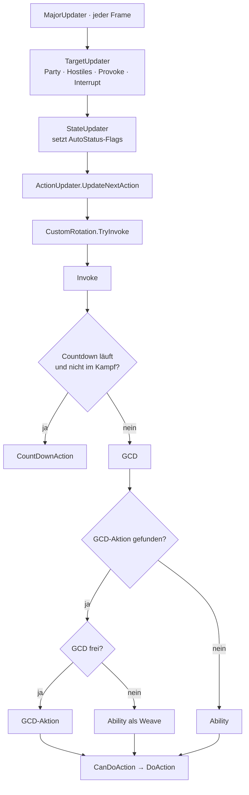

# 03 · Was bei allen Jobs identisch oder ähnlich ist

Diese Ebene beschreibt das, was *kein* Job selbst besitzt, sondern was ihm die
zentrale Maschinerie vorgibt — plus die Muster, die zwar in jedem Job einzeln
stehen, aber überall gleich aussehen.

**Die Reihenfolge der Zweige ist die umgesetzte Antwortordnung.** Was `08-mitigation-synergy.md`
als Vorgabe führt — Heilung vor Minderung —, steht hier als Dispatch-Reihenfolge: Die
Heilzweige werden vor den Verteidigungszweigen gefragt, und beide vor dem Angriff. Wer eine Regel
dieser Familie ändert, ändert entweder die Bedingung **in** einem Zweig oder die Reihenfolge der
Zweige selbst — das Zweite ist der teurere Eingriff und in C37 bereits einmal schiefgegangen.

---

## A · Der Rahmen: eine Entscheidung pro Frame



**Universelle Invariante:** Pro Frame entsteht genau *eine* Aktion. Kein Job
kann zwei Aktionen ausgeben, keiner kann die Reihenfolge des Rahmens ändern.
Jobs füllen ausschließlich Slots, sie steuern den Ablauf nicht.

**Zweite Invariante:** `StateUpdater` entscheidet *ob* ein Slot überhaupt
angefragt wird, der Job entscheidet nur *womit* er ihn füllt. Ein Job kann
eine Heilung nicht erzwingen, wenn `AutoStatus.HealSingleSpell` nicht gesetzt
ist — das ist die Ursache fast aller „warum feuert X nicht"-Fälle im
AUDIT_LOG.

**Dritte Invariante: Ein Objekt aus den Listen gilt für den Frame, in dem die Liste gebaut wurde (A309).** Gruppe,
Gegner, Flächenwirker und Ziele baut `TargetUpdater` in jedem Durchlauf neu; der Durchlauf läuft auf dem Spielthread
in einem Zug, dazwischen verschwindet kein Objekt. Über einen Frame hinaus taugt die Referenz nicht:
- Dalamud hält je Tabellenplatz und Objektart **ein** Objekt und setzt seine Adresse, sobald irgendein Plugin die
  Tabelle durchläuft (`ObjectTable.CachedEntry.Update`). Eine gehaltene Referenz zeigt danach auf den neuen Inhaber des
  Platzes; ist der Platz leer, behält sie die alte Adresse.
- `IsValid()` prüft nur, dass der Spieler geladen ist (`GameObject.IsValid`, Dalamud master, 15.10.2026), nicht das
  Objekt. Es schützt keine gehaltene Referenz; die 33 Prüfungen im Plugin sind Nullprüfungen mit dieser Zusatzbedingung.
- Spieler und Kampf-NPCs liegen in einem festen Speicherblock des Spiels (`CharacterManager.BattleCharaMemory`,
  FFXIVClientStructs). Eine veraltete Adresse liest deshalb vermutlich gültigen Speicher mit falschem Inhalt, keinen
  freigegebenen – Schluss aus dem Strukturlayout, nicht beobachtet. Upstream nennt in Kommentaren harte Abstürze an
  sterbenden Zielen (`6baba6a94`), ohne Beleg.

Was über Frames hinweg lebt, hält deshalb die Id und löst das Objekt im lesenden Frame aus der Tabelle auf
(`SearchById`): der Tankwechsel (`TankSwapWatch`), die Marker-Beobachtung, der Tankbuster-Plan für den Wirkenden des
geplanten Casts (seit A309; die Erhebung liest am Ende des Frames, der Plan im nächsten). Die Effekt-Hooks laufen zwischen
den Durchläufen und lesen die Gruppenliste des letzten; sie vergleichen erst die Id des aktuellen Inhalts mit dem Ziel
des Effekts und lesen nur dann LP oder Barriere – zeigt die Referenz auf einen anderen Spieler, passt die Id nicht. Die
Fenster lesen die Listen nur zur Anzeige.

**Vierte Invariante: Dienste außerhalb des Kampfes hängen nicht am Zustand von RSR (A576).** Der Rahmen oben läuft nur,
solange RSR an ist (`DataCenter.IsActivated`: Auto, Manuell oder Lernmodus). RSR schaltet sich ab Werk 30 s nach jedem
Kampf ab („Turn off after combat ends"), ebenso beim Gebietswechsel und in Zwischensequenzen. Was eine Rotation
zwischen den Kämpfen tut, unter einer eigenen Einstellung und über die Fenster des Spiels, fiel damit genau dann aus,
wenn es gebraucht wird:
- *Im Kampf:* Im Crucible öffnet das Spiel vor jedem Kampf das Hornfenster, nach dem Gang über das Brett und einer
  Ladezeit; RSR war längst aus. Die Hörner blieben, wie sie standen, das Teamfenster zeigte keine Empfehlung, Rast und
  Laden keinen Vorschlag (seine Meldung, 05.11.2026). Der Blaumagier bekam sein Set nur in den ersten 30 s nach einem
  Kampf verbessert; der Beastmaster im Dungeon keine Boss-Belegung, wenn der Weg zum Boss länger dauerte.
- *Regel:* Jede Rotation hat neben `UpdateInfo` (je Frame, nur bei eingeschaltetem RSR, vor der Entscheidung) einen
  zweiten Einstieg, `UpdateServices`, den `MajorUpdater` in jedem Frame ruft, in dem die Spielfigur geladen ist – an
  oder aus, auch beim Gebietswechsel und in Zwischensequenzen, nach dem Bau der Listen. Dort stehen die Dienste, die
  keine Kampfaktion wählen: Fenster des Spiels lesen und bedienen, Empfehlungen vorbereiten, Belegungen außerhalb des
  Kampfes. Was eine Kampfaktion wählt, bleibt in `UpdateInfo`; jeder Dienst steht an genau einer der beiden Stellen.
- *Warum auch beim Gebietswechsel:* Am zweiten Kampf des ersten Bretts ließ sich RSR im Hornfenster nicht einschalten
  (seine Meldung, 05.11.2026): Ein Zustand des Spiels schaltet es in jedem Frame wieder ab – „Turn off during cutscenes"
  oder „Turn off during area transitions" –, und beim Gebietswechsel läuft der ganze Rahmen nicht. Welcher Zustand es
  ist, ist nicht belegt; die Sondenzeile beim Öffnen des Hornfensters nennt seit A576 den Zustand von RSR und die
  gesetzten Zustände des Spiels. Daedalus bedient das Hornfenster in jedem Frame, nur an „eingeloggt, Spielfigur da"
  gebunden (74659a6, `Plugin.OnFrameworkUpdate`, Werkzeugquelle aus dem Spielbetrieb); dieselbe Bindung gilt hier.
- *Gegnerliste:* `TargetUpdater` baut die Listen nur bei eingeschaltetem RSR oder eingeschaltetem automatischen Start,
  und nie beim Gebietswechsel. Ein Dienst, der Gegner liest, fragt `DataCenter.HostileListLive` (in diesem Frame
  gebaut) und wartet sonst. Ein Dienst, der etwas schreibt, das das Spiel beim Laden ersetzt (das Set des
  Blaumagiers), prüft den Gebietswechsel selbst.
- *Was „aus" weiter heißt:* Aus wählt RSR keine Kampfaktion. Ein Dienst handelt nur unter seiner eigenen Einstellung,
  deren Text sagt, was er tut, und hat dort sein „Off"; ist die Rotation abgeschaltet, läuft keiner.
- *Gegenthese 1 (wer RSR ausschaltet, will keine Eingriffe):* Nicht widerlegt für den Einzelfall, widerlegt als Regel:
  Der Zustand gilt der Rotation, und RSR schaltet ihn selbst ab, ohne dass der Spieler das wollte. Wer die Hörner oder
  das Set selbst führen will, schaltet den Dienst ab; eine Handänderung hält ohnehin (B5, K6, Blaumagier-Set).
- *Gegenthese 2 (doppelte Ausführung):* Liefe ein Dienst an beiden Stellen, klickte er zweimal je Frame. Deshalb wandert
  er; der Aufruf in `UpdateInfo` entfällt.
- *Gegenthese 3 (ein Frame Versatz):* Im Kampf liest eine Regel in `UpdateInfo`, was ein Dienst im vorigen Frame
  festgestellt hat (etwa den Kampf im Brett). Ein Frame liegt unter jeder Wirkzeit und Animationssperre; am Beginn eines
  Kampfes ist der Kampf im Brett einen Frame später bekannt.

### Was ein Frame kostet

Jeder Frame rechnet die ganze Entscheidung neu: Ziele, Flags, die GCD-Kette und im Einschiebefenster die
Fähigkeitenkette, je `CanUse` die Zielsuche über alle Kandidaten. Gemessen sind im Mittel 1,55 bis 3,63 ms je
Durchlauf, 7 bis 15 % der Framezeit, Spitzen bis 70 ms in einem Critical Engagement (Protokolle 16. und 17.10.2026,
A286, A299). Was davon trägt, sagt seit A310 die Kostenzeile je Schritt nach jedem Kampf.

Drei Regeln halten die Kosten eines Frames unabhängig davon, wie oft eine Frage gestellt wird (A325):
- **Keine Suche in der Objekttabelle pro Eintrag oder pro Lesen.** `SearchById` und `Status.SourceObject` laufen
  linear über jeden Platz der Tabelle (Dalamud, `ObjectTable.SearchById`); ein fehlendes Objekt kostet die ganze
  Tabelle. Was eine Schleife oder eine oft gelesene Abfrage von Objekten wissen muss, wird einmal je Frame erhoben
  (`StatusHelper.IsFromPlayer`: die Objekte des Spielers für die Prüfung „vom Spieler") oder nach dem billigen Test
  gefragt (`IsOwnPartyMarker` erst nach dem Pfad des Markers; „vom Spieler" erst für einen Status mit gesuchter Id, wie
  Upstream seit 7.5.7.10 fragt, A434).
- **Erkennen, wo die Tatsache entsteht.** Ein Effekt ist ein Marker oder keiner, wenn er entsteht; die Warteschlange
  nimmt nur auf, was ein Leser abfragen kann (`DataCenter.IsTrackedVfxPath`, seit 7.5.7.10 von Upstream: die vier
  Markerlisten und jeder Lock-on-Effekt; das Spiel legt jeden Marker des Blatts `Lockon` unter `vfx/lockon/eff/` ab,
  A434). Vorher standen dort alle Effekte aller Figuren fünf Sekunden lang, und jeder Leser lief bei jedem Lesen
  über alle – im Critical Engagement die Skill-Effekte von 48 Spielern.
- **Eine Antwort aus der Historie einmal je Frame und Mitglied.** Für ein Gruppenmitglied läuft `GetTTK` über die
  ganze Gesundheitshistorie der Gruppe (240 Proben); die Heilzielwahl fragt es mehrmals je Mitglied. Es merkt sich die
  Antwort für den Frame, eine neue Probe verwirft sie (`ObjectHelper.ForgetTimeToKill`). Für Gegner liest es seit
  Upstream 3c6ce9ee2 die Rate aus `TimeToKillTracker`, einen Wörterbuchzugriff ohne Lauf über eine Historie (A341).

Woher die Kosten kamen: Upstream speichert alle Effekte und prüft die Herkunft eines Status über die Objekttabelle; der
Fork hat beides vervielfacht – die Gruppenprüfung der Marker (A220) vor den Pfadvergleich gesetzt, jede Regel mit
Statusabfragen mehr Lesungen. Sein Verdacht, Sonderfälle als eigene Abfragen trieben die Rechenlast, trifft damit die
Form, nicht die Zahl der Regeln: Teuer war, was bei jedem Lesen neu sucht, nicht dass es viele Regeln gibt.

**Nicht umgestellt, mit Grund:**
- *Die Erkennungsabfragen von `DataCenter` je Frame merken* (`IsHostileCastingAOE`, `AreaHitAnnounced` und
  Verwandte): Nach dem Filter laufen sie über wenige Marker und die Wirkenden; A310 hat das Merken öffentlicher
  Eigenschaften ohne Beleg verworfen, und ein Beleg liegt nicht vor.
- *`HostileTarget` je Frame merken:* eine Suche bis zu den Gegnerplätzen je Lesen; eine zeitbasierte Merkhilfe könnte
  über die Frame-Grenze greifen, wovor die dritte Invariante warnt.
- *Dalamuds Statuslisten:* Jeder Zugriff legt eine Liste und je Status ein Objekt an. Kurzlebiger Müll, den die
  Bereinigung der jüngsten Generation räumt, ohne ihn weiterzureichen – Schluss aus der Lebensdauer, nicht gemessen; ob
  eine Bereinigung mit der langsamsten Runde zusammenfällt, zeigt die Kostenzeile.
- *Die Zielsuche je `CanUse`* (Upstreams Aufbau): ein Umbau des Kerns ohne Messung, welcher Teil trägt.

**Gemessen nach dem Umbau** (sein Protokoll vom 18.10.2026, Build 274ef44de, 84 Kämpfe in Vierer-Instanzen): im
Mittel 1,56 ms je Durchlauf, 9,2 % der Framezeit. Davon trägt die Hotbar-Anzeige („highlight") 1,04 ms, die
Rotationsentscheidung mit allen Sonderregeln 0,32 ms, die Flags 0,05 ms. Die Regeln sind damit nicht mehr der größte
Posten.

**Die Hotbar-Zeit war die Rotfärbung gesperrter Aktionen** (seine Protokolle vom 19.–22.10.2026, A334): Getrennt als
„hotbar tint" kostete sie 0,78 ms je Durchlauf (Build e012fbcd7, 225 Kämpfe, im Mittel 1,24 ms, 7,9 %). Sie baute
in jedem Bild die Aktionsliste der Rotation neu (`CustomRotation.AllActions` legt bei jedem Lesen eine neue Liste
an). Upstream 7.5.7.5 liest dort die einmal gebaute Liste (`RotationUpdater.CurrentRotationActions`). Seitdem kostet
sie 0,04 ms, und ein Durchlauf im Mittel 0,48 ms, 3,3 % der Framezeit (Build 01048265d, 59 Kämpfe). Den Rest trägt die
Rotationsentscheidung mit 0,22 ms. Einmalige Spitzen bis 474 ms fielen in den ersten Kampf nach dem Start („rotation
load" 397 ms), ohne Bereinigung. Eine Messung im Critical Engagement nach dem Umbau liegt nicht vor.

**Prüfgrad:** statisch am Code und an Dalamuds Quelltext (master, 17.10.2026); Compile im CI-Lauf; Kostenzeilen
seines Protokolls vom 18.10.2026. Die Annahme über die Zahl der Effekte im Critical Engagement ist ein Schluss, nicht
gemessen.

### „Vom Spieler" heißt auch: von einem Objekt, das ihm gehörte

**Sachstand:** `StatusHelper.IsFromPlayer` zählt einen Status als vom Spieler, wenn seine Quelle der Spieler ist oder
ein Objekt, das ihm in diesem Gebiet gehört hat, auch wenn es nicht mehr da ist. Die Ids erhebt
`StatusHelper.NoteOwnedObjects` einmal je Frame aus dem Update, direkt nach den Zielen (`MajorUpdater`), und behält sie
bis zum Gebietswechsel; eine Statusabfrage außerhalb des Updates erhebt selbst, wenn die letzte Erhebung älter als ein
Frame ist. Je Frame statt nur bei Bedarf, damit auch ein Begleiter gesehen wird, der nur zwischen zwei Statusabfragen
lebt. Eine Id, unter der die Tabelle ein Objekt eines anderen Besitzers zeigt, fällt heraus.

**Anlass, seine Meldung (03.11.2026):** „ich caste am anfang als smn schimmerschild und dann obwohl es noch da ist, vor
schadenseingang nochmal" – die Doppelzündung, die A9 als einen der ersten Fehler des Forks behoben hatte.

**Ursache, an seinem Mitschnitt belegt** (ACT und `DefenseTrace.log` vom 03.11.2026, Build a885b43bf): Den Schild legt
Karfunkel, nicht der Beschwörer; Quelle des Status Schimmerschild (2702) ist das Objekt Karfunkel. Jede Beschwörung
ersetzt Karfunkel durch ein neues Objekt mit neuer Id, die Demi (Sol-Bahamut) ebenso wie die Primae (Topas-Titan). Danach
gehört die Quelle des stehenden Schilds keinem Objekt des Spielers mehr: Die Prüfung `SourceObject?.OwnerId == playerId`
(Upstream; im Fork seit A325 über die Ids je Frame) findet das alte Karfunkel nicht und zählt den Schild als fremd.
Jede Frage „vom Spieler" sieht dann keinen Schild: die Sperre über `StatusProvide` in `CanUse`,
`RadiantAegisDueBeforeDemi` und `BMRShouldRefreshBefore`. Am 03.11.2026 dreimal:

| Kampf | Erster Schild | Karfunkel ersetzt | Zweiter Schild | Rest des ersten |
|---|---|---|---|---|
| Thordan (Extrem) | 18:09:16, BossModReborn-Raidwide | Topas-Titan 18:09:25, neues Karfunkel 18:09:30,9 | 18:09:31, Einzelabwehr | 15,2 s |
| Shinryu (Unreal), Lauf 1 | 19:00:41, vor der Demi | Sol-Bahamut 19:00:44, neues Karfunkel 19:00:59,6 | 19:01:00, Flächenabwehr, 0,8 s vor Gaias Zorn | 11,8 s |
| Shinryu (Unreal), Lauf 2 | 19:13:29, vor der Demi | Sol-Bahamut, neues Karfunkel vor dem zweiten Schild | 19:13:45, Flächenabwehr, 1,6 s vor Gaias Zorn | 14,3 s |

Im Kampf: Die zweite Ladung geht auf einen Schild, der noch steht, und fehlt bei der nächsten Gefahr – die Folge, die
A9 benennt („bei echter Gefahr war keine mehr da"). In beiden Shinryu-Läufen gemessen: 24 und 25 s nach dem zweiten
Schild kam Flutwelle, bewertet mit 68 und 79 % ungemindert, traf ihn mit 75 und 63 %, und die Flächenabwehr fand
keinen Schild („refused before: Schimmerschild (Cooldown)").

**Warum A9 das nicht traf:** A9 entfernte einen Zweig ohne Gefahrenbedingung. Hier ist die Gefahr echt, aber der Blick
auf den eigenen Schild blind. Die Lage entsteht durch den Wechsel des Begleiters, und der Schild vor der Demi (Konzept 12,
„Der Schimmerschild geht vor") macht sie zur Regel: Er geht genau vor dem Wechsel hinaus.

**Die Klasse:** jeder Status, den ein Begleiter, eine Beschwörung oder ein anderes Objekt des Spielers legt und der das
Objekt überdauert. Gemessen ist Schimmerschild. Gleich gebaut, nicht gemessen: die Status der Fee des Gelehrten, wenn
sie abgelöst wird, und die Begleiter des Beastmasters beim Wechsel. Die Korrektur sitzt deshalb an der einen Stelle, die
„vom Spieler" beantwortet, nicht beim Beschwörer.

**Wiederverwendung einer Id:** In beiden Mitschnitten stiegen die Ids der Begleiter innerhalb einer Instanz streng an;
dass das Spiel eine Id nie wiederverwendet, ist damit nicht belegt. Deshalb gilt die Erinnerung nur bis zum
Gebietswechsel, und eine Id, unter der die Tabelle das Objekt eines anderen Besitzers zeigt, wird gestrichen. Ein
fremder Status zählte nur dann als eigener, wenn seine Quelle eine wiederverwendete Id trägt und schon wieder
verschwunden ist, bevor eine Erhebung sie sah.

**Ausgeschlossen:**
- *Nur Schimmerschild umstellen* (`StatusFromSelf = false`): Auf dem Beschwörer kann nur sein eigenes Karfunkel den
  Schild legen, für diese eine Aktion wäre es richtig. Die Klasse bliebe offen.
- *Jeden Status ohne auffindbare Quelle als eigenen zählen:* Auch fremde Begleiter verschwinden; ein Debuff am Gegner
  von einem fremden, schon fortgerufenen Begleiter würde zum eigenen.

**Was im Kampf anders wird:** Nach einer Beschwörung sieht RSR den stehenden Schild weiter. Eine zweite Ladung geht erst,
wenn der Schild innerhalb der Auffrischungsspanne endet (`StatusRefreshGcdCount`) oder fehlt; die Ladung bleibt für die
nächste Gefahr. Schlechter wird nichts, was RSR vorher richtig sah: Die Erinnerung erweitert „vom Spieler" nur um
Objekte, die nachweislich seine waren. Kosten: ein Lauf über die Objekttabelle je Frame mit einem Mengenzugriff je
Objekt; vorher lief dieselbe Erhebung, sobald eine Abfrage einen Status fremder Quelle traf, in einem Kampf also
ebenfalls fast jeden Frame (Schluss).

**Messmittel:** Der nächste Mitschnitt zeigt es ohne neue Zeile. Steht im ACT-Mitschnitt ein zweiter Schimmerschild,
während der erste noch läuft, nennt die `DefenseTrace.log` den Pfad, der ihn gewählt hat.

**Prüfgrad:** Ursache am Mitschnitt (ACT: Quelle des Status, Wechsel der Objekte; `DefenseTrace.log`: Pfad der zweiten
Zündung) und am Code; die Korrektur statisch und im Compile, im Spiel noch nicht beobachtet.

---

## B · Die Slot-Kette (identisch für jeden Job)

```
GCD()                                    Ability()
─────────────────────────────────        ─────────────────────────────────
 1  CommandNextAction (GCD)               1  NoCasting-Sperre
 2  NoCasting-Sperre                      2  Einschiebesperre (GCD ≤ 0,5 s)
 3  Kanal-/Wirksperren (Orbonne, PLD,     3  Kanal-/Wirksperren (Orbonne, PLD,
    AST, BLU, NIN-Mudra, PvP)                AST, BLU)
 4  EmergencyGCD                          4  CommandNextAction (oGCD)
 5  MyInterruptGCD                        5  NIN-Mudra-, PvP-Sperre
 6  DispelGCD                             6  Befohlener Gegenstand
 7  ProvokeGCD                            7  UseAbility aus / Wirken läuft / Fesselung
 8  RaiseSpell   (wenn RaisePlayerFirst)  8  EmergencyAbility
 9  MoveForwardGCD                        9  Tankbuster-Plan (nur Tanks, Option):
10  HealAreaGCD                              Minderung nach Bedarf oder Unverwundbarkeit
11  HealSingleGCD                        10  Tankwechsel (nur Tanks, Option):
12  DefenseAreaGCD                           Shirk auf den Co-Tank, dann Zurückprovozieren
13  DefenseSingleGCD                     11  InterruptAbility
14  RaiseSpell   (sonst)                 12  DispelAbility
15  GeneralGCD                           13  Shirk (befohlen)
16  Heilung ohne Anlass                  14  TankStance
    (HealWhenNothingTodo)                15  AntiKnockback
                                         16  TrueNorth / Positional
                                         17  HealAreaAbility
                                         18  HealSingleAbility
                                         19  SpeedAbility (nur befohlen)
                                         20  ProvokeAbility
                                         21  DefenseAreaAbility
                                         22  DefenseSingleAbility
                                         23  MoveForward / MoveBack
                                         24  HP-Potion
                                         25  Phönixfeder
                                         26  AttackAbility
                                         27  GeneralAbility
                                         28  MP-Potion · GeneralUsing · Speed
```

**Slot 6 beim Heiler (A565):** Die Reinigung steht vor den Heilungen, nimmt den Platz aber nur, wenn sie ein Leben
rettet (ein Zustand, der am Ende tötet); alles andere wartet, bis weder Heilung noch Abwehr ansteht – Konzept 07,
„Reinigung oder Heilung".

**Befohlene Aktionen mit Ziel (Upstream 7.5.6.22, A264):** Ein DoActions-Befehl oder ein abgefangenes Makro kann ein
Ziel tragen – einen Platzhalter wie `<t>`, `<2>`, `<mo>` oder eine Zielart wie `<LowHP>`. Solange der Befehl in der
Warteschlange steht, gilt ein Objektziel für jede Zielsuche dieser Aktion, auch für einen Druck derselben Aktion aus
einem anderen Pfad und vor jeder Zielüberschreibung (`ActionTargetInfo.FindCommandObjectTarget`); ausgenommen sind
Aktionen ohne Reichweite und Wirkradius, die immer auf dich gehen. Eine Zielart ersetzt die Zielart der Aktion und eine
Zielüberschreibung, nicht aber „du selbst". Ist das Objektziel nicht erreichbar, sucht RSR wie bisher.

Der Tankbuster-Plan (9) und der Tankwechsel (10) sitzen hinter `EmergencyAbility`,
damit eine Unverwundbarkeit, die an ihrer Schwelle zündet, vorgeht, und vor allem anderen, weil beide an einem
Tankbuster hängen (Konzept 09, „Gemessener Tankbuster: das geringste Mittel" und „Tankwechsel nach einem
Tankbuster"). Der Plan drückt die Minderungen, die ein gemessener Tankbuster braucht, oder die Unverwundbarkeit, und
steht vor dem Wechsel, der hält, solange sie bereit ist. Beide haben keinen
befohlenen Eingang; Shirk (13) läuft weiterhin nur auf Befehl. Solange der Plan zurückhält (Konzept 09, „Wann
zurückgehalten wird") oder Heiliger Boden oder Meteoritenfall den Treffer abhalten, lehnt `BaseAction.CanUse` für Tanks
in jedem Slot bewertete Abwehr auf den Spieler ab, die der Plan nicht freigibt; frei bleiben die Heilslots, Hilfe für
andere, in der Flächenabwehr (21), was über ihn hinaus wirkt, und das Befohlene.

In jedem Slot fragt der Dispatcher zuerst die Duty-Rotation (`DataCenter.CurrentDutyRotation`), dann den Job. Die
Heil-, Abwehr-, Bewegungs- und Rückzugsslots haben je zwei Eingänge: zuerst den befohlenen (`CommandStatus`), dann
den automatischen (`AutoStatus` beziehungsweise `MergedStatus`).

Beide Ketten sind **fest verdrahtet** und für alle Jobs gleich. Zwei
Konsequenzen, die im ganzen AUDIT_LOG immer wieder auftauchen:

- Alles oberhalb von `GeneralGCD` kann `GeneralGCD` **aushungern**. Ein
  gesetztes Heil-Flag verhindert dauerhaft, dass ein Zweig in `GeneralGCD`
  jemals drankommt — unabhängig davon, wie wichtig er ist.
- Wer proaktive Logik in `GeneralGCD` platziert, muss sie in `HealAreaGCD` und
  `HealSingleGCD` **wiederholen**, sonst greift sie im Heilfall nicht. Genau
  das war die Ursache der „HoT wird nicht aufrechterhalten"-Meldungen.

### Status, unter denen nicht gehandelt werden soll („No-casting debuffs")

Die Liste `OtherConfiguration.NoCastingStatus` hat in der Oberfläche den Text „Do not take action if you have one of
these debuffs". Ihr Leser ist nicht die NoCasting-Sperre der Slot-Kette (die hängt an der Stopp-Liste gegnerischer
Casts), sondern der Druck selbst (`RSCommands_Actions`, `CancelCastUpdater`, `AutoAttackUpdater`). Die Liste enthält
zwei Arten, und RSR behandelt sie getrennt (A338):
- *Schaden bei jeder Aktion* (Pyretic in fünf Fassungen, seit Upstream 42cb3a7dd auch Causality, 514): kein Druck,
  solange der Status liegt, und ein laufender Zauber wird abgebrochen. Erkannt am eigenen Wirktext des Status im
  englischen Blatt des Clients, gleich welche Sprache er zeigt: „with every action" (Pyretic, alle sechs Zeilen des
  Spiels) oder „each time an action" (Causality) – in den Spielblättern vom 24.10.2026 trifft das genau diese sieben
  Zeilen (`NoCastingStatusHelper.DamagesEveryAction`). Kein Feld der Blätter trennt die Arten.
- *Strafe beim Ablauf* (Acceleration Bomb, Extreme Caution, Glossomorph, Flesh Forward und Back, Directed Grotesquerie,
  Buyer's Remorse): kein Druck und Abbruch erst, wenn der Status in weniger als 3 s endet
  (`NoCastingStatusHelper.ResolveWindow`, Upstream); ein Status ohne Restzeit zählt als endlos und sperrt so nie.
- Auto-Angriffe ruhen, solange irgendein gelisteter Status liegt. Daneben sperren eigene Wege den Druck für die ganze
  Dauer: Motion Tracker und BossModReborns Sondermodus Pyretic.

Im Kampf: Unter Pyretic oder Causality steht RSR, wie der Text der Liste sagt und wie die Mechanik es verlangt, auch ohne
BossModReborn-Modul. Ein Heiler heilt in dieser Zeit nicht; jede Heilung kostete ihn selbst Leben. Bis A338 drückte RSR
unter Pyretic bis 3 s vor dem Ende weiter, unter Causality und den Fassungen ohne Restzeit immer.

**Vor der Landung** (A439). Ein Status, der jede Aktion bestraft, kommt mit dem Treffer, und eine Aktion, die in diesem
Augenblick noch läuft, nimmt den Schaden sofort; die Sperren oben lesen den liegenden Status und kommen dafür zu spät.
`ActionPenaltyWatch` beantwortet die Zeit davor, für alle Jobs, außer im PvP:
- *Lernen:* Legt die Landung eines Wirkens einem Gruppenmitglied oder ihm einen solchen Status der Liste an (Effektart
  „Status auf Ziel“ mit der Status-Id, erkannt wie oben über `DamagesEveryAction`), ist das Wirken gelernt, gleich auf
  wen es fiel. `ActionPenaltyCasts.json` hält je Aktion den gelegten Status, über alle Sitzungen, gespeichert wie die
  übrigen gelernten Tabellen (Zusammenführung mit der Datei, nie ungeladen geschrieben, unlesbar als `.corrupt` beiseite).
  Die erste Sichtung schreibt „learned: …“ ins `DefenseTrace.log`, die Kopfzeile zählt die Einträge.
- *Widerlegen* (Konzept 13, „Stufe 4", 4c): Ein gelerntes Wirken hält Zauber, bis die laufende Spielversion es
  mindestens zweimal auf seinem Ziel, einem Mitglied, ohne den Status landen sah, öfter als es ihn früher legte, und nie
  mit ihm; dann hält es nichts mehr, bis es ihn wieder legt. `ActionPenaltySightings.json` hält die Zählungen.
- *Erkennen:* Jede gegnerische Figur, Helfer eingeschlossen, die ein gelerntes Wirken castet, dessen Status noch in der
  Liste steht – auf ihn oder in einer Gestalt, die ihn erreicht (`DataCenter.CastReachesPlayer`). Verschwindet der Balken
  mindestens eine Aktualisierung vor seinem Ende, war das Wirken gestoppt (unterbrochen, Wirker tot) und landet nicht.
  Endet er an seinem Ende, gilt die Landung als sofort, bis sie gesehen ist oder einen GCD danach ausbleibt; ein dort
  abgebrochenes Wirken ist von einer späten Landung nicht zu unterscheiden. Dazu BossModReborns bevorstehender Sondermodus Pyretic
  (`Hints.SpecialModeIn`).
- *Entscheiden:* Gemessen wird mit der Laufzeit eines Drucks bis zum Server (`TankbusterForecast.RoundTrip`). Kein Zauber
  wird gewählt, der bei der Landung noch liefe (`ActionBasicInfo.NeedsCasting`, Wirkzeit nach Zaubertempo und
  Spontaneität). Kein Druck, dessen Aktion samt Wirkzeit dann noch liefe (ein GCD wird vor seinem Druck gewählt, und die
  Landung ist seitdem näher), und kein Auto-Angriff innerhalb der Laufzeit. Ein laufender eigener Zauber, der dann noch
  liefe, wird abgebrochen (`CancelCastUpdater`). Was vorher fertig wird, läuft; sofort wirkende Aktionen gehen bis zur
  Laufzeit vor der Landung.

Im Kampf, am Fall vom 26.10.2026 (A427, ACT-Mitschnitt): „Heißes Herz“ (#43322, 4,7 s, Pilgerpfad) landete um 21:09 auf
einem Mitglied – die Landung trägt #960 als Effektart 0x0E – und tötete es; RSR hätte das Wirken dort gelernt. Um
21:15:51 begann es auf ihn, und RSR begann 0,8 s vor der Landung Wirbelströmung (3 s); Pyretisch traf mit rund 1,03 Mio.
Mit der Regel beginnt ab drei Sekunden und Laufzeit vor der Landung kein Wirbelströmung mehr, an seiner Stelle eine
sofort wirkende Aktion oder keine; nach der Landung hält die Sperre oben. Preis: je Landung höchstens die Wirkzeit eines
Zaubers ohne Zauber, und ein Wirken auf ihn, das erst am Balkenende abbricht, hält bis einen GCD danach alles an. Am
Abend galt das Wirken dreimal ihm: einmal gelandet, einmal am Balkenende abgebrochen, einmal nach 1,8 s unterbrochen –
das gibt sofort frei.

Grenzen: Die erste Landung eines unbekannten Wirkens trifft ungehindert, wenn kein BossModReborn-Modul den Sondermodus
meldet; gelernt wird aus ihr, auch auf einem Mitglied. Im Quelltext von BossModReborn (ae64e33 vom 20.10.2026, am
29.10.2026 der Stand des Remotes) setzt ein einziges Modul `SpecialMode.Pyretic` (Cloud of Darkness, Chaotic); die
Module des Pilgerpfads kennen „Heißes Herz“ nicht. Die Liste „No-casting debuffs“ ist der
Schalter: Ein Status, der aus ihr entfernt wird, wird weder gelernt noch erwartet; eine eigene Option gibt es nicht, weil
die Regel einen belegten Tod behebt.

Ausgeschlossen: die Stoppliste gegnerischer Casts (`DataCenter.IsHostileStop`, ab Werk aus, von Hand gepflegt; sie
hielte jede Aktion für die ganze Wirkdauer, auch sofort wirkende und solche, die vorher fertig sind); ein festes Fenster vor
der Landung wie `PyreticThreshold` in BossMod (ffxiv_bossmod, ab Werk 1,0 s, Stand 4707e49c2 vom 28.10.2026): Es kennt
die eigene Wirkzeit nicht, ein Zauber, der davor beginnt, wird im Fenster abgebrochen, und sein GCD ist verloren.

Die Liste lädt aus Upstreams Repository und nur, wenn die Datei im Konfigurationsordner fehlt oder die Liste
zurückgesetzt wird; ein neuer Eintrag von Upstream erreicht eine bestehende Datei nicht von selbst.

---

## C · Muster, die in jedem Job wiederkehren

### C1 · Level-Kette

Immer dieselbe Form:

```
if (  HöchsteStufe.EnoughLevel &&  HöchsteStufe.CanUse(out act)) return true;
if ( !HöchsteStufe.EnoughLevel &&  MittlereStufe.CanUse(out act)) return true;
if ( !MittlereStufe.EnoughLevel && Basisstufe.CanUse(out act))   return true;
```

Zwei eingebaute Fehlerquellen:

1. Der linke Teil `X.EnoughLevel && X.CanUse` ist **redundant** —
   `ActionBasicInfo.BasicCheck` prüft `EnoughLevel` bereits selbst und bricht
   ab. Gezählt am 02.10.2026: 56 Vorkommen, davon 44 außerhalb von `ExtraRotations`.
2. Der Ausschluss der höheren Stufe wird **von Hand** geschrieben und mal als
   `!X.EnoughLevel`, mal als `!X.Info.EnoughLevelAndQuest()` formuliert. Beide
   Varianten kommen nebeneinander vor. Genau hier entstand der bereits
   behobene RDM-Fehler `!EnoughLevel && EnoughLevel`.

### C2 · Sustain-Zweig (proaktives Aufrechterhalten)

Seit der Vereinheitlichung überall identisch aufgebaut:

```
Auslöser (BMR-Vorhersage ODER Gegneranzahl)  →  Dauer-Prüfung  →  CanUse
```

Zentral als `ShouldSustainMitigationDebuff(...)` für Addle/Feint/Reprisal,
job-eigen als `TrySustain…OnTank(...)` bei den Heilern. Vorher: 25 bzw. 9
Kopien.

### C3 · AoE-vs-ST-Verzweigung

**Die Schwelle steht an der AoE-Aktion selbst** (26.10.2026, A391): Die Jobs entscheiden über `AoeCount` im
Zielsystem; wo eine Rotation selbst zählt, liest sie Reichweite und AoE-Zahl der Aktion, deren Treffer die Frage
beantwortet, oder vergleicht die Potenzen aus den Tooltips.

| Ort | Jobs | Mechanik |
|---|---|---|
| implizit über `AoeCount` in `CanUse` | alle | Zielsystem entscheidet |
| Weiche über die AoE-Kombo | Samurai: AoE-Iaijutsu, wenn so viele Gegner im Radius von Fuko (darunter Fuga) stehen, wie dessen AoE-Zahl verlangt (`AoeComboReaches`); Ogi Namikiri im AoE-Zweig, wenn er selbst mehr als einen trifft | dieselbe Menge und Schwelle wie das Zielsystem der Kombo |
| Potenzvergleich | Dunkelritter: Abyssal Drain statt Carve and Spit, wo er auf den Getroffenen mehr bringt (`ActionTooltip.AreaOutdamagesSingle`, ab Werk ab 3); dazu Auto Crossbow, Hellfrog, Foul (A342–A345) | Tooltips zur Laufzeit, AoE-Zahl als Untergrenze |
| eigene Zählung mit Absicht | Monk: Perfect Balance für AoE ab zwei Gegnern in 3 Yalm („position yourself in the centre of the mobs") | bleibt; er spielt den Monk bislang nicht |

Vorher zählte der Samurai in Nahkampfreichweite (3 Yalm) statt im Radius seiner Kombo (5 Yalm), der Dunkelritter
verlangte drei Gegner um sich zusätzlich zu zwei um das Ziel von Abyssal Drain. Viper und Blaumagier zählen nicht mehr
selbst (nur noch „ein Gegner in Reichweite").

**Die Gestalt der Zählung im Zielsystem:** Ein Kreis zählt um das Ziel, ein Kegel vom Spieler zum Ziel hin (Halbwinkel
60°, das Spiel nennt ihn nicht), eine Linie mit Ziel vom Spieler zum Ziel hin, so breit wie ihr `XAxisModifier` – der
Einsatz dreht den Spieler zum Ziel, und BossMods Autorotation misst sie ebenso (A399). Eine Gestalt ohne Ziel, die der
Spieler vor sich wirft (Reichweite 0: Flamethrower, Surpanakha, Apokalypsis), zählt in seiner Blickrichtung. Betroffen
von der Linie: Doom Spike, Draconian Fury und Coerthan Torment (Dragoon), Chain Saw (Maschinist), Apex Arrow und Blast
Arrow (Barde), Shadowbringer (Dunkelritter), Enlightenment (Monk) – mit gleicher AoE-Zahl nimmt die Zielwahl dann das
Ziel, dessen Linie die meisten trifft.

### C4 · Ranged-Fallback am Ende von `GeneralGCD`

Tanks und Nahkämpfer: letzter Zweig vor `base.GeneralGCD`. Gezählt am 02.10.2026 in neun Reborn-Rotationen; der
Mönch hat keinen. Bei den vier Tanks und beim Schnitter gilt nur das eigene `CanUse`. Eigene Bedingungen haben der
Samurai (nicht in den ersten 15 GCDs eines High-End-Kampfs, `CombatElapsedLessGCD(15)`), der Ninja (nicht während Mudra), der Dragoon (nicht direkt nach
`WingedGlidePvE`) und die Viper (Option `UFGhosting`).

**Beim Herankommen wartet der Nahkämpfer** (A605; Anlass Daedalus' Feldnotiz vom 24.09.2026, Shinryu: der Samurai warf
Enpi, während er schon auf sein Ziel zulief). Ist der Rückfall bereit und läuft der Spieler gerade auf sein Ziel zu, nimmt
der Fernangriff einen GCD, den der Nahkampf einen Augenblick später besser genutzt hätte; der nächste Nahkampf-GCD wartet
dann die volle Wiederaufladung ab. Wartet der GCD stattdessen t Sekunden bis zur Reichweite, verschiebt sich die ganze
Folge um t, und am Kampfende fehlt im Mittel t/GCD eines Nahkampf-GCD; gewonnen ist der Unterschied zwischen Nahkampf und
Fernangriff. Warten lohnt also, solange t < GCD · (1 − P_Fern / P_Nah) (meine Ableitung). P_Nah ist die Potenz des
Kombo-Starters laut Wirktext – der schwächste Nahkampf-GCD, die Rechnung wartet so eher zu kurz als zu lang –, P_Fern die
des Fernangriffs; liegt dessen verstärkte Form an (Enhanced Enpi, Enhanced Piercing Talon), geht er. t ist der Abstand bis
zur Reichweite des Starters geteilt durch die Geschwindigkeit, mit der der Abstand zum aktuellen Ziel schrumpft
(`DataCenter.ClosingSpeed`, aus zwei Lesungen; nach mehr als einem GCD ohne Lesung neu). Steht er, weicht er seitlich aus
oder läuft er weg, ist die Geschwindigkeit null oder negativ, und der Fernangriff geht wie bisher. Die Regel sitzt auf der
Stufe der Nahkämpfer (`CustomRotation.MeleeWorthWaitingFor`); die Tanks bleiben außen: Ihr Fernangriff im Anlauf bindet
die Gegner, bevor die Schadensausteiler treffen (Konzept 02, sein Hinweis zur Aggro). Der Mönch hat keinen Rückfall.

### C5 · Kurzschluss ganz oben

Heiler: Swiftcast+Raise. Melee: Combo-Rettung. Struktur identisch — *verlasse
die Methode, bevor Rotationslogik läuft* —, Formulierung jedes Mal neu.

### C6 · Zaubernde, wenn kein Zauber startbar ist

**Lage.** RSR beginnt keinen Zauber mit Wirkzeit, solange der Spieler läuft und die Bewegungssperre nicht gilt („Lock
movement while casting" aus – ab Werk aus – oder von ihm gelöst), BossMods KI ihn bewegt oder einen Zauber abbricht,
ein Rückstoß läuft oder „No casting" befohlen ist; ausgenommen ist ein Status, der den nächsten Zauber sofort wirken
lässt (Swiftcast, Triplecast, Dualcast). Diese Bedingung steht einmal, `CustomRotation.CastStartBlocked`; dieselbe
prüft `ActionBasicInfo.NeedsCasting` für jede Aktion, dort zusätzlich ein Status, der vor dem Ende der Wirkzeit landet
und jede Aktion schädigt (A439), und BossMods Wurfzeitgrenze, wenn der Zauber länger wirkt (A649). Dann bleibt ein
Sofort-GCD oder keiner. Mit Bewegungssperre wirkt RSR im Laufen weiter
und hält den Spieler an („Bewegungssperre beim Wirken und die KI von BossMod", unten); dann greift diese Regel nicht.

**Regel, für alle Zaubernden (Heiler, Magier, Blaumagier).** Ein GCD, der dann leer bleibt, ist ganz verloren. Ein
vorgezogener Sofort-GCD verliert höchstens seine spätere Lage: Polyglot, Farbe, Addersting oder eine Ladung fehlen
später, wären dort aber auch nur ein GCD gewesen. Deshalb geht der stärkste Sofort-GCD, dessen Ressource keinen anderen
Zweck hat, vor einem schwächeren und vor keinem. Swiftcast zählt hier nicht, wo der Job damit wiederbelebt (Konzept 11).

**Ein DoT vor seiner Zeit** (meine Ableitung, keine Quelle nennt es; The Balance schweigt dazu, Astrologian und Sage
Basic Guide, 06.11.2026). Bei voller Laufzeit des DoT ist es gleich, wann er erneuert wird; es zählt nur, wie viele
Erneuerungen im Stand einen Füller kosten. Mit Restzeit R erneut gesetzt, verschiebt er die nächste um D − R nach hinten
(D seine Dauer) und erspart im Mittel (D − R)/D eines späteren Füllers; seine MP abzüglich der ersparten Erneuerung sind
der Anteil R/D. Das zahlt sich je MP mindestens so gut aus wie der Füller im Stand, solange R ≤ D · M_Füller /
(M_Füller + M_DoT) – bei gleichen MP die halbe Dauer. Astrologe: Combust III 70 je 3 s über 30 s, 400 MP, Fall Malefic
270, 400 MP; Weiser: Eukrasian Dosis III 90 je 3 s über 30 s, 400 MP, Dosis III 400 MP (Spielblätter über xivapi,
06.11.2026). Gilt nur auf einem Ziel, das die Restzeit überlebt; stirbt es vorher, ist keine Erneuerung zu sparen. Die
Füllheilung („Use GCD heals when there's nothing else to do", Konzept 07) läuft erst, wenn kein Angriffs-GCD geht; heilen
würde sie, solange das Minimum der Gruppe unter ihrer Linie liegt – dann tritt der DoT zurück, Sicherheit vor Schaden.
Die Bedingung steht einmal, `CustomRotation.DotWorthWhileCastBlocked`; der DoT-Planer (`DotPlanner`, wann im Stand
erneuert wird) bleibt unberührt.

| Job | Sofort-GCDs, wenn kein Zauber startbar ist | Stand |
|---|---|---|
| Weißmagier | Glare IV, Afflatus Misery, Lilien in Pausen; danach Dia jeden GCD („Use DOT while moving even if it does not need refresh", ab Werk an; Dia trifft auch direkt) | deckt sich |
| Gelehrter | Ruin II nach „Seconds you must be moving before Ruin II will be used" (ab Werk 0 s) | deckt sich |
| Weiser | Phlegma, im Laufen auch die letzte Ladung; Toxikon; Eukrasia mit Eukrasian Dosis vor ihrer Zeit nach der Ableitung oben | **geändert (A603):** vorher Eukrasian Dosis nur zur Erneuerung |
| Astrologe | Lightspeed, im Laufen beide Ladungen („Use both stacks of Lightspeed while moving", ab Werk an); Combust vor seiner Zeit nach der Ableitung oben | **geändert (A603):** vorher Combust nur zur Erneuerung |
| Schwarzmagier | Triplecast im Laufen; Paradox, Firestarter, High Thunder zur Erneuerung; Xenoglossy oder Foul vor Scathe | **geändert (A602):** vorher Scathe (100 Potenz, 800 MP) vor Xenoglossy (890, ohne MP), in `BLM_RP` gar nichts |
| Beschwörer | Ruin IV, Titans Edelsteine, Slipstream mit Swiftcast (Konzept 14) | deckt sich |
| Rotmagier | Dualcast-Folge; ohne Dualcast Acceleration, Grand Impact, Enchanted Reprise | deckt sich |
| Piktomant | Hämmer, Holy in White, Comet in Black (`PaintWhileMoving`) | deckt sich |
| Blaumagier | die Wertregel wählt unter den Zaubern, die gerade wirkbar sind (Konzept 01) | deckt sich durch die Struktur |

Die Regel steht je Job, weil die Sofort-GCDs und ihre Ressourcen je Job verschieden sind; zentral ist nur die
Bedingung. Eine Gruppenstufe dazwischen bleibt leer: Weder die Heiler noch die Magier teilen einen Sofort-GCD.

---

## D · Was tatsächlich zentral gelöst ist (Positivliste)

Damit der Umbauvorschlag in `04-concept.md` nicht Dinge „zentralisiert", die
es schon sind:

| Bereich | zentraler Ort |
|---|---|
| Zielauswahl inkl. AoE-Zählung | `ActionTargetInfo.FindTarget` |
| Nutzbarkeitsprüfung (Level, MP, Combo, Status, Cooldown, TTK) | `BaseAction.CanUse` → `ActionBasicInfo.BasicCheck` |
| Flag-Erzeugung (wann wird geheilt/mitigiert) | `StateUpdater` |
| Statusdauer-Rechnung | `StatusHelper.WillStatusEnd*` |
| BMR-Vorhersage-Zugriff | `CustomRotation_OtherInfo.BMR*` |
| Rollen-Standards (Interrupt, Anti-Knockback, True North, Potions) | `CustomRotation_Ability` |
| Mitigations-Sustain | `ShouldSustainMitigationDebuff` |

**Das Ziel einer Aktion stammt aus ihrem `CanUse`.** `CanUse` sucht das Ziel und legt es in `X.Target` ab; eine
Lesung von `X.Target` ohne `X.CanUse` in derselben Entscheidung bekäme das Ziel des letzten Erfolgs, anfangs keines.
Gemessen am 26.10.2026 (A415), jede Lesung im Baum außer Churin: In `RebornRotations` und `RotationSolver.Basic` liest
jede Stelle das Ziel eines `CanUse` derselben Entscheidung, meist im Zweig gleich danach; einzige Ausnahme ist die
Anzeige des Gelehrten (`ScholarRotation.DisplayBaseStatus`), ohne Wirkung im Kampf. Der Tänzer überschreibt das Ziel
von Closed Position nach `CanUse` bewusst mit dem benannten Partner. Vor `CanUse` lesen nur die fremden Heiler
BeirutaAST, BeirutaWHM und BeirutaSGE, an 17 Stellen (TODO, technische Schuld). Eine seiteneffektfreie Zielabfrage
braucht der eigene Code deshalb nicht.

---

**Burst-Arznei nur im Kampf oder im Countdown** (`CustomRotation.UseBurstMedicine`, A433): Außerhalb des Kampfes
verweigert die Methode jede Tinktur, solange kein Countdown läuft. Im Kampf: Wartet die Gruppe ohne Countdown am Boss
oder zwischen zwei Rudeln, trinkt keine Rotation die Tinktur. Vorher konnte sie es, wo ihr Auslöser nur fragt, ob eine
Burst-Fähigkeit bereit ist – Presence of Mind, Divination, Serpent's Ire, Technical Step –, denn bereit ist sie außerhalb
des Kampfes ebenso; die Tinktur hielte dann nicht bis in den Burst und sperrte jede Arznei für ihre Wiederverwendung. Die Tinktur im Countdown (Restzeit unter der Schwelle der Rotation) geht
wie vorher, weil der Countdown dieselbe Uhr liest (`Service.CountDownTime`). Upstream hat die Lücke in drei Rotationen
geschlossen (Weißmagier, Viper, Tänzer, f1ef35ea1); die Methode trägt die Regel für jeden Aufrufer, auch für Astrologe,
Weiser, Gelehrter, Schwarzmagier und die fremden Rotationen, die ohne Kampfprüfung riefen.

**Tinktur nur in schwierigen Kämpfen, dort in jeder Burstphase, in der sie nutzbar und vorhanden ist** (seine Vorgabe
und Präzisierung, 03.11.2026, A500, A501). *Wozu:* Eine Tinktur soll helfen, einen schwierigen Kampf zu überstehen und
merklich schneller zu beenden; sie kostet Geld, und sie für einen gewöhnlichen Kampf zu verschwenden, ist nicht klug
(seine Worte). Daraus folgen zwei Fragen mit getrennten Antworten:
- *Wo:* „Tincture usage" je Job – nie, nur High-End (ab Werk), überall. High-End ist, was das Spiel so markiert
  (`ContentFinderCondition.HighEndDuty`, xivapi 03.11.2026): 14 Inhalte – die Ultimates, der Chaotic-Raid, die vier
  Savage-Kämpfe der laufenden Stufe, die laufende Extreme- und Unreal-Prüfung. Das trifft „schwierig": Ältere Savage- und
  Extreme-Kämpfe gleichen die Gegenstandsstufe nicht an (`ItemLevelSync` 0 bei allen Savage- und Extreme-Kämpfen von
  7.x außerhalb der laufenden Stufe; Mindeststufe etwa 690 bis 740), also kämpft man dort mit der heutigen Ausrüstung,
  und der Kampf ist leichter, als er gedacht war; Ultimates und Unreal gleichen an und bleiben schwer. Dungeons, Prüfungen
  und Raids der normalen Stufe, die offene Welt und die Trainingspuppe sind gewöhnliche Kämpfe: keine Tinktur. Upstreams
  Ausnahme für die Trainingspuppe unter „nur High-End" ist entfernt (A501) – auf ihr wird nichts überstanden und nichts
  beendet; wer einen Burst mit Tinktur an der Puppe üben will, stellt „überall" ein. *Grenze:* Die Savage-Dungeons
  („Criterion") trägt das Spiel nicht als High-End; dort trinkt RSR ab Werk keine Tinktur.
- *Wann:* in jeder Burstphase des Jobs, in der sie nutzbar und vorhanden ist. Im Kampf: In einem Savage-Kampf von
  acht bis zehn Minuten sind das zwei Tinkturen (Pull und sechste Minute; Wiederverwendung 300 s). Revolverklinge,
  Dunkelritter und Barde tranken dort nur die im Countdown, die zweite nie; Maschinist und Viper tranken gar keine, weil
  ihr eigener Schalter ab Werk aus stand. Gerade dort, wo die Tinktur ihr Geld wert ist, fehlte sie also.
- *Entfernt* sind die Schalter der Rotationen, die dieselbe Frage ein zweites Mal stellten: beim Beschwörer „Use potion",
  „Potion timing" und „Only use potion during a big summon" (Upstream 444388102), beim Weißmagier „Use Tincture/Gemdraught
  when about to use Presence of Mind", bei der Viper „Experimental Pot Usage", beim Maschinisten „Use burst medicine in
  countdown". Mit Viper und Maschinist ab Werk aus trank keiner von beiden je eine Tinktur. „Ab dem zweiten Searing
  Light" brachte nie mehr Tinkturen ins Fenster als das erste (Wiederverwendung 300 s, Item 44165 `Cooldowns`: Fenster
  bei 0, 6, 12 Minuten gegen 2, 8, 14).
- *Neu im Kampf*, wo die Rotation sie nur im Countdown trank: Revolverklinge unter No Mercy, Dunkelritter im
  Zwei-Minuten-Fenster (`InTwoMIsBurst`), Barde unter seinen Buffs (`InBurstStatus`), Maschinist unter Wildfire; die Viper
  weiter 5 s vor Serpent's Ire, jetzt mit erlaubtem Burst („Auto Burst"). Die Tinktur im Countdown bleibt, wo die Rotation
  sie hatte, beim Maschinisten unter „Auto Burst" wie vorher.
- *Begriffe* (sein Hinweis, 03.11.2026): Im Spiel heißen Heiltränke „Potion" (Kategorie „Medicine"), die Schadensbuffs
  „Gemdraught" oder „Tincture"; „pot" im englischen Spielerjargon meint die Tinktur. Upstreams „Use potion" meinte die
  Tinktur und las sich wie ein Heiltrank – auch deshalb entfernt.
- *Eine Wiederverwendung für alle Arzneien* (Spielblätter, xivapi 03.11.2026: `ItemAction.Action.CooldownGroup` 59 bei
  Tinkturen, Super- und Hyper-Potion, Super-Ether, Elixier und Phönixfeder; `Item.Cooldowns` 300, 75, 300, 300, 360 s).
  Die Arznei, die zuerst geht, sperrt die anderen für ihre eigene Zeit: eine Tinktur Heiltrank und Äther für 300 s, ein
  Heiltrank die Tinktur für 75 s. Ab Werk trinkt RSR Heil- und Manatränke nie („Use HP potions below this HP", „Use MP
  potions below this MP", aus) und Tinkturen nur in High-End-Inhalten. Die drei Einstellungstexte nennen die gemeinsame
  Wiederverwendung. Ein Tank, der in einem Dungeon mit „überall" eine Tinktur trinkt, hat bis zu fünf Minuten keinen
  Heiltrank.
- *Schalter je Gegenstand* (A635): Heil- und Manatränke und die Phönixfeder schaltet die Aktionsliste für alle Jobs
  zugleich, und ab Werk ist keiner aus; ausschalten nimmt den Gegenstand für jeden Job heraus. Wann sie gehen, sagt die
  eine Einstellung („Use HP potions", „Use MP potions", „Use Phoenix Down (Experimental)"). Die Aktionsliste sagt es unter dem Schalter
  („This switch holds for every job"), damit niemand ihn für den Job allein umlegt; die Spurzeile „critical class"
  nennt einen ausgeschalteten Trank „switched off in the action list (for every job)".
  - *Im Kampf vorher:* Als Beastmaster allein in Sägerschrei fiel er am 06.11.2026 bis 18:12:45 auf 34 % LP; RSR
    meldete „critical class" und für jeden Trank „Schalter aus", bei eingeschaltetem „Use HP potions" (seine Angabe,
    05.11.2026; die Spur prüft die Einstellung vor dem Schalter). Am 04.11.2026 fiel er dort in 75 s von 93 auf 6 % LP,
    RSR trank nie, seinen Ultratrank drückte er bei 6 % selbst und starb (A530, A531). *Nachher:* Unter seiner Schwelle
    trinkt jeder Job, auch einer, auf dem er nie einen Trank eingeschaltet hat; ebenso Äther und Feder, wo ihre
    Einstellung an ist.
  - *Ursache:* Upstream führte den Schalter je Job (`[JobConfig]`) und ab Werk aus (`ItemConfig.IsEnabled`, Commit
    3e9b5b164, 31.01.2024). Ein Trank ist für jeden Job derselbe Gegenstand, seine Einstellung gilt für alle Jobs; so
    blieb sie auf jedem Job ohne Wirkung, auf dem der Trank nicht von Hand eingeschaltet war – bei ihm mit allen
    Kampfjobs auf den meisten. Der Lesezugriff legte die Voreinstellung „aus" selbst an und speicherte sie; von einer
    bewussten Wahl ist sie nicht zu unterscheiden.
  - *Optionen:* A nichts – er schaltet je Job und je Trank ein; B ab Werk an, weiter je Job, gespeichertes „aus"
    einmalig auf „an"; C ein Schalter für alle Jobs als Ausschluss, ab Werk nichts ausgeschlossen; D kein Schalter für
    diese drei, nur die Einstellung; E an, wenn er auf irgendeinem Job an ist.
  - *Abwägung im Kampf:* A lässt jeden selten gespielten Job ohne Trank (zwei Tode in Sägerschrei) und jeden neuen
    Trank eines Patches aus, bis er ihn findet. B wirkt für ihn wie C, verliert aber dieselben gespeicherten Stellungen
    und lässt Aussparen nur Job für Job zu – einen teuren Trank auf allen 21 Kampfjobs einzeln. D nimmt das Aussparen
    ganz (Preis, Vorrat, ein Trank für einen Sonderinhalt), und der Schalter in der Liste wäre tot, gegen seinen Text.
    E heilt den Fehler nur, wo irgendwo schon einmal eingeschaltet wurde. C: Stärke – jeder Job trinkt unter der
    Schwelle, ein neuer Trank geht ohne Handgriff; Schwäche – eine Wahl je Job geht einmal verloren und ist danach
    nicht mehr möglich; Chance – die Regel steht einmal für alle Jobs; Bedrohung – eine Änderung Upstreams an
    `BaseItem.IsEnabled` trifft auf die Abzweigung (eine Eigenschaft, kleiner Konflikt). *Ergebnis:* C.
  - *Folgen zweiter Ordnung:* Wo ein Trank vorher nie ging, sperrt er jetzt die Tinktur 75 s (gemeinsame
    Wiederverwendung, oben); in einem High-End-Inhalt kostet ein Trank unter der Schwelle so ein Tinkturfenster – seine
    Regel, Sicherheit zuerst; wer es anders will, hat „Hold HP and MP potions for the tincture". Die Feder geht nur mit
    „Use Phoenix Down (Experimental)" (ab Werk aus) und den Prüfungen der Feder (Wirkzeit, Wiederbelebung durch andere).
  - *Gegenthese 1 (kein Defekt, er wollte sie aus):* Widerlegt – „ich habe tränke aktiviert", und seine Frage, ob die
    Tränke beim Beastmaster überhaupt verankert sind (06.11.2026).
  - *Gegenthese 2 (seine Wahl je Job):* Wer einen Trank nur für einen Job aussparte, verliert das. Bleibt als Preis; der
    Grund zum Aussparen – Preis, Vorrat – hängt am Gegenstand, nicht am Job.
  - *Gegenthese 3 (ausgeliefert, und nichts ändert sich):* Am 06.11.2026 hätte C den Tod nicht verhindert: Er trank um
    18:12:33 selbst einen Ultratrank (HQ, +696 LP bei 50 %), danach war 75 s keiner frei; gestorben ist er am
    Schadensstrom ohne heilenden Begleiter (seither hält ihn B2, Konzept 01, A636). Am
    04.11.2026 hätte RSR unter seiner Schwelle getrunken (sie steht nicht im Upload; ab Werk 50 %, seine Spuren zeigen
    Tränke bei höchstens 40 %, A531); der Fehl-LP-Wächter hält dort nicht (bei 2.785 LP heilt der Ultratrank HQ 696,
    bei 40 % fehlen 1.671). Für den gemeldeten Fehler – als Beastmaster nie ein Trank – widerlegt.
  - *Universell:* Stufe „alle Jobs"; keine Sonderregel je Rolle oder Job. Die Tinkturen folgen derselben Regel (unten).
- *Schalter der Tinkturen* (A645): Auch jede Tinktur schaltet die Aktionsliste für alle Jobs zugleich, ab Werk ist
  keine aus; ob ein Job Tinkturen trinkt und wo, sagt „Tincture usage" je Job (nie, nur High-End, überall). Unter dem
  Schalter steht derselbe Hinweis wie bei den Tränken. Gespeicherte Stellungen je Job liest RSR für Tinkturen nicht mehr.
  - *Im Kampf vorher:* Upstream führte den Schalter je Job und ab Werk aus (3e9b5b164, 31.01.2024; davor eine Liste
    ausgeschlossener Gegenstände für alle Jobs, ab Werk leer – der Umbau machte aus „nicht ausgeschlossen" stillschweigend
    „nicht eingeschaltet", während Aktionen ab Werk an blieben). Auf jedem Job, auf dem die Tinktur nicht von Hand
    eingeschaltet war, kam sie nie, gegen den Text von „Tincture usage" („the tincture goes in each burst window where it
    is ready and in your inventory") und gegen seine Vorgabe, sie in jeder Burstphase zu trinken, in der sie nutzbar und
    vorhanden ist (A500). In einem Savage-Kampf von acht bis zehn Minuten fehlten so beide Tinkturen eines Jobs; in der
    laufenden Unreal-Prüfung, die er spielt (Shinryu, A515), ebenso. *Nachher:* Jeder Kampfjob trinkt sie, wo „Tincture
    usage" es erlaubt – ab Werk in High-End-Inhalten –, in jeder Burstphase, in der eine seines Hauptwerts im Inventar
    liegt; alle 21 Kampfrotationen fragen danach (`UseBurstMedicine`).
  - *Optionen:* A nichts; B ab Werk an, weiter je Job, gespeichertes „aus" einmalig auf „an"; C Ausschluss für alle
    Jobs wie bei den Tränken, ab Werk leer; D kein Schalter, nur „Tincture usage"; E an, wenn auf irgendeinem Job an;
    F Ausschluss je Job, ab Werk leer.
  - *Abwägung im Kampf:* A lässt jeden Job ohne Tinktur, auf dem er sie nicht gefunden und eingeschaltet hat, und jeden
    neuen Grad eines Patches, bis er ihn einschaltet. E heilt nur, wo irgendwo schon eingeschaltet ist. D nimmt das
    Aussparen eines Grades (ein alter mit kleinem Nutzen, ein teurer), der Schalter wäre tot gegen seinen Text. B und F
    behalten eine Wahl je Job und Grad. Ob ein Job Tinkturen trinkt, beantwortet aber schon „Tincture usage" je Job
    (nie); welcher Grad, hängt an Preis, Vorrat und Stärke – am Gegenstand, der für jeden Job desselben Hauptwerts derselbe
    ist. Einen Grund im Kampf, einen Grad auf einem Job zu trinken und auf einem anderen desselben Hauptwerts nicht, gibt es
    nicht; B verlangt dafür das Aussparen auf jedem Job einzeln (bis zu acht beim Hauptwert Stärke), F eine zweite Liste je
    Job neben „Tincture usage". C: Stärke – jeder Job trinkt, wo seine Einstellung es erlaubt, ein neuer Grad ohne Handgriff (der neueste im
    Inventar zuerst, `Medicines` absteigend nach Zeile); Schwäche – eine Wahl je Job geht einmal verloren, je Job bleibt
    „nie"; Chance – eine Regel für Tränke und Tinkturen; Bedrohung – dieselbe Abzweigung an `BaseItem.IsEnabled` wie bei
    den Tränken. *Ergebnis:* C.
  - *Folgen zweiter Ordnung:* Jede Tinktur sperrt Heiltrank und Äther 300 s (gemeinsame Wiederverwendung, oben); in
    High-End-Inhalten jetzt auf jedem Job nach der Tinktur des Pulls bis zur fünften Minute. Das ist seine Abwägung (A500,
    „Tincture usage" nennt die Sperre), die Gegenrichtung ist bewusst nicht gebaut (oben, „Vorrang"). Liegt nur ein alter
    Grad im Inventar, geht dieser, mit kleinerem Zugewinn und derselben Sperre (die Spielblätter deckeln den Bonus je
    Grad: Grade 6 Tincture of Strength höchstens +189, Grade 2 Gemdraught of Intelligence +392, beide HQ, `ItemFood` 557
    und 665, xivapi 07.11.2026);
    wer das nicht will, schließt ihn in der Aktionsliste für alle Jobs aus. „Hold HP and MP potions for the tincture"
    (ab Werk aus) hält jetzt auf jedem Job, auf dem eine Tinktur käme – wie sein Text sagt. Fremde Rotationen, die
    `UseBurstMedicine` rufen, trinken ebenso unter „Tincture usage".
  - *Gegenthese 1 (kein Defekt, er wollte sie je Job aus):* Seine gespeicherten Stellungen sind nicht messbar (kein
    Upload enthält die Konfiguration), und ein gespeichertes „aus" ist von der Voreinstellung nicht zu unterscheiden, weil
    der Lesezugriff sie selbst anlegte. Der Text von „Tincture usage" bindet und nennt keinen zweiten Schalter; seine
    Vorgabe A500 ebenso. Widerlegt; wer auf einem Job keine Tinktur will, stellt dort „nie" ein.
  - *Gegenthese 2 (F ist richtig, die Wahl gehört je Job):* Ohne Grund im Kampf (oben) und mit einer zweiten Liste je Job
    neben „Tincture usage" – zwei Stellen für dieselbe Frage. Widerlegt.
  - *Gegenthese 3 (ausgeliefert, und nichts ändert sich):* Wo er die Tinktur schon eingeschaltet hat, ändert sich
    nichts; ebenso ohne Tinktur im Inventar, außerhalb von High-End (ab Werk) und mit „nie". Ändern muss sich etwas genau
    auf den übrigen Jobs in High-End-Inhalten, etwa in der Unreal-Prüfung: Dort ruft die Rotation die Tinktur im Burst,
    und nur der Schalter hielt sie (`BaseItem.CanUse`). Für den Defekt widerlegt.
- *Jeder Job seine eigene Liste* (A646): Was RSR je Job speichert – die Schalter und Werte der Aktionsliste, die der
  Gegenstände, die Einstellungen der gewählten Rotation –, legt es für einen Job ohne Eintrag als eigene Kopie der
  Voreinstellung an. Eine Änderung auf einem Job gilt nur dort.
  - *Im Kampf vorher:* Der erzeugte Lesezugriff (`JobConfigGenerator`, `JobChoiceConfigGenerator`; Upstream 40c987beb,
    05.02.2024) legte für einen Job ohne Eintrag nicht eine Kopie, sondern die Voreinstellung selbst ab. Bei Zahlen und
    Schaltern ist das eine Kopie, bei Listen dasselbe Objekt: Jeder Job, der in einer Sitzung zum ersten Mal gelesen
    wurde, teilte eine Liste mit jedem anderen solchen Job, und die Voreinstellung selbst trug danach die Änderungen.
    Drei Speicher sind Listen: die Aktionen (`_rotationActionConfig`), die Gegenstände (`_rotationItemConfig`) und die
    Rotationseinstellungen (`_rotationConfigurations`, je Job und Rotation, nach dem Namen der Eigenschaft). Eine
    Aktion legt ihren Eintrag schon beim Lesen an (`BaseAction.Config`), eine Rotationseinstellung erst, wenn er sie ändert
    (`RotationConfigBase.Value`). Beispiel: Er spielt zum ersten Mal einen Astrologen und schaltet „Use GCDs to heal …"
    (`GCDHeal`, ab Werk an, A433) aus. Wechselt er in derselben Sitzung zu einem Gelehrten ohne Eintrag, steht dessen
    gleichnamige Einstellung ebenfalls aus, ohne dass er sie berührt hat. Ebenso `UseArmsLengthOnPull` unter den vier
    Tanks, `SwiftLogic` unter den vier Heilern, `BurstDefense` bei Barde, Tänzer und Piktomant, und `MultiHitRestrict`,
    das beim Weisen Panhaima und beim Astrologen Macrocosmos auf Serien beschränkt – ein Schlüssel für zwei verschiedene
    Aktionen: Wer es beim Weisen einschaltet, beschränkt in derselben Sitzung auch Macrocosmos eines neuen Astrologen. Dazu
    kommt jede Rollenaktion der Aktionsliste (Swiftcast, Arm's Length, Head Graze …) über alle Jobs ihrer Rolle, die in
    derselben Sitzung neu sind. Von 325 Namen der Rotationseinstellungen tragen zehn mehrere Rotationen (Erhebung
    07.11.2026).
    Gespeichert wurde die geteilte Liste für jeden dieser Jobs als eigene Abschrift; nach einem Neustart sind sie getrennt,
    tragen aber die Werte des anderen Jobs. *Nachher:* Ein neu gespielter Job und eine neu gewählte Rotation beginnen mit
    der Voreinstellung ihrer Rotation; was er auf einem Job ändert, bleibt dort.
  - *Optionen:* A nichts; B je Job eine Kopie der Voreinstellung (für Referenztypen, außer Zeichenketten); C je Job ein
    neues leeres Objekt (`new()`); D die Felder als Fabrik statt als Instanz.
  - *Abwägung:* A lässt den Fehler in jeder ersten Sitzung eines Jobs oder einer Rotation stehen – bei jedem neuen Nutzer,
    nach jedem Zurücksetzen der Konfiguration, bei jeder neu gewählten Rotation (etwa `BLM_RP` neben `BLM_Default`, die
    drei Namen teilen). C trifft heute dasselbe, weil alle drei Voreinstellungen leer sind, bricht aber still, sobald eine
    Voreinstellung Inhalt bekommt. D ändert die Form der Felder in `Configs` und jeden künftigen Merge Upstreams daran. B:
    Stärke – eine Kopie, was immer die Voreinstellung enthält; die Voreinstellung wird nie mehr verändert; die
    gespeicherte Form (`Dictionary<Job, …>`) bleibt, keine Umstellung gespeicherter Dateien. Schwäche – eine Abschrift
    über den Serialisierer beim ersten Lesen je Job (einmal je Job und Sitzung). Bedrohung – eine Änderung Upstreams an den
    beiden Generatoren trifft auf die Abzweigung (je eine Zeile). *Ergebnis:* B.
  - *Was bleibt:* Abschriften aus früheren Sitzungen sind von einer eigenen Wahl nicht zu unterscheiden; RSR lässt sie
    stehen.
  - *Gegenthese 1 (kein Defekt, ein neuer Job soll die Werte des letzten übernehmen):* Die Felder heißen „je Job"
    (`[JobConfig]`, `[JobChoiceConfig]`), und die Voreinstellungen einer Rotation unterscheiden sich gewollt (der
    Astrologe heilt ab Werk mit GCDs, der Weise nicht); übernähme ein Job die Werte eines anderen, gälte keine davon.
    Zudem übernimmt er sie nur in der ersten Sitzung, danach nicht mehr. Widerlegt.
  - *Gegenthese 2 (C reicht):* Heute gleich, B kostet nichts im Kampf und hält, wenn eine Voreinstellung Inhalt bekommt.
    Widerlegt.
  - *Gegenthese 3 (ausgeliefert, und nichts ändert sich):* Für jeden Job, den er schon gespielt hat, ändert sich nichts;
    seine Abschriften bleiben. Ändern muss sich etwas bei jedem Job und jeder Rotation ohne Eintrag: Dort liest die
    Rotation jetzt ihre eigene Voreinstellung. Für den Defekt widerlegt; für seine heutigen Jobs ist die Wirkung keine,
    das ist der Preis.
- *Die Schwelle nach der Vorhersage, wo kein Heiler lebt* (A641). „Use HP potions below this HP" liest deine LP jetzt – und lebt kein Heiler in der Gruppe
  (`DataCenter.AnyLivingHealer`), zusätzlich deine LP beim nächsten Webfenster, einen GCD voraus, so wie RSR die kritische
  Klasse vorhersagt (`GetForecastPlayerHealthRatio`, aus der Gesundheitshistorie). Liegt eine der beiden unter der
  Schwelle, geht der Trank; der Wächter gegen Überheilung (fehlende LP mindestens so viel, wie der Trank heilt) bleibt.
  Dieselbe Lesart gilt für den Heilgegenstand des Bretts (Konzept 21, K8) und die Regenerationstränke unten.
  - *Im Kampf vorher:* Als Beastmaster allein in Sägerschrei stand er am 06.11.2026 bei 34 % LP, RSR sagte für den
    nächsten GCD 9 % voraus („critical class"). Mit einer Schwelle zwischen 9 und 34 % wäre kein Trank gegangen, bis die
    LP selbst darunter fielen – einen GCD später (getrunken wurde damals gar nicht, der Schalter war aus, oben). Am
    04.11.2026 fiel er dort in 75 s von 93 auf 6 %, rund 1,2 % je Sekunde.
    *Nachher:* Der Trank geht, sobald die LP beim nächsten Webfenster unter der Schwelle lägen – bei 1,2 % je Sekunde und
    einem GCD Vorlauf rund 3 bis 6 % LP früher, bei einem Absturz wie dem des Wurms einen ganzen GCD früher.
  - *Messgröße der Wahrscheinlichkeit:* der gemessene Verlauf deiner LP (Restzeit aus der Gesundheitshistorie, netto nach
    allem, was dich heilt). Ohne Heiler kehrt niemand den Verlauf um; mit Heiler bleibt es bei den LP jetzt – dessen nächste
    große Heilung steht in keinem Verlauf, und ein Trank zu früh sperrt Trank und Tinktur 75 s.
  - *Warum einen GCD voraus und nicht sofort:* Ein Trank geht im Webfenster; verpasst er dieses, kommt das nächste erst
    einen GCD später. Die sofortige Vorhersage (wie bei den Fähigkeitsheilungen, A213) läge fast bei den LP jetzt und
    änderte nichts.
  - *Text der Schwelle:* Der Trank geht nur, wenn deine LP – jetzt oder beim nächsten Fenster – unter ihr liegen; über
    ihr trinkt RSR weiter nur gegen einen Tankbuster (unten, A284). Die kritische Klasse allein öffnet keinen Trank: Liegt
    deine Schwelle unter ihrer Linie, tränke RSR sonst über deiner Schwelle.
  - *Preis:* Ohne Heiler geht der Trank bis zu einen GCD früher, auch wenn der Verlauf danach abflacht; der Wächter
    verhindert, dass er überheilt.
  - *Gegenthese 1 (kein Defekt):* Unter der Schwelle trank RSR schon; ein GCD später reicht. Widerlegt, wo der Fall
    schnell ist: Am 04.11.2026 kostete jeder GCD rund 3 % LP, gegen den Wurm ein GCD rund 200 von 2.785 LP – genug, dass
    ein Trank, der erst im nächsten Fenster geht, den Tod nicht mehr aufhält.
  - *Gegenthese 2 (ausgeliefert, und nichts ändert sich):* Mit „Heal ahead of damage" aus ist die Vorhersage die LP
    jetzt; ohne gemessenen Fall ebenso. Dann bleibt alles wie zuvor.
  - *Universell:* Stufe „alle Jobs", die Bedingung ist kein lebender Heiler, kein Job.
- *Vorrang: Tränke warten auf die Tinktur* (Einstellung je Job „Hold HP and MP potions for the tincture", ab Werk aus;
  A502). Schaden gegen Heilung und Mana entscheidet jeder Spieler selbst (sein Hinweis und seine Präzisierung,
  03.11.2026: „die Entscheidung Sicherheit vor Schaden ist meine. andere Spieler können anders entscheiden").
  - *Aus (seine Regel):* Es geht die Arznei, deren Auslöser zuerst greift – im Burst die Tinktur, unter der Schwelle der
    Trank, auch wenn die Tinktur dann ihren Burst verpasst.
  - *An:* Heil- und Manatränke warten, solange die Tinktur käme. Das heißt: Die Rotation hat in diesem Kampf schon eine
    verlangt (`UseBurstMedicine` im Kampf gerufen), „Tincture usage" erlaubt sie hier (`CustomRotation.TinctureAllowedHere`),
    und eine Tinktur vom Typ des Jobs ist eingeschaltet und im Inventar. Ein Trank gegen einen Tankbuster auf den Spieler
    geht trotzdem: Ein Tod kostet mehr Schaden, als die Tinktur bringt, also spricht auch die Schadensabwägung für ihn.
  - *Warum ohne Burstvorhersage:* Trank und Tinktur sind nur gemeinsam frei, wenn die letzte Tinktur 300 s zurückliegt.
    Im Zwei-Minuten-Zyklus kommt der nächste Burst dann spätestens 60 s später (Tinktur bei 0, frei ab 5:00, Burst 6:00).
    Ein Heiltrank sperrt 75 s, ein Äther 300 s; jeder Trank in diesem Fenster schiebt die Tinktur also aus ihrem Burst.
    Halten, solange die Tinktur bereit ist, ist deshalb genau die Lage, in der ein Trank sie kostet. Über das Ziel hinaus
    hält die Regel nur, wo eine Pause den Burst über 75 s hinausschiebt.
  - *Nicht gehalten:* Phönixfeder (Wiederbelebung, Konzept 11) und die Regenerationstränke aus Eureka und den Tiefen
    Gewölben (unten, eigene Abklinggruppe 60, Spielblätter 03.11. und 06.11.2026; sie sperren die Tinktur nicht).
  - *Die Gegenrichtung* – die Tinktur zurückhalten, weil ein Trank nötig werden könnte – ist nicht gebaut: Sie nähme eine
    Gefahr ohne Messung an. Wer keine Tinktur will, stellt „Tincture usage" auf „nie".
- *Regenerationstränke der Sonderinhalte* (A613): Sustaining Potion (Palast der Toten), Empyrean Potion (Himmelssäule),
  Orthos Potion (Eureka Orthos), Pilgrim's Potion (Pilgerpfad) und Eurekan Potion (Eureka) – genau die Gegenstände mit der
  Aktion 8667 in Abklinggruppe 60 (Spielblätter, xivapi 06.11.2026). Sie legen Rehabilitation (Regeneration, 30 s, beim
  Eurekan Potion 40 s) und sind nur in ihrem Inhalt nutzbar; das prüft das Spiel selbst.
  - *Was gilt:* Ein solcher Trank ist eine eigene Entscheidung neben dem gewöhnlichen, keine Wahl zwischen beiden – er
    teilt dessen Wiederverwendung nicht. Er geht unter derselben Schwelle („Use HP potions below this HP"), solange keine
    Rehabilitation auf dir liegt (erkannt am englischen Statusnamen, gleich welche Zeile des Blatts – elf, xivapi 06.11.2026); unter derselben
    Schwelle geht ein gewöhnlicher zuerst, der Regenerationstrank im nächsten Fenster. Gegen einen Tankbuster zählt er
    nicht: Eine Regeneration fängt keinen Treffer ab.
  - *Im Kampf:* Allein in der Himmelssäule bei 45 % LP trinkt RSR den Empyrean Potion; vorher keinen Gewölbe-Trank. Im
    Pilgerpfad bei 45 % mit einer Ultra-Potion im Inventar trinkt es erst die Ultra-Potion, dann den Pilgrim's Potion;
    vorher nur die Ultra-Potion und den Pilgrim's Potion nie, solange ein gewöhnlicher Trank bereit war.
  - *Begründung:* Der Vergleich nach geheilter Menge (`HpPotionItem.MaxHp`) liest Prozent und Obergrenze aus den
    ItemAction-Daten; bei diesen Tränken stehen dort andere Werte (Pilgrim's Potion 11854, 0), die Menge ergab 0, und jeder
    gewöhnliche Trank gewann. Die Prüfung je Gebiet kannte nur Palast der Toten, Pilgerpfad und Eureka; Himmelssäule und
    Eureka Orthos fehlten. Eine eigene Entscheidung braucht beides nicht.
  - *Verworfen:* (a) Die Menge aus dem Regenerationsstatus schätzen und weiter vergleichen: Eine Regeneration gegen einen
    Sofortheiltrank zu wiegen ist keine Wahl, wenn beide zugleich gehen. (b) Eine eigene, höhere Schwelle wie BossMod
    (60 %, Tanks 40 %): eine Zahl ohne Herleitung; die Schwelle stellt der Spieler.
  - *Gegenthese 1 – Die Regeneration kommt zu spät:* Sie verteilt die Heilung über 30 s. Gegen einen Absturz hilft der
    gewöhnliche Trank, der zuerst geht; die Regeneration trägt die Zeit danach.
  - *Gegenthese 2 (ausgeliefert, und nichts ändert sich):* „Use HP potions" ist ab Werk aus. Bei ihm ist es an (seine Angabe,
    05.11.2026); der Schalter des Tranks gilt seit A635 für alle Jobs und ist ab Werk an.

**Pause im Kampf** (`CustomRotation.InCombatPause`): im Kampf, kein Gegner in 25 Yalm. Die allgemeine
Hälfte der Pausenregel; was ein Job in der Pause wirkt, ist seine Regel (Konzept 14, „Pausen und
Phasenenden"). Die vorhergesagte Pause liest `BMRDowntimeWithin`, nur mit Modul.

## Wahl des DoT-Ziels

**Vorgabe des Auftraggebers (16.10.2026), wörtlich:** „bei der dot-verteilung sollte immer geschaut werden, welcher
gegner die aktuell höchsten hp hat, so dass der maximale effekt beim schaden erzielt werden kann. danach immer der
reihe nach wie die dots auslaufen." Seine Präzisierung (16.10.2026): „dots werden bei mehrern gegnern nicht nur auf
einen gelegt, sondern auf alle anwesenden. es geht hier um die initiale reihenfolge. deswegen ist die standardzielart
hier uninteressant. das gilt eher bei einzelzielangriffen, bei aoe angriffen ist es eh egal, weil mehrere gegner in der
auswahlfläche stehen. bei direkten einzelzielangriffen (ohne dot) gilt die gewählte vorgabe (High HP, Low HP etc.)
weiterhin."

**Geltende Regel** (`ActionTargetInfo.DotSpreadOrder`, Einstellung „Spread damage over time by HP, then by
expiry", ab Werk an, A295): Kann ein Schadens-DoT auf mehrere Gegner, geht er auf den, dessen eigener DoT zuerst
ausläuft, und bei gleicher Restzeit auf den mit der höchsten aktuellen Gesundheit (absolut, nicht in Prozent). Ein
Gegner ohne den DoT zählt als ausgelaufen, ein gerade gesendeter als nie auslaufend. In einem frischen Pull erhalten
die Gegner den DoT damit in der Reihenfolge ihrer HP, der mit den meisten zuerst (seine Formulierung, 16.10.2026);
tragen ihn alle, wird er in der Reihenfolge erneuert, in der er abläuft. Die Regel sitzt auf der Stufe „alle" in der zentralen Gegnerwahl und gilt für jeden Job
mit DoT; keine Stufe darunter braucht eine eigene, weil die Frage für jeden DoT dieselbe ist.

**Was vorher entschied:** Den DoT erhalten ohnehin alle anwesenden Gegner; die Reihenfolge folgte der allgemeinen
Zielart (`DataCenter.TargetingType`). Ab Werk ist das „Low HP" (der erste Eintrag der Standardliste): Der schwächste
Gegner erhielt den ersten DoT, der stärkste den letzten; auf ihm fehlte der DoT damit am längsten. Für direkte
Einzelzielangriffe ohne DoT bleibt die Zielart, wie er sie wählt, außer die Aktion bringt eine eigene Sortierung mit
(Upstream f1ef35ea1): Corps-a-corps des Rotmagiers springt auf den nächsten Gegner im Bewegungsradius statt auf den nach
seiner Zielart, also den kürzesten Weg; vorher galt die Sortierung der Aktion nur für Ziele in der Gruppe. Die
DoT-Verteilung und ein Befehl gehen ihr vor. Bei Flächenangriffen spielt die Reihenfolge keine Rolle,
weil mehrere Gegner in der Fläche stehen, und auch ein Flächen-DoT wie High Thunder II wird unter den Zielen mit der
größten Abdeckung nur zusätzlich geordnet.

**Wer Kandidat ist, entscheidet die Statusprüfung** (`CheckStatus`, `CheckTimeToKill`): Gegner, denen der eigene DoT
fehlt oder bald ausläuft, mit einer Zeit bis zum Tod über der Schwelle der Aktion, nicht unverwundbar, nicht auf der
Liste eingeschränkter DoTs. „Bald" heißt bei einem DoT mit Potenzangaben (`ActionSetting.Dot`, Upstream 3c6ce9ee2 für
Weißmagier, Astrologe, Gelehrter, Weiser, Schwarzmagier und Schnitter) und an „Time DoT refreshes from DoT ticks and
time to kill (Experimental)": auf dem letzten GCD, der keinen Tick des Ziels verliert, und gar nicht, wenn das Ziel
stirbt, bevor der DoT mehr bringt als der Füller (`DotPlanner`, Tickuhr des Ziels aus `ActorControl` 0x605). Ab Werk
an, anders als bei Upstream – seine Regel für Voreinstellungen (A341). Sonst und bei den übrigen DoTs: in `Number of
GCDs before the DOT/Status effect is reapplied` GCDs. Die Rangfolge davor bleibt ebenfalls: ein Befehl, die
Stopmarker, die Gegner mit Vorrang (Angriffsmarker, Gegnerteile, Schatzkarten-Symbole). Erst unter dem, was danach
übrig ist, ordnet die Regel.

**Wann sie nicht ordnet:**

- Eine Rotation wirkt die Aktion ohne Statusprüfung — dann ist es keine Verteilung: Chaotic Spring und Chaos Thrust als
  Kombo-Abschluss des Dragoons, Iron Jaws des Barden, Dia/Aero im Upkeep-Modus des Weißmagiers. Ebenso, wenn die
  Statusprüfung der Aktion abgeschaltet ist.
- Eine Rotation oder ein Befehl gibt das Ziel vor (Zielüberschreibung, Befehlsziel). Die Zielüberschreibung eines
  Pfads gilt nur in ihrem Lauf: Seit A305 setzt der Fähigkeitenlauf sie zu Beginn zurück, sodass Befehl,
  Notfallfähigkeiten, Tankbuster-Plan und Tankwechsel nach ihrer eigenen Zielart suchen, nicht nach der der Heil-,
  Reinigungs-, Provoke-, Wiederbelebungs- oder Abwehr-GCD davor.
- Der Status macht keinen Schaden. Death's Design des Schnitters erhöht nur dessen eigenen Schaden auf diesem Ziel und
  gehört auf den Gegner, den er angreift.
- Im manuellen Modus ist ohnehin nur das eigene Ziel Kandidat.

**Erkannt wird der DoT am eigenen Text des Status** in der englischen Statustabelle des Clients („Sustaining damage
over time.", „Toxins are causing damage over time.", „Sustaining lightning damage over time."; `StatusHelper.IsDamageOverTime`).
Die vorhandene Kennzeichnung `IsRestrictedDOT` trägt nur 19 Aktionen der Heiler, des Barden und des Schnitters; Thunder
und High Thunder des Schwarzmagiers, Higanbana, Chaotic Spring, Sonic Break und Bow Shock fehlen darin. Ist die Tabelle
nicht lesbar, ordnet die Regel nicht, und die Zielart entscheidet wie vorher.

**Meine Ableitung, nicht sein Wortlaut:** Ein Gegner ohne DoT kommt vor einer fälligen Erneuerung, weil er als
ausgelaufen zählt. Seine Worte stellen die höchsten HP an den Anfang und die Ablaufreihenfolge danach; beides fällt in
dieser einen Ordnung zusammen. Folge: Ein neues Add ohne DoT erhält ihn vor der Erneuerung auf dem Boss. Liegt dessen
Restzeit unter einem GCD, fehlt der DoT dort höchstens einen GCD lang; Kandidat für die Erneuerung ist er ohnehin
erst, wenn er in höchstens zwei GCDs ausläuft (Voreinstellung).

**Wann DoTs überhaupt auf mehreren Gegnern fallen** (sein Hinweis, 16.10.2026): im Wall-to-Wall, solange der Tank
zieht; in der Stun-Streckung des Weißmagiers zwischendurch; bei weniger als drei Gegnern, dann auf alle. Ab drei Gegnern
stehen Flächenangriffe an (RSR: Fläche vor DoT, Konzept 02). The Balance deckt sich damit: „When doing trash pulls, Aero
the mobs as your tank moves to gather everything up and use Stone when they stop", und auf Stufe 94 gilt „holy is still
only a gain on 3+ targets" (White Mage Leveling Guide, abgerufen 16.10.2026).

**Gegenposition, geprüft — sie trägt nicht.** Erwogen war, die Zeit bis zum Tod statt der Gesundheit als Reihenfolge zu
nehmen, weil ein DoT tickt, solange das Ziel lebt. In den Lagen, in denen DoTs verteilt werden, haben die Gegner eines
Pulls ihre volle Gesundheit und nehmen denselben Flächenschaden; die Reihenfolge ihrer HP ist dann die ihrer Lebensdauer
(Schluss). Die Zeit bis zum Tod fehlt zudem zu Beginn eines Pulls, weil sie erst aus dem Verlauf entsteht. Die Schwelle
von The Balance (Astrologe, Leveling-Leitfaden: Combust vor Malefic, wenn der Gegner mindestens 15 s lebt) ist eine
andere Frage: ob der DoT einen Füllzauber ersetzen soll. Beim Laufen ersetzt er keinen, weil der Füllzauber eine Wirkzeit
hat. Im Stand rechnet sich Dia gegen Glare III ab dem vierten Tick, also nach etwa 12 s (Job-Guide: Dia 85 sofort und 85
je 3 s, Glare III 350). Darunter liegt nur ein Gegner, der gleich stirbt; dafür gibt es die Schwelle „Time to kill" je
Aktion, ab Werk 0. Für Einzelzielangriffe ohne DoT gilt die gewählte Zielart; „Low HP" verkleinert den Pulk von unten, und
der DoT tickt am längsten auf dem, der am längsten lebt. Beides ergänzt sich.

**Prüfgrad:** statisch (Code, Statustexte über xivapi v2); Compile über die CI. Im Kampf: Bei mehreren Gegnern zeigt
sich die Regel daran, wer zuerst und wer zuletzt einen DoT trägt.

## Zielart ohne Tank und Heiler

**Vorgabe des Auftraggebers (04.11.2026), wörtlich:** „da beim beastmaster kein tank bereitsteht und kein healer, ist das
zielverhalten auf gegner mit niedrigen hp zu priorisieren, egal wie die einstellungen der ui sind." Sein Grund, im
selben Zug: „weniger gegener machen weniger schaden, besser als möglichst viele gegner gleichmäßig runterzubringen, wie
es damagedealer in gruppen machen, um möglichst effizient zu sein." Seine Präzisierung (04.11.2026): „ich habe über
beastmaster gesprochen, nicht über andere jobs. der einzige job, bei dem das ebenfalls passen könnte, wäre der
bluemage" – den Blaumagier als sein Vorschlag, geprüft unten.

**Geltende Regel** (`DataCenter.DangerFirstAlone`, `EnemyDanger`, A525, A526, A541): Spielt er den Beastmaster oder
den Blaumagier und lebt neben ihm in der Gruppe kein Tank und kein Heiler (`DataCenter.NoTankNoHealerBeside`), greift
RSR unter den Gegnern, die eine Aktion erreichen kann, zuerst den an, dessen Gefahr je Sekunde im Verhältnis zu seinen LP
am größten ist (Regel von Smith, unten). Solange kein Gegner gemessen ist, ist das der mit den wenigsten LP in Punkten.
Seine eingestellte Zielart gilt dann nicht, auch ohne Option.
- *Gefahr je Sekunde eines Gegners* (`EnemyDanger.Rate`): der Schaden, den er der Gruppe – ihm, den Mitgliedern und
  seinem Begleiter – in diesem Kampf zugefügt hat, geteilt durch die Zeit seit seinem ersten Treffer (mindestens ein
  GCD), Auto-Attacken eingeschlossen; dazu ein angekündigter Treffer, sofort: ein Zauber auf ihn oder einer, der ihn
  erreicht, mit seiner gelernten Größe (Tabelle gezielter Treffer, Flächentabelle), verteilt auf die Restzeit des
  Zaubers; bei einem Gegner, der andere Gegner heilt, dazu der Schaden, den die Geheilten in der gewonnenen Zeit machen:
  geheilte LP je Sekunde mal ihrer Restzeit je LP (`GetCorrectedTTK`) mal ihrer Gefahr je Sekunde.
  - *Der Begleiter zählt mit* (A582): Im Crucible nimmt er nach Zähnefletschen alles, was dir galt (dein Status
    „Gedeckt"), und auch sonst greifen Gegner ihn an. Gezählt waren nur Treffer auf ihn und die Mitglieder; unter der
    Deckung sah RSR die Gefahr der Gegner kaum – im Endkampf von Brett 1 (05.11.2026) stand die Seelenlose nach 55 s mit
    einem gemessenen Treffer unter 1 LP je Sekunde. Seine LP zählen wie deine; ihr Gewicht nach seinem Bedarf über das
    Brett ist offen (Konzept 21, K3).
- *Ungemessene Gegner* (A582): Hat ein Gegner noch nicht getroffen, andere aber schon, gilt für ihn eine geschätzte
  Gefahr: das Mittel der gemessenen Gegner des Kampfs, im Crucible je mit dem Verhältnis ihrer Blattwerte umgerechnet
  (größerer Wert aus Stärke und Intelligenz), wo das Blatt beide führt; ihre Unsicherheit ist die der Messungen, auf
  denen sie steht. Bis A582 zählte
  er null und verlor gegen jeden gemessenen: Im Endkampf von Brett 1 sprang das Ziel 3 s nach dem Erscheinen der
  Sukkubus-Magierin (2.020 LP; laut Blatt stärkt sie die anderen) zurück auf die Seelenlose (10.409 LP), deren einer
  gemessener Treffer unter 1 LP je Sekunde ergab. Mit dem Blatt (Seelenlose 5, Magierin 2) steht die Magierin mit 40 %
  der Gefahr der Seelenlose bei einem Fünftel ihrer LP vorn. Hat noch kein Gegner getroffen, gilt wie bisher das Blatt
  allein, außerhalb wenigste LP.
- *Vorrang* = Gefahr je Sekunde ÷ LP. Bei gleicher Gefahr ist das „wenigste LP zuerst".
- *Wechsel nur über der Messunsicherheit:* Der Gegner, den er gerade angreift, bleibt, bis ein anderer sicher dringender
  ist: dessen Vorrang abzüglich seiner Unsicherheit über dem eigenen zuzüglich dessen. Die Unsicherheit eines gemessenen
  Werts ist 1/√n bei n Treffern (relative Streuung einer Zählung), die eines angekündigten Treffers null.
- *Ablesbar:* `DefenseTrace.log` schreibt jeden Wechsel der Führung, höchstens einmal je GCD: „targeting by danger: …
  first, … per second over … HP". Lebt ein Tank oder ein Heiler neben ihm, gilt wieder seine Zielart. Ein Blaumagier neben ihm
zählt in der Rolle seiner Mimikry (Status „Aetheric Mimicry: Tank" oder „: Healer"); Job-Rolle allein machte ihn zum
Damage Dealer. Für alle anderen Jobs gilt seine Zielart, wie er sie am 16.10.2026 für Einzelzielangriffe festgelegt hat.
- *Die Rolle eines Mitspielers, überall* (A559): Jede Frage nach der Rolle eines Gruppenmitglieds – lebt ein Heiler, wer
  ist Tank, wem gilt ein Tankbuster, wen heilt RSR zuerst, wem gibt ein Heiler seine Karte – geht über `IsJobCategory`,
  und dort zählt ein Blaumagier in der Rolle seiner Mimikry, ohne Tank- oder Heiler-Mimikry als magischer Fernkämpfer.
  Für den Spieler selbst gilt dasselbe schon über `DataCenter.Role`. Bis A559 las nur diese Zielart die Mimikry; ein
  Mitspieler unter „Aetheric Mimicry: Healer" galt sonst als Damage Dealer: Ein Tank oder Damage Dealer unter RSR
  öffnete seine Abwehr bei jedem Angriff („Without a living healer …"), und Heilungen warteten nicht auf ihn. Ein
  Blaumagier-Tank galt nicht als Tank, für die Heilreihenfolge ebenso wenig wie für Tankbuster.
- *Was vorgeht, wie bisher:* eine Zielart, die ein anderes Plugin über IPC setzt (AutoDuty, PvP-Modus), ein Befehl mit
  Zielart, die eigene Sortierung einer Aktion (etwa Bewegung), die DoT-Verteilung (oben), die Stopmarker und die Gegner
  mit Vorrang. Flächenangriffe wählen weiter das Ziel mit den meisten Treffern; nur bei Gleichstand ordnet die Zielart.
- *Warum Punkte, nicht Prozent:* Weniger Gegner heißt: den zuerst, der am wenigsten Schaden bis zum Tod braucht. Das
  sind seine LP in Punkten; ein Boss bei 10 % hat meist mehr als ein voller Gegner aus dem Rudel.
- *Warum „neben ihm":* Sein Grund ist, dass niemand die Gegner hält und niemand heilt. Ein toter Tank oder Heiler hält
  und heilt nicht; einer, der lebt, tut es, und dann trägt sein Grund nicht.
- *Lage, die er spielt* (sein Mitschnitt vom 04.11.2026): keine Gruppe (keine Zeile 11), Kupferglocken-Mine und offene
  Welt allein; das Protokoll meldet „no healer alive, an enemy attacks you". Ein Beastmaster kann zwar mit einer Gruppe
  ohne Stufenbeschränkung in Inhalte (eorzeantavern, Gemeinschaftsquelle); dann gilt mit Tank oder Heiler seine Zielart.

**Erfüllt eine andere Regel seinen Grund besser?** (seine Frage vom 05.11.2026: „die entscheidung wenigste hp zuerst
hatte einen grund. wenn der grund bei anderer entscheidung besser erfüllt wird, wäre das möglich. ist dem so?") Ja.
- *Sein Grund:* weniger Schaden. „Wenigste LP zuerst" erreicht ihn über die Zahl der Gegner: Es lässt die meisten
  Gegner am schnellsten fallen. Das ist der kleinste Schaden nur, wenn alle Gegner gleich hart treffen.
- *Die bessere Regel:* zuerst der Gegner mit dem größten Schaden je Sekunde im Verhältnis zur Zeit bis zu seinem Fall
  (Regel von Smith, Ablaufplanung: Sie macht die Summe aus Schaden je Sekunde mal Lebensdauer über alle Gegner am
  kleinsten). Bei gleichem Schaden aller Gegner ist sie „wenigste LP zuerst"; treffen sie verschieden hart, ist sie
  besser, nie schlechter.
- *Im Kampf, sein Tod in Sägerschrei (04.11.2026, gemessen):* Myrmidonen-Wache etwa 23 bis 39 LP/s bei 606 LP, sechs
  Soldaten je 3 bis 7 LP/s bei 227 LP, Myrmidonen-Marschall 39 LP/s bei 2.424 LP, die Prinzessin 30 LP/s bei 25.452 LP.
  „Wenigste LP" schlägt erst die sechs Soldaten (je etwa 2,5 s), die Wache trifft so rund 15 s länger; die bessere Regel
  schlägt erst die Wache (etwa 7 s). Gerechnet, nicht gemessen: etwa 250 LP weniger Schaden, ein Zehntel seiner LP; er
  starb bei 135 LP.
- *Gegenthese 1 – zu Beginn ist der Schaden je Gegner unbekannt:* Bis zur Messung gilt gleicher Schaden, also „wenigste
  LP"; ein angekündigter Treffer (Vorhersage der gegnerischen Zauber) zählt sofort. Widerlegt: nie schlechter als heute.
- *Gegenthese 2 – Messrauschen lässt das Ziel springen:* Gewechselt wird nur, wenn der Unterschied über der
  Messunsicherheit liegt. Widerlegt.
- *Gegenthese 3 – ein Gegner, der lädt und spät hart trifft, wirkt harmlos:* Teilweise: Seine Ankündigung zählt, sobald
  er zaubert; ein Treffer ohne Ankündigung erst nach dem ersten Mal.
- *Gegenthese 4 – Wechsel kosten Laufwege:* wie bisher nur Gegner in Reichweite der Aktion.
- *Seine Präzisierung des Grundes* (05.11.2026): „wenigste hp zuerst hatte hintergrund, dass besiegte gegner keinen
  schaden mehr machen, spieler sicherer ist. wenn ein heilergegner andere gegner heilt und so diese länger leben, machen
  sie mehr schaden, damit größeres risiko für spieler. wenn ein gegner besonders viel schaden macht, gefährdet er auch.
  das ist ein abwägen, was aktuell am sinnvollsten ist, was optimal den spieler schützt." Maß ist also der Schutz des
  Spielers, im Augenblick neu abgewogen. Die Regel rechnet deshalb als Gefahr eines Gegners: seinen eigenen Schaden je
  Sekunde, angekündigte Treffer sofort; bei einem Heiler dazu den Schaden, den die Geheilten durch die längere Lebenszeit
  machen (geheilte LP durch deinen Schaden auf ihnen, mal ihr Schaden je Sekunde), gemessen an seinen Heilungen; bei
  einem Wiederbeleber den Schaden des Zurückgeholten über dessen neue Lebenszeit. Schaden an Begleitern zählt, soweit er
  dich schützt: der Heiler unter ihnen, der dich deckende, im Crucible der Bedarf über das Brett (Konzept 21, K3, K11).
- *Gilt* nach seiner Bedingung für Beastmaster und Blaumagier ohne lebenden Tank und Heiler, wie bisher; gebaut in A541.
- *Grenzen:* Ein Wiederbeleber unter den Gegnern zählt nicht eigens; seine Wiederbelebung kommt nicht als Heilung an,
  und messbar wird nur der Schaden des Zurückgeholten. Schaden an seinem Begleiter zählt nicht (außer im Crucible, wo K3
  und K11 das Brett planen, Konzept 21); er deckt ihn nur nach Zähnefletschen. Flächenangriffe wählen weiter das Ziel
  mit den meisten Treffern, und bei Gleichstand ordnet dort weiter „wenigste LP".

**Was im Kampf anders wird:** In einem Rudel aus fünf Gegnern fällt der schwächste zuerst, dann der nächste. Mit jedem
toten Gegner schlägt einer weniger auf ihn ein; vorher verteilten sich Einzelzielangriffe nach seiner Zielart, bei „High
HP" auf den stärksten. Flächenangriffe treffen weiter alle. Gegen einen Boss allein ändert sich nichts.
- *Preis:* Wechselt das Ziel mit jedem Tod, verliert ein Nahkämpfer Weg zum nächsten, wenn der nicht schon in seiner
  Reichweite steht; Kandidaten sind ohnehin nur Gegner in Reichweite der Aktion. Sonst kostet die Reihenfolge keinen
  Schaden: Ein Einzelzielangriff macht auf jedem Ziel denselben (Schluss; DoTs ordnet die Verteilung oben).
- *Anfreunden:* Es sucht sein Ziel selbst (A1); die Zielart ordnet nur, wenn mehrere Bestien zugleich fällig sind.

**Blaumagier (sein Vorschlag, geprüft; A526):**
- *Wo dieselbe Lage:* Allein in der offenen Welt oder beim Lernen von Zaubern in einem Inhalt: kein Tank, kein
  Heiler, das Rudel schlägt auf ihn. Mit „Aetheric Mimicry: Tank" und
  Mighty Guard ist er selbst der Tank; auch dann nimmt jeder tote Gegner Schaden von ihm.
- *Wo nicht:* In einer Gruppe mit Tank oder Heiler, auch mit Blaumagiern in deren Mimikry (eine Gruppe nur aus
  Blaumagiern), gilt seine Zielart: Ein Tank hält die Gegner. Ohne die Mimikry zählte der Blaumagier-Tank der Gruppe
  nicht, und die Regel griff, wo sein Grund nicht trägt.
- *Masked Carnivale:* Die Stufen geben die Gegner vor. Manche reagieren auf den Tod eines anderen; welche, kennt RSR
  nicht, und das gilt für jede Zielart gleich. Gegen einen Gegner allein ändert sich nichts.
- *DoTs und Flächen:* Song of Torment, Bad Breath und die übrigen DoTs ordnet die Verteilung oben; Flächen treffen
  weiter das größte Rudel.
- *Kein Defekt?* Sein Grund trägt beim Blaumagier allein ebenso. *Option falsch?* Nur, wo ein Blaumagier-Tank neben
  ihm hält; das fängt die Mimikry. *Ausgeliefert, und nichts ändert sich?* Wenn er den Blaumagier nur in Gruppen oder in
  Stufen mit einem Gegner spielt; dann bleibt seine Zielart, und die Spurzeile sagt es.

**Gegenposition, geprüft:**
- *Nach Schaden je LP ordnen* (wer am härtesten schlägt und am schnellsten fällt, zuerst): Weniger Gegner heißt nicht
  weniger Schaden, wenn einer allein so viel austeilt wie drei andere. RSR misst den Schaden je Gegner auf den Spieler
  nicht zentral, und seine Vorgabe nennt die LP. Nicht übernommen; im Rudel gleicher Gegner fällt es zusammen.
- *Für alle Jobs:* von ihm verworfen (Präzisierung oben); für Einzelzielangriffe gilt seine Zielart.

**Spur:** Wechselt die Regel zwischen „gilt" und „gilt nicht", schreibt RSR eine Zeile ins `DefenseTrace.log`; die
Zustandszeile des Beastmasters nennt es ebenfalls.

**Prüfgrad:** statisch am Code; Compile über die CI. Im Kampf: Im Rudel greift er den Gegner mit den wenigsten LP an;
die Spurzeile nennt, ob die Regel gilt.

## Gegner mit Stacheln

*Was gilt (A571, A588):* Ein Gegner mit einem Zustand, dessen englischer Wirktext seine Angreifer treffen lässt, ist kein
Ziel eines Angriffs, den der Zustand trifft, solange er steht. Der Text nennt beides:
- *Dass er trifft:* „damage to attackers" (auch „damage to and slowing down attackers", Stacheln), „countering … attacks"
  und „counter damage" (Gegenangriff), „reflected back" oder „Reflecting …" mit „attacks", „magic", „caster" oder
  „dealer" (Rückwurf). „Doom … counter reaches zero" ist kein Gegenangriff und zählt nicht.
- *Welche Angriffe:* Nennt der Satz „physical", trifft er physische Angriffe; „magic" oder „-aspected" magische;
  „ranged" Angriffe aus der Ferne; sonst jeden.
- *Welche Angriffe du führst*, sagt das Jobblatt (`ClassJob`): Kriegerdisziplinen (`ClassJobCategory` 30, auch der
  Beastmaster) greifen physisch an, Magierdisziplinen (31) magisch, die Rollen Fernkampf und Heiler (3, 4) aus der Ferne;
  der Blaumagier mit Zaubern jeder Art zählt für alle drei.

Eine Aktion, die genau diesen Zustand entfernt (`TargetStatusNeed`: Quelling Wave des Beastmaster auf Blaze Spikes und
Needles Out), darf ihn wählen; Bannen geht vor Meiden, weil es die Stacheln für alle beendet. Seine Zauber zählen weiter
für Flächen und Tankbuster (A566). RSR schreibt je Gegner und Zustand eine Zeile ins `DefenseTrace.log`, wenn es ihn
meidet. Einstellung „Do not attack enemies whose spikes damage their attackers", ab Werk an; aus greift RSR ihn an wie
jeden Gegner. Die Liste unverwundbarer Zustände bleibt daneben bestehen und editierbar.

*Im Kampf (A588):* Im Drachen-Kampf von Brett 5 legt sich der barbmole piece „Needles Out" an („Damage taken is reduced
while countering physical attacks"; BossModReborn 27be42256: „reflect with a stacking bleed when attacked"). Bis A588
traf das Textmuster nur „damage to attackers": Der Beastmaster schlug ihn weiter und sammelte Blutungen. Jetzt meidet er
ihn, und Quelling Wave darf ihn wählen: Sie „removes one beneficial status from target" (Wirktext 44900), und Needles Out
ist ein positiver Zustand (`StatusCategory` 1). Sie ist ein Zauber (`AttackType` 5, magisch), der physische Gegenangriff
trifft dich dabei nicht. *Unbelegt:* ob das Spiel Needles Out wählt, wenn der Gegner mehrere positive Zustände trägt.
Preis, wenn nicht: eine Quelling Wave mit ihrem Schaden auf ihm statt auf einem anderen Ziel; dein Begleiter folgt deinem
Ziel (Brett 1, 05.11.2026: 202 von 221 seiner Treffer auf deinem aktuellen Ziel, nach einem Wechsel binnen 0 bis 1,7 s,
zweimal 4 bis 6 s) und nimmt in dieser Zeit den Gegenangriff auf seine Schläge.

*Belege:* Statusblatt (xivapi v2, 05.11.2026): Blaze Spikes 197, 4579, 5465; Ice Spikes 198 („sometimes slowing"),
2528; Shock Spikes 199, 2406 („sometimes stunning"), 2263; Paralyzing Spikes 5434; Veil of the Whorl 1724. Im Crucible
legen sie sich drei Gegner mit eigener Aktion an (`XBMBattleDetailAction`, Ziel „Self"): snoll piece (Ice Spikes 2528),
drake piece (Blaze Spikes 5465), Sahagin piece (Paralyzing Spikes 5434). Upstream führt 5465 und 5434 als unverwundbar
(30.09.2026, A229; 5434 dazu in der Ymir-Regel, `EncounterImmunity`). Daedalus 74659a6 im Feld (v0.1.112): ein
Beastmaster schlug den drake piece durch Blaze Spikes und starb am Rückwurf. Gegenangriff und Rückwurf (A588, xivapi
v2, 05.11.2026): jeden Angriff Freezing, Burning, Cutting, Burying, Drowning, Shocking und Unrelenting Counter (948 bis
954), Chiten 1240, Wreath of Ice 4316, Perfect Defense 5376 und 5377, Retaliation 2184; physische Needles Out 5145,
Repelling Spray 555 und 557, Push Back 870, Counter 519; magische Repelling Spray 342, 556 und 558, Reflect 518, 1649
und 2337, Mantle of the Whorl 477, Magitek Field 2166, Fire-, Ice- und Lightning Convergence 1275 bis 1277 („-aspected");
aus der Ferne Veil of the Whorl 478. Quelling Wave: `ActionCategory` 2 („Spell"), `AttackType` 5 (Aktionsblatt 44900).

*Begründung:* Der Rückwurf trifft mit jedem Schlag sicher; wie viel, nennt kein Blatt. Warten, bis die Stacheln ablaufen
oder gebannt sind, kostet Schaden, keine LP – Sicherheit vor Schaden. Die Erkennung am Wirktext statt an einer Liste
deckt jeden Stachelzustand, auch einen künftigen.

*Verworfen:* (a) Upstreams Liste um 2528 und die übrigen ergänzen: ein neuer Stachelzustand fehlte wieder, und das Bannen
bliebe blockiert. (b) Den Gegner nur nach hinten reihen: Der einzige Gegner mit Stacheln würde weiter geschlagen – genau
Daedalus' Feldfall. (c) Den Rückwurf messen und gegen eine Schwelle wägen: eine Zahl ohne Herleitung, und das Warten
kostet keine LP. (d) Die Angriffsart je Aktion statt je Job (A588): Das Aktionsblatt führt sie nicht verlässlich – die
Äxte und der Auto-Angriff des Beastmaster tragen `AttackType` 0 und treffen als Hieb (A586). Die Disziplin des Jobs
trifft jede seiner Aktionen; es bleibt, dass eine magische Aktion eines Kriegers (etwa Quelling Wave) einen Gegner mit
physischem Gegenangriff nur wählt, wenn sie seinen Zustand entfernt. (e) „Radiant Shield" 313 („Increasing physical
damage taken by attackers") und Arm's Length 2172 („Weakening enemies when attacked") mitnehmen: Sie schwächen den
Angreifer, sie fügen ihm keinen Schaden zu; die Einstellung nennt Schaden, und ihr Text bindet. (f) Elementbezogene
Rückwürfe („-aspected") für Krieger mitzählen: Ihre Waffenfertigkeiten tragen in der Regel kein Element. *Unbelegte
Annahme;* ein Krieger mit elementarem Angriff (Ninjutsu) schlägt einen solchen Gegner dann, bis der Rückwurf trifft.

*Gegenthese 1:* Dauerhafte Stacheln halten den Kampf an. Teilweise widerlegt: Die bekannten legt sich der Gegner mit
einer eigenen Aktion an, und eine Aktion, die sie entfernt, bleibt erlaubt; die Spurzeile sagt, warum RSR wartet, und mit
der Einstellung oder einem eigenen Schlag greift der Spieler an. Es bleibt: Gegen Stacheln ohne Ablauf und ohne Bannen
steht RSR, bis er eingreift.
*Gegenthese 2:* Ein Tank, der nicht schlägt, verliert die Feindseligkeit. Teilweise widerlegt: Wer mit RSR spielt, schlägt
ebenso nicht, die Feindseligkeit bleibt beim Höchsten; Fähigkeiten ohne Schaden (Provokation) bleiben. Es bleibt: Ein
Spieler ohne RSR schlägt weiter und kann sie ziehen; Preis: ein Treffer auf ihn, bis die Stacheln fallen.
*Gegenthese 3 (ausgeliefert, und nichts ändert sich):* Das Bannen fände den Gegner weiterhin nicht, weil die Gegnerliste
ihn ausschließt. Widerlegt: Gegner mit Stacheln stehen in einer eigenen Liste, aus der nur Aktionen wählen, die einen
ihrer Zustände entfernen – wie die Figuren, die nur Heilung besiegt (A516).

## Gegner, die keine Fläche treffen darf

*Was gilt (A572):* Ein Gegner, den RSR nicht angreifen darf, trifft auch keine Flächenaktion: Eine Fläche, deren
Wirkgebiet ihn einschließt, sucht sich einen anderen Mittelpunkt oder wartet – für jeden Job, Kreis, Kegel, Linie und
Ring nach der Form der Aktion (`GetCanTarget`), Flächen um dich ebenso wie um ein Ziel oder einen Bodenpunkt. Solche
Gegner sind:
- Gegner mit Stacheln (oben, A571): Eine Fläche löst den Rückwurf so sicher aus wie ein Einzelschlag.
- Gegner mit Stopp-Markierung, solange „Never attack targets with stop markers" an ist: Der Text der Einstellung bindet,
  und eine Fläche, die einen markierten Gegner trifft, greift ihn an (Upstream schloss ihn nur als Ziel aus; die Fläche
  weckte etwa einen Schlafenden).
- Im Crucible die Eier des Zu, solange der Zu lebt (Konzept 21, K12).
- Gegner, die eine Tötungsregel zurückhält (unten, „Tötungsregeln"), wo die Regel es sagt: Eine Fläche ließe sie zu
  früh oder am falschen Ort fallen.
Gegner, die nur unverwundbar sind, gehören nicht dazu: Sie zu treffen kostet nichts.

*Begründung:* Die Gefahr liegt im Treffer, nicht in der Zielwahl; eine Regel, die nur das Ziel ausschließt, lässt jede
Fläche durch. Eine Fläche ohne den Gegner kostet Schaden, keine LP.

*Verworfen:* (a) Nur das Ziel ausschließen (Stand bis A571): Jede Fläche trifft weiter. (b) Flächen ganz sperren, solange
ein solcher Gegner lebt: Auch eine Fläche weit weg von ihm entfiele.

*Gegenthese 1:* Ein Gegner wandert in die Fläche, nachdem sie ausgelöst ist. Nicht abwendbar: RSR prüft beim Auslösen;
eine Fläche mit Wirkzeit trifft, wer bei ihrem Ende darin steht. Preis: ein Treffer, so selten wie ein Gegner, der in der
Wirkzeit in den Kreis läuft.
*Gegenthese 2:* Die Kegelprüfung um dich nimmt die Blickrichtung erst nach der Entfernung; ein Gegner hinter dir sperrt
dann einen Kegel, den er nicht träfe. Widerlegt: Wie bei den Zielen der Fläche zählt `FilterAffectsByFacing` nur, wer im
Kegel steht.
*Gegenthese 3 (ausgeliefert, und nichts ändert sich):* Der Gegner steht in keiner Liste, die die Fläche liest. Widerlegt:
Die Liste `DataCenter.UntouchableHostiles` baut der Zielabgleich jeden Takt aus allen Gegnern in Reichweite, auch denen,
die die Gegnerliste ausschließt.

## Tötungsregeln: zuerst, gemeinsam, erst danach

Manche Gegner verlangen eine Reihenfolge, die keine Gefahrenrechnung findet: einer stirbt am nächsten Treffer, zwei
müssen zusammen fallen, einer erst nach einem anderen oder nur an einem Ort. Die Regeln gelten für jeden Job und jede
Zielart (`KillRules`, A588); welche Gegner sie betreffen, steht je Kampf im Konzept des Inhalts (Crucible: Konzept 21,
K12). Sie gehen der Zielart vor, wie die Gegner mit Vorrang und die Stopp-Markierung.

**1 · Ein Treffer tötet ihn: zuerst.** Trägt ein Gegner einen Zustand, dessen englischer Wirktext sagt „Taking damage
results in instant death" (Stone Curse 437, 1417, 4537, 5058; xivapi v2, 05.11.2026), ist er ein Gegner mit Vorrang
(`IsTopPriorityHostile`). *Im Kampf:* Im Medusa-Kampf von Brett 5 versteinert ihr Blick den cyclops piece; er stirbt
versteinert am ersten Treffer (BossModReborn 27be42256: „These will also instantly die upon taking any damage while
petrified", dort der höchste Vorrang) und deckt sonst nach der Versteinerung wieder die Arena mit Flächen ein. *Ohne
Option:* Der Nutzen steht im Wirktext – ein Treffer nimmt einen Gegner vom Feld –, und RSR kennt keinen Gegner, der so
versteinert stehen bleiben müsste. *Gegenthese:* Er steht außer Reichweite. Wie jeder Gegner mit Vorrang zählt er nur,
wenn eine Aktion ihn erreicht.

**2 · Gemeinsam fallen.** Eine Gruppe, deren Überlebende beim Fall eines Mitglieds eine Aktion beginnen – Wut, die die
Arena räumt, oder Wiederbelebung des Gefallenen –, muss so fallen, dass der Letzte vor dem Ende dieser Aktion liegt.
- *Fenster W:* die Wirkzeit dieser Aktion aus dem Aktionsblatt (`Cast100ms`), zur Laufzeit gelesen.
- *Schadensstrom r:* der größte LP-Verlust je Sekunde unter den Mitgliedern aus ihrer LP-Historie (`TimeToKillTracker`,
  Anteil je Sekunde mal maximale LP) – dein Schaden und der deines Begleiters, gemessen und mit jedem Abtasten
  nachgeführt. Du greifst eines nach dem anderen an, und das gerade angegriffene zeigt deinen Strom. Der Wert eines
  zurückgehaltenen bleibt stehen, bis seine Historie verfällt (30 s ohne Abtastung).
- *Rücklage L = r × W / 2.* Ein Mitglied mit höchstens L LP hält RSR zurück – kein Ziel, keine Fläche –, solange ein
  anderes angreifbares Mitglied mehr als L hat. Haben alle höchstens L, hält RSR keines mehr; die Zielart ordnet. Fällt
  dann eines, hat jeder Überlebende höchstens L: Bei gleichem Strom liegt er nach W/2.
- *Warum die Hälfte:* Die andere Hälfte des Fensters bleibt für den Weg zum Überlebenden – nach dem Fall des ersten steht
  er nicht neben dir – und für einen Strom, der am Ende sinkt (Begleiter zieht sich zurück, Bewegung). Mit dem ganzen
  Fenster wäre nichts für den Weg übrig; mit weniger als der Hälfte wechselt das Ziel öfter, ohne dass die Lage am Ende
  sicherer würde: Sie hängt an L, nicht an der Zahl der Wechsel.
- *Wechsel:* zwei je Gruppe – erst bis L auf das eine, dann bis L auf das andere, dann nacheinander zu Ende. Die Zielart
  „das vollere zuerst" wechselte ohne Spanne mit jedem Treffer, mit fester Spanne (Daedalus: 10 % der LP; BossModReborn:
  30 % der LP des Jüngeren) ist der Rest beim ersten Fall eine Zahl ohne Bezug zum Fenster: bei 30 % ein Drittel der LP in
  9 s.
- *Begleiter:* Er folgt deinem Ziel (oben, „Gegner mit Stacheln": meist binnen 1,7 s); bis dahin trifft er das
  zurückgehaltene Mitglied weiter. Was er in dieser Zeit wegschlägt, ist gegen L klein: sein Anteil (Brett 1: rund ein
  Drittel deines Schadens) eine Sekunde lang gegen W/2 des ganzen Stroms.
- *Vor der ersten Messung* (r unbekannt) hält RSR nichts: Alle Mitglieder stehen dann noch voll.

**3 · Erst nach einem anderen, oder nur an einem Ort.** Ein Gegner, dessen Fall schadet, solange ein anderer lebt, oder
außerhalb eines Ortes, ist in dieser Lage kein Ziel; wo sein Fall selbst schadet, trifft ihn auch keine Fläche. Die
Lagen stehen je Kampf in K12; ein Ort ist ein Bodenobjekt des Kampfes mit dem Wirkradius der Aktion, die es legt.

*Einstellung* „Kill rules of known fights", ab Werk an: Regeln 2 und 3; aus greift RSR diese Gegner an wie jeden. Regel
1 gilt ohne Einstellung. Die Zu-Regel behält ihre eigene (K12, A572).

*Spur:* Je Gegner und Wechsel eine Zeile ins `DefenseTrace.log`, wenn RSR ihn zurückhält und wenn es ihn freigibt, mit
Grund, Rücklage und Fenster.

*Verworfen:* (a) BossModReborns Zielvorrang übernehmen: BossModReborn gibt ihn über keine IPC heraus
(`IPCProvider.cs`, 27be42256: nur Hinweise zu Zaubern, Flächen, Wegen, keine Gegner-Prioritäten), und eine Regel ohne
Weg ohne BossModReborn wäre keine. (b) Die Rücklage als feste Spanne der LP (Daedalus, BossModReborn): ohne Bezug zum
Fenster und zum eigenen Schaden. (c) Eine Gruppe nur über die Zielart „das vollere zuerst" ordnen: Flächen träfen beide
weiter, und das zurückgehaltene Mitglied fiele mit ihnen. (d) Der Strom als Summe über die angreifbaren Mitglieder: Beim
ersten Zurückhalten fiele er auf den Verlust des anderen, das bis dahin nicht geschlagen wurde, die Rücklage auf null,
und das zurückgehaltene fiele doch.

*Gegenthese 1 – Ein Mitglied bleibt unangreifbar über L, das andere wartet ewig:* Gezählt werden nur angreifbare
Mitglieder; ist das andere unverwundbar oder nicht anwählbar, hält RSR nichts zurück.
*Gegenthese 2 – Eine Fläche des Begleiters oder ein DoT trifft das zurückgehaltene Mitglied:* Die Flächensperre gilt für
deine Aktionen; ein Trick deines Begleiters oder ein laufender DoT schlägt weiter. Preis: Das zurückgehaltene Mitglied
verliert weiter LP. Reicht das bis zu seinem Fall, bevor das andere bei L steht, beginnt die Aktion des Überlebenden
doch – so selten wie ein Begleiter, der eine Rücklage von W/2 des ganzen Stroms allein abträgt.
*Gegenthese 3 – Die Gruppe steht weit auseinander:* Liegt der Weg zum Überlebenden über W/2, reicht die Rücklage nicht.
Nicht abwendbar ohne Weg-Messung; die Spur nennt die Rücklage, und der Rest des Fensters zeigt sich am Kampfausgang.
*Gegenthese 4 (ausgeliefert, und nichts ändert sich):* Die Zielwahl kennt die zurückgehaltenen Gegner weiter. Widerlegt:
Sie fehlen in der Gegnerliste (`DataCenter.AllHostileTargets`), aus der jede Aktion ihr Ziel wählt, und stehen in der
Liste, die Flächen meiden.

## Unterbrechen, Betäuben, Provozieren: welcher Gegner

*Was gilt (A612):*
- **Gestoppt wird nur, was jemanden bedroht.** Das Wirken eines Gegners bricht RSR nur ab, wenn er im Kampf ist – das
  Spiel führt ihn so, er hat ein Ziel, oder sein Wirken zielt auf einen anderen (`ObjectHelper.IsEngaged`) – oder wenn
  sein Wirken eine Fläche ist, die dich oder zwei Mitglieder erreicht (`ObjectHelper.CastAreaReachesParty`). Das gilt
  für jede Unterbrechung über `ObjectHelper.CanInterrupt` (Zwischenruf, Stolperfalle, Haarscharfer Schuss, Phantom- und
  Blaumagier-Aktionen), für den Tiefschlag auf ein nicht unterbrechbares Wirken und für den Stopp der Heiler und Magier
  mit Betäubung oder Schlaf (Konzept 08, „Ein gegnerisches Wirken stoppen").
- **Das Ziel wählt jede Aktion selbst.** RSR führt alle Gegner, deren Wirken eine Unterbrechung stoppen soll
  (`DataCenter.InterruptCandidates`), und alle, die ein Tank provozieren soll (`DataCenter.ProvokeCandidates`), in je
  einer Liste. Jede Aktion nimmt den ersten davon, der unter ihren eigenen Zielen steht: in ihrer Reichweite und nach
  der Zielart der Einstellungen angreifbar. Die Verzögerungen der Einstellungen („Interrupt delay", „Provoke delay")
  laufen wie bisher ab dem ersten Kandidaten; ein Wirken mit höchstens einem GCD Rest geht sofort (A500), ebenso ein
  Gegner, dessen Provokation nicht warten kann – je Gegner verfolgt, wann er sich einem Mitglied zugewandt hat.
  `DataCenter.InterruptTarget` und `DataCenter.ProvokeTarget` bleiben als der erste bereite Kandidat für die
  Statusflaggen und abgeleitete Rotationen.

*Im Kampf:*
- Ein Tank zieht im Pilgerpfad allein eine Gruppe; daneben zaubert ein noch nicht gezogener Gegner. RSR unterbricht ihn
  nicht mehr. Vorher zog der Zwischenruf ihn als zweite Gruppe dazu: Allein in einem Gebiet stellt die Zielart „All
  targets when solo in duty" (ab Werk) jeden Gegner als angreifbar.
- Zwei Gegner zaubern unterbrechbar, einer 15 y, einer 35 y entfernt, und der ferne steht in der Liste vorn. Ein Barde
  unterbricht jetzt den nahen. Vorher unterbrach er keinen, bis der ferne fertig oder tot war – in der Gruppe ebenso,
  wenn der vordere ein noch nicht gezogener Gegner war, den die Zielart ausschließt.
- Ein Gegner 30 y entfernt greift einen Magier an, ein zweiter 10 y entfernt den Heiler. Der Tank provoziert jetzt den
  nahen; vorher wartete Provozieren auf den fernen.

*Begründung:*
- Vorher wählte RSR je Bild **einen** Gegner aus der ganzen Feindesliste – bis 48 y, in der Reihenfolge der
  Objekttabelle, nicht nach Entfernung (`GetAllTargets`) –, und erst die Aktion prüfte, ob er in ihrer Reichweite liegt
  und angreifbar ist. Lag er außerhalb, blieb die Aktion liegen, auch wenn ein zweiter erreichbar war.
- Ein Gegner außerhalb des Kampfes zielt mit seinem Wirken auf niemanden; es abzubrechen schützt niemanden und zieht
  ihn. BossMod nimmt deshalb bei jeder Unterbrechung und Betäubung seiner KI nur Gegner im Kampf: „deep dungeon enemies
  can randomly cast interruptible spells out of combat - interjecting causes aggro" (ffxiv_bossmod a9f4e5f1f vom
  20.01.2025, in BossmodReborn 27be422 vom 05.11.2026 unverändert; Werkzeugquelle).
- Sein Mitschnitt vom 26.10.2026 (Pilgerpfad, Ebenen 71–90, A427): Wirken vor der ersten Berührung mit der Gruppe kam
  von Gegnern, die gerade gezogen wurden (2 bis 11 s davor; sie haben ein Ziel und bleiben Kandidaten), und von nicht
  anvisierbaren Helfern der Bosskämpfe, die in keiner Feindesliste stehen. Einen ungezogenen Zauberer zeigt dieser
  Mitschnitt nicht; dafür steht BossMod.

*Verworfen:* (a) Den einen Kandidaten auf die größte Reichweite der eigenen Unterbrechungen begrenzen: Jede Aktion hat
ihre eigene (Zwischenruf 3 y, Haarscharfer Schuss 25 y), und die Zielart bliebe außen vor. (b) Ungezogene Gegner ganz ausnehmen:
Trifft ihre Fläche die Gruppe, schützt der Abbruch. (c) Die Liste nach Entfernung sortieren: Die Zielart bliebe außen
vor, und die nächste Aktion fände wieder nur einen Gegner.

*Gegenthese 1 – Ein gerade gezogener Gegner zählt noch nicht als kämpfend:* Ob das Spiel ihn sofort so führt, ist nicht
belegt. Sein Ziel und ein Wirken auf jemanden tragen die Erkennung auch ohne; ein Wirken ohne beides, das die Gruppe
trifft, zählt über die Fläche.
*Gegenthese 2 – Eine Unterbrechung half bisher einem anderen Spieler:* Ein Gegner, der einen fremden Spieler angreift,
hat ein Ziel und bleibt Kandidat; daran ändert sich nichts.
*Gegenthese 3 (ausgeliefert, und nichts ändert sich):* In der Gruppe schloss die Zielart ungezogene Gegner schon aus,
und meist zaubert nur einer. Dann ändert sich nichts; es ändert sich, sobald mehrere zaubern oder einer außer Reichweite
vorn steht – in Rudeln mit mehreren Magiern, in der offenen Welt und in Kreszentia mit vielen Gegnern im Umkreis.

## Sichtlinie: das Urteil des Spiels zuerst

*Was gilt (A621):*
- **Ein befreundetes Ziel prüft das Spiel.** Ob eine Aktion ein Gruppenmitglied, einen Toten oder eine Figur hinter einer
  Säule erreicht, fragt RSR das Spiel selbst (`ActionManager.GetActionInRangeOrLoS`, dieselbe Prüfung, mit der die
  Leiste ein Symbol außer Reichweite rot zeigt): 0 heißt in Sicht, 562 heißt verdeckt („Du kannst das Ziel nicht
  sehen.", LogMessage 562). Jede andere Antwort – außer Reichweite (566) oder ein anderer Code – entscheidet RSRs eigener
  Strahl (`ObjectHelper.CanSee`: von 2 Yalm über den Füßen des Spielers zu 2 Yalm über denen des Ziels, gegen die
  Kollision der Umgebung). Das gilt für jede Aktion mit befreundetem Ziel, die keine Fläche am Boden setzt
  (`ActionTargetInfo.CanUseTo`, `ObjectHelper.InSightFor`); alle 106 Spieleraktionen mit Gruppenziel verlangen laut
  Action-Blatt eine Sichtlinie (xivapi v2, `RequiresLineOfSight`, 06.11.2026).
- **Die Gegnerliste prüft weiter mit dem Strahl.** Sie entsteht ohne Aktion (jeder Gegner in 48 Yalm mit Sichtlinie),
  und die Frage an das Spiel braucht eine. Ebenso die Toten für die Wiederbelebung (`TargetFilter.GetDeath`) und
  die Gegnerzahl für „Mobs time".
- **Weichen Spiel und Strahl ab, steht es im Protokoll:** `DefenseTrace.log` schreibt je Ziel eine Zeile, wenn die
  Abweichung beginnt („line of sight: …"), mit beiden Urteilen und der Aktion.

*Im Kampf:* Ein Mitglied steht hinter einer Säule oder einem Eisblock, um einem Angriff auszuweichen. Sieht der Strahl
es, das Spiel nicht, wählte RSR die Heilung, das Spiel lehnte sie ab, und RSR wählte sie im nächsten Bild wieder: Der GCD
blieb leer, solange das Mitglied verdeckt stand. Sieht das Spiel es, der Strahl nicht, ging die Heilung an einen anderen
oder gar nicht, während das Mitglied fiel. Jetzt heilt RSR, wen das Spiel heilen lässt. In seinen 14 ACT-Mitschnitten
(25.10.–05.11.2026) steht die Meldung 562 kein einziges Mal; ob das Spiel sie auch für die Aktionen eines Plugins in den
Chat schreibt, ist unbelegt, und den zweiten Fall zeigt kein Mitschnitt. Wie oft beide Urteile auseinanderliegen, ist
damit offen; die Protokollzeile misst es, die Regel folgt in beiden Fällen dem Spiel.

*Warum das Spiel zuerst:* Was das Spiel zur Laufzeit liefert, hat Vorrang (seine Vorgabe, 12.10.2026); der Strahl ist
ein Modell seiner Prüfung, mit einer festen Augenhöhe für jedes Volk und jede Gegnergröße. Andere Werkzeuge fragen das
Spiel ebenso: WrathCombo (1e64c866c, 03.11.2026) für das Ziel seiner Reinigung, Daedalus (c4a788f, 05.11.2026) für jede
Reichweite – Werkzeugquellen.

*Gegenthese 1 – Kosten:* Jede Aktion fragt für jedes Mitglied. Eine Antwort von 0 oder 562 gilt deshalb wie der Strahl
33 ms je Ziel, solange beide stehen bleiben. Annahme: Die Sichtlinie hängt nicht von der Aktion ab, nur von Quelle und
Ziel; stimmt das nicht, gilt eine falsche Antwort höchstens 33 ms.
*Gegenthese 2 – Flächen am Boden* (Asylum, Sacred Soil, Earthly Star): ob die Funktion für einen Punkt antwortet, ist
unbelegt; sie behalten den Strahl.
*Gegenthese 3 (ausgeliefert, und nichts ändert sich):* Spiel und Strahl stimmen immer überein. Dann kostet die Regel eine
Frage je Ziel und 33 ms und ändert nichts; die Protokollzeile zeigt, ob es so ist, und mit ihr, ob die Gegnerliste
denselben Weg braucht.

## Tiefe Gewölbe

Eigenes Konzept: `23-deep-dungeons.md` – Verwandlung, Pomander, Magicite, Demiklone und Weihrauch. Die
Regenerationstränke dieser Inhalte stehen hier bei den Tränken („Regenerationstränke der Sonderinhalte").

## Limit Break allein

*Was gilt (A628, A630):* Ist kein anderer Spieler in der Gruppe – Duty Support, Trust, allein –, setzt RSR das Limit
Break des Jobs, sobald die Leiste voll ist und seine Rolle es verlangt – Option „Use the Limit Break when no other player
is in the party", ab Werk an. Die Regel sitzt für alle Jobs an einer Stelle (`CustomRotation_LimitBreak.cs`); die Rollen
unterscheiden nur, wann es lohnt. Eine Jobstufe gibt es nicht: Die Stufe-3-Limit-Breaks einer Rolle wirken gleich, nur
ihre Aktion ist je Job eine andere („functionally identical", consolegameswiki, Limit Break, 06.11.2026), und welche,
nennt das Spiel (`GetActionId`).

**Für alle Rollen:**
- **Leiste voll:** `LimitBreakController`: Einheiten ≥ Balken × Einheiten je Balken. Gesetzt wird die Stufe der Balkenzahl
  (`LimitBreak1/2/3` des Jobs, aus `ClassJob` erzeugt). Warten bringt dann nichts mehr: Die Leiste füllt nicht über voll,
  jede weitere Füllung geht verloren.
- **Allein:** In der Gruppenliste von RSR steht kein Spieler außer dir; NPCs zählen nicht. Mit einem Spieler entscheiden
  Menschen über die Leiste, und RSR nimmt sie ihnen nicht weg. Eine Leiste gibt es erst ab vier Gruppenmitgliedern
  (Wiki); ganz allein ist sie leer, und die Regel ruht.
- **Das Fenster** ist Wirkzeit (Action-Blatt) plus Animationssperre; in ihm kannst du weder handeln noch gehen
  („noticeable animation lock … higher-level limit breaks have longer animation locks", Wiki).
- **Die Sperre:** Kein Blatt nennt sie. RSR misst sie selbst: Fällt die Leiste nach seinem Einsatz, gilt die erste
  Animationssperre nach dem Ende der Wirkzeit (`ActionManager.AnimationLock`) für dieses Limit Break in der Sitzung.
  Bis dahin die Obergrenze je Stufe aus seinen Mitschnitten (15 ACT-Mitschnitte 25.10.–05.11.2026, 70 Limit Breaks von
  Mitspielern; kürzeste Lücke vom Treffer bis zur nächsten Aktion desselben Spielers, Reaktionszeit eingeschlossen):
  Stufe 1 4,4 s (Braver 4,36, Skyshard 3,65), Stufe 2 5,8 s (Starstorm 5,80, Desperado 4,76, Bladedance 4,37), Stufe 3
  8,4 s (Vermilion Scourge 8,39, Doom of the Living 4,23). Sie deckt auch Tank und Heiler: Das Wiki nennt für Tanks
  1,93 / 3,86 / 3,86 s, für Heiler 2,1 / 5,1 / 8,1 s nach 2 s Wirkzeit.
- **BossMod muss dich nicht bewegen:** Seine KI läuft nicht (`BMRIsMoving`), und seine Wurfzeitgrenze trägt das ganze
  Fenster (`Hints.MaxCastTime`: „maximal time we can spend casting before we need to move", BossmodReborn 27be422,
  `AIHints.cs`). Gemessen wird gegen Wirkzeit plus Sperre, nicht nur gegen die Wirkzeit: Auch in der Sperre kannst du
  nicht aus einer Fläche gehen. Ohne Modul ist die Grenze unbegrenzt, und nur RSRs eigene Prüfungen gelten.
- **Lohnt es:** Die Gegner im Kampf leben länger als das Fenster (`IsLongerThan`, solange die Zeit bis zum Fall
  unbekannt ist, gilt das). Fällt alles vorher, endet mit ihnen auch der Schaden, den das Limit Break mindern oder heilen
  soll.
- Eine Spurzeile je Einsatz mit Rolle, Grund, Stufe und Fenster, eine je gemessener Sperre und gemessener Dauer.

**Damage Dealer** (Nahkampf, Fernkampf, Magie; A628): sobald die Leiste voll ist, solange in seinem Fenster kein
angekündigter Treffer auf dich liegt – ein Cast auf dich oder dich erreichend, ein Marker, ein Raidwide oder Tankbuster
von BossMod (`RaiseProtection.FirstWithin`, dieselbe Frage wie beim Schutz nach der Wiederbelebung) – und du nicht in der
kritischen Klasse stehst. Schaden lohnt immer; gesperrt wird nur, was dich im Fenster treffen kann.

**Tank** (A630): Das Limit Break mindert den Schaden aller Mitglieder in 50 Yalm, dich eingeschlossen (Stufe 1 20 %,
Stufe 2 40 %, Stufe 3 80 %; Action-Blatt), ohne Wirkzeit. Es geht, wenn die Abwehr ohnehin fragt:
- ein angekündigter Treffer auf die Gruppe (`AutoStatus.DefenseArea`: gelisteter Flächen-Cast, Raidwide von BossMod), oder
- einer auf dich (`AutoStatus.DefenseSingle`: Tankbuster auf dich, die Zugregel – mehrere Gegner greifen dich an und
  deine LP liegen unter der Schwelle –, kein lebender Heiler), solange du nicht unverwundbar bist;
- und der Treffer landet, solange der Status steht: Ein Raidwide oder Tankbuster auf dich liegt in seiner Dauer
  (`RaiseProtection.FirstWithin`), oder der Schaden strömt schon (Zugregel, kein Heiler). Die Dauer misst RSR beim ersten
  eigenen Einsatz am Status gleichen Namens auf dir; bis dahin gilt die im Wirktext genannte, bei leerem Text die
  kürzeste der Stufen des Jobs. Die Blätter nennen 10 / 15 / 12 s, das Wiki 10 / 12 / 8 s – die erste Messung
  entscheidet.
- Vor den eigenen Minderungen des Jobs: Die volle Leiste verliert jede weitere Füllung, ein Cooldown bleibt für den
  nächsten Treffer.
- Nicht in der kritischen Klasse: Dort gehen Unverwundbarkeit und Notfallabwehr vor, und die Sperre hielte sie bis zu
  4 s zurück.
- Kein Treffer, dem du ausweichen musst, in der Sperre (siehe unten).

**Heiler** (A630): Das Limit Break heilt dich und alle Mitglieder in 50 Yalm um 25 / 60 / 100 % der maximalen LP nach 2 s
Wirkzeit (Action-Blatt); Stufe 3 belebt dazu alle Toten mit vollen LP und MP und ohne Schwäche (Wiki; im Spiel: „Raise at
level 3"). Es geht,
- wenn mehr als ein Mitglied in Reichweite in der kritischen Klasse steht – ein Einzelheilzauber rettet einen, das Limit
  Break alle –, oder
- als Stufe 3, wenn ein Mitglied in Reichweite tot ist und noch nicht belebt wird.
- Nach der Notfall-Fähigkeit: Ein sofortiger Heilzauber für ein Mitglied in der kritischen Klasse (Benediction,
  Essential Dignity) geht vor, denn in den 2 s Wirkzeit kann es sterben. Das Limit Break nimmt den Platz des nächsten
  Heilzaubers ein.
- Kein Treffer, dem du ausweichen musst, im Fenster.

**Ausweichen in der Sperre (Tank, Heiler):** Für sie ist ein Raidwide oder ein Tankbuster auf sie gerade der Grund, also
sperrt er nicht. Gesperrt wird, was sie nur durch Gehen vermeiden: ein Stapel- oder Serienmarker auf ihnen, oder ein
Cast, dessen Form sie erreicht, der nicht auf sie zielt und kein gelisteter Flächen-Cast ist
(`RaiseProtection.FirstDodgeableWithin`). *Preis:* Die Flächenliste trennt Raidwide und ausweichbare Fläche nicht
(TODO „Die Aufnahme in die AoE-Liste trennt Raidwide und ausweichbare Fläche nicht"); eine gelistete Fläche, der man
ausweichen kann, gilt hier als unausweichlich. Mit einem Modul von BossMod fängt dessen Wurfzeitgrenze sie ab; ohne Modul
steht der Tank bis zu 4 s, der Heiler bis zu 10 s darin – dieselbe Einordnung, auf die schon die Gruppenminderungen des
Jobs antworten, nur mit längerer Sperre.

**Von Hand gedrückt** (A629, seine Meldung vom 06.11.2026: Teraflare auf Shinryu Unreal startet und bricht ab, „wie ein
Stottern"): RSR fängt ein Limit Break nicht ab (`ActionQueueManager.ShouldInterceptAction`); der Druck geht mit seinem
Ziel unverändert ans Spiel. Bis dahin reihte RSR ihn als Befehl ein, den die Sperre von Upstream nie ausführte – mit
„Also pass your press to the game" (ab Werk an) erreichte der Druck das Spiel trotzdem, ohne die Option wurde er
verschluckt. Den Abbruch eines laufenden Wurfs machen drei Wege möglich: BossMods KI läuft los, wenn ihr Ausweichen nicht
bis zum Ende des Wurfs warten kann (`AIController`, 27be422: Spielraum kürzer als Restwirkzeit − 0,5 s; danach hält sie
Würfe), BossMod bricht bei verbotenem Ziel oder einem Mechanik-Abbruch ab (`CancelCastTweak`), und RSR spiegelt diesen
Mechanik-Abbruch (`CancelCastUpdater`, Upstream f72a0a93e, 04.08.2026 – verdoppelt BossMods eigenen Abbruch, ändert
nichts am Ausgang). Jeder Abbruch durch RSR schreibt „cast cancelled by RSR" mit Grund; fehlt die Zeile beim Stottern,
brach BossMod oder das Spiel ab (Dalamud-Log: „[AI] Movement will interrupt cast", „[CancelCast]").

*Im Kampf:* Im Duty Support füllt sich die Leiste über einen Dungeon; bisher blieb sie voll stehen.
- Ein Schwarzmagier setzt Starstorm (3 s Wirkzeit, 10 y) auf die Gruppe, sobald beide Balken voll sind und in den
  nächsten 8,8 s kein Cast auf ihn zielt oder ihn erreicht; kommt ein Raidwide in 6 s, wartet er, bis es vorbei ist.
- Ein Krieger mit voller Leiste zieht eine große Gruppe; sobald die Zugregel greift, setzt er Stronghold, und für die
  nächsten Sekunden nehmen er und die NPCs 40 % weniger Schaden, ohne dass Rampart oder Vengeance fallen. Kündigt der
  Endgegner ein Raidwide an, geht Stronghold kurz davor, und Shake It Off bleibt für das nächste.
- Ein Weißmagier sieht Tank und Nahkämpfer nach einem Raidwide in der kritischen Klasse; Benediction geht auf den Tank,
  danach Breath of the Earth: Nach 2 s stehen alle 60 % höher, und in den gut 5 s Sperre ist niemand mehr in Gefahr. In
  einer Prüfung mit drei Balken belebt er einen toten NPC mit Pulse of Life statt mit Raise – ohne Schwäche, mit vollen
  LP, und die übrigen dazu.

*Begründung:* Upstream sperrt jedes Limit Break in der Grundprüfung (`ActionBasicInfo`, 54fba5714, 23.08.2025: „potential
issues with PvE LB being incorrectly activated"), nachdem ein früherer Pfad sie an allen Prüfungen vorbei freigab. Die
Sperre bleibt; nur dieser Pfad öffnet sie für die Dauer seiner Prüfung (`IBaseAction.LimitBreakPathRunning`), und alle
übrigen Prüfungen gelten. BossModReborns Rollen-KI setzt das Limit Break unter derselben Bedingung (kein anderer Spieler)
nur für Damage Dealer und nur mit laufendem Modul (A618); Tank und Heiler bietet es nur als Strategie, die der Spieler
plant (`GenericUtility.LBOption`). RSR braucht kein Modul, weil es die Treffer selbst sieht. Dass das Wiki Heiler-Limit-Breaks
der Stufen 1 und 2 „not worth using in most situations" nennt, gilt in Gruppen, in denen ein Damage Dealer die Leiste
besser nutzt; allein gibt es keinen anderen Nutzer, und die Füllung einer vollen Leiste ginge verloren.

*Nicht gebaut, mit Grund:*
- Tank und Heiler sofort bei voller Leiste wie die Damage Dealer: Eine Minderung ohne Treffer und eine Heilung ohne
  Verletzte nützen nichts, und die Sperre kostet trotzdem.
- Eine Schwelle, ab der die Heilmenge des Limit Breaks die der Heilzauber in derselben Zeit übertrifft: Das hinge an
  Zahlen, die nur gemessen gälten (Heilung je Zauber bei Stufensynchronisation); ausgelöst wird stattdessen von der Gefahr
  selbst, und dort zählt, dass alle zugleich geheilt werden.
- Ein Limit Break vor voller Leiste am Ende eines Kampfs: Die Leiste bleibt in der Instanz stehen, außer an Prüfpunkten
  mancher Prüfungen und Raids, an denen das Spiel sie zurücksetzt („the limit break gauge will reset when reaching a
  certain point in the duty", Wiki); dort geht ein Rest verloren. Preis benannt.

*Gegenthese 1 – Ein Treffer ohne Ankündigung:* Eine Fläche ohne Cast trifft in der Sperre. Preis benannt; RSR sieht sie
nicht, ebenso wenig ohne Limit Break bei jedem anderen Zauber mit Wirkzeit.
*Gegenthese 2 – Die Obergrenze ist zu kurz:* Ein Limit Break, das in seinen Mitschnitten nicht vorkommt (etwa Big Shot,
Meteor), sperrt länger als die Stufe sagt. Die erste eigene Messung ersetzt die Grenze; für Tank und Heiler liegt sie
nach dem Wiki darüber.
*Gegenthese 3 – Der Tank verbraucht die Leiste an einem kleinen Treffer:* Ein Raidwide, das kaum schadet, nimmt Stronghold,
und das große danach trifft ohne. Widerlegt, soweit RSR es misst: Die Flächenabwehr öffnet nur für Casts, die nach ihrer
gelernten Größe eine Minderung lohnen („Skip mitigation for small area casts"), und die Zugregel erst unter ihrer LP-Schwelle;
das Limit Break folgt denselben Flaggen. Für ein großes Raidwide vor der nächsten Füllung bleiben die Minderungen des Jobs.
*Gegenthese 4 – Die Sperre des Heilers lässt einen Sterbenden liegen:* In den bis zu 8 s nach Stufe 3 heilt er nichts.
Alle stehen dann bei vollen LP; nach Stufe 1 (25 %) und 2 (60 %) ist die Sperre 2 und 5 s lang. Bleibt ein Mitglied
trotzdem in Gefahr, ist das der Preis.
*Gegenthese 5 (ausgeliefert, und nichts ändert sich):* Er spielt nur mit anderen Spielern, die Leiste füllt sich nie
ganz, oder als Tank greift weder Flächenabwehr noch Zugregel (beide stehen ab Werk an) und als Heiler steht nie mehr als
ein Mitglied in der kritischen Klasse. Dann bleibt alles wie bisher.

## Hilfsfenster

*Was gilt (A633, sein Vorschlag vom 06.11.2026: „das hilfsfenster sollte evtl. besser aussehen und den rebornmaterials
entsprechen"):* Alle Empfehlungsfenster – Crucible-Team, -Laden, -Schatz, -Campsite, -Weg und der Masked-Carnivale-Satz –
teilen ein Gerüst (`RecommendationWindow`): das Schema von RebornMaterial für das ganze Fenster in der knappen Dichte, wie
die übrigen Zusatzfenster von RSR (`M3Style.Push(M3Density.Tight)`), jeder Teil als Karte mit Titel und Symbol, jede
Empfehlung als Zeile mit einem Badge (empfohlen, sicher, hinzu; Warnung, wo etwas fehlt oder nicht bezahlbar ist), Gründe
und Grundlagen in der gedämpften Textrolle, die Aktion als gefüllter Material-Knopf, der ausgegraut ist, solange nichts zu
tun ist. *Im Kampf mittelbar:* Was empfohlen ist und warum, steht getrennt; vor dem Kampf liest man den Badge, nicht die
ganze Zeile. *Universell zuerst:* Das Gerüst sitzt einmal; ein neues Fenster erbt es, statt Darstellung zu kopieren.
*Nicht gebaut:* Fensterbreite mit Umbruch – feste Breiten wären Zahlen ohne Herleitung; die Fenster passen ihre Größe dem
Inhalt an wie bisher.

## Bewegungssperre beim Wirken und die KI von BossMod

**Geltender Stand:** Mit „Lock movement while casting" („Stops your character from moving while casting, and while using
the actions ticked below.", ab Werk aus) setzt `MovingUpdater.UpdateCanMove` die Bewegungssperre des Spiels für die ganze
Wirkzeit jedes Zaubers, vor einem Zauber, den RSR gleich drückt, und solange einer der angehakten Kanäle läuft:
Waffengang (Passage of Arms), Flammenwerfer (Flamethrower), Tanzimprovisation (Improvisation), je ab Werk aus. Lösen
lässt sie nur der Spieler: Modifikatortaste, R1 am Gamepad, beide Maustasten (`DataCenter.NoPoslock`). Neue Zauber
startet RSR nicht, solange BossMod den Spieler bewegt (`BMRIsMoving` in `ActionBasicInfo.CastStartBlockedNow`), und
keinen, der länger wirkt, als BossMod Zeit bis zum nötigen Gehen meldet (`Hints.MaxCastTime`, die Wurfzeitgrenze, in
`ActionBasicInfo.NeedsCasting`; A649) – außer die Grenze steht nur deshalb auf null, weil der Spieler selbst eine
Bewegungstaste drückt (`Movement.IsMoveRequested`): Dann gilt die Sperre, wie er sie eingestellt hat. Einen laufenden
Zauber bricht BossMod selbst nur bei Blick- und Pyretisch-Mechaniken ab (`ForceCancelCastMechanic`, `Plugin.cs` mit
`CancelCastTweak`); der zweite Abbruchweg in `CancelCastUpdater` hängt an „Use BossModReborn's timeline for proactive
mitigation" (Upstream f72a0a93e) und ändert daneben nichts.

**Wie BossMods KI mit einem Zauber umgeht** (BossmodReborn 27be422, 05.11.2026, Werkzeugquelle):
- Sie sieht jeden Zauber, auch RSRs, an der Aktionsanforderung (`ActionManagerEx.UseActionDetour`,
  `MoveMightInterruptCast`).
- Mitten im Zauber geht sie nur, wenn ihr Spielraum nicht mehr bis zum Gleitfenster reicht: Spielraum ≤ Restwirkzeit
  − 0,5 s (`AIController.Update`, `mustMoveNow`). Der Spielraum ist die kleinste Zeitreserve auf ihrem Weg, bevor dort eine
  verbotene Fläche aktiv wird (`ThetaStar.PathLeeway`); er misst Gefahr. Einem Anführer oder Ziel folgt sie im Zauber
  nicht.
- Sonst wartet sie und geht los, sobald das Spiel die Antwort auf den Zauber hat (`MoveMightInterruptCast = false` bei der
  eigenen Aktionswirkung). Ab dann bricht Bewegung den Zauber nicht mehr: das Gleitfenster („at this point cast can't be
  cancelled - this is the start of the slidecast window", `CastInfo.ResponseSourceSequence`, FFXIVClientStructs 0adb2e5,
  06.11.2026), nach BossMods und RSRs Kommentaren rund 0,5 s vor dem Ende des Balkens.
- Kanäle ohne Zauberbalken kennt sie nicht (`MoveMightInterruptCast` gilt nur bei laufender Wirkzeit): Während Waffengang,
  Flammenwerfer oder Tanzimprovisation geht sie zu jedem Ziel, auch nur um nachzurücken, und jeder Schritt beendet den
  Kanal („Effect ends upon using another action or moving", ActionTransient 7385, 7418, 16014, xivapi v2, 07.11.2026).
- Ihr Gehen sieht RSR als `Movement.IsMoving` (erzwungene Bewegung oder zurückgehaltene Zauber). Mit dem Bewegungsmodul
  ihrer Autorotation (`NormalMovement`, Wirkstrategie „Leeway") meldet sie den Spielraum vorab als Wurfzeitgrenze, und
  ihre eigene Rotation beginnt keinen längeren Zauber (`ActionQueue`, `candidate.CastTime > hints.MaxCastTime`). Mit der
  klassischen KI ist die Grenze unbegrenzt, oder null, solange sie Zauber zurückhält, ein Rückstoß ansteht oder der Spieler
  eine Bewegungstaste drückt (`AIHintsBuilder.Update`).
- Ob die Sperre des Spiels auch BossMods Gehen anhält, steht in keiner Quelle. Abgeleitet: BossMod ersetzt die Eingabe des
  Spielers in der Gehfunktion (`MovementOverride`), und dieselbe Sperre hält diese Eingabe an (Schluss, nicht gemessen; die
  Spurzeile der Empfehlung misst es).

**Was im Kampf geschieht, mit Option und KI:**
1. *Treffer mitten im Zauber.* Ein Weißmagier ohne Spontaneität beginnt Wiederbeleben (8 s, Aktion 125); nach 3 s
   erscheint unter ihm eine Fläche, die 3 s später landet, 1 s Weg hinaus. Der Spielraum (rund 2 s) reicht nicht bis zum
   Gleitfenster (in 4,5 s); die KI will sofort gehen, die Sperre hält, der Treffer landet mit der Wiederbelebung noch im
   Wirken.
2. *Losgehen im Gleitfenster.* Ein Schwarzmagier wirkt 2,5 s; nach 1 s erscheint eine Fläche, die bei 3,2 s landet, 1 s Weg
   hinaus. Der Spielraum reicht knapp bis zum Gleitfenster; die KI plant, dort (bei etwa 2,0 s) loszugehen, und wäre bei
   3,0 s draußen. Die Sperre hält bis zum Ende des Balkens; draußen erst bei 3,5 s, nach dem Treffer. So trifft jede Fläche,
   deren Spielraum am Beginn des Gleitfensters kürzer ist als der Rest des Balkens.
3. *Kanal.* Ein Paladin hält Waffengang für einen angekündigten Raidwide; der Boss rückt, die KI will nachrücken – die
   Sperre hält, Waffengang bleibt (gewollt). Erscheint eine Fläche unter ihm, hält die Sperre ihn ebenso.
4. *Zauberbeginn gegen die Wurfzeitgrenze* (bis A649): Mit dem Bewegungsmodul meldete BossMod etwa 1,2 s bis zum nötigen
   Gehen, und RSR begann trotzdem einen Zauber von 1,5 s. Ohne Sperre brach der Gang ihn ab, mit Sperre hielt sie den
   Spieler über seinen Spielraum hinaus.

Ohne KI steuert der Spieler selbst; die Sperre hält auch ihn bis zum Ende des Balkens, und das Gleitfenster bleibt
ungenutzt, es sei denn, er drückt die Taste. Ohne die Option läuft die KI ohnehin, und RSR beginnt im Laufen keinen
Zauber.

Daedalus kam an dieselbe Stelle mit einer eigenen Pause (`AI.PauseMovement`), die BossMods Ausweichen für den ganzen Zauber
anhielt: Ein Heiler starb mitten in der Wiederbelebung (Feldnotiz 02.08.2026, `ResurrectionModule`; Daedalus c4a788f,
05.11.2026, Werkzeugquelle). Seitdem gibt Daedalus die Pause frei, sobald ein Schaden oder eine Fläche vor dem Ende des
Zaubers liegt („a dead cast beats a dead toon", `CastMovementHoldService`), und beginnt eine harte Wiederbelebung nicht
auf unsicherem Boden.

**Die Lösungen im Kampf:**
- *A – so lassen.* Stärke: Die Sperre hält, wie ihr Text sagt; kein Zauber und kein Kanal bricht. Schwäche: Die Fälle 1
  und 2 treffen bei jeder solchen Fläche; der Spieler ohne KI verschenkt das Gleitfenster. Bedrohung: In Savage und
  Extreme erscheinen Flächen oft mitten in Wirkzeiten, und Treffer hinterlassen Verwundbarkeit.
- *B – die ganze Sperre weicht der KI* (bisherige Empfehlung, A595). Für Zauber richtig: Mitten im Zauber geht die KI nur
  aus Not, im Gleitfenster planmäßig; beides gibt B frei (Fälle 1, 2). Für Kanäle falsch: Dort geht die KI auch, um
  nachzurücken; B gäbe jedes Mal frei, und Waffengang endete beim ersten Schritt des Bosses – die Gruppe verlöre die
  Minderung, für die der Paladin ihn gesetzt hat (`PLD_Reborn`, `DefenseAreaAbility`). In dieser Form verworfen.
- *BZ – nur die Sperre des Zaubers weicht der KI.* Stärke: Fälle 1 und 2, entschieden von BossMod, das Weg und Spielraum
  kennt; auch Skript-Bewegungen (Quest-Kämpfe, erzwungener Marsch, FATE, Kampfstrategien einzelner Module) laufen nicht
  mehr gegen die Sperre. Schwäche: Ein abgebrochener Zauber kostet seine bisherige Wirkzeit, bei Wiederbeleben bis 7,5 s;
  RSR beginnt ihn neu, sobald die KI steht. Bedrohung: Ginge BossMod künftig auch ohne Not mitten im Zauber (wie die
  Version, gegen die Daedalus seine Pause baute, Feldnotiz 20.07.2026 in `CastMovementHoldService`), bräche BZ Zauber ohne
  Gefahr – Schaden, keine Sicherheit; die Spurzeile je Freigabe zeigt es.
- *S – die Sperre endet mit der Antwort des Spiels.* Hat das Spiel die Antwort auf den laufenden Zauber
  (`ResponseSourceSequence` gleich `SourceSequence`), kann Bewegung ihn nicht mehr brechen; die Sperre endet dort, mit und
  ohne BossMod. Stärke: Kein Zauber geht verloren; Spieler und KI gewinnen das Gleitfenster – Fall 2 auch dann, wenn
  BossMod das Gehen nicht meldet, und der Spieler ohne KI bei jedem Zauber einen Augenblick mehr zum Ausweichen. Schwäche:
  keine im Kampf; wörtlich gilt „while casting" bis zum Ende des Balkens. Bedrohung: hohe Latenz – kommt die Antwort spät,
  gewinnt S wenig, verliert aber nichts.
- *P1 – kein Zauber über die Wurfzeitgrenze* (gebaut, A649; geltender Stand). Stärke: Was BossMod vorab weiß, kommt nicht
  zum Konflikt (Fall 4); RSR nimmt einen Sofort-GCD (C6). Schwäche: wirkt nur mit dem Bewegungsmodul, einer Wirkstrategie
  „nur Sofortzauber" oder bei anstehendem Rückstoß; mit der klassischen KI fast nie, weil sie dann schon geht. Ändert die
  Sperre nicht und berührt keinen Optionstext.
- *P-Ort – Zauberbeginn nach BossMods Flächen* (Daedalus `MechanicCastGate`): kein harter Zauber, solange der Ort unsicher
  ist oder irgendeine Fläche oder ein Schaden vor seinem Ende kommt. Verworfen: Die Zeit gilt der frühesten Fläche
  überhaupt, nicht der unter dem Spieler, und ein Raidwide sperrt mit – ein Heiler begänne kurz vor einem Raidwide keine
  harte Heilung, genau wenn sie zählt. Mit KI bringt es nichts, weil sie eine Fläche verlässt, bevor RSR einen Zauber
  beginnt (`BMRIsMoving`).
- *Daedalus' Freigabe* (Fläche oder Schaden irgendwo im Fenster Restwirkzeit + 1,5 s): gröber als BZ, aus globalen Zeiten
  statt aus dem Weg geschätzt; verworfen.
- *V – der Wert entscheidet* (eine fast fertige Wiederbelebung gegen einen überlebbaren Treffer): nicht baubar. BossMods
  Flächen tragen weder Schaden noch den gegnerischen Zauber, aus dem RSRs gelernte Tabellen den Schaden kennen.
- *C – nur aus Gefahr:* in BZ enthalten.
- *K – Kanäle weichen der Gefahr.* Während eines Kanals gibt RSR frei, wenn die KI navigiert (`AI.IsNavigating`), BossMod
  den Ort des Spielers verbietet (`Hints.IsPositionSafe` falsch) und die früheste Fläche vor dem Ende des Kanals plus dem
  Weg zum Ziel der KI aktiv wird (`Hints.ForbiddenZonesNextActivation`, `AI.NaviTargetPos`, `AI.PlayerSpeed`); sonst hält
  die Sperre gegen das Nachrücken. Beispiel: Ein Maschinist mit Flammenwerfer (10 s), nach 4 s eine Fläche unter ihm, die
  3 s später landet – K gibt frei, er geht, der Kanal endet 3 s vor seinem Ende. Stärke: Ausweichen im Kanal, ohne ihn dem
  Nachrücken zu opfern. Schwäche: Die früheste Fläche ist die irgendwo, nicht die unter ihm; landet seine erst nach dem
  Kanal und eine andere früher, endet der Kanal unnötig. Bedrohung: Ohne Ziel der KI gilt der Weg als null, und K gibt
  später frei als nötig.
- *K' – Schutzkanäle halten für den Gruppentreffer.* Wie K, doch Waffengang und Tanzimprovisation halten, solange ein
  angekündigter Gruppentreffer (Raidwide von BossMod, gelisteter Flächen-Cast; `AutoStatus.DefenseArea`) vor ihrem Ende
  landet. Beispiel: Paladin mit Waffengang für einen Raidwide in 4 s, unter ihm eine Fläche in 2 s. Mit K geht er, und die
  Gruppe hinter ihm nimmt den Raidwide ohne die 15 % Minderung; mit K' bleibt er, nimmt die Fläche mit 100 % Blockrate,
  und die Gruppe behält die Minderung. Stärke: Die Gruppe behält den Schutz, für den der Kanal gesetzt wurde. Schwäche:
  Der Tank nimmt den Treffer samt etwaiger Verwundbarkeit. Was überwiegt, hängt am Schaden der Fläche, den RSR nicht kennt.

**Ergebnis:** B ist nicht das Optimum. Besser sind für Zauber BZ und S zusammen (H), dazu P1 (gebaut), und für Kanäle K'
(Flammenwerfer weicht wie in K, die Schutzkanäle halten für den Gruppentreffer). H statt BZ allein, weil S das Gleitfenster
auch ohne BossMods Meldung und für den Spieler ohne KI freigibt; mit KI geben in Fall 2 beide frei, ohne sich zu stören.
Der Text bekäme: „Stops your character from moving while casting until the spell can no longer be interrupted, and while
using the actions ticked below. BossMod's AI can still move you out of danger." Dazu eine Spurzeile je Freigabe: Grund
(BossMod, Antwort des Spiels, Gefahr im Kanal), Aktion, Restzeit und ob der Spieler vorher stand, während BossMod gehen
wollte – sie misst zugleich, ob die Sperre BossMod überhaupt anhält.

**Gegenthesen** zu H und K':
- *1 – kein Defekt:* Hält die Sperre BossMods Gehen gar nicht an, gibt es mit KI keinen Konflikt, und BZ ändert nichts.
  Nicht widerlegt, aber ohne Preis: BZ gibt dann frei, wo ohnehin nichts hielt, und S hilft dem Spieler ohne KI
  unabhängig davon. Die Spurzeile entscheidet es.
- *2 – Option falsch:* Stärkste Form: „Eine Wiederbelebung, die in 2 s fertig ist, ist mehr wert als ein Treffer."
  BossMod geht mitten im Zauber nur, wenn es bis zum Treffer nicht mehr ins Gleitfenster reicht; der Treffer ist
  angekündigt, also wahrscheinlich, und tötet er den Heiler, ist auch die Wiederbelebung verloren. Spontaneität bleibt für
  Wiederbelebungen bereit (Konzept 11), und P1 verhindert den Beginn, wo BossMod es vorab weiß. Widerlegt, soweit RSR den
  Schaden der Fläche nicht kennt (V).
- *3 – ausgeliefert, und nichts ändert sich:* Er spielt ohne die Option (ab Werk aus) oder ohne die KI, oder BossMods Modul
  verbietet die Fläche nicht. Dann bleibt S für den Spieler ohne KI, und P1 nur mit dem Bewegungsmodul. Die Spurzeilen
  zeigen, ob und wie oft es greift.

**Offen zur Entscheidung des Auftraggebers:** H und K' ändern das Verhalten seiner Option und ihren Text, und der Text
bindet; gebündelt am Ende des TODO. P1 berührt beides nicht und ist gebaut.

## E · Universelle Strukturschwächen

| # | Schwäche | Beleg | Stand |
|---|---|---|---|
| U1 | `GeneralGCD` ist Sammelbecken ohne Untergliederung | 7–81 Zweige auf einer Ebene, Median ~19 | für die fünf größten Dateien behoben (`04` A4a); MCH bewusst ausgelassen |
| U2 | Proaktive Logik steht in drei Methoden | Heiler-Sustain | **keine Schwäche.** Die Bedingung liegt in genau einem Helfer je Job; dreifach steht nur die **Position**, und die ist je Dispatch-Slot eine eigene Prioritätsaussage. Herleitung in `04-concept.md` unter A1 |
| U3 | Level-Ketten von Hand | 2 Schreibweisen, 1 realer Bug daraus | Fehlerklasse durch den Wächter A2′ geschlossen; die Ketten selbst bleiben |
| U4 | Hook-Belegung ohne Regel | Dragoon und Viper ohne `CountDownAction` | keine Lücke: The Balance sieht keinen Vorlauf vor, den seine Regeln zulassen (`04`, „Countdown und Notfallslot"); die Slot-Lücken der Fernkämpfer und der Heilslot des Mönchs sind geschlossen (`04` B4/B5); ohne eigenen Notfall sind Schnitter und Samurai, und das ist keine Lücke (`04`, „Countdown und Notfallslot") |
| U5 | Gleiche Rolle, verschiedene Orte | AoE-Schwelle an drei Orten (C3) | erledigt (A391): die Schwelle steht an der AoE-Aktion; keine Laufzeitfrage (A325); die Platzierung der Reflexion ist vereinheitlicht (`04` B3) |
| U6 | Kein Job kann sagen „ich bin fertig" | jede Ebene muss `base.X` aufrufen; Vergessen oder Vertauschen war mit neun Fällen die häufigste Fehlerklasse im AUDIT_LOG | Fehlerklasse durch den Wächter A3 in der CI geschlossen; die Kette selbst bleibt |

U6 war der unauffälligste und teuerste Punkt: Die Kette wird über
`return base.Methode(out act)` fortgesetzt, und ein falscher Methodenname im
`base`-Aufruf ist syntaktisch korrekt, kompiliert und im Diff unsichtbar. Genau
deshalb ist er nicht durch Sorgfalt, sondern durch eine CI-Prüfung zu schließen.

## Offene Punkte zu diesem Konzept

Sie stehen in `TODO.md` und sind dort unter der Überschrift des Eintrags mit **Konzept:** auf dieses
Dokument gekennzeichnet — an **einer** Stelle statt in zweien, damit keine Kopie altert.
`.github/scripts/audit/check_concept_links.py` listet sie je Konzept und nennt zugleich, wie viele
Einträge überhaupt keinem Konzept zugeordnet sind.
