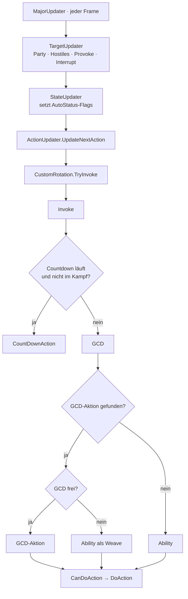

# 03 · Was bei allen Jobs identisch oder ähnlich ist

Diese Ebene beschreibt das, was *kein* Job selbst besitzt, sondern was ihm die
zentrale Maschinerie vorgibt — plus die Muster, die zwar in jedem Job einzeln
stehen, aber überall gleich aussehen.

**Die Reihenfolge der Zweige ist die umgesetzte Antwortordnung.** Was `08-mitigation-synergy.md`
als Vorgabe führt — Heilung vor Minderung —, steht hier als Dispatch-Reihenfolge: Die
Heilzweige werden vor den Verteidigungszweigen gefragt, und beide vor dem Angriff. Wer eine Regel
dieser Familie ändert, ändert entweder die Bedingung **in** einem Zweig oder die Reihenfolge der
Zweige selbst — das Zweite ist der teurere Eingriff und in C37 bereits einmal schiefgegangen.

---

## A · Der Rahmen: eine Entscheidung pro Frame



**Universelle Invariante:** Pro Frame entsteht genau *eine* Aktion. Kein Job
kann zwei Aktionen ausgeben, keiner kann die Reihenfolge des Rahmens ändern.
Jobs füllen ausschließlich Slots, sie steuern den Ablauf nicht.

**Zweite Invariante:** `StateUpdater` entscheidet *ob* ein Slot überhaupt
angefragt wird, der Job entscheidet nur *womit* er ihn füllt. Ein Job kann
eine Heilung nicht erzwingen, wenn `AutoStatus.HealSingleSpell` nicht gesetzt
ist — das ist die Ursache fast aller „warum feuert X nicht"-Fälle im
AUDIT_LOG.

**Dritte Invariante: Ein Objekt aus den Listen gilt für den Frame, in dem die Liste gebaut wurde (A309).** Gruppe,
Gegner, Flächenwirker und Ziele baut `TargetUpdater` in jedem Durchlauf neu; der Durchlauf läuft auf dem Spielthread
in einem Zug, dazwischen verschwindet kein Objekt. Über einen Frame hinaus taugt die Referenz nicht:
- Dalamud hält je Tabellenplatz und Objektart **ein** Objekt und setzt seine Adresse, sobald irgendein Plugin die
  Tabelle durchläuft (`ObjectTable.CachedEntry.Update`). Eine gehaltene Referenz zeigt danach auf den neuen Inhaber des
  Platzes; ist der Platz leer, behält sie die alte Adresse.
- `IsValid()` prüft nur, dass der Spieler geladen ist (`GameObject.IsValid`, Dalamud master, 15.10.2026), nicht das
  Objekt. Es schützt keine gehaltene Referenz; die Prüfungen im Plugin (32, gezählt 16.11.2026) sind Nullprüfungen mit dieser
  Zusatzbedingung.
- Spieler und Kampf-NPCs liegen in einem festen Speicherblock des Spiels (`CharacterManager.BattleCharaMemory`,
  FFXIVClientStructs). Innerhalb einer Sitzung bleibt der Speicher einer veralteten Adresse lesbar, ihre
  Funktionstabelle nicht; beim Ausloggen gibt das Spiel auch den Speicher frei (A845). Fast jede
  Eigenschaft einer Figur – `GameObjectId`, `Name`, `IsDead`, `StatusList`, jede Wirk-Eigenschaft über `GetCastInfo` –
  ruft über sie. Beobachtet am 15.11.2026 (A827): Die Blickwache fragte eine gehaltene Figur zwei Sekunden nach ihrem
  Blick nach `IsCasting`, und das Spiel endete mit einer Zugriffsverletzung, die .NET nicht abfängt. Upstreams
  Kommentare zu harten Abstürzen an sterbenden Zielen (`6baba6a94`) beschreiben denselben Weg.

Was über Frames hinweg lebt, hält deshalb die Id – beim Anlegen aus der frischen Figur gelesen – und löst das Objekt im
lesenden Frame aus der Tabelle auf (`SearchById`); eine gehaltene Figur wird nach keiner Eigenschaft gefragt, auch nicht
nach ihrer Id. So halten es der Tankwechsel (`TankSwapWatch`), die Marker-Beobachtung, der Tankbuster-Plan für den
Wirkenden des geplanten Casts (seit A309) und seit A827 die Blickwache. Was eine Figur doch über das Bild hinaus hält,
fängt eine Prüfung ab, die nichts aus der Figur liest (A827, A845): `ObjectHelper.IsCurrent` vergleicht die Adresse der
Figur mit der, die ihr Tabellenplatz jetzt trägt. Den Platz kennt RSR ohne Lesen: Dalamud legt je Platz und Objektart
einen festen Wrapper an und gibt ihn bei jedem Lesen des Platzes heraus (`ObjectTable.CachedEntry`, Dalamud 43b3411,
10.11.2026); ein leerer Platz lässt ihm die alte Adresse. RSR merkt sich je Wrapper seinen Platz, gelesen an der Tabelle,
solange die Figur darin steht, und liest danach nur noch den Platz der Tabelle (`GetObjectAddress`), nie die Figur.
- *Absturz beim Ausloggen (A845):* Bis A845 holte `IsCurrent` den Platz aus der Figur selbst (`ObjectIndex`, ein Feld in
  ihrem Speicher), unter der Annahme, der Speicherblock der Kampffiguren bleibe lesbar. Am 16.11.2026 um 19:26 loggte er
  aus (Dalamud-Log: `LoggingOut`), das Spiel gab den Speicher frei, und die Bereinigung zu Beginn des nächsten Durchlaufs
  las `ObjectIndex` einer gehaltenen Figur: Zugriffsverletzung, das Spiel endete (`StaleFigures.Prune`, sein Upload).
  Jetzt zeigt die Tabelle nach dem Ausloggen leere Plätze, und jede gehaltene Figur fällt, ohne gelesen zu werden.
- *Ein Wrapper ohne bekannten Platz:* RSR durchläuft die Tabelle höchstens einmal je Bild (`IFramework.LastUpdate`) und
  merkt sich die Plätze aller Wrapper, die sie dann herausgibt. Steht der Wrapper danach nicht darin – sein Platz ist
  leer oder trägt eine Figur anderer Art, oder er stammt nicht aus der Tabelle (`CreateObjectReference`) –, gilt er als
  nicht aktuell. Grund: Ohne Platz bliebe nur das Lesen der Figur, und das ist genau der Fehler.
- *Zu Beginn jedes Durchlaufs* (`StaleFigures.Prune`, vor allem anderen): Die Listen von `DataCenter` und die
  Einzelziele (Unterbrechen, Provozieren, Tote, Reinigung), die Casts des Tankbuster-Plans samt Plan und die Ziele des
  Tankwechsels verlieren jede Figur, die nicht mehr aktuell ist. Wer die Listen in diesem Durchlauf neu baut, baut sie
  ohnehin; wer sie liest, ohne dass sie neu gebaut werden – RSR aus, ein übersprungener Durchlauf –, liest keine
  verschwundene Figur. Gültige bleiben, die Dienste zwischen den Kämpfen arbeiten weiter wie bisher.
- *Zwischen den Durchläufen* (Effekt-Hooks): Jede Schleife über eine Liste des letzten Durchlaufs überspringt eine
  Figur, die nicht mehr aktuell ist, bevor sie sie fragt.
- *Neuer Inhaber desselben Platzes (Code-Review vom 15.11.2026, A832):* Der feste Speicherblock gibt einer Figur, die
  einen frei gewordenen Platz übernimmt, dieselbe Adresse; der Adressvergleich hält sie für die alte. Abstürzen kann das
  nicht (die Funktionstabelle ist gültig), aber ein Halter liest dann eine andere Figur – einen Tankbuster, der nicht
  gewirkt wird, ein Tankwechselziel, das ein anderer Gegner ist. Wo die Id beim Anlegen gelesen wurde (Tankbuster:
  `Cast.SourceId`; Tankwechsel: beim Setzen von Ziel und Rückholquelle), vergleicht die Bereinigung nach dem
  Adressvergleich auch die Id (`IsCurrent(id)`); erst der bestandene Adressvergleich erlaubt die Frage nach ihr.
- *Kosten:* ein Wörterbuchzugriff und ein Lesen der Tabelle je gehaltener Figur und Bild, wo eine Id gehalten wird dazu
  ein Lesen der Figur nach bestandenem Vergleich; höchstens ein Lauf über die Tabelle je Bild, wenn ein Wrapper unbekannt
  ist. Angelegt wird nur ein Eintrag je neuem Wrapper, höchstens fünf je Platz (die Arten, für die Dalamud Wrapper führt).
- *Vorbild (BossModReborn 35a908a, `WorldStateGameSync.UpdateActors`):* BMR hält keine Figur des Spiels über ein Bild
  hinaus. Es liest jedes Bild die Objekttabelle direkt, vergleicht je Platz die `EntityId`, führt eigene Kopien
  (`Actor`, die Wirkinformation als `ActorCastInfo`) und entfernt eine Kopie, sobald ihre Figur den Platz verlässt;
  `GetCastInfo` ruft es nur an einer Figur, die im selben Bild in der Tabelle steht. Darum stürzt es an derselben
  Stelle nicht ab. Bei der Blickwache las ich von BMR die Blickmodule und die Drehung, nicht dieses Fundament (seine
  Frage, 15.11.2026: „warum stürzte bmr nicht ab? hast du dir die dortigen funktionen nicht genau genug angesehen?").
- *Preis:* Eine Figur, die ihren Platz an eine neue derselben Art abgegeben hat, besteht die Prüfung (gleiche Adresse,
  gültige Tabelle) – kein Absturz, aber eine fremde Figur für den Rest des Bildes; die Listen sind im nächsten Durchlauf
  wieder richtig. Die Blickwache hält dafür nur die Id.

**Vierte Invariante: Dienste außerhalb des Kampfes hängen nicht am Zustand von RSR (A576).** Der Rahmen oben läuft nur,
solange RSR an ist (`DataCenter.IsActivated`: Auto, Manuell oder Lernmodus). RSR schaltet sich ab Werk 30 s nach jedem
Kampf ab („Turn off after combat ends"), ebenso beim Gebietswechsel und in Zwischensequenzen. Was eine Rotation
zwischen den Kämpfen tut, unter einer eigenen Einstellung und über die Fenster des Spiels, fiel damit genau dann aus,
wenn es gebraucht wird:
- *Im Kampf:* Im Crucible öffnet das Spiel vor jedem Kampf das Hornfenster, nach dem Gang über das Brett und einer
  Ladezeit; RSR war längst aus. Die Hörner blieben, wie sie standen, das Teamfenster zeigte keine Empfehlung, Rast und
  Laden keinen Vorschlag (seine Meldung, 05.11.2026). Der Blaumagier bekam sein Set nur in den ersten 30 s nach einem
  Kampf verbessert; der Beastmaster im Dungeon keine Boss-Belegung, wenn der Weg zum Boss länger dauerte.
- *Regel:* Jede Rotation hat neben `UpdateInfo` (je Frame, nur bei eingeschaltetem RSR, vor der Entscheidung) einen
  zweiten Einstieg, `UpdateServices`, den `MajorUpdater` in jedem Frame ruft, in dem die Spielfigur geladen ist – an
  oder aus, auch beim Gebietswechsel und in Zwischensequenzen, nach dem Bau der Listen. Dort stehen die Dienste, die
  keine Kampfaktion wählen: Fenster des Spiels lesen und bedienen, Empfehlungen vorbereiten, Belegungen außerhalb des
  Kampfes. Was eine Kampfaktion wählt, bleibt in `UpdateInfo`; jeder Dienst steht an genau einer der beiden Stellen.
- *Warum auch beim Gebietswechsel:* Am zweiten Kampf des ersten Bretts ließ sich RSR im Hornfenster nicht einschalten
  (seine Meldung, 05.11.2026): Ein Zustand des Spiels schaltet es in jedem Frame wieder ab – „Turn off during cutscenes"
  oder „Turn off during area transitions" –, und beim Gebietswechsel läuft der ganze Rahmen nicht. Welcher Zustand es
  ist, ist nicht belegt; die Sondenzeile beim Öffnen des Hornfensters nennt seit A576 den Zustand von RSR und die
  gesetzten Zustände des Spiels. Daedalus bedient das Hornfenster in jedem Frame, nur an „eingeloggt, Spielfigur da"
  gebunden (74659a6, `Plugin.OnFrameworkUpdate`, Werkzeugquelle aus dem Spielbetrieb); dieselbe Bindung gilt hier.
- *Gegnerliste:* `TargetUpdater` baut die Listen nur bei eingeschaltetem RSR oder eingeschaltetem automatischen Start,
  und nie beim Gebietswechsel. Ein Dienst, der Gegner liest, fragt `DataCenter.HostileListLive` (in diesem Frame
  gebaut) und wartet sonst. Ein Dienst, der etwas schreibt, das das Spiel beim Laden ersetzt (das Set des
  Blaumagiers), prüft den Gebietswechsel selbst.
- *Was „aus" weiter heißt:* Aus wählt RSR keine Kampfaktion. Ein Dienst handelt nur unter seiner eigenen Einstellung,
  deren Text sagt, was er tut, und hat dort sein „Off"; ist die Rotation abgeschaltet, läuft keiner.
- *Gegenthese 1 (wer RSR ausschaltet, will keine Eingriffe):* Nicht widerlegt für den Einzelfall, widerlegt als Regel:
  Der Zustand gilt der Rotation, und RSR schaltet ihn selbst ab, ohne dass der Spieler das wollte. Wer die Hörner oder
  das Set selbst führen will, schaltet den Dienst ab; eine Handänderung hält ohnehin (B5, K6, Blaumagier-Set).
- *Gegenthese 2 (doppelte Ausführung):* Liefe ein Dienst an beiden Stellen, klickte er zweimal je Frame. Deshalb wandert
  er; der Aufruf in `UpdateInfo` entfällt.
- *Gegenthese 3 (ein Frame Versatz):* Im Kampf liest eine Regel in `UpdateInfo`, was ein Dienst im vorigen Frame
  festgestellt hat (etwa den Kampf im Brett). Ein Frame liegt unter jeder Wirkzeit und Animationssperre; am Beginn eines
  Kampfes ist der Kampf im Brett einen Frame später bekannt.

### Was ein Frame kostet

Jeder Frame rechnet die ganze Entscheidung neu: Ziele, Flags, die GCD-Kette und im Einschiebefenster die
Fähigkeitenkette, je `CanUse` die Zielsuche über alle Kandidaten. Gemessen sind im Mittel 1,55 bis 3,63 ms je
Durchlauf, 7 bis 15 % der Framezeit, Spitzen bis 70 ms in einem Critical Engagement (Protokolle 16. und 17.10.2026,
A286, A299). Was davon trägt, sagt seit A310 die Kostenzeile je Schritt nach jedem Kampf. Seit A739 nennt sie die Zeit, die die
Übersetzung neuer Methoden (JIT) im Spielthread kostete, und RSR übersetzt den Kern beim Laden und jede Rotation bei
ihrem Wechsel vorab auf einem Hintergrundthread: Die Ruckler bis 64 ms fielen in den ersten Kampf einer Sitzung oder
auf einen neuen Pfad, nie mit einer Speicherbereinigung (Konzept 24, „Der erste Pull").

Drei Regeln halten die Kosten eines Frames unabhängig davon, wie oft eine Frage gestellt wird (A325):
- **Keine Suche in der Objekttabelle pro Eintrag oder pro Lesen.** `SearchById` und `Status.SourceObject` laufen
  linear über jeden Platz der Tabelle (Dalamud, `ObjectTable.SearchById`); ein fehlendes Objekt kostet die ganze
  Tabelle. Was eine Schleife oder eine oft gelesene Abfrage von Objekten wissen muss, wird einmal je Frame erhoben
  (`StatusHelper.IsFromPlayer`: die Objekte des Spielers für die Prüfung „vom Spieler") oder nach dem billigen Test
  gefragt (`IsOwnPartyMarker` erst nach dem Pfad des Markers; „vom Spieler" erst für einen Status mit gesuchter Id, wie
  Upstream seit 7.5.7.10 fragt, A434).
- **Erkennen, wo die Tatsache entsteht.** Ein Effekt ist ein Marker oder keiner, wenn er entsteht; die Warteschlange
  nimmt nur auf, was ein Leser abfragen kann (`DataCenter.IsTrackedVfxPath`, seit 7.5.7.10 von Upstream: die vier
  Markerlisten und jeder Lock-on-Effekt; das Spiel legt jeden Marker des Blatts `Lockon` unter `vfx/lockon/eff/` ab,
  A434). Vorher standen dort alle Effekte aller Figuren fünf Sekunden lang, und jeder Leser lief bei jedem Lesen
  über alle – im Critical Engagement die Skill-Effekte von 48 Spielern.
- **Eine Antwort aus der Historie einmal je Frame und Mitglied.** Für ein Gruppenmitglied läuft `GetTTK` über die
  ganze Gesundheitshistorie der Gruppe (240 Proben); die Heilzielwahl fragt es mehrmals je Mitglied. Es merkt sich die
  Antwort für den Frame, eine neue Probe verwirft sie (`ObjectHelper.ForgetTimeToKill`). Für Gegner liest es seit
  Upstream 3c6ce9ee2 die Rate aus `TimeToKillTracker`, einen Wörterbuchzugriff ohne Lauf über eine Historie (A341).

Woher die Kosten kamen: Upstream speichert alle Effekte und prüft die Herkunft eines Status über die Objekttabelle; der
Fork hat beides vervielfacht – die Gruppenprüfung der Marker (A220) vor den Pfadvergleich gesetzt, jede Regel mit
Statusabfragen mehr Lesungen. Sein Verdacht, Sonderfälle als eigene Abfragen trieben die Rechenlast, trifft damit die
Form, nicht die Zahl der Regeln: Teuer war, was bei jedem Lesen neu sucht, nicht dass es viele Regeln gibt.

**Nicht umgestellt, mit Grund:**
- *Die Erkennungsabfragen von `DataCenter` je Frame merken* (`IsHostileCastingAOE`, `AreaHitAnnounced` und
  Verwandte): Nach dem Filter laufen sie über wenige Marker und die Wirkenden; A310 hat das Merken öffentlicher
  Eigenschaften ohne Beleg verworfen, und ein Beleg liegt nicht vor.
- *`HostileTarget` je Frame merken:* eine Suche bis zu den Gegnerplätzen je Lesen; eine zeitbasierte Merkhilfe könnte
  über die Frame-Grenze greifen, wovor die dritte Invariante warnt.
- *Dalamuds Statuslisten:* Jeder Zugriff legt eine Liste und je Status ein Objekt an. Kurzlebiger Müll, den die
  Bereinigung der jüngsten Generation räumt, ohne ihn weiterzureichen – Schluss aus der Lebensdauer, nicht gemessen; ob
  eine Bereinigung mit der langsamsten Runde zusammenfällt, zeigt die Kostenzeile.
- *Die Zielsuche je `CanUse`* (Upstreams Aufbau): ein Umbau des Kerns ohne Messung, welcher Teil trägt.

**Gemessen nach dem Umbau** (sein Protokoll vom 18.10.2026, Build 274ef44de, 84 Kämpfe in Vierer-Instanzen): im
Mittel 1,56 ms je Durchlauf, 9,2 % der Framezeit. Davon trägt die Hotbar-Anzeige („highlight") 1,04 ms, die
Rotationsentscheidung mit allen Sonderregeln 0,32 ms, die Flags 0,05 ms. Die Regeln sind damit nicht mehr der größte
Posten.

**Die Hotbar-Zeit war die Rotfärbung gesperrter Aktionen** (seine Protokolle vom 19.–22.10.2026, A334): Getrennt als
„hotbar tint" kostete sie 0,78 ms je Durchlauf (Build e012fbcd7, 225 Kämpfe, im Mittel 1,24 ms, 7,9 %). Sie baute
in jedem Bild die Aktionsliste der Rotation neu (`CustomRotation.AllActions` legt bei jedem Lesen eine neue Liste
an). Upstream 7.5.7.5 liest dort die einmal gebaute Liste (`RotationUpdater.CurrentRotationActions`). Seitdem kostet
sie 0,04 ms, und ein Durchlauf im Mittel 0,48 ms, 3,3 % der Framezeit (Build 01048265d, 59 Kämpfe). Den Rest trägt die
Rotationsentscheidung mit 0,22 ms. Einmalige Spitzen bis 474 ms fielen in den ersten Kampf nach dem Start („rotation
load" 397 ms), ohne Bereinigung. Eine Messung im Critical Engagement nach dem Umbau liegt nicht vor.

**Prüfgrad:** statisch am Code und an Dalamuds Quelltext (master, 17.10.2026); Compile im CI-Lauf; Kostenzeilen
seines Protokolls vom 18.10.2026. Die Annahme über die Zahl der Effekte im Critical Engagement ist ein Schluss, nicht
gemessen.

### „Vom Spieler" heißt auch: von einem Objekt, das ihm gehörte

**Sachstand:** `StatusHelper.IsFromPlayer` zählt einen Status als vom Spieler, wenn seine Quelle der Spieler ist oder
ein Objekt, das ihm in diesem Gebiet gehört hat, auch wenn es nicht mehr da ist. Die Ids erhebt
`StatusHelper.NoteOwnedObjects` einmal je Frame aus dem Update, direkt nach den Zielen (`MajorUpdater`), und behält sie
bis zum Gebietswechsel; eine Statusabfrage außerhalb des Updates erhebt selbst, wenn die letzte Erhebung älter als ein
Frame ist. Je Frame statt nur bei Bedarf, damit auch ein Begleiter gesehen wird, der nur zwischen zwei Statusabfragen
lebt. Eine Id, unter der die Tabelle ein Objekt eines anderen Besitzers zeigt, fällt heraus.

**Anlass, seine Meldung (03.11.2026):** „ich caste am anfang als smn schimmerschild und dann obwohl es noch da ist, vor
schadenseingang nochmal" – die Doppelzündung, die A9 als einen der ersten Fehler des Forks behoben hatte.

**Ursache, an seinem Mitschnitt belegt** (ACT und `DefenseTrace.log` vom 03.11.2026, Build a885b43bf): Den Schild legt
Karfunkel, nicht der Beschwörer; Quelle des Status Schimmerschild (2702) ist das Objekt Karfunkel. Jede Beschwörung
ersetzt Karfunkel durch ein neues Objekt mit neuer Id, die Demi (Sol-Bahamut) ebenso wie die Primae (Topas-Titan). Danach
gehört die Quelle des stehenden Schilds keinem Objekt des Spielers mehr: Die Prüfung `SourceObject?.OwnerId == playerId`
(Upstream; im Fork seit A325 über die Ids je Frame) findet das alte Karfunkel nicht und zählt den Schild als fremd.
Jede Frage „vom Spieler" sieht dann keinen Schild: die Sperre über `StatusProvide` in `CanUse`,
`RadiantAegisDueBeforeDemi` und `BMRShouldRefreshBefore`. Am 03.11.2026 dreimal:

| Kampf | Erster Schild | Karfunkel ersetzt | Zweiter Schild | Rest des ersten |
|---|---|---|---|---|
| Thordan (Extrem) | 18:09:16, BossModReborn-Raidwide | Topas-Titan 18:09:25, neues Karfunkel 18:09:30,9 | 18:09:31, Einzelabwehr | 15,2 s |
| Shinryu (Unreal), Lauf 1 | 19:00:41, vor der Demi | Sol-Bahamut 19:00:44, neues Karfunkel 19:00:59,6 | 19:01:00, Flächenabwehr, 0,8 s vor Gaias Zorn | 11,8 s |
| Shinryu (Unreal), Lauf 2 | 19:13:29, vor der Demi | Sol-Bahamut, neues Karfunkel vor dem zweiten Schild | 19:13:45, Flächenabwehr, 1,6 s vor Gaias Zorn | 14,3 s |

Im Kampf: Die zweite Ladung geht auf einen Schild, der noch steht, und fehlt bei der nächsten Gefahr – die Folge, die
A9 benennt („bei echter Gefahr war keine mehr da"). In beiden Shinryu-Läufen gemessen: 24 und 25 s nach dem zweiten
Schild kam Flutwelle, bewertet mit 68 und 79 % ungemindert, traf ihn mit 75 und 63 %, und die Flächenabwehr fand
keinen Schild („refused before: Schimmerschild (Cooldown)").

**Warum A9 das nicht traf:** A9 entfernte einen Zweig ohne Gefahrenbedingung. Hier ist die Gefahr echt, aber der Blick
auf den eigenen Schild blind. Die Lage entsteht durch den Wechsel des Begleiters, und der Schild vor der Demi (Konzept 12,
„Der Schimmerschild geht vor") macht sie zur Regel: Er geht genau vor dem Wechsel hinaus.

**Die Klasse:** jeder Status, den ein Begleiter, eine Beschwörung oder ein anderes Objekt des Spielers legt und der das
Objekt überdauert. Gemessen ist Schimmerschild. Gleich gebaut, nicht gemessen: die Status der Fee des Gelehrten, wenn
sie abgelöst wird, und die Begleiter des Beastmasters beim Wechsel. Die Korrektur sitzt deshalb an der einen Stelle, die
„vom Spieler" beantwortet, nicht beim Beschwörer.

**Wiederverwendung einer Id:** In beiden Mitschnitten stiegen die Ids der Begleiter innerhalb einer Instanz streng an;
dass das Spiel eine Id nie wiederverwendet, ist damit nicht belegt. Deshalb gilt die Erinnerung nur bis zum
Gebietswechsel, und eine Id, unter der die Tabelle das Objekt eines anderen Besitzers zeigt, wird gestrichen. Ein
fremder Status zählte nur dann als eigener, wenn seine Quelle eine wiederverwendete Id trägt und schon wieder
verschwunden ist, bevor eine Erhebung sie sah.

**Ausgeschlossen:**
- *Nur Schimmerschild umstellen* (`StatusFromSelf = false`): Auf dem Beschwörer kann nur sein eigenes Karfunkel den
  Schild legen, für diese eine Aktion wäre es richtig. Die Klasse bliebe offen.
- *Jeden Status ohne auffindbare Quelle als eigenen zählen:* Auch fremde Begleiter verschwinden; ein Debuff am Gegner
  von einem fremden, schon fortgerufenen Begleiter würde zum eigenen.

**Was im Kampf anders wird:** Nach einer Beschwörung sieht RSR den stehenden Schild weiter. Eine zweite Ladung geht erst,
wenn der Schild innerhalb der Auffrischungsspanne endet (`StatusRefreshGcdCount`) oder fehlt; die Ladung bleibt für die
nächste Gefahr. Schlechter wird nichts, was RSR vorher richtig sah: Die Erinnerung erweitert „vom Spieler" nur um
Objekte, die nachweislich seine waren. Kosten: ein Lauf über die Objekttabelle je Frame mit einem Mengenzugriff je
Objekt; vorher lief dieselbe Erhebung, sobald eine Abfrage einen Status fremder Quelle traf, in einem Kampf also
ebenfalls fast jeden Frame (Schluss).

**Messmittel:** Der nächste Mitschnitt zeigt es ohne neue Zeile. Steht im ACT-Mitschnitt ein zweiter Schimmerschild,
während der erste noch läuft, nennt die `DefenseTrace.log` den Pfad, der ihn gewählt hat.

**Prüfgrad:** Ursache am Mitschnitt (ACT: Quelle des Status, Wechsel der Objekte; `DefenseTrace.log`: Pfad der zweiten
Zündung) und am Code; die Korrektur statisch und im Compile, im Spiel noch nicht beobachtet.

---

## B · Die Slot-Kette (identisch für jeden Job)

```
GCD()                                    Ability()
─────────────────────────────────        ─────────────────────────────────
 1  CommandNextAction (GCD)               1  NoCasting-Sperre
 2  NoCasting-Sperre                      2  Einschiebesperre (GCD ≤ 0,5 s)
 3  Kanal-/Wirksperren (Orbonne, PLD,     3  Kanal-/Wirksperren (Orbonne, PLD,
    AST, BLU, NIN-Mudra, PvP)                AST, BLU)
 4  EmergencyGCD                          4  CommandNextAction (oGCD)
 5  MyInterruptGCD                        5  NIN-Mudra-, PvP-Sperre
 6  DispelGCD                             6  Befohlener Gegenstand
 7  ProvokeGCD                            7  UseAbility aus / Wirken läuft / Fesselung
 8  RaiseSpell   (wenn RaisePlayerFirst)  8  EmergencyAbility
 9  MoveForwardGCD                        9  Tankbuster-Plan (nur Tanks, Option):
10  HealAreaGCD                              Minderung nach Bedarf oder Unverwundbarkeit
11  HealSingleGCD                        10  Tankwechsel (nur Tanks, Option):
12  DefenseAreaGCD                           Shirk auf den Co-Tank, dann Zurückprovozieren
13  DefenseSingleGCD                     11  InterruptAbility
14  RaiseSpell   (sonst)                 12  DispelAbility
15  GeneralGCD                           13  Shirk (befohlen)
16  Heilung ohne Anlass                  14  TankStance
    (HealWhenNothingTodo)                15  AntiKnockback
                                         16  TrueNorth / Positional
                                         17  HealAreaAbility
                                         18  HealSingleAbility
                                         19  SpeedAbility (nur befohlen)
                                         20  ProvokeAbility
                                         21  DefenseAreaAbility
                                         22  DefenseSingleAbility
                                         23  MoveForward / MoveBack
                                         24  HP-Potion
                                         25  Phönixfeder
                                         26  AttackAbility
                                         27  GeneralAbility
                                         28  MP-Potion · GeneralUsing · Speed
```

**Slot 6 beim Heiler (A565):** Die Reinigung steht vor den Heilungen, nimmt den Platz aber nur, wenn sie ein Leben
rettet (ein Zustand, der am Ende tötet); alles andere wartet, bis weder Heilung noch Abwehr ansteht – Konzept 07,
„Reinigung oder Heilung".

**Befohlene Aktionen mit Ziel (Upstream 7.5.6.22, A264):** Ein DoActions-Befehl oder ein abgefangenes Makro kann ein
Ziel tragen – einen Platzhalter wie `<t>`, `<2>`, `<mo>` oder eine Zielart wie `<LowHP>`. Solange der Befehl in der
Warteschlange steht, gilt ein Objektziel für jede Zielsuche dieser Aktion, auch für einen Druck derselben Aktion aus
einem anderen Pfad und vor jeder Zielüberschreibung (`ActionTargetInfo.FindCommandObjectTarget`); ausgenommen sind
Aktionen ohne Reichweite und Wirkradius, die immer auf dich gehen. Eine Zielart ersetzt die Zielart der Aktion und eine
Zielüberschreibung, nicht aber „du selbst". Ist das Objektziel nicht erreichbar, sucht RSR wie bisher.

Der Tankbuster-Plan (9) und der Tankwechsel (10) sitzen hinter `EmergencyAbility`,
damit eine Unverwundbarkeit, die an ihrer Schwelle zündet, vorgeht, und vor allem anderen, weil beide an einem
Tankbuster hängen (Konzept 09, „Gemessener Tankbuster: das geringste Mittel" und „Tankwechsel nach einem
Tankbuster"). Der Plan drückt die Minderungen, die ein gemessener Tankbuster braucht, oder die Unverwundbarkeit, und
steht vor dem Wechsel, der hält, solange sie bereit ist. Beide haben keinen
befohlenen Eingang; Shirk (13) läuft weiterhin nur auf Befehl. Solange der Plan zurückhält (Konzept 09, „Wann
zurückgehalten wird") oder Heiliger Boden oder Meteoritenfall den Treffer abhalten, lehnt `BaseAction.CanUse` für Tanks
in jedem Slot bewertete Abwehr auf den Spieler ab, die der Plan nicht freigibt; frei bleiben die Heilslots, Hilfe für
andere, in der Flächenabwehr (21), was über ihn hinaus wirkt, und das Befohlene.

In jedem Slot fragt der Dispatcher zuerst die Duty-Rotation (`DataCenter.CurrentDutyRotation`), dann den Job. Die
Heil-, Abwehr-, Bewegungs- und Rückzugsslots haben je zwei Eingänge: zuerst den befohlenen (`CommandStatus`), dann
den automatischen (`AutoStatus` beziehungsweise `MergedStatus`).

Beide Ketten sind **fest verdrahtet** und für alle Jobs gleich. Zwei
Konsequenzen, die im ganzen AUDIT_LOG immer wieder auftauchen:

- Alles oberhalb von `GeneralGCD` kann `GeneralGCD` **aushungern**. Ein
  gesetztes Heil-Flag verhindert dauerhaft, dass ein Zweig in `GeneralGCD`
  jemals drankommt — unabhängig davon, wie wichtig er ist.
- Wer proaktive Logik in `GeneralGCD` platziert, muss sie in `HealAreaGCD` und
  `HealSingleGCD` **wiederholen**, sonst greift sie im Heilfall nicht. Genau
  das war die Ursache der „HoT wird nicht aufrechterhalten"-Meldungen.

### Status, unter denen nicht gehandelt werden soll („No-casting debuffs")

Die Liste `OtherConfiguration.NoCastingStatus` hat in der Oberfläche den Text „Do not take action if you have one of
these debuffs". Ihr Leser ist nicht die NoCasting-Sperre der Slot-Kette (die hängt an der Stopp-Liste gegnerischer
Casts), sondern der Druck selbst (`RSCommands_Actions`, `CancelCastUpdater`, `AutoAttackUpdater`). Die Liste enthält
zwei Arten, und RSR behandelt sie getrennt (A338):
- *Schaden bei jeder Aktion* (Pyretic in fünf Fassungen, seit Upstream 42cb3a7dd auch Causality, 514): kein Druck,
  solange der Status liegt, und ein laufender Zauber wird abgebrochen. Erkannt am eigenen Wirktext des Status im
  englischen Blatt des Clients, gleich welche Sprache er zeigt: „with every action" (Pyretic, alle sechs Zeilen des
  Spiels) oder „each time an action" (Causality) – in den Spielblättern vom 24.10.2026 trifft das genau diese sieben
  Zeilen (`NoCastingStatusHelper.DamagesEveryAction`). Kein Feld der Blätter trennt die Arten.
- *Strafe beim Ablauf* (Acceleration Bomb, Extreme Caution, Glossomorph, Flesh Forward und Back, Directed Grotesquerie,
  Buyer's Remorse): kein Druck und Abbruch erst, wenn der Status in weniger als 3 s endet
  (`NoCastingStatusHelper.ResolveWindow`, Upstream); ein Status ohne Restzeit zählt als endlos und sperrt so nie.
- Auto-Angriffe ruhen, solange irgendein gelisteter Status liegt. Daneben sperren eigene Wege den Druck für die ganze
  Dauer: Motion Tracker und BossModReborns Sondermodus Pyretic.

Im Kampf: Unter Pyretic oder Causality steht RSR, wie der Text der Liste sagt und wie die Mechanik es verlangt, auch ohne
BossModReborn-Modul. Ein Heiler heilt in dieser Zeit nicht; jede Heilung kostete ihn selbst Leben. Bis A338 drückte RSR
unter Pyretic bis 3 s vor dem Ende weiter, unter Causality und den Fassungen ohne Restzeit immer.

**Vor der Landung** (A439). Ein Status, der jede Aktion bestraft, kommt mit dem Treffer, und eine Aktion, die in diesem
Augenblick noch läuft, nimmt den Schaden sofort; die Sperren oben lesen den liegenden Status und kommen dafür zu spät.
`ActionPenaltyWatch` beantwortet die Zeit davor, für alle Jobs, in PvE und PvP. Die frühere PvP-Ausnahme war von
Upstreams Sperre für liegende Status übernommen. Keiner der 31 Status der Liste kommt in PvP vor (alle aus
PvE-Bosskämpfen, xivapi v2 am 13.11.2026), die Ausnahme schränkte also nichts ein und hatte keinen technischen Grund
(A755):
- *Lernen:* Legt die Landung eines Wirkens einem Gruppenmitglied oder ihm einen solchen Status der Liste an (Effektart
  „Status auf Ziel“ mit der Status-Id, erkannt wie oben über `DamagesEveryAction`), ist das Wirken gelernt, gleich auf
  wen es fiel. `ActionPenaltyCasts.json` hält je Aktion den gelegten Status, über alle Sitzungen, gespeichert wie die
  übrigen gelernten Tabellen (Zusammenführung mit der Datei, nie ungeladen geschrieben, unlesbar als `.corrupt` beiseite).
  Die erste Sichtung schreibt „learned: …“ ins `DefenseTrace.log`, die Kopfzeile zählt die Einträge.
- *Widerlegen* (Konzept 13, „Stufe 4", 4c): Ein gelerntes Wirken hält Zauber, bis die laufende Spielversion es
  mindestens zweimal auf seinem Ziel, einem Mitglied, ohne den Status landen sah, öfter als es ihn früher legte, und nie
  mit ihm; dann hält es nichts mehr, bis es ihn wieder legt. `ActionPenaltySightings.json` hält die Zählungen.
- *Erkennen:* Jede gegnerische Figur, Helfer eingeschlossen, die ein gelerntes Wirken castet, dessen Status noch in der
  Liste steht – auf ihn oder in einer Gestalt, die ihn erreicht (`DataCenter.CastReachesPlayer`). Verschwindet der Balken
  mindestens eine Aktualisierung vor seinem Ende, war das Wirken gestoppt (unterbrochen, Wirker tot) und landet nicht.
  Endet er an seinem Ende, gilt die Landung als sofort, bis sie gesehen ist oder einen GCD danach ausbleibt; ein dort
  abgebrochenes Wirken ist von einer späten Landung nicht zu unterscheiden. Dazu BossModReborns bevorstehender Sondermodus Pyretic
  (`Hints.SpecialModeIn`).
- *Entscheiden:* Gemessen wird mit der Laufzeit eines Drucks bis zum Server (`TankbusterForecast.RoundTrip`). Kein Zauber
  wird gewählt, der bei der Landung noch liefe (`ActionBasicInfo.NeedsCasting`, Wirkzeit nach Zaubertempo und
  Spontaneität). Kein Druck, dessen Aktion samt Wirkzeit dann noch liefe (ein GCD wird vor seinem Druck gewählt, und die
  Landung ist seitdem näher), und kein Auto-Angriff innerhalb der Laufzeit. Ein laufender eigener Zauber, der dann noch
  liefe, wird abgebrochen (`CancelCastUpdater`). Was vorher fertig wird, läuft; sofort wirkende Aktionen gehen bis zur
  Laufzeit vor der Landung.

Im Kampf, am Fall vom 26.10.2026 (A427, ACT-Mitschnitt): „Heißes Herz“ (#43322, 4,7 s, Pilgerpfad) landete um 21:09 auf
einem Mitglied – die Landung trägt #960 als Effektart 0x0E – und tötete es; RSR hätte das Wirken dort gelernt. Um
21:15:51 begann es auf ihn, und RSR begann 0,8 s vor der Landung Wirbelströmung (3 s); Pyretisch traf mit rund 1,03 Mio.
Mit der Regel beginnt ab drei Sekunden und Laufzeit vor der Landung kein Wirbelströmung mehr, an seiner Stelle eine
sofort wirkende Aktion oder keine; nach der Landung hält die Sperre oben. Preis: je Landung höchstens die Wirkzeit eines
Zaubers ohne Zauber, und ein Wirken auf ihn, das erst am Balkenende abbricht, hält bis einen GCD danach alles an. Am
Abend galt das Wirken dreimal ihm: einmal gelandet, einmal am Balkenende abgebrochen, einmal nach 1,8 s unterbrochen –
das gibt sofort frei.

Grenzen: Die erste Landung eines unbekannten Wirkens trifft ungehindert, wenn kein BossModReborn-Modul den Sondermodus
meldet; gelernt wird aus ihr, auch auf einem Mitglied. Im Quelltext von BossModReborn (ae64e33 vom 20.10.2026, am
29.10.2026 der Stand des Remotes) setzt ein einziges Modul `SpecialMode.Pyretic` (Cloud of Darkness, Chaotic); die
Module des Pilgerpfads kennen „Heißes Herz“ nicht. Die Liste „No-casting debuffs“ ist der
Schalter: Ein Status, der aus ihr entfernt wird, wird weder gelernt noch erwartet; eine eigene Option gibt es nicht, weil
die Regel einen belegten Tod behebt.

Ausgeschlossen: die Stoppliste gegnerischer Casts (`DataCenter.IsHostileStop`, ab Werk aus, von Hand gepflegt; sie
hielte jede Aktion für die ganze Wirkdauer, auch sofort wirkende und solche, die vorher fertig sind); ein festes Fenster vor
der Landung wie `PyreticThreshold` in BossMod (ffxiv_bossmod, ab Werk 1,0 s, Stand 4707e49c2 vom 28.10.2026): Es kennt
die eigene Wirkzeit nicht, ein Zauber, der davor beginnt, wird im Fenster abgebrochen, und sein GCD ist verloren.

Die Liste lädt aus Upstreams Repository und nur, wenn die Datei im Konfigurationsordner fehlt oder die Liste
zurückgesetzt wird; ein neuer Eintrag von Upstream erreicht eine bestehende Datei nicht von selbst.

---

## C · Muster, die in jedem Job wiederkehren

### C1 · Level-Kette

Immer dieselbe Form:

```
if (  HöchsteStufe.EnoughLevel &&  HöchsteStufe.CanUse(out act)) return true;
if ( !HöchsteStufe.EnoughLevel &&  MittlereStufe.CanUse(out act)) return true;
if ( !MittlereStufe.EnoughLevel && Basisstufe.CanUse(out act))   return true;
```

Zwei eingebaute Fehlerquellen:

1. Der linke Teil `X.EnoughLevel && X.CanUse` ist **redundant** —
   `ActionBasicInfo.BasicCheck` prüft `EnoughLevel` bereits selbst und bricht
   ab. Gezählt am 02.10.2026: 56 Vorkommen, davon 44 außerhalb von `ExtraRotations`.
2. Der Ausschluss der höheren Stufe wird **von Hand** geschrieben und mal als
   `!X.EnoughLevel`, mal als `!X.Info.EnoughLevelAndQuest()` formuliert. Beide
   Varianten kommen nebeneinander vor. Genau hier entstand der bereits
   behobene RDM-Fehler `!EnoughLevel && EnoughLevel`.

### C2 · Sustain-Zweig (proaktives Aufrechterhalten)

Seit der Vereinheitlichung überall identisch aufgebaut:

```
Auslöser (BMR-Vorhersage ODER Gegneranzahl)  →  Dauer-Prüfung  →  CanUse
```

Zentral als `ShouldSustainMitigationDebuff(...)` für Addle/Feint/Reprisal,
job-eigen als `TrySustain…OnTank(...)` bei den Heilern. Vorher: 25 bzw. 9
Kopien.

### C3 · AoE-vs-ST-Verzweigung

**Die Schwelle steht an der AoE-Aktion selbst** (26.10.2026, A391): Die Jobs entscheiden über `AoeCount` im
Zielsystem; wo eine Rotation selbst zählt, liest sie Reichweite und AoE-Zahl der Aktion, deren Treffer die Frage
beantwortet, oder vergleicht die Potenzen aus den Tooltips.

| Ort | Jobs | Mechanik |
|---|---|---|
| implizit über `AoeCount` in `CanUse` | alle | Zielsystem entscheidet |
| Weiche über die AoE-Kombo | Samurai: AoE-Iaijutsu, wenn so viele Gegner im Radius von Fuko (darunter Fuga) stehen, wie dessen AoE-Zahl verlangt (`AoeComboReaches`); Ogi Namikiri im AoE-Zweig, wenn er selbst mehr als einen trifft | dieselbe Menge und Schwelle wie das Zielsystem der Kombo |
| Potenzvergleich | Dunkelritter: Abyssal Drain statt Carve and Spit, wo er auf den Getroffenen mehr bringt (`ActionTooltip.AreaOutdamagesSingle`, ab Werk ab 3); dazu Auto Crossbow, Hellfrog, Foul (A342–A345) | Tooltips zur Laufzeit, AoE-Zahl als Untergrenze |
| eigene Zählung mit Absicht | Monk: Perfect Balance für AoE ab zwei Gegnern in 3 Yalm („position yourself in the centre of the mobs") | bleibt; er spielt den Monk bislang nicht |

Vorher zählte der Samurai in Nahkampfreichweite (3 Yalm) statt im Radius seiner Kombo (5 Yalm), der Dunkelritter
verlangte drei Gegner um sich zusätzlich zu zwei um das Ziel von Abyssal Drain. Viper und Blaumagier zählen nicht mehr
selbst (nur noch „ein Gegner in Reichweite").

**Die Gestalt der Zählung im Zielsystem:** Ein Kreis zählt um das Ziel, ein Kegel vom Spieler zum Ziel hin (Halbwinkel
60°, das Spiel nennt ihn nicht), eine Linie mit Ziel vom Spieler zum Ziel hin, so breit wie ihr `XAxisModifier` – der
Einsatz dreht den Spieler zum Ziel, und BossMods Autorotation misst sie ebenso (A399). Eine Gestalt ohne Ziel, die der
Spieler vor sich wirft (Reichweite 0: Flamethrower, Surpanakha, Apokalypsis), zählt in seiner Blickrichtung. Betroffen
von der Linie: Doom Spike, Draconian Fury und Coerthan Torment (Dragoon), Chain Saw (Maschinist), Apex Arrow und Blast
Arrow (Barde), Shadowbringer (Dunkelritter), Enlightenment (Monk) – mit gleicher AoE-Zahl nimmt die Zielwahl dann das
Ziel, dessen Linie die meisten trifft.

### C4 · Ranged-Fallback am Ende von `GeneralGCD`

Tanks und Nahkämpfer: letzter Zweig vor `base.GeneralGCD`. Gezählt am 02.10.2026 in neun Reborn-Rotationen; der
Mönch hat keinen. Bei den vier Tanks und beim Schnitter gilt nur das eigene `CanUse`. Eigene Bedingungen haben der
Samurai (nicht in den ersten 15 GCDs eines High-End-Kampfs, `CombatElapsedLessGCD(15)`), der Ninja (nicht während Mudra), der Dragoon (nicht direkt nach
`WingedGlidePvE`) und die Viper (Option `UFGhosting`).

**Beim Herankommen wartet der Nahkämpfer** (A605; Anlass Daedalus' Feldnotiz vom 24.09.2026, Shinryu: der Samurai warf
Enpi, während er schon auf sein Ziel zulief). Ist der Rückfall bereit und läuft der Spieler gerade auf sein Ziel zu, nimmt
der Fernangriff einen GCD, den der Nahkampf einen Augenblick später besser genutzt hätte; der nächste Nahkampf-GCD wartet
dann die volle Wiederaufladung ab. Wartet der GCD stattdessen t Sekunden bis zur Reichweite, verschiebt sich die ganze
Folge um t, und am Kampfende fehlt im Mittel t/GCD eines Nahkampf-GCD; gewonnen ist der Unterschied zwischen Nahkampf und
Fernangriff. Warten lohnt also, solange t < GCD · (1 − P_Fern / P_Nah) (meine Ableitung). P_Nah ist die Potenz des
Kombo-Starters laut Wirktext – der schwächste Nahkampf-GCD, die Rechnung wartet so eher zu kurz als zu lang –, P_Fern die
des Fernangriffs; liegt dessen verstärkte Form an (Enhanced Enpi, Enhanced Piercing Talon), geht er. t ist der Abstand bis
zur Reichweite des Starters geteilt durch die Geschwindigkeit, mit der der Abstand zum aktuellen Ziel schrumpft
(`DataCenter.ClosingSpeed`, aus zwei Lesungen; nach mehr als einem GCD ohne Lesung neu). Steht er, weicht er seitlich aus
oder läuft er weg, ist die Geschwindigkeit null oder negativ, und der Fernangriff geht wie bisher. Die Regel sitzt auf der
Stufe der Nahkämpfer (`CustomRotation.MeleeWorthWaitingFor`); die Tanks bleiben außen: Ihr Fernangriff im Anlauf bindet
die Gegner, bevor die Schadensausteiler treffen (Konzept 02, sein Hinweis zur Aggro). Der Mönch hat keinen Rückfall.

### C5 · Kurzschluss ganz oben

Heiler: Swiftcast+Raise. Melee: Combo-Rettung. Struktur identisch — *verlasse
die Methode, bevor Rotationslogik läuft* —, Formulierung jedes Mal neu.

### C6 · Zaubernde, wenn kein Zauber startbar ist

**Lage.** RSR beginnt keinen Zauber mit Wirkzeit, solange der Spieler läuft und die Bewegungssperre nicht gilt („Lock
movement while casting" aus – ab Werk aus – oder von ihm gelöst), BossMods KI ihn bewegt oder einen Zauber abbricht,
ein Rückstoß läuft oder „No casting" befohlen ist; ausgenommen ist ein Status, der den nächsten Zauber sofort wirken
lässt (Swiftcast, Triplecast, Dualcast). Diese Bedingung steht einmal, `CustomRotation.CastStartBlocked`; dieselbe
prüft `ActionBasicInfo.NeedsCasting` für jede Aktion, dort zusätzlich ein Status, der vor dem Ende der Wirkzeit landet
und jede Aktion schädigt (A439), und BossMods Wurfzeitgrenze, wenn der Zauber länger wirkt (A649). Diese beiden hängen
an der Wirkzeit; passt der kürzeste Zauber, den der Job jetzt hat, unter keine von ihnen, kann ebenso kein Zauber
starten, und `CastStartBlocked` sagt das auch (`ActionBasicInfo.NoCastFitsNow`, A650). Beispiel: BossMod meldet einen
anstehenden Rückstoß (Grenze null); ohne diesen Zusatz blieb dem Schwarzmagier der Weg über Polyglot verschlossen, weil nur
Feuka (Fire IV) einzeln gesperrt war, und der GCD konnte leer bleiben. Dann bleibt ein Sofort-GCD oder keiner. Mit Bewegungssperre wirkt RSR im Laufen weiter
und hält den Spieler an, außer er geht in Gefahr („Bewegungssperre beim Wirken und die KI von BossMod", unten).

**Regel, für alle Zaubernden (Heiler, Magier, Blaumagier).** Ein GCD, der dann leer bleibt, ist ganz verloren. Ein
vorgezogener Sofort-GCD verliert höchstens seine spätere Lage: Polyglot, Farbe, Addersting oder eine Ladung fehlen
später, wären dort aber auch nur ein GCD gewesen. Deshalb geht der stärkste Sofort-GCD, dessen Ressource keinen anderen
Zweck hat, vor einem schwächeren und vor keinem. Swiftcast zählt hier nicht, wo der Job damit wiederbelebt (Konzept 11).

**Ein DoT vor seiner Zeit** (meine Ableitung, keine Quelle nennt es; The Balance schweigt dazu, Astrologian und Sage
Basic Guide, 06.11.2026). Bei voller Laufzeit des DoT ist es gleich, wann er erneuert wird; es zählt nur, wie viele
Erneuerungen im Stand einen Füller kosten. Mit Restzeit R erneut gesetzt, verschiebt er die nächste um D − R nach hinten
(D seine Dauer) und erspart im Mittel (D − R)/D eines späteren Füllers; seine MP abzüglich der ersparten Erneuerung sind
der Anteil R/D. Das zahlt sich je MP mindestens so gut aus wie der Füller im Stand, solange R ≤ D · M_Füller /
(M_Füller + M_DoT) – bei gleichen MP die halbe Dauer. Astrologe: Combust III 70 je 3 s über 30 s, 400 MP, Fall Malefic
270, 400 MP; Weiser: Eukrasian Dosis III 90 je 3 s über 30 s, 400 MP, Dosis III 400 MP (Spielblätter über xivapi,
06.11.2026). Gilt nur auf einem Ziel, das die Restzeit überlebt; stirbt es vorher, ist keine Erneuerung zu sparen. Die
Füllheilung („Use GCD heals when there's nothing else to do", Konzept 07) läuft erst, wenn kein Angriffs-GCD geht; heilen
würde sie, solange das Minimum der Gruppe unter ihrer Linie liegt – dann tritt der DoT zurück, Sicherheit vor Schaden.
Die Bedingung steht einmal, `CustomRotation.DotWorthWhileCastBlocked`; der DoT-Planer (`DotPlanner`, wann im Stand
erneuert wird) bleibt unberührt.

| Job | Sofort-GCDs, wenn kein Zauber startbar ist | Stand |
|---|---|---|
| Weißmagier | Glare IV, Afflatus Misery, Lilien in Pausen; danach Dia jeden GCD („Use DOT while moving even if it does not need refresh", ab Werk an; Dia trifft auch direkt) | deckt sich |
| Gelehrter | Ruin II nach „Seconds you must be moving before Ruin II will be used" (ab Werk 0 s) | deckt sich |
| Weiser | Phlegma, im Laufen auch die letzte Ladung; Toxikon; Eukrasia mit Eukrasian Dosis vor ihrer Zeit nach der Ableitung oben | **geändert (A603):** vorher Eukrasian Dosis nur zur Erneuerung |
| Astrologe | Lightspeed, im Laufen beide Ladungen („Use both stacks of Lightspeed while moving", ab Werk an); Combust vor seiner Zeit nach der Ableitung oben | **geändert (A603):** vorher Combust nur zur Erneuerung |
| Schwarzmagier | Triplecast im Laufen; Paradox, Firestarter, High Thunder zur Erneuerung; Xenoglossy oder Foul vor Scathe | **geändert (A602):** vorher Scathe (100 Potenz, 800 MP) vor Xenoglossy (890, ohne MP), in `BLM_RP` gar nichts |
| Beschwörer | Ruin IV, Titans Edelsteine, Slipstream mit Swiftcast (Konzept 14) | deckt sich |
| Rotmagier | Dualcast-Folge; ohne Dualcast Acceleration, Grand Impact, Enchanted Reprise | deckt sich |
| Piktomant | Hämmer, Holy in White, Comet in Black (`PaintWhileMoving`) | deckt sich |
| Blaumagier | die Wertregel wählt unter den Zaubern, die gerade wirkbar sind (Konzept 01) | deckt sich durch die Struktur |

Die Regel steht je Job, weil die Sofort-GCDs und ihre Ressourcen je Job verschieden sind; zentral ist nur die
Bedingung. Eine Gruppenstufe dazwischen bleibt leer: Weder die Heiler noch die Magier teilen einen Sofort-GCD.

---

## D · Was tatsächlich zentral gelöst ist (Positivliste)

Damit der Umbauvorschlag in `04-concept.md` nicht Dinge „zentralisiert", die
es schon sind:

| Bereich | zentraler Ort |
|---|---|
| Zielauswahl inkl. AoE-Zählung | `ActionTargetInfo.FindTarget` |
| Nutzbarkeitsprüfung (Level, MP, Combo, Status, Cooldown, TTK) | `BaseAction.CanUse` → `ActionBasicInfo.BasicCheck` |
| Flag-Erzeugung (wann wird geheilt/mitigiert) | `StateUpdater` |
| Statusdauer-Rechnung | `StatusHelper.WillStatusEnd*` |
| BMR-Vorhersage-Zugriff | `CustomRotation_OtherInfo.BMR*` |
| Rollen-Standards (Interrupt, Anti-Knockback, True North, Potions) | `CustomRotation_Ability` |
| Mitigations-Sustain | `ShouldSustainMitigationDebuff` |

**Das Ziel einer Aktion stammt aus ihrem `CanUse`.** `CanUse` sucht das Ziel und legt es in `X.Target` ab; eine
Lesung von `X.Target` ohne `X.CanUse` in derselben Entscheidung bekäme das Ziel des letzten Erfolgs, anfangs keines.
Gemessen am 26.10.2026 (A415), jede Lesung im Baum außer Churin: In `RebornRotations` und `RotationSolver.Basic` liest
jede Stelle das Ziel eines `CanUse` derselben Entscheidung, meist im Zweig gleich danach; einzige Ausnahme ist die
Anzeige des Gelehrten (`ScholarRotation.DisplayBaseStatus`), ohne Wirkung im Kampf. Der Tänzer überschreibt das Ziel
von Closed Position nach `CanUse` bewusst mit dem benannten Partner. Vor `CanUse` lesen nur die fremden Heiler
BeirutaAST, BeirutaWHM und BeirutaSGE, an 17 Stellen (TODO, technische Schuld). Eine seiteneffektfreie Zielabfrage
braucht der eigene Code deshalb nicht.

---

**Burst-Arznei nur im Kampf oder im Countdown** (`CustomRotation.UseBurstMedicine`, A433): Außerhalb des Kampfes
verweigert die Methode jede Tinktur, solange kein Countdown läuft. Im Kampf: Wartet die Gruppe ohne Countdown am Boss
oder zwischen zwei Rudeln, trinkt keine Rotation die Tinktur. Vorher konnte sie es, wo ihr Auslöser nur fragt, ob eine
Burst-Fähigkeit bereit ist – Presence of Mind, Divination, Serpent's Ire, Technical Step –, denn bereit ist sie außerhalb
des Kampfes ebenso; die Tinktur hielte dann nicht bis in den Burst und sperrte jede Arznei für ihre Wiederverwendung. Die Tinktur im Countdown (Restzeit unter der Schwelle der Rotation) geht
wie vorher, weil der Countdown dieselbe Uhr liest (`Service.CountDownTime`). Upstream hat die Lücke in drei Rotationen
geschlossen (Weißmagier, Viper, Tänzer, f1ef35ea1); die Methode trägt die Regel für jeden Aufrufer, auch für Astrologe,
Weiser, Gelehrter, Schwarzmagier und die fremden Rotationen, die ohne Kampfprüfung riefen.

**Tinktur nur in schwierigen Kämpfen, dort in jeder Burstphase, in der sie nutzbar und vorhanden ist** (seine Vorgabe
und Präzisierung, 03.11.2026, A500, A501). *Wozu:* Eine Tinktur soll helfen, einen schwierigen Kampf zu überstehen und
merklich schneller zu beenden; sie kostet Geld, und sie für einen gewöhnlichen Kampf zu verschwenden, ist nicht klug
(seine Worte). Daraus folgen zwei Fragen mit getrennten Antworten:
- *Wo:* „Tincture usage" je Job – nie, nur High-End (ab Werk), überall. High-End ist, was das Spiel so markiert
  (`ContentFinderCondition.HighEndDuty`, xivapi 03.11.2026): 14 Inhalte – die Ultimates, der Chaotic-Raid, die vier
  Savage-Kämpfe der laufenden Stufe, die laufende Extreme- und Unreal-Prüfung. Das trifft „schwierig": Ältere Savage- und
  Extreme-Kämpfe gleichen die Gegenstandsstufe nicht an (`ItemLevelSync` 0 bei allen Savage- und Extreme-Kämpfen von
  7.x außerhalb der laufenden Stufe; Mindeststufe etwa 690 bis 740), also kämpft man dort mit der heutigen Ausrüstung,
  und der Kampf ist leichter, als er gedacht war; Ultimates und Unreal gleichen an und bleiben schwer. Dungeons, Prüfungen
  und Raids der normalen Stufe, die offene Welt und die Trainingspuppe sind gewöhnliche Kämpfe: keine Tinktur. Upstreams
  Ausnahme für die Trainingspuppe unter „nur High-End" ist entfernt (A501) – auf ihr wird nichts überstanden und nichts
  beendet; wer einen Burst mit Tinktur an der Puppe üben will, stellt „überall" ein. *Grenze:* Die Savage-Dungeons
  („Criterion") trägt das Spiel nicht als High-End; dort trinkt RSR ab Werk keine Tinktur.
- *Wann:* in jeder Burstphase des Jobs, in der sie nutzbar und vorhanden ist. Im Kampf: In einem Savage-Kampf von
  acht bis zehn Minuten sind das zwei Tinkturen (Pull und sechste Minute; Wiederverwendung 300 s). Revolverklinge,
  Dunkelritter und Barde tranken dort nur die im Countdown, die zweite nie; Maschinist und Viper tranken gar keine, weil
  ihr eigener Schalter ab Werk aus stand. Gerade dort, wo die Tinktur ihr Geld wert ist, fehlte sie also.
- *Opener oder später, alle Jobs* (seine Präzisierung vom 14.11.2026: „Generalisierung vor Spezialisierung solange keine
  Nachteile. Der trinkzeitpunkt richtet sich nach Schaden, da prozentuale Erhöhung“; seine Rüge dazu: „Es geht nicht
  darum, was die Mehrheit macht, sondern was belegt am sinnvollsten ist“; A780, A781).
  - *Wirkung:* Eine Tinktur hebt den Hauptwert für 30 s um 10 %, höchstens um 461 (`ItemAction.Data`, `ItemFood` 686).
    Nach der Schadensformel der Community ist das bei Ausrüstung dieser Stufe höchstens etwa 11 % mehr eigener Schaden.
    *Werkzeugquelle, nicht aus dem Spiel.* Die Tinktur gehört also in die 30-s-Fenster mit dem meisten eigenen Schaden.
  - *Gemessen (FFLogs, 14.11.2026, `tincture_windows.py`):*
    - Grundlage: je 4 beste Kämpfe aller 21 Jobs an drei Savage-Bossen (AAC Heavyweight 101, 103, 104; 6:08 bis 11:00).
    - Gemessen ist der eigene Schaden je Sekunde, Begleiter eingeschlossen, im besten 30-s-Fenster um jeden Burst.
    - Die Tinktur ist einmal mit 0 % und einmal mit 11 % Wirkung herausgerechnet. Nur ein Ergebnis, das bei beiden gilt,
      ist belegt.
  - *Ergebnis:*
    - Bei Schnitter, Viper, Barde, Dragoon und Tänzer ist der 2-Minuten-Burst stärker als der Opener: Opener durch
      2 min 0,82 bis 0,96, mit zwei Tränken (0 + 6) durch (2 + 8) 0,89 bis 1,00.
    - Bei Krieger, Mönch und Ninja ist der Opener stärker (1,02 bis 1,16).
    - Bei den übrigen 13 Jobs schließen die Grenzen beide Seiten ein; dort entscheidet nur die Zahl der Tränke.
  - *Zahl der Tränke:* Wiederverwendung 300 s (`Item.Cooldowns`). Aus dem Opener folgen Tränke bei 0, 6, 12 min, aus
    dem 2-Minuten-Burst bei 2, 8, 14 min. Je nach Kampflänge bringt der Opener einen Trank mehr. Ein ganzer Trank wiegt
    mehr als jeder gemessene Unterschied zwischen zwei Fenstern.
  - *Regel* (`UseBurstMedicine`, für alle Jobs; nur die Liste der Jobs ist je Job):
    - Bei einem Job mit stärkerem 2-Minuten-Burst wartet die Tinktur des ersten Bursts, wenn beide Pläne bei der zu
      erwartenden Kampflänge gleich viele Tränke bringen.
    - Die Kampflänge ist der letzte Zug im Gebiet (`LastPullTime`). Der Burst-Takt ist der je Gebiet gemessene zweite
      Burst. Wiederverwendung und Wirkdauer kommen aus dem Gegenstand.
    - Ohne diese Werte, im ersten Zug, trinkt der Job im Opener, denn der Opener bringt nie weniger Tränke.
  - *Im Kampf:*
    - Schnitter, Kampf von 11 min: Tränke bei 2 und 8 statt 0 und 6 min, beide im stärkeren Fenster.
    - Schnitter, Kampf von 7 min: Trank im Opener. Er trinkt dann bei 0 und 6, statt nur einmal bei 2 min.
  - *Grenzen:*
    - Gemessen sind Spitzenkämpfe dieser drei Bosse. Kämpfe mit Pausen verschieben Fenster.
    - Dunkelritter und Beschwörer liegen je in einem der beiden Fälle unter 1, im anderen nicht. Sie bleiben im
      Opener, bis eine Messung beide Fälle trennt.
- *In der Lernphase* (A780, aus A779 verallgemeinert):
  - Jeder Wipe vor dem zweiten Burst kostet die Opener-Tinktur ohne Nutzen (seine Regel A501). Ein Zug, der den
    zweiten Burst erreicht, verbraucht in beiden Fällen eine.
  - *Regel* (`UseBurstMedicine`, für alle Jobs): In einem Kampf, den der Spieler noch nicht geschafft hat
    (`InClearedDuty`, aus dem Spiel), wartet die Tinktur im ersten Burst des Zugs. Das ist der Countdown und die
    Kampfzeit, solange ein Opener-Trank noch wirken würde (seine Dauer aus `ItemAction.Data`).
  - *Ausnahme:* Der letzte Zug im selben Gebiet (`LastPullTime`) reichte bis zur zweiten Gelegenheit. Diese misst RSR je
    Gebiet selbst als den ersten Aufruf nach dieser Wartezeit. Dann kommen Wipes spät, die Tinktur kostet im Opener
    nichts mehr, und der Schadenscheck zählt.
  - *Im Kampf:* Erster Zug eines neuen Savage: keine Tinktur im Opener, die erste im 2-Minuten-Burst. Hat ein Zug den
    2-Minuten-Burst erreicht, trinkt der nächste im Opener. Im geschafften Kampf trinkt jeder Zug im Opener.
  - Der Schnitter verlor dafür seine eigenen Schalter „Use potion“ und „First Potion timing“ (Upstream 6462f8a90), wie
    die anderen Schalter unten. Sie stellten dieselbe Frage ein zweites Mal.
- *Warum keine kam* (A881): Hält die allgemeine Regel eine Tinktur im Kampf zurück, schreibt die Spur je Zug und Grund
  eine Zeile „tincture held“: „Tincture usage“ erlaubt hier keine (mit dem Kennzeichen des Inhalts für High-End), keine
  Tinktur des Typs im Inventar, die vorhandene ist in der Gegenstandsliste abgeschaltet, oder sie wartet auf einen
  späteren Burst. Abklingzeit und Weben sind kein Grund dafür; sie halten jeden Gegenstand. *Anlass:* Shinryu (Unreal),
  17.11.2026, Schnitter 621 s ohne Tinktur, der Beschwörer trank im selben Inhalt (A877). *Sein Hinweis (18.11.2026):*
  „es kann sein, dass keine richtige tinktur vorlag, oder diese in der ui bei items durch mich nicht freigegeben war“ –
  zwei der vier Gründe; welcher es war, sagt die nächste Zeile. Gebaut ist nur die Zeile: Jeder Grund folgt seiner
  Einstellung oder seinem Bestand, keiner ist ein Defekt.
- *Entfernt* sind die Schalter der Rotationen, die dieselbe Frage ein zweites Mal stellten: beim Beschwörer „Use potion",
  „Potion timing" und „Only use potion during a big summon" (Upstream 444388102), beim Weißmagier „Use Tincture/Gemdraught
  when about to use Presence of Mind", bei der Viper „Experimental Pot Usage", beim Maschinisten „Use burst medicine in
  countdown". Mit Viper und Maschinist ab Werk aus trank keiner von beiden je eine Tinktur. „Ab dem zweiten Searing
  Light" brachte nie mehr Tinkturen ins Fenster als das erste (Wiederverwendung 300 s, Item 44165 `Cooldowns`: Fenster
  bei 0, 6, 12 Minuten gegen 2, 8, 14).
- *Neu im Kampf*, wo die Rotation sie nur im Countdown trank: Revolverklinge unter No Mercy, Dunkelritter im
  Zwei-Minuten-Fenster (`InTwoMIsBurst`), Barde unter seinen Buffs (`InBurstStatus`), Maschinist unter Wildfire; die Viper
  weiter 5 s vor Serpent's Ire, jetzt mit erlaubtem Burst („Auto Burst"). Die Tinktur im Countdown bleibt, wo die Rotation
  sie hatte, beim Maschinisten unter „Auto Burst" wie vorher.
- *Der Burst des Jobs als Uhr, und ein Verstärker, der ihm folgt: Phantom Aim* (A885; Anlass Daedalus dd3690d, v0.1.125,
  17.11.2026, „Phantom Aim waits for your burst“ – Werkzeugquelle, am Spiel geprüft):
  - *Mechanik* (Action 41599, xivapi v2, 18.11.2026): Phantom Aim des Phantom-Waldläufers hebt die kritische Trefferrate
    und die Direkttrefferrate um 50 % und lässt jeden Angriff treffen, 30 s, Wiederverwendung 120 s; Heilungen nicht.
    Nach der Schadensformel der Community etwa ein Drittel bis zwei Fünftel mehr Schaden für 30 s *[Schätzung, aus 25 %
    Grund-Krit, 1,6-fachem Krit und 30 % Grund-Direkttreffer]*. Der Gewinn ist ein Anteil des Schadens im Fenster; er ist
    im Burst des Jobs am größten. RSR drückte ihn bisher, sobald er bereit war (`PhantomDefault`, im Kampf).
  - *Wann es auseinanderläuft:* Burst und Aim haben in der Regel denselben Takt (120 s) und beginnen beide am Pull. Ist
    Aim aus dem vorigen Kampf noch im Recast – in Kreszentia folgen FATEs und Gefechte dicht aufeinander –, wird er mitten
    im Kampf bereit, der Burst zum Pull oder später. Dann liegen alle weiteren Aims ebenso weit neben dem Burst, bis der
    Kampf endet; ein Halten richtet sie einmal aus, und jeder folgende liegt wieder darauf.
  - *Die Uhr* (`BurstClock`, alle Jobs): Jede Rotation ruft im eigenen Burst nach der Tinktur (`UseBurstMedicine`, in den
    Rotationen aller 21 Jobs). Diese Rufe sind das jobunabhängige Signal, das die Tinktur schon liest (A780). Ein Burst
    beginnt für einen Verstärker der Dauer d, wenn ein Ruf nach einer Lücke länger als d kommt: Was d lang wirkt, deckt
    die Rufe davor nicht mehr. Der Takt ist der Median der Abstände zwischen zwei Burstbeginnen im selben Kampf, je Job
    über die Sitzung. Die Tinktur liest dieselbe Uhr mit ihrer eigenen Dauer, statt die Rufe ein zweites Mal zu zählen.
  - *Regel* (Option „Hold Phantom Aim for your burst while that costs no use in the fight", ab Werk an): Bereit, nicht im
    Burst (kein Ruf seit einem GCD), mit gemessenem Takt und einem Burstbeginn in diesem Kampf wartet Aim auf den
    erwarteten nächsten Burst w s später, wenn das im Kampf keinen Einsatz kostet: Bei R s verbleibender Kampfzeit (die
    Zeit bis zum Fall des Ziels, `GetCorrectedTTK`) und Wiederverwendung r bringt Drücken jetzt ⌊R/r⌋ + 1 Einsätze,
    Warten ⌊(R − w)/r⌋ + 1. Sind beide gleich, liegt jeder Einsatz im Burst, und keiner geht verloren. Kostet es einen,
    geht Aim jetzt.
  - *Grenze: Raten über 100 %* (Synergieprüfung A888; Wirktexte 16011, 3557, 7436, 118, xivapi v2, 18.11.2026). Im Burst
    der Gruppe heben Devilment (+20 % Krit und Direkttreffer, auch für den Tanzpartner), Battle Litany (+10 % Krit),
    Chain Stratagem (+10 % Krit am Ziel) und Battle Voice (+20 % Direkttreffer) die Raten. Mit Aims +50 % kommen sie
    über 100 %, wenn du Tanzpartner bist und ein Barde oder Dragoon und Gelehrter mitspielt: bei 25 % Grund-Krit
    25 + 20 + 10 + 10 + 50 = 115 %, bei 35 % Grund-Direkttreffer 35 + 20 + 20 + 50 = 125 %. Ob ein Überschuss bei
    gewöhnlichen Treffern noch wirkt, nennt kein Wirktext (unbelegt); garantierte Treffer wie Inner Release setzen ihn in
    Schaden um (Action 7389). Höchstens geht so ein Viertel des Aim-Zuschlags im Burst verloren, während die
    Schadensbuffs desselben Fensters (Divination 6 %, Radiant Finale bis 6 %, Embolden, Brotherhood, Searing Light je
    5 %; Action 16552, 25785, 7520, 7396, 25801) jeden Treffer heben *[Schätzung]*. Warten bleibt deshalb die Regel; „nie schlechter“ gilt nur unterhalb dieser
    Grenze. Kommt der Burst nicht
    binnen eines GCD nach seiner Zeit, endet das Warten.
  - *Im Kampf:* Gefecht von 5 min, Aim bereit 60 s vor dem nächsten Burst. Bisher: Aim bei 0, 120, 240 s, jeweils 60 s
    neben dem Burst. Jetzt: bei 60, 180, 300 s, jeder im Burst, drei Einsätze wie vorher. Rudel, das in 20 s fällt: Ein
    Warten von 60 s kostet den Einsatz, Aim geht sofort.
  - *Verworfen:* Daedalus' Liste von sechs Jobs mit je einer Burstaktion (Ikishoten, Inner Release, Kunai's Bane, Raging
    Strikes, Starry Muse, Searing Light) und ein Warten von höchstens 30 s. Die Liste gilt nur für sechs Jobs und muss
    je Patch gepflegt werden; die 30 s kappen gerade die Fälle, in denen ein längeres Warten keinen Einsatz kostet.
    Garantierte Treffer verlieren durch Aim nichts: Inner Release etwa „increases damage dealt when under an effect that
    raises critical hit rate or direct hit rate" (Action 7389). Ebenfalls verworfen: Aim unter
    Upstreams „Save Phantom Attacks for class specific damage bonus?" (`IsBursting`) zu stellen. Der Text nennt Angriffe,
    und `IsBursting` ist bei 13 von 21 Jobs immer wahr, bei Krieger, Dunkelritter, Samurai und Tänzer fast immer.
  - *SWOT:* Stärke: jeder Aim im Burst des eigenen Jobs, ohne Einsatz zu verlieren. Schwäche: Die Kampfzeit ist eine
    Vorhersage; fällt das Ziel früher, geht ein gehaltener Aim höchstens w s zu spät oder gar nicht. Chance: In langen
    Gefechten und im Gabelturm, wo Gruppen-Buffs im Burst liegen, wächst der Zuschlag. Bedrohung: Eine Rotation, die nie
    nach der Tinktur ruft (fremde Rotationen), lässt die Uhr leer; dann gilt das Verhalten vorher.
  - *Falsifikation:* (1) Kein Defekt, weil beide am Pull beginnen? Nur, solange Aim nie aus dem vorigen Kampf nachläuft;
    in Kreszentia tut er das zwischen dicht folgenden Kämpfen. (2) Option falsch, weil der Burst-Zuschlag unbekannt ist?
    Die Regel verlangt keinen: Sie wartet nur, wo die Zahl der Einsätze gleich bleibt; die Grenze der Raten über 100 %
    (oben) kostet höchstens einen Teil des Krit- und Direkttrefferzuschlags, nicht den Einsatz. (3) Ausgeliefert, und nichts
    ändert sich? Ohne Takt (erste Sitzung ohne zwei Bursts in einem Kampf), ohne Zeit bis zum Fall und in kurzen Kämpfen –
    in kurzen Rudeln ist das richtig. Die Spur schreibt je Halten „phantom aim: held for the burst …" und, wenn der Kampf
    vor dem Burst endet, „phantom aim: hold ended with the fight …"; die Vorhersagen dazu stehen in
    `predictions/2026-11-18.json`.
- *Die Uhr für die Phantom-Angriffe der Jobs ohne eigenes Burstfenster* (A890; TODO „Daedalus-Ideen für alle Jobs“,
  Fund aus A888). Upstreams Option „Save Phantom Attacks for class specific damage bonus?" (ab Werk an) hält die
  schadenden Phantom-Fähigkeiten und -GCDs, solange die Rotation des Jobs nicht im Burst ist (`IsBursting`). Bei 13 von
  21 Jobs gibt `IsBursting` immer wahr (die Grundfassung in `CustomRotation`), bei Krieger, Dunkelritter, Samurai und
  Tänzer fast immer – dort hielt die Option nie, obwohl ihr Text es verspricht. *Regel:* Bei einem Job ohne eigenes
  `IsBursting` warten die bereiten Phantom-Angriffe auf den Burst, den die Uhr erwartet (Lücke so lang wie eine Tinktur
  wirkt, wie für die Tinktur), wenn keiner von ihnen dabei einen Einsatz verliert – dieselbe Rechnung wie für Phantom
  Aim, je Angriff mit seiner eigenen Wiederverwendung. Ein GCD-Angriff verliert bei jedem Warten über einen GCD einen
  Einsatz und wartet deshalb nie. Jobs mit eigenem `IsBursting` behalten Upstreams Verhalten. *Im Kampf:* Beschwörer im
  Gefecht von 4 min, Searing Light in 40 s: Ein bereiter Phantom-Angriff mit 120 s Wiederverwendung wartet und trifft
  unter Searing Light (+5 %, Action 25801) und den Buffs der Gruppe; ist zugleich einer mit 30 s bereit, gehen beide
  sofort, weil dieser sonst einen Einsatz verlöre. Gehalten werden die Fähigkeiten aus Upstreams Abschnitt „Burst
  abilities" (Drain Touch, die Rollen, Fuma Shuriken, Lance, Mesmerize, Occult Counter, Occult Libra, Phantom Kick,
  Pilfer Weapon); die GCDs und die Orakelkarten behalten Upstreams Regel. *Gegenthese:* Upstream hat die Jobs ohne Fenster bewusst ausgelassen. Nicht belegt: Die
  Grundfassung gibt einfach wahr zurück, und der Text der Option nennt keine Ausnahme. *Ausgeliefert, und nichts ändert
  sich?* Ohne gemessenen Takt, ohne Zeit bis zum Fall oder wenn ein bereiter Angriff verlöre; die Spur schreibt „phantom
  attacks: held for the burst …".
- *Begriffe* (sein Hinweis, 03.11.2026): Im Spiel heißen Heiltränke „Potion" (Kategorie „Medicine"), die Schadensbuffs
  „Gemdraught" oder „Tincture"; „pot" im englischen Spielerjargon meint die Tinktur. Upstreams „Use potion" meinte die
  Tinktur und las sich wie ein Heiltrank – auch deshalb entfernt.
- *Eine Wiederverwendung für alle Arzneien* (Spielblätter, xivapi 03.11.2026: `ItemAction.Action.CooldownGroup` 59 bei
  Tinkturen, Super- und Hyper-Potion, Super-Ether, Elixier und Phönixfeder; `Item.Cooldowns` 300, 75, 300, 300, 360 s).
  Die Arznei, die zuerst geht, sperrt die anderen für ihre eigene Zeit: eine Tinktur Heiltrank und Äther für 300 s, ein
  Heiltrank die Tinktur für 75 s. Ab Werk trinkt RSR Heil- und Manatränke nie („Use HP potions below this HP", „Use MP
  potions below this MP", aus) und Tinkturen nur in High-End-Inhalten. Die drei Einstellungstexte nennen die gemeinsame
  Wiederverwendung. Ein Tank, der in einem Dungeon mit „überall" eine Tinktur trinkt, hat bis zu fünf Minuten keinen
  Heiltrank.
- *Wann ein Heiltrank geht, nach Upstream 78b43e656 (A894):* Die Arznei-Einstellungen stehen in einer eigenen Gruppe
  („Auto > Item Usage"). Upstream ergänzt eigene Bedingungen des Tranks. Er geht nur im Kampf, außer „Use HP potions
  out of combat" ist an; ab Werk aus, wie bisher die feste Regel des Forks: Außerhalb des Kampfs kehren die LP von selbst
  zurück. „Stop using HP potions when enemies will die within" ist ab Werk 0, also aus. „Only when no healer is present
  or alive" ist ab Werk aus: Die Sicherheit der Gruppe geht vor, und ein lebender Heiler heißt nicht, dass er rechtzeitig
  heilt. Dazu kein Trank im PvP und keiner während des Sonderzaubers des Tyrannen; für Äther gilt „Use MP potions out
  of combat". Die Wahl selbst bleibt die des Forks:
  - die meiste Heilung, bei Gleichstand die niedrigere Stufe;
  - der Notfall vor einem Tankbuster;
  - Feder und Tinktur zuerst;
  - die fünf Regenerationstränke der Sonderinhalte, wo Upstream drei kennt und jeden an seinen Inhalt bindet, den das
    Spiel selbst prüft.

  Upstream entfernt das Setzen von `ShouldEndSpecial` um den Trank; das gehörte zum Heilbefehl, und der Trank ist keine
  seiner Aktionen (wie hier seit A530).
- *Schalter je Gegenstand* (A635): Heil- und Manatränke und die Phönixfeder schaltet die Aktionsliste für alle Jobs
  zugleich, und ab Werk ist keiner aus; ausschalten nimmt den Gegenstand für jeden Job heraus. Wann sie gehen, sagt die
  eine Einstellung („Use HP potions", „Use MP potions", „Use Phoenix Down (Experimental)"). Die Aktionsliste sagt es unter dem Schalter
  („This switch holds for every job"), damit niemand ihn für den Job allein umlegt; die Spurzeile „critical class"
  nennt einen ausgeschalteten Trank „switched off in the action list (for every job)".
  - *Im Kampf vorher:* Als Beastmaster allein in Sägerschrei fiel er am 06.11.2026 bis 18:12:45 auf 34 % LP; RSR
    meldete „critical class" und für jeden Trank „Schalter aus", bei eingeschaltetem „Use HP potions" (seine Angabe,
    05.11.2026; die Spur prüft die Einstellung vor dem Schalter). Am 04.11.2026 fiel er dort in 75 s von 93 auf 6 % LP,
    RSR trank nie, seinen Ultratrank drückte er bei 6 % selbst und starb (A530, A531). *Nachher:* Unter seiner Schwelle
    trinkt jeder Job, auch einer, auf dem er nie einen Trank eingeschaltet hat; ebenso Äther und Feder, wo ihre
    Einstellung an ist.
  - *Ursache:* Upstream führte den Schalter je Job (`[JobConfig]`) und ab Werk aus (`ItemConfig.IsEnabled`, Commit
    3e9b5b164, 31.01.2024). Ein Trank ist für jeden Job derselbe Gegenstand, seine Einstellung gilt für alle Jobs; so
    blieb sie auf jedem Job ohne Wirkung, auf dem der Trank nicht von Hand eingeschaltet war – bei ihm mit allen
    Kampfjobs auf den meisten. Der Lesezugriff legte die Voreinstellung „aus" selbst an und speicherte sie; von einer
    bewussten Wahl ist sie nicht zu unterscheiden.
  - *Optionen:* A nichts – er schaltet je Job und je Trank ein; B ab Werk an, weiter je Job, gespeichertes „aus"
    einmalig auf „an"; C ein Schalter für alle Jobs als Ausschluss, ab Werk nichts ausgeschlossen; D kein Schalter für
    diese drei, nur die Einstellung; E an, wenn er auf irgendeinem Job an ist.
  - *Abwägung im Kampf:* A lässt jeden selten gespielten Job ohne Trank (zwei Tode in Sägerschrei) und jeden neuen
    Trank eines Patches aus, bis er ihn findet. B wirkt für ihn wie C, verliert aber dieselben gespeicherten Stellungen
    und lässt Aussparen nur Job für Job zu – einen teuren Trank auf allen 21 Kampfjobs einzeln. D nimmt das Aussparen
    ganz (Preis, Vorrat, ein Trank für einen Sonderinhalt), und der Schalter in der Liste wäre tot, gegen seinen Text.
    E heilt den Fehler nur, wo irgendwo schon einmal eingeschaltet wurde. C: Stärke – jeder Job trinkt unter der
    Schwelle, ein neuer Trank geht ohne Handgriff; Schwäche – eine Wahl je Job geht einmal verloren und ist danach
    nicht mehr möglich; Chance – die Regel steht einmal für alle Jobs; Bedrohung – eine Änderung Upstreams an
    `BaseItem.IsEnabled` trifft auf die Abzweigung (eine Eigenschaft, kleiner Konflikt). *Ergebnis:* C.
  - *Folgen zweiter Ordnung:* Wo ein Trank vorher nie ging, sperrt er jetzt die Tinktur 75 s (gemeinsame
    Wiederverwendung, oben); in einem High-End-Inhalt kostet ein Trank unter der Schwelle so ein Tinkturfenster – seine
    Regel, Sicherheit zuerst; wer es anders will, hat „Hold HP and MP potions for the tincture". Die Feder geht nur mit
    „Use Phoenix Down (Experimental)" (ab Werk aus) und den Prüfungen der Feder (Wirkzeit, Wiederbelebung durch andere).
  - *Gegenthese 1 (kein Defekt, er wollte sie aus):* Widerlegt – „ich habe tränke aktiviert", und seine Frage, ob die
    Tränke beim Beastmaster überhaupt verankert sind (06.11.2026).
  - *Gegenthese 2 (seine Wahl je Job):* Wer einen Trank nur für einen Job aussparte, verliert das. Bleibt als Preis; der
    Grund zum Aussparen – Preis, Vorrat – hängt am Gegenstand, nicht am Job.
  - *Gegenthese 3 (ausgeliefert, und nichts ändert sich):* Am 06.11.2026 hätte C den Tod nicht verhindert: Er trank um
    18:12:33 selbst einen Ultratrank (HQ, +696 LP bei 50 %), danach war 75 s keiner frei; gestorben ist er am
    Schadensstrom ohne heilenden Begleiter (seither hält ihn B2, Konzept 01, A636). Am
    04.11.2026 hätte RSR unter seiner Schwelle getrunken (sie steht nicht im Upload; ab Werk 50 %, seine Spuren zeigen
    Tränke bei höchstens 40 %, A531); der Fehl-LP-Wächter hält dort nicht (bei 2.785 LP heilt der Ultratrank HQ 696,
    bei 40 % fehlen 1.671). Für den gemeldeten Fehler – als Beastmaster nie ein Trank – widerlegt.
  - *Universell:* Stufe „alle Jobs"; keine Sonderregel je Rolle oder Job. Die Tinkturen folgen derselben Regel (unten).
- *Schalter der Tinkturen* (A645): Auch jede Tinktur schaltet die Aktionsliste für alle Jobs zugleich, ab Werk ist
  keine aus; ob ein Job Tinkturen trinkt und wo, sagt „Tincture usage" je Job (nie, nur High-End, überall). Unter dem
  Schalter steht derselbe Hinweis wie bei den Tränken. Gespeicherte Stellungen je Job liest RSR für Tinkturen nicht mehr.
  - *Im Kampf vorher:* Upstream führte den Schalter je Job und ab Werk aus (3e9b5b164, 31.01.2024; davor eine Liste
    ausgeschlossener Gegenstände für alle Jobs, ab Werk leer – der Umbau machte aus „nicht ausgeschlossen" stillschweigend
    „nicht eingeschaltet", während Aktionen ab Werk an blieben). Auf jedem Job, auf dem die Tinktur nicht von Hand
    eingeschaltet war, kam sie nie, gegen den Text von „Tincture usage" („the tincture goes in each burst window where it
    is ready and in your inventory") und gegen seine Vorgabe, sie in jeder Burstphase zu trinken, in der sie nutzbar und
    vorhanden ist (A500). In einem Savage-Kampf von acht bis zehn Minuten fehlten so beide Tinkturen eines Jobs; in der
    laufenden Unreal-Prüfung, die er spielt (Shinryu, A515), ebenso. *Nachher:* Jeder Kampfjob trinkt sie, wo „Tincture
    usage" es erlaubt – ab Werk in High-End-Inhalten –, in jeder Burstphase, in der eine seines Hauptwerts im Inventar
    liegt; alle 21 Kampfrotationen fragen danach (`UseBurstMedicine`).
  - *Optionen:* A nichts; B ab Werk an, weiter je Job, gespeichertes „aus" einmalig auf „an"; C Ausschluss für alle
    Jobs wie bei den Tränken, ab Werk leer; D kein Schalter, nur „Tincture usage"; E an, wenn auf irgendeinem Job an;
    F Ausschluss je Job, ab Werk leer.
  - *Abwägung im Kampf:* A lässt jeden Job ohne Tinktur, auf dem er sie nicht gefunden und eingeschaltet hat, und jeden
    neuen Grad eines Patches, bis er ihn einschaltet. E heilt nur, wo irgendwo schon eingeschaltet ist. D nimmt das
    Aussparen eines Grades (ein alter mit kleinem Nutzen, ein teurer), der Schalter wäre tot gegen seinen Text. B und F
    behalten eine Wahl je Job und Grad. Ob ein Job Tinkturen trinkt, beantwortet aber schon „Tincture usage" je Job
    (nie); welcher Grad, hängt an Preis, Vorrat und Stärke – am Gegenstand, der für jeden Job desselben Hauptwerts derselbe
    ist. Einen Grund im Kampf, einen Grad auf einem Job zu trinken und auf einem anderen desselben Hauptwerts nicht, gibt es
    nicht; B verlangt dafür das Aussparen auf jedem Job einzeln (bis zu acht beim Hauptwert Stärke), F eine zweite Liste je
    Job neben „Tincture usage". C: Stärke – jeder Job trinkt, wo seine Einstellung es erlaubt, ein neuer Grad ohne Handgriff (der neueste im
    Inventar zuerst, `Medicines` absteigend nach Zeile); Schwäche – eine Wahl je Job geht einmal verloren, je Job bleibt
    „nie"; Chance – eine Regel für Tränke und Tinkturen; Bedrohung – dieselbe Abzweigung an `BaseItem.IsEnabled` wie bei
    den Tränken. *Ergebnis:* C.
  - *Folgen zweiter Ordnung:* Jede Tinktur sperrt Heiltrank und Äther 300 s (gemeinsame Wiederverwendung, oben); in
    High-End-Inhalten jetzt auf jedem Job nach der Tinktur des Pulls bis zur fünften Minute. Das ist seine Abwägung (A500,
    „Tincture usage" nennt die Sperre), die Gegenrichtung ist bewusst nicht gebaut (oben, „Vorrang"). Liegt nur ein alter
    Grad im Inventar, geht dieser, mit kleinerem Zugewinn und derselben Sperre (die Spielblätter deckeln den Bonus je
    Grad: Grade 6 Tincture of Strength höchstens +189, Grade 2 Gemdraught of Intelligence +392, beide HQ, `ItemFood` 557
    und 665, xivapi 07.11.2026);
    wer das nicht will, schließt ihn in der Aktionsliste für alle Jobs aus. „Hold HP and MP potions for the tincture"
    (ab Werk aus) hält jetzt auf jedem Job, auf dem eine Tinktur käme – wie sein Text sagt. Fremde Rotationen, die
    `UseBurstMedicine` rufen, trinken ebenso unter „Tincture usage".
  - *Gegenthese 1 (kein Defekt, er wollte sie je Job aus):* Seine gespeicherten Stellungen sind nicht messbar (kein
    Upload enthält die Konfiguration), und ein gespeichertes „aus" ist von der Voreinstellung nicht zu unterscheiden, weil
    der Lesezugriff sie selbst anlegte. Der Text von „Tincture usage" bindet und nennt keinen zweiten Schalter; seine
    Vorgabe A500 ebenso. Widerlegt; wer auf einem Job keine Tinktur will, stellt dort „nie" ein.
  - *Gegenthese 2 (F ist richtig, die Wahl gehört je Job):* Ohne Grund im Kampf (oben) und mit einer zweiten Liste je Job
    neben „Tincture usage" – zwei Stellen für dieselbe Frage. Widerlegt.
  - *Gegenthese 3 (ausgeliefert, und nichts ändert sich):* Wo er die Tinktur schon eingeschaltet hat, ändert sich
    nichts; ebenso ohne Tinktur im Inventar, außerhalb von High-End (ab Werk) und mit „nie". Ändern muss sich etwas genau
    auf den übrigen Jobs in High-End-Inhalten, etwa in der Unreal-Prüfung: Dort ruft die Rotation die Tinktur im Burst,
    und nur der Schalter hielt sie (`BaseItem.CanUse`). Für den Defekt widerlegt.
- *Jeder Job seine eigene Liste* (A646): Was RSR je Job speichert – die Schalter und Werte der Aktionsliste, die der
  Gegenstände, die Einstellungen der gewählten Rotation –, legt es für einen Job ohne Eintrag als eigene Kopie der
  Voreinstellung an. Eine Änderung auf einem Job gilt nur dort.
  - *Im Kampf vorher:* Der erzeugte Lesezugriff (`JobConfigGenerator`, `JobChoiceConfigGenerator`; Upstream 40c987beb,
    05.02.2024) legte für einen Job ohne Eintrag nicht eine Kopie, sondern die Voreinstellung selbst ab. Bei Zahlen und
    Schaltern ist das eine Kopie, bei Listen dasselbe Objekt: Jeder Job, der in einer Sitzung zum ersten Mal gelesen
    wurde, teilte eine Liste mit jedem anderen solchen Job, und die Voreinstellung selbst trug danach die Änderungen.
    Drei Speicher sind Listen: die Aktionen (`_rotationActionConfig`), die Gegenstände (`_rotationItemConfig`) und die
    Rotationseinstellungen (`_rotationConfigurations`, je Job und Rotation, nach dem Namen der Eigenschaft). Eine
    Aktion legt ihren Eintrag schon beim Lesen an (`BaseAction.Config`), eine Rotationseinstellung erst, wenn er sie ändert
    (`RotationConfigBase.Value`). Beispiel: Er spielt zum ersten Mal einen Astrologen und schaltet „Use GCDs to heal …"
    (`GCDHeal`, ab Werk an, A433) aus. Wechselt er in derselben Sitzung zu einem Gelehrten ohne Eintrag, steht dessen
    gleichnamige Einstellung ebenfalls aus, ohne dass er sie berührt hat. Ebenso `UseArmsLengthOnPull` unter den vier
    Tanks, `SwiftLogic` unter den vier Heilern, `BurstDefense` bei Barde, Tänzer und Piktomant, und `MultiHitRestrict`,
    das beim Weisen Panhaima und beim Astrologen Macrocosmos auf Serien beschränkt – ein Schlüssel für zwei verschiedene
    Aktionen: Wer es beim Weisen einschaltet, beschränkt in derselben Sitzung auch Macrocosmos eines neuen Astrologen. Dazu
    kommt jede Rollenaktion der Aktionsliste (Swiftcast, Arm's Length, Head Graze …) über alle Jobs ihrer Rolle, die in
    derselben Sitzung neu sind. Von 325 Namen der Rotationseinstellungen tragen zehn mehrere Rotationen (Erhebung
    07.11.2026).
    Gespeichert wurde die geteilte Liste für jeden dieser Jobs als eigene Abschrift; nach einem Neustart sind sie getrennt,
    tragen aber die Werte des anderen Jobs. *Nachher:* Ein neu gespielter Job und eine neu gewählte Rotation beginnen mit
    der Voreinstellung ihrer Rotation; was er auf einem Job ändert, bleibt dort.
  - *Optionen:* A nichts; B je Job eine Kopie der Voreinstellung (für Referenztypen, außer Zeichenketten); C je Job ein
    neues leeres Objekt (`new()`); D die Felder als Fabrik statt als Instanz.
  - *Abwägung:* A lässt den Fehler in jeder ersten Sitzung eines Jobs oder einer Rotation stehen – bei jedem neuen Nutzer,
    nach jedem Zurücksetzen der Konfiguration, bei jeder neu gewählten Rotation (etwa `BLM_RP` neben `BLM_Default`, die
    drei Namen teilen). C trifft heute dasselbe, weil alle drei Voreinstellungen leer sind, bricht aber still, sobald eine
    Voreinstellung Inhalt bekommt. D ändert die Form der Felder in `Configs` und jeden künftigen Merge Upstreams daran. B:
    Stärke – eine Kopie, was immer die Voreinstellung enthält; die Voreinstellung wird nie mehr verändert; die
    gespeicherte Form (`Dictionary<Job, …>`) bleibt, keine Umstellung gespeicherter Dateien. Schwäche – eine Abschrift
    über den Serialisierer beim ersten Lesen je Job (einmal je Job und Sitzung). Bedrohung – eine Änderung Upstreams an den
    beiden Generatoren trifft auf die Abzweigung (je eine Zeile). *Ergebnis:* B.
  - *Was bleibt:* Abschriften aus früheren Sitzungen sind von einer eigenen Wahl nicht zu unterscheiden; RSR lässt sie
    stehen.
  - *Gegenthese 1 (kein Defekt, ein neuer Job soll die Werte des letzten übernehmen):* Die Felder heißen „je Job"
    (`[JobConfig]`, `[JobChoiceConfig]`), und die Voreinstellungen einer Rotation unterscheiden sich gewollt (der
    Astrologe heilt ab Werk mit GCDs, der Weise nicht); übernähme ein Job die Werte eines anderen, gälte keine davon.
    Zudem übernimmt er sie nur in der ersten Sitzung, danach nicht mehr. Widerlegt.
  - *Gegenthese 2 (C reicht):* Heute gleich, B kostet nichts im Kampf und hält, wenn eine Voreinstellung Inhalt bekommt.
    Widerlegt.
  - *Gegenthese 3 (ausgeliefert, und nichts ändert sich):* Für jeden Job, den er schon gespielt hat, ändert sich nichts;
    seine Abschriften bleiben. Ändern muss sich etwas bei jedem Job und jeder Rotation ohne Eintrag: Dort liest die
    Rotation jetzt ihre eigene Voreinstellung. Für den Defekt widerlegt; für seine heutigen Jobs ist die Wirkung keine,
    das ist der Preis.
- *Die Schwelle nach der Vorhersage, wo kein Heiler lebt* (A641). „Use HP potions below this HP" liest deine LP jetzt – und lebt kein Heiler in der Gruppe
  (`DataCenter.AnyLivingHealer`), zusätzlich deine LP beim nächsten Webfenster, einen GCD voraus, so wie RSR die kritische
  Klasse vorhersagt (`GetForecastPlayerHealthRatio`, aus der Gesundheitshistorie). Liegt eine der beiden unter der
  Schwelle, geht der Trank; der Wächter gegen Überheilung (fehlende LP mindestens so viel, wie der Trank heilt) bleibt.
  Dieselbe Lesart gilt für den Heilgegenstand des Bretts (Konzept 21, K8) und die Regenerationstränke unten.
  - *Im Kampf vorher:* Als Beastmaster allein in Sägerschrei stand er am 06.11.2026 bei 34 % LP, RSR sagte für den
    nächsten GCD 9 % voraus („critical class"). Mit einer Schwelle zwischen 9 und 34 % wäre kein Trank gegangen, bis die
    LP selbst darunter fielen – einen GCD später (getrunken wurde damals gar nicht, der Schalter war aus, oben). Am
    04.11.2026 fiel er dort in 75 s von 93 auf 6 %, rund 1,2 % je Sekunde.
    *Nachher:* Der Trank geht, sobald die LP beim nächsten Webfenster unter der Schwelle lägen – bei 1,2 % je Sekunde und
    einem GCD Vorlauf rund 3 bis 6 % LP früher, bei einem Absturz wie dem des Wurms einen ganzen GCD früher.
  - *Messgröße der Wahrscheinlichkeit:* der gemessene Verlauf deiner LP (Restzeit aus der Gesundheitshistorie, netto nach
    allem, was dich heilt). Ohne Heiler kehrt niemand den Verlauf um; mit Heiler bleibt es bei den LP jetzt – dessen nächste
    große Heilung steht in keinem Verlauf, und ein Trank zu früh sperrt Trank und Tinktur 75 s.
  - *Warum einen GCD voraus und nicht sofort:* Ein Trank geht im Webfenster; verpasst er dieses, kommt das nächste erst
    einen GCD später. Die sofortige Vorhersage (wie bei den Fähigkeitsheilungen, A213) läge fast bei den LP jetzt und
    änderte nichts.
  - *Text der Schwelle:* Der Trank geht nur, wenn deine LP – jetzt oder beim nächsten Fenster – unter ihr liegen; über
    ihr trinkt RSR weiter nur gegen einen Tankbuster (unten, A284). Die kritische Klasse allein öffnet keinen Trank: Liegt
    deine Schwelle unter ihrer Linie, tränke RSR sonst über deiner Schwelle.
  - *Preis:* Ohne Heiler geht der Trank bis zu einen GCD früher, auch wenn der Verlauf danach abflacht; der Wächter
    verhindert, dass er überheilt.
  - *Gegenthese 1 (kein Defekt):* Unter der Schwelle trank RSR schon; ein GCD später reicht. Widerlegt, wo der Fall
    schnell ist: Am 04.11.2026 kostete jeder GCD rund 3 % LP, gegen den Wurm ein GCD rund 200 von 2.785 LP – genug, dass
    ein Trank, der erst im nächsten Fenster geht, den Tod nicht mehr aufhält.
  - *Gegenthese 2 (ausgeliefert, und nichts ändert sich):* Mit „Heal ahead of incoming damage" aus ist die Vorhersage die LP
    jetzt; ohne gemessenen Fall ebenso. Dann bleibt alles wie zuvor.
  - *Universell:* Stufe „alle Jobs", die Bedingung ist kein lebender Heiler, kein Job.
- *Vorrang: Tränke warten auf die Tinktur* (Einstellung je Job „Hold HP and MP potions for the tincture", ab Werk aus;
  A502). Schaden gegen Heilung und Mana entscheidet jeder Spieler selbst (sein Hinweis und seine Präzisierung,
  03.11.2026: „die Entscheidung Sicherheit vor Schaden ist meine. andere Spieler können anders entscheiden").
  - *Aus (seine Regel):* Es geht die Arznei, deren Auslöser zuerst greift – im Burst die Tinktur, unter der Schwelle der
    Trank, auch wenn die Tinktur dann ihren Burst verpasst.
  - *An:* Heil- und Manatränke warten, solange die Tinktur käme. Das heißt: Die Rotation hat in diesem Kampf schon eine
    verlangt (`UseBurstMedicine` im Kampf gerufen), „Tincture usage" erlaubt sie hier (`CustomRotation.TinctureAllowedHere`),
    und eine Tinktur vom Typ des Jobs ist eingeschaltet und im Inventar. Ein Trank gegen einen Tankbuster auf den Spieler
    geht trotzdem: Ein Tod kostet mehr Schaden, als die Tinktur bringt, also spricht auch die Schadensabwägung für ihn.
  - *Warum ohne Burstvorhersage:* Trank und Tinktur sind nur gemeinsam frei, wenn die letzte Tinktur 300 s zurückliegt.
    Im Zwei-Minuten-Zyklus kommt der nächste Burst dann spätestens 60 s später (Tinktur bei 0, frei ab 5:00, Burst 6:00).
    Ein Heiltrank sperrt 75 s, ein Äther 300 s; jeder Trank in diesem Fenster schiebt die Tinktur also aus ihrem Burst.
    Halten, solange die Tinktur bereit ist, ist deshalb genau die Lage, in der ein Trank sie kostet. Über das Ziel hinaus
    hält die Regel nur, wo eine Pause den Burst über 75 s hinausschiebt.
  - *Nicht gehalten:* Phönixfeder (Wiederbelebung, Konzept 11) und die Regenerationstränke aus Eureka und den Tiefen
    Gewölben (unten, eigene Abklinggruppe 60, Spielblätter 03.11. und 06.11.2026; sie sperren die Tinktur nicht).
  - *Die Gegenrichtung* – die Tinktur zurückhalten, weil ein Trank nötig werden könnte – ist nicht gebaut: Sie nähme eine
    Gefahr ohne Messung an. Wer keine Tinktur will, stellt „Tincture usage" auf „nie".
- *Regenerationstränke der Sonderinhalte* (A613): Sustaining Potion (Palast der Toten), Empyrean Potion (Himmelssäule),
  Orthos Potion (Eureka Orthos), Pilgrim's Potion (Pilgerpfad) und Eurekan Potion (Eureka) – genau die Gegenstände mit der
  Aktion 8667 in Abklinggruppe 60 (Spielblätter, xivapi 06.11.2026). Sie legen Rehabilitation (Regeneration, 30 s, beim
  Eurekan Potion 40 s) und sind nur in ihrem Inhalt nutzbar. Außerhalb lehnt das Spiel sie mit einem Ortsgrund ab, und
  den liest RSR („Was das Spiel hier ablehnt", unten; A683).
  - *Was gilt:* Ein solcher Trank ist eine eigene Entscheidung neben dem gewöhnlichen, keine Wahl zwischen beiden – er
    teilt dessen Wiederverwendung nicht. Er geht unter derselben Schwelle („Use HP potions below this HP"), solange keine
    Rehabilitation auf dir liegt (erkannt am englischen Statusnamen, gleich welche Zeile des Blatts – elf, xivapi 06.11.2026); unter derselben
    Schwelle geht ein gewöhnlicher zuerst, der Regenerationstrank im nächsten Fenster. Gegen einen Tankbuster zählt er
    nicht: Eine Regeneration fängt keinen Treffer ab.
  - *Im Kampf:* Allein in der Himmelssäule bei 45 % LP trinkt RSR den Empyrean Potion; vorher keinen Gewölbe-Trank. Im
    Pilgerpfad bei 45 % mit einer Ultra-Potion im Inventar trinkt es erst die Ultra-Potion, dann den Pilgrim's Potion;
    vorher nur die Ultra-Potion und den Pilgrim's Potion nie, solange ein gewöhnlicher Trank bereit war.
  - *Begründung:* Der Vergleich nach geheilter Menge (`HpPotionItem.MaxHp`) liest Prozent und Obergrenze aus den
    ItemAction-Daten; bei diesen Tränken stehen dort andere Werte (Pilgrim's Potion 11854, 0), die Menge ergab 0, und jeder
    gewöhnliche Trank gewann. Die Prüfung je Gebiet kannte nur Palast der Toten, Pilgerpfad und Eureka; Himmelssäule und
    Eureka Orthos fehlten. Eine eigene Entscheidung braucht beides nicht.
  - *Verworfen:* (a) Die Menge aus dem Regenerationsstatus schätzen und weiter vergleichen: Eine Regeneration gegen einen
    Sofortheiltrank zu wiegen ist keine Wahl, wenn beide zugleich gehen. (b) Eine eigene, höhere Schwelle wie BossMod
    (60 %, Tanks 40 %): eine Zahl ohne Herleitung; die Schwelle stellt der Spieler.
  - *Gegenthese 1 – Die Regeneration kommt zu spät:* Sie verteilt die Heilung über 30 s. Gegen einen Absturz hilft der
    gewöhnliche Trank, der zuerst geht; die Regeneration trägt die Zeit danach.
  - *Gegenthese 2 (ausgeliefert, und nichts ändert sich):* „Use HP potions" ist ab Werk aus. Bei ihm ist es an (seine Angabe,
    05.11.2026); der Schalter des Tranks gilt seit A635 für alle Jobs und ist ab Werk an.

**Pause im Kampf** (`CustomRotation.InCombatPause`): im Kampf, kein Gegner in 25 Yalm. Die allgemeine
Hälfte der Pausenregel; was ein Job in der Pause wirkt, ist seine Regel (Konzept 14, „Pausen und
Phasenenden"). Die vorhergesagte Pause liest `BMRDowntimeWithin`, nur mit Modul.

## Wahl des DoT-Ziels

**Vorgabe des Auftraggebers (16.10.2026), wörtlich:** „bei der dot-verteilung sollte immer geschaut werden, welcher
gegner die aktuell höchsten hp hat, so dass der maximale effekt beim schaden erzielt werden kann. danach immer der
reihe nach wie die dots auslaufen." Seine Präzisierung (16.10.2026): „dots werden bei mehrern gegnern nicht nur auf
einen gelegt, sondern auf alle anwesenden. es geht hier um die initiale reihenfolge. deswegen ist die standardzielart
hier uninteressant. das gilt eher bei einzelzielangriffen, bei aoe angriffen ist es eh egal, weil mehrere gegner in der
auswahlfläche stehen. bei direkten einzelzielangriffen (ohne dot) gilt die gewählte vorgabe (High HP, Low HP etc.)
weiterhin."

**Geltende Regel** (`ActionTargetInfo.DotSpreadOrder`, Einstellung „Spread damage over time by HP, then by
expiry", ab Werk an, A295): Kann ein Schadens-DoT auf mehrere Gegner, geht er auf den, dessen eigener DoT zuerst
ausläuft, und bei gleicher Restzeit auf den mit der höchsten aktuellen Gesundheit (absolut, nicht in Prozent). Ein
Gegner ohne den DoT zählt als ausgelaufen, ein gerade gesendeter als nie auslaufend. In einem frischen Pull erhalten
die Gegner den DoT damit in der Reihenfolge ihrer HP, der mit den meisten zuerst (seine Formulierung, 16.10.2026);
tragen ihn alle, wird er in der Reihenfolge erneuert, in der er abläuft. Die Regel sitzt auf der Stufe „alle" in der zentralen Gegnerwahl und gilt für jeden Job
mit DoT; keine Stufe darunter braucht eine eigene, weil die Frage für jeden DoT dieselbe ist.

**Was vorher entschied:** Den DoT erhalten ohnehin alle anwesenden Gegner; die Reihenfolge folgte der allgemeinen
Zielart (`DataCenter.TargetingType`). Ab Werk ist das „Low HP" (der erste Eintrag der Standardliste): Der schwächste
Gegner erhielt den ersten DoT, der stärkste den letzten; auf ihm fehlte der DoT damit am längsten. Für direkte
Einzelzielangriffe ohne DoT bleibt die Zielart, wie er sie wählt, außer die Aktion bringt eine eigene Sortierung mit
(Upstream f1ef35ea1): Corps-a-corps des Rotmagiers springt auf den nächsten Gegner im Bewegungsradius statt auf den nach
seiner Zielart, also den kürzesten Weg; vorher galt die Sortierung der Aktion nur für Ziele in der Gruppe. Die
DoT-Verteilung und ein Befehl gehen ihr vor. Bei Flächenangriffen spielt die Reihenfolge keine Rolle,
weil mehrere Gegner in der Fläche stehen, und auch ein Flächen-DoT wie High Thunder II wird unter den Zielen mit der
größten Abdeckung nur zusätzlich geordnet.

**Wer Kandidat ist, entscheidet die Statusprüfung** (`CheckStatus`, `CheckTimeToKill`): Gegner, denen der eigene DoT
fehlt oder bald ausläuft, mit einer Zeit bis zum Tod über der Schwelle der Aktion, nicht unverwundbar, nicht auf der
Liste eingeschränkter DoTs. „Bald" heißt bei einem DoT mit Potenzangaben (`ActionSetting.Dot`, Upstream 3c6ce9ee2 für
Weißmagier, Astrologe, Gelehrter, Weiser, Schwarzmagier und Schnitter) und an „Time DoT refreshes from DoT ticks and
time to kill (Experimental)": auf dem letzten GCD, der keinen Tick des Ziels verliert, und gar nicht, wenn das Ziel
stirbt, bevor der DoT mehr bringt als der Füller (`DotPlanner`, Tickuhr des Ziels aus `ActorControl` 0x605). Ab Werk
an, anders als bei Upstream – seine Regel für Voreinstellungen (A341). Sonst und bei den übrigen DoTs: in `Number of
GCDs before the DOT/Status effect is reapplied` GCDs. Die Rangfolge davor bleibt ebenfalls: ein Befehl, die
Stopmarker, die Gegner mit Vorrang (Angriffsmarker, Gegnerteile, Schatzkarten-Symbole). Erst unter dem, was danach
übrig ist, ordnet die Regel.

**Wann sie nicht ordnet:**

- Eine Rotation wirkt die Aktion ohne Statusprüfung — dann ist es keine Verteilung: Chaotic Spring und Chaos Thrust als
  Kombo-Abschluss des Dragoons, Iron Jaws des Barden, Dia/Aero im Upkeep-Modus des Weißmagiers. Ebenso, wenn die
  Statusprüfung der Aktion abgeschaltet ist.
- Eine Rotation oder ein Befehl gibt das Ziel vor (Zielüberschreibung, Befehlsziel). Die Zielüberschreibung eines
  Pfads gilt nur in ihrem Lauf: Seit A305 setzt der Fähigkeitenlauf sie zu Beginn zurück, sodass Befehl,
  Notfallfähigkeiten, Tankbuster-Plan und Tankwechsel nach ihrer eigenen Zielart suchen, nicht nach der der Heil-,
  Reinigungs-, Provoke-, Wiederbelebungs- oder Abwehr-GCD davor.
- Der Status macht keinen Schaden. Death's Design des Schnitters erhöht nur dessen eigenen Schaden auf diesem Ziel und
  gehört auf den Gegner, den er angreift.
- Im manuellen Modus ist ohnehin nur das eigene Ziel Kandidat.

**Erkannt wird der DoT am eigenen Text des Status** in der englischen Statustabelle des Clients („Sustaining damage
over time.", „Toxins are causing damage over time.", „Sustaining lightning damage over time."; `StatusHelper.IsDamageOverTime`).
Die vorhandene Kennzeichnung `IsRestrictedDOT` trägt nur 19 Aktionen der Heiler, des Barden und des Schnitters; Thunder
und High Thunder des Schwarzmagiers, Higanbana, Chaotic Spring, Sonic Break und Bow Shock fehlen darin. Ist die Tabelle
nicht lesbar, ordnet die Regel nicht, und die Zielart entscheidet wie vorher.

**Meine Ableitung, nicht sein Wortlaut:** Ein Gegner ohne DoT kommt vor einer fälligen Erneuerung, weil er als
ausgelaufen zählt. Seine Worte stellen die höchsten HP an den Anfang und die Ablaufreihenfolge danach; beides fällt in
dieser einen Ordnung zusammen. Folge: Ein neues Add ohne DoT erhält ihn vor der Erneuerung auf dem Boss. Liegt dessen
Restzeit unter einem GCD, fehlt der DoT dort höchstens einen GCD lang; Kandidat für die Erneuerung ist er ohnehin
erst, wenn er in höchstens zwei GCDs ausläuft (Voreinstellung).

**Kein DoT auf Gegner, die bald sterben – gemessen** (seine Frage, 17.11.2026: „gerade bei mehreren gegnern ist doch die
nutzung dot schneller, oder?“, und sein Einwand: „wenn alle denken, dass der gegner bald stirbt und ihre aktionen
einstellen, wird er nie sterben“). `DotPlanner` setzt den DoT nur, wenn Direkttreffer und Ticks bis zum geschätzten Tod
mehr bringen als der Füller im selben GCD; beim Weißmagier (Dia 85 und 85 je 3 s, Glare III 350) liegt die Grenze bei rund
zehn Sekunden Restleben. Der Einwand trifft die Rotation nicht in der Form, in der er gestellt ist: Der GCD wird nicht
eingestellt, sondern geht in den Füller, der auf den sterbenden Gegner mehr bringt; der Gegner fällt damit nicht später.
Er trifft aber die Schätzung: Sie rechnet den LP-Verlauf der letzten Sekunden fort, und der enthält den Burst der
Gruppe. Endet der Burst, lebt der Gegner länger als geschätzt. *Gemessen* in seinen Läufen durch Pilgers Pfad (ACT,
15. und 16.11.2026, Weißmagier): 1.048 Glare III auf Gegner mit Dia, 34 ohne; davon starben 24 binnen 6 s und 7 binnen
10 s (Verzicht richtig), 3 lebten 10 bis 16 s (Verzicht falsch, je etwa 75 bis 160 Potenz verloren; der deutlichste
Fall: Afflatus Misery und der Burst eines Beschwörers ergaben neun Sekunden geschätzt, der Gegner lebte 16). Die
nachsteuernde Restzeit (`GetCorrectedTTK`) hilft hier nicht: Sie lernt je Gegner, und im Burst lag die Schätzung zuerst
zu lang, ihr Ausgleich hätte sie weiter verkürzt. *Erwogen und nicht gebaut:* die Restzeit für DoTs vorsichtiger, über
ein längeres Fenster, schätzen – das kippt auch die sieben richtigen Fälle unter zehn Sekunden (je etwa 95 Potenz
Verlust); gegen 3 Fehler in rund drei Stunden steht kein messbarer Gewinn. Abschalten lässt es sich mit „Time DoT
refreshes from DoT ticks and time to kill (Experimental)“.

**Wann DoTs überhaupt auf mehreren Gegnern fallen** (sein Hinweis, 16.10.2026): im Wall-to-Wall, solange der Tank
zieht; in der Stun-Streckung des Weißmagiers zwischendurch; bei weniger als drei Gegnern, dann auf alle. Ab drei Gegnern
stehen Flächenangriffe an (RSR: Fläche vor DoT, Konzept 02). The Balance deckt sich damit: „When doing trash pulls, Aero
the mobs as your tank moves to gather everything up and use Stone when they stop", und auf Stufe 94 gilt „holy is still
only a gain on 3+ targets" (White Mage Leveling Guide, abgerufen 16.10.2026).

**Gegenposition, geprüft — sie trägt nicht.** Erwogen war, die Zeit bis zum Tod statt der Gesundheit als Reihenfolge zu
nehmen, weil ein DoT tickt, solange das Ziel lebt. In den Lagen, in denen DoTs verteilt werden, haben die Gegner eines
Pulls ihre volle Gesundheit und nehmen denselben Flächenschaden; die Reihenfolge ihrer HP ist dann die ihrer Lebensdauer
(Schluss). Die Zeit bis zum Tod fehlt zudem zu Beginn eines Pulls, weil sie erst aus dem Verlauf entsteht. Die Schwelle
von The Balance (Astrologe, Leveling-Leitfaden: Combust vor Malefic, wenn der Gegner mindestens 15 s lebt) ist eine
andere Frage: ob der DoT einen Füllzauber ersetzen soll. Beim Laufen ersetzt er keinen, weil der Füllzauber eine Wirkzeit
hat. Im Stand rechnet sich Dia gegen Glare III ab dem vierten Tick, also nach etwa 12 s (Job-Guide: Dia 85 sofort und 85
je 3 s, Glare III 350). Darunter liegt nur ein Gegner, der gleich stirbt; dafür gibt es die Schwelle „Time to kill" je
Aktion, ab Werk 0. Für Einzelzielangriffe ohne DoT gilt die gewählte Zielart; „Low HP" verkleinert den Pulk von unten, und
der DoT tickt am längsten auf dem, der am längsten lebt. Beides ergänzt sich.

**Prüfgrad:** statisch (Code, Statustexte über xivapi v2); Compile über die CI. Im Kampf: Bei mehreren Gegnern zeigt
sich die Regel daran, wer zuerst und wer zuletzt einen DoT trägt.

## Zielart ohne Tank und Heiler

**Vorgabe des Auftraggebers (04.11.2026), wörtlich:** „da beim beastmaster kein tank bereitsteht und kein healer, ist das
zielverhalten auf gegner mit niedrigen hp zu priorisieren, egal wie die einstellungen der ui sind." Sein Grund, im
selben Zug: „weniger gegener machen weniger schaden, besser als möglichst viele gegner gleichmäßig runterzubringen, wie
es damagedealer in gruppen machen, um möglichst effizient zu sein." Seine Präzisierung (04.11.2026): „ich habe über
beastmaster gesprochen, nicht über andere jobs. der einzige job, bei dem das ebenfalls passen könnte, wäre der
bluemage" – den Blaumagier als sein Vorschlag, geprüft unten.

**Geltende Regel** (`DataCenter.DangerFirstAlone`, `EnemyDanger`, A525, A526, A541): Spielt er den Beastmaster oder
den Blaumagier und lebt neben ihm in der Gruppe kein Tank und kein Heiler (`DataCenter.NoTankNoHealerBeside`), greift
RSR unter den Gegnern, die eine Aktion erreichen kann, zuerst den an, dessen Gefahr je Sekunde im Verhältnis zu seinen LP
am größten ist (Regel von Smith, unten). Solange kein Gegner gemessen ist, ist das der mit den wenigsten LP in Punkten.
Seine eingestellte Zielart gilt dann nicht, auch ohne Option.
- *Gefahr je Sekunde eines Gegners* (`EnemyDanger.Rate`): der Schaden, den er der Gruppe – ihm, den Mitgliedern und
  seinem Begleiter – in diesem Kampf zugefügt hat, geteilt durch die Zeit seit seinem ersten Treffer (mindestens ein
  GCD), Auto-Attacken eingeschlossen; dazu ein angekündigter Treffer, sofort: ein Zauber auf ihn oder einer, der ihn
  erreicht, mit seiner gelernten Größe (Tabelle gezielter Treffer, Flächentabelle), verteilt auf die Restzeit des
  Zaubers; bei einem Gegner, der andere Gegner heilt, dazu der Schaden, den die Geheilten in der gewonnenen Zeit machen:
  geheilte LP je Sekunde mal ihrer Restzeit je LP (`GetCorrectedTTK`) mal ihrer Gefahr je Sekunde.
  - *Schaden über Zeit zählt mit* (A723): Das Spiel meldet die Ticks getrennt von den Treffern, je Träger als einen
    Wert für alle seine Schäden über Zeit. Trägt ein Mitglied genau einen gegnerischen Schaden über Zeit, gehört der
    Tick dem Gegner, der ihn gelegt hat; bei mehreren ist er keinem zuzuordnen und bleibt weg. Bis A723 fehlte er: im
    Elitekampf von Brett 1 am 11.11.2026 nahm er in Lauf 3 57 LP aus Treffern und 145 aus Gift – der Gegner, der
    vergiftet, stand mit einem Bruchteil seiner Gefahr in der Reihenfolge.
  - *Der Begleiter zählt mit* (A582): Im Crucible nimmt er nach Zähnefletschen alles, was dir galt (dein Status
    „Gedeckt"), und auch sonst greifen Gegner ihn an. Gezählt waren nur Treffer auf ihn und die Mitglieder; unter der
    Deckung sah RSR die Gefahr der Gegner kaum – im Endkampf von Brett 1 (05.11.2026) stand die Seelenlose nach 55 s mit
    einem gemessenen Treffer unter 1 LP je Sekunde. Seine LP zählen wie deine; ein Gewicht nach seinem Bedarf über das
    Brett ist geprüft und verworfen (Konzept 21, K3, A660).
- *Ungemessene Gegner* (A582): Hat ein Gegner noch nicht getroffen, andere aber schon, gilt für ihn eine geschätzte
  Gefahr: das Mittel der gemessenen Gegner des Kampfs, im Crucible je mit dem Verhältnis ihrer Blattwerte umgerechnet
  (größerer Wert aus Stärke und Intelligenz), wo das Blatt beide führt; ihre Unsicherheit ist die der Messungen, auf
  denen sie steht. Bis A582 zählte
  er null und verlor gegen jeden gemessenen: Im Endkampf von Brett 1 sprang das Ziel 3 s nach dem Erscheinen der
  Sukkubus-Magierin (2.020 LP; laut Blatt stärkt sie die anderen) zurück auf die Seelenlose (10.409 LP), deren einer
  gemessener Treffer unter 1 LP je Sekunde ergab. Mit dem Blatt (Seelenlose 5, Magierin 2) steht die Magierin mit 40 %
  der Gefahr der Seelenlose bei einem Fünftel ihrer LP vorn. Hat noch kein Gegner getroffen, gilt wie bisher das Blatt
  allein, außerhalb wenigste LP. *Art vor Mittel (A674):* Hat in diesem Gebiet schon ein Gegner derselben Art (Name)
  getroffen – in diesem Kampf oder einem früheren –, gilt zuerst die gemessene Gefahr der Art (Mittel über ihre gemessenen
  Gegner), ihre Unsicherheit die ihrer Treffer; erst ohne sie das Mittel des Kampfs. Grund: Eine zweite Aetheric Charge
  (Konzept 21, K3) oder ein zweites Irrlicht zählte das Mittel fremder Gegner, obwohl seine Art schon gemessen war.
  Gemessen wird je Gegner seine Gefahr je Sekunde bis zu seinem Fall: vom ersten Treffer bis zuletzt in der Gegnerliste
  gesehen oder zuletzt getroffen – ein gefallener Gegner verdünnt sich nicht über die Zeit nach seinem Tod. Es zählen nur
  Gegner, die in der Gegnerliste standen; unsichtbare Helfer, die den Namen ihres Bosses tragen und je einmal treffen,
  blähten die Art sonst auf. Das Gebiet grenzt die Art ein, weil derselbe Name in einem Inhalt anderer Stufe anders
  schadet.
- *Vorrang* = Gefahr je Sekunde ÷ LP. Bei gleicher Gefahr ist das „wenigste LP zuerst".
- *Wechsel nur über der Messunsicherheit:* Der Gegner, den er gerade angreift, bleibt, bis ein anderer sicher dringender
  ist: dessen Vorrang abzüglich seiner Unsicherheit über dem eigenen zuzüglich dessen. Die Unsicherheit eines gemessenen
  Werts ist 1/√n bei n Treffern (relative Streuung einer Zählung), die eines angekündigten Treffers null.
- *Ablesbar:* `DefenseTrace.log` schreibt jeden Wechsel der Führung, höchstens einmal je GCD: „targeting by danger: …
  first, … per second over … HP". Lebt ein Tank oder ein Heiler neben ihm, gilt wieder seine Zielart. Ein Blaumagier neben ihm
zählt in der Rolle seiner Mimikry (Status „Aetheric Mimicry: Tank" oder „: Healer"); Job-Rolle allein machte ihn zum
Damage Dealer. Für alle anderen Jobs gilt seine Zielart, wie er sie am 16.10.2026 für Einzelzielangriffe festgelegt hat.
- *Die Rolle eines Mitspielers, überall* (A559): Jede Frage nach der Rolle eines Gruppenmitglieds – lebt ein Heiler, wer
  ist Tank, wem gilt ein Tankbuster, wen heilt RSR zuerst, wem gibt ein Heiler seine Karte – geht über `IsJobCategory`,
  und dort zählt ein Blaumagier in der Rolle seiner Mimikry, ohne Tank- oder Heiler-Mimikry als magischer Fernkämpfer.
  Für den Spieler selbst gilt dasselbe schon über `DataCenter.Role`. Bis A559 las nur diese Zielart die Mimikry; ein
  Mitspieler unter „Aetheric Mimicry: Healer" galt sonst als Damage Dealer: Ein Tank oder Damage Dealer unter RSR
  öffnete seine Abwehr bei jedem Angriff („Without a living healer …"), und Heilungen warteten nicht auf ihn. Ein
  Blaumagier-Tank galt nicht als Tank, für die Heilreihenfolge ebenso wenig wie für Tankbuster.
- *Was vorgeht, wie bisher:* eine Zielart, die ein anderes Plugin über IPC setzt (AutoDuty, PvP-Modus), ein Befehl mit
  Zielart, die eigene Sortierung einer Aktion (etwa Bewegung), die DoT-Verteilung (oben), die Stopmarker und die Gegner
  mit Vorrang. Flächenangriffe wählen weiter das Ziel mit den meisten Treffern; nur bei Gleichstand ordnet die Zielart.
- *Warum Punkte, nicht Prozent:* Weniger Gegner heißt: den zuerst, der am wenigsten Schaden bis zum Tod braucht. Das
  sind seine LP in Punkten; ein Boss bei 10 % hat meist mehr als ein voller Gegner aus dem Rudel.
- *Warum „neben ihm":* Sein Grund ist, dass niemand die Gegner hält und niemand heilt. Ein toter Tank oder Heiler hält
  und heilt nicht; einer, der lebt, tut es, und dann trägt sein Grund nicht.
- *Lage, die er spielt* (sein Mitschnitt vom 04.11.2026): keine Gruppe (keine Zeile 11), Kupferglocken-Mine und offene
  Welt allein; das Protokoll meldet „no healer alive, an enemy attacks you". Ein Beastmaster kann zwar mit einer Gruppe
  ohne Stufenbeschränkung in Inhalte (eorzeantavern, Gemeinschaftsquelle); dann gilt mit Tank oder Heiler seine Zielart.

**Erfüllt eine andere Regel seinen Grund besser?** (seine Frage vom 05.11.2026: „die entscheidung wenigste hp zuerst
hatte einen grund. wenn der grund bei anderer entscheidung besser erfüllt wird, wäre das möglich. ist dem so?") Ja.
- *Sein Grund:* weniger Schaden. „Wenigste LP zuerst" erreicht ihn über die Zahl der Gegner: Es lässt die meisten
  Gegner am schnellsten fallen. Das ist der kleinste Schaden nur, wenn alle Gegner gleich hart treffen.
- *Die bessere Regel:* zuerst der Gegner mit dem größten Schaden je Sekunde im Verhältnis zur Zeit bis zu seinem Fall
  (Regel von Smith, Ablaufplanung: Sie macht die Summe aus Schaden je Sekunde mal Lebensdauer über alle Gegner am
  kleinsten). Bei gleichem Schaden aller Gegner ist sie „wenigste LP zuerst"; treffen sie verschieden hart, ist sie
  besser, nie schlechter.
- *Im Kampf, sein Tod in Sägerschrei (04.11.2026, gemessen):* Myrmidonen-Wache etwa 23 bis 39 LP/s bei 606 LP, sechs
  Soldaten je 3 bis 7 LP/s bei 227 LP, Myrmidonen-Marschall 39 LP/s bei 2.424 LP, die Prinzessin 30 LP/s bei 25.452 LP.
  „Wenigste LP" schlägt erst die sechs Soldaten (je etwa 2,5 s), die Wache trifft so rund 15 s länger; die bessere Regel
  schlägt erst die Wache (etwa 7 s). Gerechnet, nicht gemessen: etwa 250 LP weniger Schaden, ein Zehntel seiner LP; er
  starb bei 135 LP.
- *Gegenthese 1 – zu Beginn ist der Schaden je Gegner unbekannt:* Bis zur Messung gilt gleicher Schaden, also „wenigste
  LP"; ein angekündigter Treffer (Vorhersage der gegnerischen Zauber) zählt sofort. Widerlegt: nie schlechter als heute.
- *Gegenthese 2 – Messrauschen lässt das Ziel springen:* Gewechselt wird nur, wenn der Unterschied über der
  Messunsicherheit liegt. Widerlegt.
- *Gegenthese 3 – ein Gegner, der lädt und spät hart trifft, wirkt harmlos:* Teilweise: Seine Ankündigung zählt, sobald
  er zaubert; ein Treffer ohne Ankündigung erst nach dem ersten Mal.
- *Gegenthese 4 – Wechsel kosten Laufwege:* wie bisher nur Gegner in Reichweite der Aktion.
- *Seine Präzisierung des Grundes* (05.11.2026): „wenigste hp zuerst hatte hintergrund, dass besiegte gegner keinen
  schaden mehr machen, spieler sicherer ist. wenn ein heilergegner andere gegner heilt und so diese länger leben, machen
  sie mehr schaden, damit größeres risiko für spieler. wenn ein gegner besonders viel schaden macht, gefährdet er auch.
  das ist ein abwägen, was aktuell am sinnvollsten ist, was optimal den spieler schützt." Maß ist also der Schutz des
  Spielers, im Augenblick neu abgewogen. Die Regel rechnet deshalb als Gefahr eines Gegners: seinen eigenen Schaden je
  Sekunde, angekündigte Treffer sofort; bei einem Heiler dazu den Schaden, den die Geheilten durch die längere Lebenszeit
  machen (geheilte LP durch deinen Schaden auf ihnen, mal ihr Schaden je Sekunde), gemessen an seinen Heilungen; bei
  einem Wiederbeleber den Schaden des Zurückgeholten über dessen neue Lebenszeit. Schaden an deinen Begleitern zählt wie
  Schaden an dir (A582); ein Gewicht nach ihrem Bedarf über das Brett ist verworfen (Konzept 21, K3, A660).
- *Gilt* nach seiner Bedingung für Beastmaster und Blaumagier ohne lebenden Tank und Heiler, wie bisher; gebaut in A541.
- *Grenzen:* Ein Wiederbeleber unter den Gegnern zählt nicht eigens; seine Wiederbelebung kommt nicht als Heilung an,
  und messbar wird nur der Schaden des Zurückgeholten. Flächenangriffe wählen weiter das Ziel
  mit den meisten Treffern, und bei Gleichstand ordnet dort weiter „wenigste LP".

**Was im Kampf anders wird:** In einem Rudel aus fünf Gegnern fällt zuerst der, dessen Gefahr je Sekunde im Verhältnis
zu seinen LP am größten ist; bis ein Gegner gemessen ist, der schwächste. Mit jedem toten Gegner schlägt einer weniger
auf ihn ein; vorher verteilten sich Einzelzielangriffe nach seiner Zielart, bei „High
HP" auf den stärksten. Flächenangriffe treffen weiter alle. Gegen einen Boss allein ändert sich nichts.
- *Preis:* Wechselt das Ziel mit jedem Tod, verliert ein Nahkämpfer Weg zum nächsten, wenn der nicht schon in seiner
  Reichweite steht; Kandidaten sind ohnehin nur Gegner in Reichweite der Aktion. Sonst kostet die Reihenfolge keinen
  Schaden: Ein Einzelzielangriff macht auf jedem Ziel denselben (Schluss; DoTs ordnet die Verteilung oben).
- *Anfreunden:* Es sucht sein Ziel selbst (A1); die Zielart ordnet nur, wenn mehrere Bestien zugleich fällig sind.

**Blaumagier (sein Vorschlag, geprüft; A526):**
- *Wo dieselbe Lage:* Allein in der offenen Welt oder beim Lernen von Zaubern in einem Inhalt: kein Tank, kein
  Heiler, das Rudel schlägt auf ihn. Mit „Aetheric Mimicry: Tank" und
  Mighty Guard ist er selbst der Tank; auch dann nimmt jeder tote Gegner Schaden von ihm.
- *Wo nicht:* In einer Gruppe mit Tank oder Heiler, auch mit Blaumagiern in deren Mimikry (eine Gruppe nur aus
  Blaumagiern), gilt seine Zielart: Ein Tank hält die Gegner. Ohne die Mimikry zählte der Blaumagier-Tank der Gruppe
  nicht, und die Regel griff, wo sein Grund nicht trägt.
- *Masked Carnivale:* Die Stufen geben die Gegner vor. Manche reagieren auf den Tod eines anderen; welche, kennt RSR
  nicht, und das gilt für jede Zielart gleich. Gegen einen Gegner allein ändert sich nichts.
- *DoTs und Flächen:* Song of Torment, Bad Breath und die übrigen DoTs ordnet die Verteilung oben; Flächen treffen
  weiter das größte Rudel.
- *Kein Defekt?* Sein Grund trägt beim Blaumagier allein ebenso. *Option falsch?* Nur, wo ein Blaumagier-Tank neben
  ihm hält; das fängt die Mimikry. *Ausgeliefert, und nichts ändert sich?* Wenn er den Blaumagier nur in Gruppen oder in
  Stufen mit einem Gegner spielt; dann bleibt seine Zielart, und die Spurzeile sagt es.

**Gegenposition, geprüft:**
- *Nach Schaden je LP ordnen* (wer am härtesten schlägt und am schnellsten fällt, zuerst): zuerst nicht übernommen,
  weil RSR den Schaden je Gegner nicht maß und seine Vorgabe die LP nannte; seit A541 die geltende Regel, auf seine
  Frage nach seinem Grund (oben, „Erfüllt eine andere Regel seinen Grund besser?"). Im Rudel gleicher Gegner fällt sie
  mit „wenigste LP" zusammen.
- *Für alle Jobs:* von ihm verworfen (Präzisierung oben); für Einzelzielangriffe gilt seine Zielart.

**Spur:** Wechselt die Regel zwischen „gilt" und „gilt nicht", schreibt RSR eine Zeile ins `DefenseTrace.log`; die
Zustandszeile des Beastmasters nennt es ebenfalls.

**Prüfgrad:** statisch am Code; Compile über die CI. Im Kampf: Im Rudel greift er den Gegner mit dem größten Vorrang an,
ohne Messung den mit den wenigsten LP; die Spurzeilen nennen, ob die Regel gilt, und jeden Wechsel der Führung.

## Gegner mit Stacheln

*Was gilt (A571, A588):* Ein Gegner mit einem Zustand, dessen englischer Wirktext seine Angreifer treffen lässt, ist kein
Ziel eines Angriffs, den der Zustand trifft, solange er steht. Der Text nennt beides:
- *Dass er trifft:* „damage to attackers" (auch „damage to and slowing down attackers", Stacheln), „countering … attacks"
  und „counter damage" (Gegenangriff), „sustained damage back to its source" (Rückgabe), „reflected back" oder
  „Reflecting …" mit „attacks", „magic", „caster" oder „dealer" (Rückwurf). „Doom … counter reaches zero" ist kein
  Gegenangriff und zählt nicht.
- *Welche Angriffe:* Nennt der Satz „physical", trifft er physische Angriffe; „magic" oder „-aspected" magische;
  „ranged" Angriffe aus der Ferne; sonst jeden.
- *Welche Angriffe du führst*, sagt das Jobblatt (`ClassJob`): Kriegerdisziplinen (`ClassJobCategory` 30, auch der
  Beastmaster) greifen physisch an, Magierdisziplinen (31) magisch, die Rollen Fernkampf und Heiler (3, 4) aus der Ferne;
  der Blaumagier mit Zaubern jeder Art zählt für alle drei.

Eine Aktion, die genau diesen Zustand entfernt (`TargetStatusNeed`: Quelling Wave des Beastmaster auf Blaze Spikes und
Needles Out), darf ihn wählen; Bannen geht vor Meiden, weil es die Stacheln für alle beendet. Seine Zauber zählen weiter
für Flächen und Tankbuster (A566). RSR schreibt je Gegner und Zustand eine Zeile ins `DefenseTrace.log`, wenn es ihn
meidet. Einstellung „Do not attack enemies whose spikes damage their attackers", ab Werk an; aus greift RSR ihn an wie
jeden Gegner. Die Liste unverwundbarer Zustände bleibt daneben bestehen und editierbar. Die Regel gilt in PvE und PvP
gleich (A755, `25-pvp.md`): In PvP gibt Nebula des Revolverklingen-Kämpfers (3051) jedem Angreifer 4.000 Potenz zurück.

*Rückgabe (A755):* „Inflicting a portion of sustained damage back to its source" trägt als Zustand eines Gegners heute
nur Nebula in PvP (3051, Revolverklingen-Kämpfer, 8 s). Dieselbe Formulierung führen Spielerzustände in PvE (Vengeance
89, Damnation 3832), Wuk Lamats Rollenspiel-Zustände Br'aax Pulse (3784) und Blood of the Br'aax (4170, BossModReborn
`TakingAStand.cs`) und Schiltron (3631, Herkunft unbelegt). Bis A755 traf das Textmuster sie nicht; gegen Nebula schlug RSR in PvP weiter
und nahm je Angriff 4.000 Potenz zurück. Welche Angriffe sie trifft, nennt der Text nicht; sie zählt deshalb für jeden.
Statusblatt, xivapi v2, 13.11.2026.

*Im Kampf (A588):* Im Drachen-Kampf von Brett 5 legt sich der barbmole piece „Needles Out" an („Damage taken is reduced
while countering physical attacks"; BossModReborn 27be42256: „reflect with a stacking bleed when attacked"). Bis A588
traf das Textmuster nur „damage to attackers": Der Beastmaster schlug ihn weiter und sammelte Blutungen. Jetzt meidet er
ihn, und Quelling Wave darf ihn wählen: Sie „removes one beneficial status from target" (Wirktext 44900), und Needles Out
ist ein positiver Zustand (`StatusCategory` 1). Sie ist ein Zauber (`AttackType` 5, magisch), der physische Gegenangriff
trifft dich dabei nicht. *Unbelegt:* ob das Spiel Needles Out wählt, wenn der Gegner mehrere positive Zustände trägt.
Preis, wenn nicht: eine Quelling Wave mit ihrem Schaden auf ihm statt auf einem anderen Ziel; dein Begleiter folgt deinem
Ziel (Brett 1, 05.11.2026: 202 von 221 seiner Treffer auf deinem aktuellen Ziel, nach einem Wechsel binnen 0 bis 1,7 s,
zweimal 4 bis 6 s) und nimmt in dieser Zeit den Gegenangriff auf seine Schläge.

*Belege:* Statusblatt (xivapi v2, 05.11.2026): Blaze Spikes 197, 4579, 5465; Ice Spikes 198 („sometimes slowing"),
2528; Shock Spikes 199, 2406 („sometimes stunning"), 2263; Paralyzing Spikes 5434; Veil of the Whorl 1724. Im Crucible
legen sie sich drei Gegner mit eigener Aktion an (`XBMBattleDetailAction`, Ziel „Self"): snoll piece (Ice Spikes 2528),
drake piece (Blaze Spikes 5465), Sahagin piece (Paralyzing Spikes 5434). Upstream führt 5465 und 5434 als unverwundbar
(30.09.2026, A229; 5434 dazu in der Ymir-Regel, `EncounterImmunity`). Daedalus 74659a6 im Feld (v0.1.112): ein
Beastmaster schlug den drake piece durch Blaze Spikes und starb am Rückwurf. Gegenangriff und Rückwurf (A588, xivapi
v2, 05.11.2026): jeden Angriff Freezing, Burning, Cutting, Burying, Drowning, Shocking und Unrelenting Counter (948 bis
954), Chiten 1240, Wreath of Ice 4316, Perfect Defense 5376 und 5377, Retaliation 2184; physische Needles Out 5145,
Repelling Spray 555 und 557, Push Back 870, Counter 519; magische Repelling Spray 342, 556 und 558, Reflect 518, 1649
und 2337, Mantle of the Whorl 477, Magitek Field 2166, Fire-, Ice- und Lightning Convergence 1275 bis 1277 („-aspected");
aus der Ferne Veil of the Whorl 478. Quelling Wave: `ActionCategory` 2 („Spell"), `AttackType` 5 (Aktionsblatt 44900).

*Begründung:* Der Rückwurf trifft mit jedem Schlag sicher; wie viel, nennt kein Blatt. Warten, bis die Stacheln ablaufen
oder gebannt sind, kostet Schaden, keine LP – Sicherheit vor Schaden. Die Erkennung am Wirktext statt an einer Liste
deckt jeden Stachelzustand, auch einen künftigen.

*Verworfen:* (a) Upstreams Liste um 2528 und die übrigen ergänzen: ein neuer Stachelzustand fehlte wieder, und das Bannen
bliebe blockiert. (b) Den Gegner nur nach hinten reihen: Der einzige Gegner mit Stacheln würde weiter geschlagen – genau
Daedalus' Feldfall. (c) Den Rückwurf messen und gegen eine Schwelle wägen: eine Zahl ohne Herleitung, und das Warten
kostet keine LP. (d) Die Angriffsart je Aktion statt je Job (A588): Das Aktionsblatt führt sie nicht verlässlich – die
Äxte und der Auto-Angriff des Beastmaster tragen `AttackType` 0 und treffen als Hieb (A586). Die Disziplin des Jobs
trifft jede seiner Aktionen; es bleibt, dass eine magische Aktion eines Kriegers (etwa Quelling Wave) einen Gegner mit
physischem Gegenangriff nur wählt, wenn sie seinen Zustand entfernt. (e) „Radiant Shield" 313 („Increasing physical
damage taken by attackers") und Arm's Length 2172 („Weakening enemies when attacked") mitnehmen: Sie schwächen den
Angreifer, sie fügen ihm keinen Schaden zu; die Einstellung nennt Schaden, und ihr Text bindet. (f) Elementbezogene
Rückwürfe („-aspected") für Krieger mitzählen: Ihre Waffenfertigkeiten tragen in der Regel kein Element. *Unbelegte
Annahme;* ein Krieger mit elementarem Angriff (Ninjutsu) schlägt einen solchen Gegner dann, bis der Rückwurf trifft.

*Gegenthese 1:* Dauerhafte Stacheln halten den Kampf an. Teilweise widerlegt: Die bekannten legt sich der Gegner mit
einer eigenen Aktion an, und eine Aktion, die sie entfernt, bleibt erlaubt; die Spurzeile sagt, warum RSR wartet, und mit
der Einstellung oder einem eigenen Schlag greift der Spieler an. Es bleibt: Gegen Stacheln ohne Ablauf und ohne Bannen
steht RSR, bis er eingreift.
*Gegenthese 2:* Ein Tank, der nicht schlägt, verliert die Feindseligkeit. Teilweise widerlegt: Wer mit RSR spielt, schlägt
ebenso nicht, die Feindseligkeit bleibt beim Höchsten; Fähigkeiten ohne Schaden (Provokation) bleiben. Es bleibt: Ein
Spieler ohne RSR schlägt weiter und kann sie ziehen; Preis: ein Treffer auf ihn, bis die Stacheln fallen.
*Gegenthese 3 (ausgeliefert, und nichts ändert sich):* Das Bannen fände den Gegner weiterhin nicht, weil die Gegnerliste
ihn ausschließt. Widerlegt: Gegner mit Stacheln stehen in einer eigenen Liste, aus der nur Aktionen wählen, die einen
ihrer Zustände entfernen – wie die Figuren, die nur Heilung besiegt (A516).

## Gegner, die deine Seite pariert

*Was gilt (A734):* Ein Gegner mit „Gerichtete Parade" (Status 680, Directional Parry), der dich nicht selbst im Visier
hat, ist kein Ziel deiner Angriffe, solange du auf einer Seite stehst, die er schützt, und ein anderer Gegner anwählbar
ist. Steht keiner sonst zur Wahl, bleibt er Ziel, wie bisher. Gilt für jeden Job.
- *Die Seite:* der Viertelkreis um seine Blickrichtung, in dem du stehst – vorn, hinten oder seitlich, getrennt an den
  Diagonalen. Welche Seiten er schützt, steht in den unteren Bits des Zusatzwerts des Status: 1 vorn, 2 hinten, 4 und 8
  die Seiten (BossModReborn `Components/DirectionalParry`, 2087153c2, Werkzeugquelle; dort ist offen, welches Bit links
  und welches rechts ist, RSR nimmt beide Seiten, wenn eines gesetzt ist). Belegt ist „vorn = 1" an seinem Lauf vom
  11.11.2026 (Erstes Brett, Knochen-Ritter, Zusatzwert 01).
- *Warum:* Eine parierte Aktion macht keinen Schaden. In seinen drei Läufen vom 11.11.2026 trafen alle Angriffe von vorn
  während des Status mit 0 (Effektart 06), alle von hinten voll; im zweiten Lauf gingen so zwölf Angriffe in 11 s ins
  Leere, bis er hinter dem Ritter stand. Der Status lag jeweils gut 20 s. Die Angriffe der Begleiter pariert er nicht.
- *Im Kampf:* Statt ins Leere zu schlagen, greift RSR einen anderen Gegner an, bis der Status endet oder du auf einer
  freien Seite stehst; dann ist er wieder Ziel. Du wirst nicht bewegt (seine Vorgabe: nichts, was dich für Schaden aus
  einer sicheren Position holt); BossMods KI geht mit einem Modul selbst auf die freie Seite.
- *Ausgenommen:* ein Gegner, der dich im Visier hat. Er dreht sich zu dir, jede Seite, auf die du gehst, ist vorn; der
  Tank hält ihn so (BossModReborn gibt dort ebenso keine Hinweise). Und Flächen: Sie treffen ihn weiter, wo sie ohnehin
  fallen – pariert wird nur dein Treffer auf ihn, die anderen Gegner trifft die Fläche voll.
- *Gegenthese 1 – Der Zielwechsel kostet die Kombo oder einen DoT:* Ein Schlag ohne Schaden kostet mehr als ein
  Kombo-Schritt auf einem anderen Ziel; die Zielwahl nimmt den nächsten nach ihrer Art.
- *Gegenthese 2 – Die Tötungsregel will ihn zuerst:* Eine Regel „zuerst" (Konzept 03, „Tötungsregeln") bleibt bestehen,
  aber ein parierter Schlag bringt seinen Fall nicht näher; mit einem anderen Ziel fällt der Rest der Gruppe früher.
- *Gegenthese 3 (ausgeliefert, und nichts ändert sich):* Ist er der einzige Gegner, bleibt er Ziel; dann schlägt RSR
  weiter ins Leere, und nur ein Schritt auf die freie Seite hilft – den macht BossMods KI mit Modul, sonst er selbst.
- *Ausgeschlossen:* den Gegner ganz aus der Zielwahl nehmen wie Stacheln – der Beastmaster könnte seine Begleiter nicht
  mehr auf ihn lenken, und deren Angriffe pariert er nicht.

## Gegner, die keine Fläche treffen darf

*Was gilt (A572):* Ein Gegner, den RSR nicht angreifen darf, trifft auch keine Flächenaktion: Eine Fläche, deren
Wirkgebiet ihn einschließt, sucht sich einen anderen Mittelpunkt oder wartet – für jeden Job, Kreis, Kegel, Linie und
Ring nach der Form der Aktion (`GetCanTarget`), Flächen um dich ebenso wie um ein Ziel oder einen Bodenpunkt. Solche
Gegner sind:
- Gegner mit Stacheln (oben, A571): Eine Fläche löst den Rückwurf so sicher aus wie ein Einzelschlag.
- Gegner mit Stopp-Markierung, solange „Never attack targets with stop markers" an ist: Der Text der Einstellung bindet,
  und eine Fläche, die einen markierten Gegner trifft, greift ihn an (Upstream schloss ihn nur als Ziel aus; die Fläche
  weckte etwa einen Schlafenden). Das gilt auch in PvP; Upstream nahm PvP ohne technischen Grund aus (A755).
- Im Crucible die Eier des Zu, solange der Zu lebt (Konzept 21, K12).
- Gegner, die eine Tötungsregel zurückhält (unten, „Tötungsregeln"), wo die Regel es sagt: Eine Fläche ließe sie zu
  früh oder am falschen Ort fallen.
Gegner, die nur unverwundbar sind, gehören nicht dazu: Sie zu treffen kostet nichts.

*Begründung:* Die Gefahr liegt im Treffer, nicht in der Zielwahl; eine Regel, die nur das Ziel ausschließt, lässt jede
Fläche durch. Eine Fläche ohne den Gegner kostet Schaden, keine LP.

*Verworfen:* (a) Nur das Ziel ausschließen (Stand bis A571): Jede Fläche trifft weiter. (b) Flächen ganz sperren, solange
ein solcher Gegner lebt: Auch eine Fläche weit weg von ihm entfiele.

*Gegenthese 1:* Ein Gegner wandert in die Fläche, nachdem sie ausgelöst ist. Nicht abwendbar: RSR prüft beim Auslösen;
eine Fläche mit Wirkzeit trifft, wer bei ihrem Ende darin steht. Preis: ein Treffer, so selten wie ein Gegner, der in der
Wirkzeit in den Kreis läuft.
*Gegenthese 2:* Die Kegelprüfung um dich nimmt die Blickrichtung erst nach der Entfernung; ein Gegner hinter dir sperrt
dann einen Kegel, den er nicht träfe. Widerlegt: Wie bei den Zielen der Fläche zählt `FilterAffectsByFacing` nur, wer im
Kegel steht.
*Gegenthese 3 (ausgeliefert, und nichts ändert sich):* Der Gegner steht in keiner Liste, die die Fläche liest. Widerlegt:
Die Liste `DataCenter.UntouchableHostiles` baut der Zielabgleich jeden Takt aus allen Gegnern in Reichweite, auch denen,
die die Gegnerliste ausschließt.

## Flächen, die Gegner treffen, und Gegner, die noch nicht kämpfen

*Was gilt (A826):* Eine Aktion, die Gegner um dich trifft, ist ein Angriff, auch wenn sie dazu heilt: „AoE usage: Off"
sperrt sie, und „Don't pull new enemies with AoE" lässt sie nicht los, solange ihr Wirkgebiet einen Gegner einschließt,
der noch nicht kämpft (kein Ziel). Beides gilt für jede Fläche – um dich, um ein Ziel, auf einem Bodenpunkt –, für jeden
Job, auch wenn die Rotation die Mindestzahl der Fläche überspringt (`skipAoeCheck`).

*Seine Meldung (15.11.2026):* „assise zählt anscheinend nicht zu den aoes, die man ausschalten kann, damit keine neuen
mobs gepullt werden". Assise (Assize, 3571) richtet laut Wirktext Schaden an „all nearby enemies" an (20 y) und heilt
dazu die Gruppe.

*Ursache, am Code:*
- RSR stuft eine Aktion als freundlich ein, wenn sie Verbündete oder die Gruppe anvisiert oder, ohne Gegnerziel, mehr
  als 5 y um dich wirkt (`CustomRotation.LoadActionSetting`). Assise und Makrokosmos (Macrocosmos, 25874) fallen darunter;
  für freundliche Aktionen gilt „AoE usage" nicht, und unberührbare Gegner (Stopp-Markierung) schützt die Fläche
  nicht. Holy, Holy III und Flammenwerfer hat Upstream von Hand auf feindlich gestellt; die Klasse blieb offen. Erhoben
  am Spielblatt (ffxiv-datamining, 15.11.2026): Von den 195 Job-Aktionen dieser Einstufung richten laut Wirktext 26
  selbst Schaden an Gegnern um dich an; außerhalb des Blaumagiers und des PvP diese vier und König der Kronen (Lord of
  Crowns, 7444, Karte des Astrologen), dazu Flammenwerfer im Kegel. Die Sterndetonation lässt ihn an anderem Ort
  anrichten (unten, A832). Ohne den Filter „Spieleraktion" gezählt: Sterndetonation und König der Kronen führt das Blatt
  nicht als solche, RSR stuft sie trotzdem ein.
- „Don't pull new enemies with AoE" liest nur die Zählung des allgemeinen Pfads: Ein Mittelpunkt, dessen Fläche einen
  Gegner ohne Ziel trifft, zählt 0. Die Flächen um dich prüfen den Schalter gar nicht (Überwältigen, Totale Eklipse,
  Holy und jede andere), und mit `skipAoeCheck` ist die Mindestzahl 0 – ein Mittelpunkt mit 0 ging durch.

*Gebaut:*
- Die Einstufung liest den Wirktext: Wer laut Text selbst Schaden an Gegnern um dich anrichtet – ein Satz, der mit
  „Deals … damage … to all nearby enemies" beginnt –, ist nicht freundlich. Gelesen wird der Text des Blatts ohne
  Auswertung (`ActionTooltip.DamagesEnemiesAround`), denn die Einstufung fällt, wenn die Aktion angelegt wird, und die
  Formulierung hängt nicht an der Stufe. Die Handkorrekturen von Upstream bleiben; sie sagen dasselbe.
- *Nicht:* eine Aktion, die etwas an anderem Ort auslöst, das dort Schaden macht. Sterndetonation (Stellar Detonation,
  8324): „detonates the currently deployed Earthly Star, creating a Stellar Burst that deals … to all nearby enemies"
  – der Schaden fällt um den gelegten Stern, und die Gruppe wird dort geheilt. RSR rechnet eine Fläche ohne Reichweite
  um dich; als Angriff eingestuft, hätte sie einen Gegner in 20 y um dich verlangt und mit „AoE usage: Off" gar nicht
  mehr geheilt. Bis zum Code-Review vom 15.11.2026 las die Einstufung jedes „deals" und nahm sie mit (A832).
- Der Schalter gilt für die Flächen um dich mit derselben Prüfung wie im allgemeinen Pfad (Gegner im Wirkgebiet ohne
  Ziel), und ein Mittelpunkt, der einen solchen Gegner träfe, scheidet aus, statt mit 0 zu zählen – für Angriffe, nicht
  für freundliche Flächen (ein Gruppenmitglied ohne Ziel zieht nichts), und nicht wegen des gewählten Ziels selbst:
  Wen die Rotation anvisiert, will sie treffen (A832). Die Prüfung „kämpft noch nicht" ist eine einzige
  (`DataCenter.NotFightingYet`), für die Flächen, die Zielwahl und die Schlafregel; ob sie gilt, sagt
  `DataCenter.GuardsAgainstPull` – außerhalb der Tiefen Gewölbe dieser Schalter, in ihnen deren Optionen (Konzept 23).

*Die Einstellung „Engage settings" gilt auch für Flächen (A884):* Ein Gegner, der noch nicht kämpft und den RSR nach seiner
Einstellung nicht selbst angriffe (`ObjectHelper.IsAttackable` lehnt ihn ab), wird auch von keiner Fläche getroffen – mit
und ohne „Don't pull new enemies with AoE", außerhalb der Tiefen Gewölbe (dort entscheiden deren Optionen). Grund: Der Text
der Einstellung sagt „Which enemies RSR attacks", und eine Fläche, die einen unbeteiligten Gegner trifft, greift ihn an;
mit „Previously engaged targets (Non-Tanks)", seiner Einstellung (sein Hinweis, 18.11.2026), und mit der Voreinstellung in
einer Gruppe wählte RSR einen solchen Gegner nie als Ziel, zog ihn aber als Nebenziel einer Fläche. Ein Gegner, den RSR
trotzdem angriffe – eine Vorrangregel, ein Objekt wie die Wurzel in Dohn Meg –, bleibt treffbar; mit „All targets … (Tanks)"
gilt nur der Schalter, wie bisher. *Quelle:* Daedalus v0.1.126 (ofnature/Daedalus fdb0811, 17.11.2026, Werkzeugquelle)
zielt und zählt Flächen über dieselbe Regel wie die Einzelzielwahl, nachdem ein Astrologe und ein Piktomant in Eureka
Pagos so neue Packs zogen. *Preis:* Eine Fläche wartet, solange ein unbeteiligter Gegner in ihrem Wirkgebiet steht – in
einer Gruppe nur, bis er jemanden anvisiert. *Gegenthese (Bossobjekte ohne Ziel werden nicht mehr getroffen):* widerlegt –
die Grenze ist `IsAttackable`, das Vorrang und besondere Ziele vor der Einstellung annimmt.

*Im Kampf:* Mit „AoE usage: Off" kommen Assise und Makrokosmos nicht mehr; ein Weißmagier verliert ihre Heilung und das
MP, ein Astrologe die gespeicherte Heilung von Makrokosmos – der Preis, den der Schalter nennt. Mit „Don't pull new
enemies" wartet jede Fläche um dich, bis die Gegner in ihrem Wirkgebiet kämpfen; ein Tank, der mit einer Fläche
ansammeln will, lässt den Schalter aus (ab Werk aus). Einen schlafenden Gegner schützt die Fläche nur, wenn er eine
Stopp-Markierung trägt oder in den Tiefen Gewölben schläft, solange dort die Schlafoption an ist – gleich, wer ihn schlafen
legte (Konzept 23, A834, A835); bis A834 stand
hier, Assise wecke keinen Schlafenden mehr – das galt nur mit Markierung (C209).

*Gegenthese 1 (Assise ist eine Heilung):* Ihr Heilanteil ginge mit der Sperre verloren. Nicht widerlegt, aber gewollt:
Der Schalter fragt, ob eine Aktion Gegner trifft, nicht wozu sie gedrückt wird; eine Heilung, die einen neuen Pack
zieht, kostet mehr LP, als sie bringt.
*Gegenthese 2 (ein Gegner ohne Ziel kämpft doch):* Ein Gegner kann im Kampf kurz kein Ziel halten (Wirken auf den
Boden, Phasenwechsel). Bis A833 wartete die Fläche dann. *Widerlegt seit A833:* Als „kämpft noch nicht" gilt ein Gegner
nur, wenn er weder ein Ziel hält noch im Kampf steht (das Kampfkennzeichen seiner Figur, `ObjectHelper.InCombat`) – für
die Flächen, die Zielwahl und die Schlafregel gleich (`DataCenter.NotFightingYet`).
*Sein Ziel (15.11.2026, A833):* „dass bei schwierigen Kämpfen in Deep Dungeons nicht unnötig weitere Gegner durch assiese
gepullt werden … Gerade in Deep Dungeons ist aggrokontrolle und gegnermanagement überlebenswichtig. … Vielleicht die
jetzt gewählte Lösung übervorsichtig." *Geprüft:*
- *Was zieht:* der Schadensteil – Assise trifft jeden Gegner in 20 y um dich (`EffectRange` 20), und ein getroffener
  Gegner kämpft. Heilhass verteilt das Spiel auf die Gegner, die schon mit euch kämpfen (Akhmorning, Feindschaft,
  Shadowbringers: Heilhass geteilt durch die Zahl der Gegner im Kampf); einen ruhenden Gegner zieht die Heilung nicht.
  In den Tiefen Gewölben nicht eigens gemessen.
- *Was RSR prüft:* genau diesen Fall – „Don't pull new enemies with AoE" lässt Assise warten, solange ein Gegner in
  ihren 20 y nicht kämpft; sonst geht sie wie bisher (Weißmagier: als Angriffsfähigkeit im Kampf). Kein Gegner im
  Radius: Assise geht nicht, weil sie als Angriff mindestens einen Gegner verlangt – sie wird in RSRs Rotation nur als
  Angriff gedrückt, die Heilung entgeht nicht.
- *Übervorsichtig war:* ein kämpfender Gegner ohne Ziel (Gegenthese 2, behoben).
- *Nicht übervorsichtig:* „AoE usage: Off" sperrt Assise ganz – das fragte seine Meldung („zählt nicht zu den aoes, die
  man ausschalten kann"). Für die Gegnerkontrolle trifft „Don't pull new enemies" genau den Fall; „AoE usage: Off"
  verzichtet auf jede Fläche. Gegner, die das Spiel aneinander bindet (sie greifen gemeinsam an), zieht ein Treffer auf
  einen von ihnen mit, auch außerhalb der 20 y – das erkennt RSR nicht.
*Gegenthese 3 (ausgeliefert, und nichts ändert sich):* Der Wirktext einer betroffenen Aktion lautet anders. Widerlegt
am Blatt für die vier genannten; ein anders formulierter Text bleibt bei der alten Einstufung – der Preis einer Lücke,
nicht eines Fehlgriffs.
*Gegenthese 4 (eine Heilung wird zum Angriff, A832):* Eine Aktion, deren Schaden an einem gelegten Objekt entsteht,
wäre mit dem Satzanfang „deals" eingefangen worden – so die Sterndetonation bis zum Code-Review. Widerlegt für sie mit
der Regel „der Satz beginnt mit Deals"; geprüft an allen 195 Job-Aktionen dieser Einstufung: Beide Regeln treffen
dieselben 26, die neue lässt nur die Sterndetonation aus (A832).

## Den Kampf eröffnen: Bereitschaftsanfrage und Countdown

*Was gilt (A879):* Solange eine Bereitschaftsanfrage offen ist – ein Mitglied hat noch nicht geantwortet – und kein
Countdown läuft, greift RSR außerhalb des Kampfes keinen Gegner an, der noch nicht kämpft (`DataCenter.NotFightingYet`:
kein Ziel, nicht im Kampf). Das gilt für jeden Job, jede Einstellung „Engage settings“ und jede Vorrangregel; ein Gegner,
der schon kämpft, bleibt angreifbar, und mit dem Countdown kommt das Signal zum Pull (`CountDownAction`). Eröffnet RSR
selbst einen Kampf – eine eigene Aktion außerhalb des Kampfes, deren Ziel oder Wirkgebiet einen Gegner erreicht, der noch
nicht kämpft (eine Fläche um dich hat dich als Ziel, A883) –, schreibt die Spur
je Annäherung eine Zeile „pull: RSR opened …“ mit Aktion, Gegner, Einstellung, Countdown und offener Anfrage; die gehaltene
Anfrage schreibt „pull: held …“ einmal je Anfrage.

*Anlass (A877):* Shinryu (Unreal), 17.11.2026: Bereitschaftsanfrage des Tanks um 19:14:33, kein Countdown, 19:14:35,975
Ruinga des Beschwörers auf Shinryus Herz, das seit seinem Erscheinen (19:14:19) kein Ziel hielt (Mitschnitt, Zeile 261
`NPCTargetID` E0000000). Beide Schwingen schlugen ihn, Tod nach 8 s, danach die Gruppe. RSR war aktiv (Sprint 1,6 s vorher
außerhalb des Kampfes in Bewegung, die Einstellung „Use movement speed abilities out of combat in duties“).

*Wer drückte:* unbelegt; die Spur schrieb bis A879 keinen Angriff außerhalb des Kampfes. *Sein Hinweis (18.11.2026):*
„normal habe ich eigentlich eingestellt, dass kein eigenständiger angriff auf nicht im kampf begriffene gegner erfolgt
(no-tank)“ – die Einstellung „Previously engaged targets (Non-Tanks)“ (`TargetHostileType.TargetsHaveTarget`). Am Code
(`ObjectHelper.IsAttackable`): Damit ist ein Gegner ohne Ziel nur angreifbar, wenn ein Countdown läuft, im PvP, als Black
Star oder Mythic Idol, wenn er dich anvisiert, im Modus „Henched“, wenn ein anderes Plugin über IPC die Einstellung oder
einen Namensvorrang setzt, oder über eine Vorrangregel (`IsTopPriorityHostile`): ein Status „stirbt durch jeden Treffer“,
eine Tötungsregel des Crucible, Schatzgewölbe, die Verlorene im FATE, M9/M10 (episch), das dritte Crucible-Brett, drei
Objekte in Verliesen, Ereignisgegner in Kreszentia, das Ziel des eigenen Wildfeuers. Keine davon traf das Herz. Aktionsziele
kommen nur über `TargetHelper.GetTargetsByRange`, das `IsAttackable` liest; die Wege am Spielerziel vorbei sind Sprünge
(`HostileMovingForward`, nur mit Countdown oder seinem Befehl) und freundliche Flächen. *Schluss:* Mit seiner Einstellung
hat RSR das Herz sehr wahrscheinlich nicht gewählt; er oder ein anderes Werkzeug drückte. Die Zeile „pull: RSR opened“
entscheidet das beim nächsten Fall.

*Warum trotzdem eine Sperre:* Mit „All targets that are in range for any abilities (Tanks/Autoduty)“ – die Einstellung,
die der Text Tanks empfiehlt, und er spielt alle Kampfjobs – zieht RSR jeden Gegner in Reichweite, auch während die
Gruppe noch antwortet; ebenso jede Vorrangregel. Eine offene Anfrage sagt, dass jemand noch nicht bereit ist; ein Pull
in dieser Zeit ist nie Schaden wert (Sicherheit der Gruppe vor Schaden), und die Wahrscheinlichkeit misst das Spiel
selbst (`AgentReadyCheck.ReadyCheckEntries`, Status `AwaitingResponse`; FFXIVClientStructs, Werkzeugquelle).

*Optionen:* (0) nichts ändern, nur die Spurzeile – lässt Tanks und Vorrangregeln während der Anfrage ziehen. (1) Sperre
während einer offenen Anfrage, gewählt. (2) Außerhalb des Kampfes ohne Countdown nie einen nicht kämpfenden Gegner –
bräche „All targets … (Tanks/Autoduty)“, dessen Text bindet, und AutoDuty, das darüber zieht. (3) Vorrangregeln nur im
Kampf des Spielers – verworfen: Keine belegt einen Fall gegen seine Einstellung, und die Verlorene im FATE oder ein
Ereignis in Kreszentia beginnen, bevor er kämpft.
*SWOT (1):* Stärke – kein Pull von RSR, solange die Gruppe antwortet, für alle Jobs und Wege. Schwäche – ein Tank, der
während der Anfrage ziehen will, drückt selbst; danach kämpft der Gegner, und RSR folgt. Chance – die Spurzeile beantwortet,
wer zieht. Bedrohung – eine Anfrage, deren Einträge nach ihrem Ende auf „wartet“ stehen blieben (unbelegt), hielte RSR vom
Eröffnen ab; das ist für seine Einstellung ohnehin das Verhalten und für Tanks einmal ein eigener Druck. Liest das Spiel
die Struktur nicht (anderer Patch), gilt keine Sperre – das Verhalten vorher.
*Gegenthesen:* (a) kein Defekt – mit seiner Einstellung zog RSR nicht: möglich, deshalb die Spurzeile; die Sperre
kostet nichts. (b) Option falsch – ein Countdown während der offenen Anfrage: Der Countdown gibt frei. (c) Ausgeliefert,
und nichts ändert sich: Er drückte selbst – dann zeigt die Spur keine Zeile „pull: RSR opened“, und der Befund ist
erledigt; eine Sperre gegen seine eigenen Tasten baut RSR nicht.
*Vorhersage:* Im nächsten Kampf mit Bereitschaftsanfrage ohne Countdown, in dem ein Gegner vor dem Kampf angegriffen
wird: entweder „pull: held“ und kein „pull: RSR opened“ vor „combat started“, oder ein „pull: RSR opened“ nur mit
„ready check none“.

## Tötungsregeln: zuerst, gemeinsam, erst danach

Manche Gegner verlangen eine Reihenfolge, die keine Gefahrenrechnung findet: einer stirbt am nächsten Treffer, zwei
müssen zusammen fallen, einer erst nach einem anderen oder nur an einem Ort. Die Regeln gelten für jeden Job und jede
Zielart (`KillRules`, A588); welche Gegner sie betreffen, steht je Kampf im Konzept des Inhalts (Crucible: Konzept 21,
K12). Sie gehen der Zielart vor, wie die Gegner mit Vorrang und die Stopp-Markierung.

**1 · Ein Treffer tötet ihn: zuerst.** Trägt ein Gegner einen Zustand, dessen englischer Wirktext sagt „Taking damage
results in instant death" (Stone Curse 437, 1417, 4537, 5058; xivapi v2, 05.11.2026), ist er ein Gegner mit Vorrang
(`IsTopPriorityHostile`). *Im Kampf:* Im Medusa-Kampf von Brett 5 versteinert ihr Blick den cyclops piece; er stirbt
versteinert am ersten Treffer (BossModReborn 27be42256: „These will also instantly die upon taking any damage while
petrified", dort der höchste Vorrang) und deckt sonst nach der Versteinerung wieder die Arena mit Flächen ein. *Ohne
Option:* Der Nutzen steht im Wirktext – ein Treffer nimmt einen Gegner vom Feld –, und RSR kennt keinen Gegner, der so
versteinert stehen bleiben müsste. *Gegenthese:* Er steht außer Reichweite. Wie jeder Gegner mit Vorrang zählt er nur,
wenn eine Aktion ihn erreicht.

**2 · Gemeinsam fallen.** Eine Gruppe, deren Überlebende beim Fall eines Mitglieds eine Aktion beginnen – Wut, die die
Arena räumt, oder Wiederbelebung des Gefallenen –, muss so fallen, dass der Letzte vor dem Ende dieser Aktion liegt.
- *Fenster W:* die Wirkzeit dieser Aktion aus dem Aktionsblatt (`Cast100ms`), zur Laufzeit gelesen.
- *Schadensstrom r:* der größte LP-Verlust je Sekunde, den RSR in diesem Kampf an einem Mitglied der Gruppe gemessen
  hat, aus ihrer LP-Historie (`TimeToKillTracker`, Anteil je Sekunde mal maximale LP) – dein Schaden und der deines
  Begleiters. Du greifst eines nach dem anderen an, und das gerade angegriffene zeigt deinen Strom. Der Höchstwert
  sinkt nicht, solange ein Mitglied lebt (A687): Die Historie eines Gegners beginnt neu, sobald er LP zurückgewinnt,
  und ein frischer Fit über wenige Abtastungen zeigt fast nichts. In seinem Lauf vom 11.11.2026 (Brett 2, Lauf 4) fiel
  der Wert so 0,6 s vor der Freigabe von 155 auf 12 LP/s, während das Jüngere rund 570 LP/s verlor; die Rücklage
  schrumpfte von 698 auf 55 LP, das Ältere (526 LP) wurde frei, und das Jüngere fiel 0,85 s vor dem Ende seines
  Endlos-Schlags. Mit dem Höchstwert hätte RSR das Ältere gehalten, bis das Jüngere ebenfalls bei 698 LP stand; beide
  fallen dann in rund 3,5 s.
- *Rücklage L = r × (W − T) / 2, je Paar.* Ein Mitglied mit höchstens L LP hält RSR zurück – kein Ziel, keine Fläche –,
  solange ein anderes lebendes Mitglied mehr als die L dieses Paars hat. Haben alle höchstens L, hält RSR keines mehr;
  die Zielart ordnet. Fällt dann eines, hat jeder Überlebende höchstens L: Bei gleichem Strom liegt er nach dem Weg
  T und (W − T)/2.
- *Weg T (A730):* die Zeit, die du vom Gefallenen zum Überlebenden brauchst – ihr Abstand, weniger der Reichweite
  deines Jobs (`DataCenter.JobRange`) und des Trefferkreises des Überlebenden, geteilt durch deine Laufgeschwindigkeit;
  0, wo der Überlebende schon in Reichweite steht, also für Fernkämpfer fast immer. Die Geschwindigkeit liefert
  BossModReborn (`AI.PlayerSpeed`: Grundgeschwindigkeit mal Zuschlägen, `WorldStateGameSync`, 2087153c2); ohne
  BossModReborn misst RSR sie an deiner letzten Bewegung von mindestens einem GCD, als gelaufener Weg über die Zeit.
  Sprint hebt diese Messung, und eine zu hohe Geschwindigkeit verkürzt den Weg: Der Fehler führt zur Rücklage ohne Weg
  wie vor A730, nie dazu, dass RSR gar nicht hält. Eine gerade Strecke über die Zeit wäre falsch: Kurven drückten sie,
  und ein zu langer Weg über W schaltete das Halten ab. Ohne beide Werte bleibt T bei 0, wie vor A730. Ist T
  mindestens W, erreichst du den Überlebenden nicht vor dem Ende seiner Aktion; dann hält RSR ihn nicht, denn Warten
  ändert daran nichts.
- *Wer lebt* (für Regel 2 und 3): jeder Gegner der Objekttabelle des Spiels mit LP über null, der in diesem Gebiet
  schon einmal anwählbar war, auch wenn er es gerade nicht ist oder unverwundbar ist (A683). Seine Aktion beim Fall
  eines anderen beginnt er auch dann. Die Gegnerliste von RSR führt nur anwählbare Gegner und taugt allein dafür nicht.
  Nie anwählbare Figuren zählen nicht: In jedem Tablitauren-Kampf seines Laufs vom 11.11.2026 standen sechs
  unsichtbare Figuren mit 44 LP und den Namen der Tablitauren in der Objekttabelle (A687) – Helfer, die Zauber
  ausführen. Gezählt hielt die Regel sie in jedem Kampf fest, und ein Helfer über einer kleinen Rücklage hätte ein
  echtes Mitglied bis zum Verfall des Stroms gesperrt. Dasselbe Merkmal trennt in `EnemyDanger` echte Gegner von
  Helfern (A674).
- *Warum die Hälfte:* Die andere Hälfte des Fensters bleibt für den Weg zum Überlebenden – nach dem Fall des ersten steht
  er nicht neben dir – und für einen Strom, der am Ende sinkt (Begleiter zieht sich zurück, Bewegung). Mit dem ganzen
  Fenster wäre nichts für den Weg übrig; mit weniger als der Hälfte wechselt das Ziel öfter, ohne dass die Lage am Ende
  sicherer würde: Sie hängt an L, nicht an der Zahl der Wechsel.
- *Wechsel:* zwei je Gruppe – erst bis L auf das eine, dann bis L auf das andere, dann nacheinander zu Ende. Die Zielart
  „das vollere zuerst" wechselte ohne Spanne mit jedem Treffer, mit fester Spanne (Daedalus: 10 % der LP; BossModReborn:
  30 % der LP des Jüngeren) ist der Rest beim ersten Fall eine Zahl ohne Bezug zum Fenster: bei 30 % ein Drittel der LP in
  9 s.
- *Begleiter:* Er folgt deinem Ziel (oben, „Gegner mit Stacheln": meist binnen 1,7 s); bis dahin trifft er das
  zurückgehaltene Mitglied weiter. Was er in dieser Zeit wegschlägt, ist gegen L klein: sein Anteil (Brett 1: rund ein
  Drittel deines Schadens) eine Sekunde lang gegen W/2 des ganzen Stroms.
- *Vor der ersten Messung* (r unbekannt) hält RSR nichts: Alle Mitglieder stehen dann noch voll.

**3 · Erst nach einem anderen, nur an einem Ort, oder nur zu einer Zeit.** Ein Gegner, dessen Fall schadet, solange
ein anderer lebt, außerhalb eines Ortes oder zu einer Zeit, ist in dieser Lage kein Ziel; wo sein Fall selbst schadet,
trifft ihn auch keine Fläche. Die Lagen stehen je Kampf in K12; ein Ort ist ein Bodenobjekt des Kampfes mit dem
Wirkradius der Aktion, die es legt; eine Zeit liest RSR an dem Objekt, das sie anzeigt, und an der gemessenen Laufzeit
deines Tastendrucks bis zum Treffer. Schadet sein Fall zu spät ebenso – ein Wirken, das ungebrochen dasselbe auslöst –,
geht er außerhalb dieser Zeit jedem Gegner vor wie in Regel 1.

*Einstellung* „Kill rules of known fights", ab Werk an: Regeln 2 und 3; aus greift RSR diese Gegner an wie jeden. Regel
1 gilt ohne Einstellung. Die Zu-Regel behält ihre eigene (K12, A572).

*Spur:* Je Gegner und Wechsel eine Zeile ins `DefenseTrace.log`, wenn RSR ihn zurückhält und wenn es ihn freigibt, mit
Grund, Rücklage und Fenster.

*Verworfen:* (a) BossModReborns Zielvorrang übernehmen: BossModReborn gibt ihn über keine IPC heraus
(`IPCProvider.cs`, 27be42256: nur Hinweise zu Zaubern, Flächen, Wegen, keine Gegner-Prioritäten), und eine Regel ohne
Weg ohne BossModReborn wäre keine. (b) Die Rücklage als feste Spanne der LP (Daedalus, BossModReborn): ohne Bezug zum
Fenster und zum eigenen Schaden. (c) Eine Gruppe nur über die Zielart „das vollere zuerst" ordnen: Flächen träfen beide
weiter, und das zurückgehaltene Mitglied fiele mit ihnen. (d) Der Strom als Summe über die angreifbaren Mitglieder: Beim
ersten Zurückhalten fiele er auf den Verlust des anderen, das bis dahin nicht geschlagen wurde, die Rücklage auf null,
und das zurückgehaltene fiele doch.

*Gegenthese 1 – Ein Mitglied ist eine Weile nicht anwählbar:* Es zählt weiter (oben, „Wer lebt").
- *Gemessen in seinem Lauf vom 08.11.2026 (Brett 2, A683):* Der Ältere Tablitaur ist für seinen Endlos-Schwung (48206,
  5,7 s Wirkzeit, danach Treffer im Sekundentakt) 26 s nicht anwählbar.
- *Was davor geschah:* Die frühere Fassung zählte nur angreifbare Mitglieder. Sie gab deshalb in dieser Zeit den
  Jüngeren frei, und RSR schlug ihn von 2393 auf 176 LP. Beide fielen nur deshalb 2 s nacheinander, weil der Ältere
  rechtzeitig zurückkam; bei RSRs Strom fehlten etwa 3 s.
- *Was gedroht hätte:* Fällt einer, während der andere nicht anwählbar ist, läuft dessen Fenster ab, ohne dass jemand
  ihn treffen kann.
- *Preis:* Bleibt ein Mitglied nach seiner ersten Anwählbarkeit für immer unangreifbar, wartet RSR mit dem anderen.
  Die Spur nennt den Halt mit Grund, und von Hand geht es weiter. Ein solches Mitglied nennt keine Quelle, und sein
  Überlebender begänne seine Aktion ohnehin. Ein Mitglied, das nie anwählbar war, zählt nicht (oben, „Wer lebt"); ein
  echtes, das erst spät anwählbar wird, zählt ab dann – vorher hält es kein anderes zurück.
*Gegenthese 2 – Eine Fläche des Begleiters oder ein DoT trifft das zurückgehaltene Mitglied:* Die Flächensperre gilt für
deine Aktionen; ein Trick deines Begleiters oder ein laufender DoT schlägt weiter. Preis: Das zurückgehaltene Mitglied
verliert weiter LP. Reicht das bis zu seinem Fall, bevor das andere bei L steht, beginnt die Aktion des Überlebenden
doch – so selten wie ein Begleiter, der eine Rücklage von W/2 des ganzen Stroms allein abträgt.
*Gegenthese 3 – Die Gruppe steht weit auseinander:* Liegt der Weg zum Überlebenden über W/2, reichte eine Rücklage von
r × W / 2 nicht. Behoben mit dem Weg T (oben, A730): Die Rücklage schrumpft um den Weg, und beide fallen näher
beieinander. *Preis:* Eine kleinere Rücklage hält früher, und der Kampf dauert um die Zeit länger, in der du ein Mitglied
nicht angreifst. Wo der Gefallene liegt, schätzt RSR mit seinem jetzigen Ort; wechselst du vorher das Ziel, ist der Weg
kürzer als gerechnet, und RSR hält nur früher als nötig.
*Gegenthese 4 (ausgeliefert, und nichts ändert sich):* Die Zielwahl kennt die zurückgehaltenen Gegner weiter. Widerlegt:
Sie fehlen in der Gegnerliste (`DataCenter.AllHostileTargets`), aus der jede Aktion ihr Ziel wählt, und stehen in der
Liste, die Flächen meiden.
*Gegenthese 5 – Der Höchstwert überschätzt den Strom:* Ein Burst hebt den Fit über 30 s, danach sinkt der wahre Strom.
Die Rücklage ist W/2 des Höchstwerts; der Überlebende liegt dann auch bei einem doppelt so hohen Höchstwert wie dem
wahren Strom noch innerhalb von W. Dass sich ein Fit über 30 s durch einen Burst nicht verdoppelt, ist ein Schluss aus
der Fensterlänge, nicht gemessen. Preis: ein früherer Halt, der den Kampf um wenige Sekunden verlängert.

## Unterbrechen, Betäuben, Provozieren: welcher Gegner

*Was gilt (A612):*
- **Gestoppt wird nur, was jemanden bedroht.** Das Wirken eines Gegners bricht RSR nur ab, wenn er im Kampf ist – das
  Spiel führt ihn so, er hat ein Ziel, oder sein Wirken zielt auf einen anderen (`ObjectHelper.IsEngaged`) – oder wenn
  sein Wirken eine Fläche ist, die dich oder zwei Mitglieder erreicht (`ObjectHelper.CastAreaReachesParty`). Das gilt
  für jede Unterbrechung über `ObjectHelper.CanInterrupt` (Zwischenruf, Stolperfalle, Haarscharfer Schuss, Phantom- und
  Blaumagier-Aktionen), für den Tiefschlag auf ein nicht unterbrechbares Wirken und für den Stopp der Heiler und Magier
  mit Betäubung oder Schlaf (Konzept 08, „Ein gegnerisches Wirken stoppen").
- **Das Ziel wählt jede Aktion selbst.** RSR führt alle Gegner, deren Wirken eine Unterbrechung stoppen soll
  (`DataCenter.InterruptCandidates`), und alle, die ein Tank provozieren soll (`DataCenter.ProvokeCandidates`), in je
  einer Liste. Jede Aktion nimmt den ersten davon, der unter ihren eigenen Zielen steht: in ihrer Reichweite und nach
  der Zielart der Einstellungen angreifbar. Die Verzögerungen der Einstellungen („Interrupt delay", „Provoke delay")
  laufen wie bisher ab dem ersten Kandidaten; ein Wirken mit höchstens einem GCD Rest geht sofort (A500), ebenso ein
  Gegner, dessen Provokation nicht warten kann – je Gegner verfolgt, wann er sich einem Mitglied zugewandt hat.
  `DataCenter.InterruptTarget` und `DataCenter.ProvokeTarget` bleiben als der erste bereite Kandidat für die
  Statusflaggen und abgeleitete Rotationen.

*Im Kampf:*
- Ein Tank zieht im Pilgerpfad allein eine Gruppe; daneben zaubert ein noch nicht gezogener Gegner. RSR unterbricht ihn
  nicht mehr. Vorher zog der Zwischenruf ihn als zweite Gruppe dazu: Allein in einem Gebiet stellt die Zielart „All
  targets when solo in duty" (ab Werk) jeden Gegner als angreifbar.
- Zwei Gegner zaubern unterbrechbar, einer 15 y, einer 35 y entfernt, und der ferne steht in der Liste vorn. Ein Barde
  unterbricht jetzt den nahen. Vorher unterbrach er keinen, bis der ferne fertig oder tot war – in der Gruppe ebenso,
  wenn der vordere ein noch nicht gezogener Gegner war, den die Zielart ausschließt.
- Ein Gegner 30 y entfernt greift einen Magier an, ein zweiter 10 y entfernt den Heiler. Der Tank provoziert jetzt den
  nahen; vorher wartete Provozieren auf den fernen.

*Begründung:*
- Vorher wählte RSR je Bild **einen** Gegner aus der ganzen Feindesliste – bis 48 y, in der Reihenfolge der
  Objekttabelle, nicht nach Entfernung (`GetAllTargets`) –, und erst die Aktion prüfte, ob er in ihrer Reichweite liegt
  und angreifbar ist. Lag er außerhalb, blieb die Aktion liegen, auch wenn ein zweiter erreichbar war.
- Ein Gegner außerhalb des Kampfes zielt mit seinem Wirken auf niemanden; es abzubrechen schützt niemanden und zieht
  ihn. BossMod nimmt deshalb bei jeder Unterbrechung und Betäubung seiner KI nur Gegner im Kampf: „deep dungeon enemies
  can randomly cast interruptible spells out of combat - interjecting causes aggro" (ffxiv_bossmod a9f4e5f1f vom
  20.01.2025, in BossmodReborn 27be422 vom 05.11.2026 unverändert; Werkzeugquelle).
- Sein Mitschnitt vom 26.10.2026 (Pilgerpfad, Ebenen 71–90, A427): Wirken vor der ersten Berührung mit der Gruppe kam
  von Gegnern, die gerade gezogen wurden (2 bis 11 s davor; sie haben ein Ziel und bleiben Kandidaten), und von nicht
  anvisierbaren Helfern der Bosskämpfe, die in keiner Feindesliste stehen. Einen ungezogenen Zauberer zeigt dieser
  Mitschnitt nicht; dafür steht BossMod.

*Verworfen:* (a) Den einen Kandidaten auf die größte Reichweite der eigenen Unterbrechungen begrenzen: Jede Aktion hat
ihre eigene (Zwischenruf 3 y, Haarscharfer Schuss 25 y), und die Zielart bliebe außen vor. (b) Ungezogene Gegner ganz ausnehmen:
Trifft ihre Fläche die Gruppe, schützt der Abbruch. (c) Die Liste nach Entfernung sortieren: Die Zielart bliebe außen
vor, und die nächste Aktion fände wieder nur einen Gegner.

*Gegenthese 1 – Ein gerade gezogener Gegner zählt noch nicht als kämpfend:* Ob das Spiel ihn sofort so führt, ist nicht
belegt. Sein Ziel und ein Wirken auf jemanden tragen die Erkennung auch ohne; ein Wirken ohne beides, das die Gruppe
trifft, zählt über die Fläche.
*Gegenthese 2 – Eine Unterbrechung half bisher einem anderen Spieler:* Ein Gegner, der einen fremden Spieler angreift,
hat ein Ziel und bleibt Kandidat; daran ändert sich nichts.
*Gegenthese 3 (ausgeliefert, und nichts ändert sich):* In der Gruppe schloss die Zielart ungezogene Gegner schon aus,
und meist zaubert nur einer. Dann ändert sich nichts; es ändert sich, sobald mehrere zaubern oder einer außer Reichweite
vorn steht – in Rudeln mit mehreren Magiern, in der offenen Welt und in Kreszentia mit vielen Gegnern im Umkreis.

## Sichtlinie: das Urteil des Spiels zuerst

*Was gilt (A621):*
- **Ein befreundetes Ziel prüft das Spiel.** Ob eine Aktion ein Gruppenmitglied, einen Toten oder eine Figur hinter einer
  Säule erreicht, fragt RSR das Spiel selbst (`ActionManager.GetActionInRangeOrLoS`, dieselbe Prüfung, mit der die
  Leiste ein Symbol außer Reichweite rot zeigt): 0 heißt in Sicht, 562 heißt verdeckt („Du kannst das Ziel nicht
  sehen.", LogMessage 562). Jede andere Antwort – außer Reichweite (566) oder ein anderer Code – entscheidet RSRs eigener
  Strahl (`ObjectHelper.CanSee`: von 2 Yalm über den Füßen des Spielers zu 2 Yalm über denen des Ziels, gegen die
  Kollision der Umgebung). Das gilt für jede Aktion mit befreundetem Ziel, die keine Fläche am Boden setzt
  (`ActionTargetInfo.CanUseTo`, `ObjectHelper.InSightFor`); alle 106 Spieleraktionen mit Gruppenziel verlangen laut
  Action-Blatt eine Sichtlinie (xivapi v2, `RequiresLineOfSight`, 06.11.2026).
- **Die Gegnerliste prüft weiter mit dem Strahl.** Sie entsteht ohne Aktion (jeder Gegner in 48 Yalm mit Sichtlinie),
  und die Frage an das Spiel braucht eine. Ebenso die Toten für die Wiederbelebung (`TargetFilter.GetDeath`) und
  die Gegnerzahl für „Mobs time".
- **Weichen Spiel und Strahl ab, steht es im Protokoll:** `DefenseTrace.log` schreibt je Ziel eine Zeile, wenn die
  Abweichung beginnt („line of sight: …"), mit beiden Urteilen und der Aktion.

*Im Kampf:* Ein Mitglied steht hinter einer Säule oder einem Eisblock, um einem Angriff auszuweichen. Sieht der Strahl
es, das Spiel nicht, wählte RSR die Heilung, das Spiel lehnte sie ab, und RSR wählte sie im nächsten Bild wieder: Der GCD
blieb leer, solange das Mitglied verdeckt stand. Sieht das Spiel es, der Strahl nicht, ging die Heilung an einen anderen
oder gar nicht, während das Mitglied fiel. Jetzt heilt RSR, wen das Spiel heilen lässt. In seinen 14 ACT-Mitschnitten
(25.10.–05.11.2026) steht die Meldung 562 kein einziges Mal; ob das Spiel sie auch für die Aktionen eines Plugins in den
Chat schreibt, ist unbelegt, und den zweiten Fall zeigt kein Mitschnitt. Wie oft beide Urteile auseinanderliegen, ist
damit offen; die Protokollzeile misst es, die Regel folgt in beiden Fällen dem Spiel.

*Warum das Spiel zuerst:* Was das Spiel zur Laufzeit liefert, hat Vorrang (seine Vorgabe, 12.10.2026); der Strahl ist
ein Modell seiner Prüfung, mit einer festen Augenhöhe für jedes Volk und jede Gegnergröße. Andere Werkzeuge fragen das
Spiel ebenso: WrathCombo (1e64c866c, 03.11.2026) für das Ziel seiner Reinigung, Daedalus (c4a788f, 05.11.2026) für jede
Reichweite – Werkzeugquellen.

*Gegenthese 1 – Kosten:* Jede Aktion fragt für jedes Mitglied. Eine Antwort von 0 oder 562 gilt deshalb wie der Strahl
33 ms je Ziel, solange beide stehen bleiben. Annahme: Die Sichtlinie hängt nicht von der Aktion ab, nur von Quelle und
Ziel; stimmt das nicht, gilt eine falsche Antwort höchstens 33 ms.
*Gegenthese 2 – Flächen am Boden* (Asylum, Sacred Soil, Earthly Star): ob die Funktion für einen Punkt antwortet, ist
unbelegt; sie behalten den Strahl.
*Gegenthese 3 (ausgeliefert, und nichts ändert sich):* Spiel und Strahl stimmen immer überein. Dann kostet die Regel eine
Frage je Ziel und 33 ms und ändert nichts; die Protokollzeile zeigt, ob es so ist, und mit ihr, ob die Gegnerliste
denselben Weg braucht.

## Was das Spiel hier ablehnt

*Was gilt (A683):*
- RSR plant keinen Gegenstand und keine Aktion, die das Spiel an diesem Ort ablehnt. Maßgeblich ist die Antwort des
  Spiels (`ActionManager.GetActionStatus`) mit einem Ortsgrund:
  - 593 „Cannot be used here.";
  - 2651 „Unable to use that item in this area.";
  - 639 „Unable to use in PvP areas.";
  - 656 „Unable to use action outside of PvP.";
  - 663 „Unable to use outside duels or Frontline." (LogMessage, xivapi v2, 08.11.2026).
- Diese Gründe hängen am Gebiet, nicht am Augenblick. Gegenstände (`ConfigurationHelper.BadStatus`, für die normale und
  die hochwertige Fassung) und Aktionen (`BadStatusAction`) lesen dieselben Codes.
- *Messung:* Lehnt das Spiel den Einsatz eines Gegenstands trotzdem ab (`UseAction` liefert false), schreibt RSR je
  Gegenstand und Gebiet einmal beide Codes ins `DefenseTrace.log` („item refused by the game: …").
- *Gedrückt, nicht nur gewählt (A737):* Jeder Gegenstand, den das Spiel annimmt, schreibt „item pressed: …" mit seiner
  Fassung. Die Zeile „HP potion -> …" nennt nur die Wahl: RSR wählt in jedem Bild neu und drückt eine Fähigkeit erst im
  Webfenster nach der Klickverzögerung; steigen die LP vorher über die Schwelle, geht eine andere. In seinem Lauf im
  Pilgerpfad (12.11.2026, 19:20) wählte RSR den Wallfahrtstrank fünfmal in 46 s, der Mitschnitt zeigt keinen; ob er nicht
  gedrückt wurde oder nicht im Inventar lag (der erste dieses Abends kam laut Chat um 19:23), sagte das Protokoll nicht.
- *Die Fassung, die RSR schickt (A730):* Ein Gegenstand gilt als abgelehnt, wenn das Spiel die Fassung ablehnt, die
  `UseAction` schicken wird: die hochwertige, wenn du sie besitzt, sonst die normale. Bis A730 sperrte RSR ihn nur, wenn
  das Spiel beide Fassungen ablehnte. Seine Mitschnitte vom 11.11.2026 zeigen die Folge: Die Ultra-Potion (#47701)
  wurde in zwei Gebieten abgelehnt, mit 583 „You do not have that item." für die normale Fassung und 0 für die
  hochwertige, die er nicht besaß. RSR zählte sie als vorhanden (`HasIt` zählt den Bestand, den das Spiel dort nicht
  anbietet) und wählte sie unter der Trankschwelle im selben Gebiet erneut (19:39 und 19:41, A687). Jeder Versuch
  belegte ein Webfenster, in dem ein anderer Trank oder eine Abwehr hätte gehen können. Jetzt sperrt die Antwort für
  die geschickte Fassung, und ein anderer Trank rückt nach. *Gegenthese:* 583 ist ein Grund des Augenblicks, der
  Gegenstand kommt gleich wieder. Dann liest die nächste Prüfung 0, und er geht wieder; gesperrt ist nur, was das
  Spiel in diesem Augenblick ablehnt.

*Im Kampf (seine Läufe vom 08.11.2026):* Als Beastmaster ohne Heiler wählte RSR in Sägerschrei unter 43 % LP siebenmal den
Wallfahrt-Trank (Pilgrim's Potion, „Only available for use in Pilgrim's Traverse"), alle 2,5 s bis zum Tod, in Mor
Dhona sechsmal, dazu dreimal auf den Brettern des Crucible und einmal in Alexandria: 17-mal in fünf Gebieten. Die Zeile „critical class" nannte ihn bereit. Geheilt hat er nie, laut ACT-Mitschnitt lehnte das Spiel
jeden Versuch ab. Beide Male lag der gewöhnliche Trank in seiner Abklingzeit; ein anderer Trank hätte nicht geholfen, aber
jeder Versuch belegte ein Webfenster. Jetzt plant RSR ihn außerhalb von Pilgers Pfad nicht.

*Ursache:* Die Liste `BadStatus` enthielt nur Gründe des Augenblicks – Abklingzeit, kein Gegenstand, Zustand, nicht
gelernt –, keinen Ortsgrund. A613 verließ sich darauf, dass die Prüfung die Ablehnung des Spiels liest (C179).

*Gegenthesen, mit Versuch der Widerlegung:*
- „Das Spiel antwortet außerhalb mit 0 und lehnt erst beim Einsatz ab": Dann fängt die Liste nichts. Die Messzeile nennt
  dann den Code, mit dem das Spiel ablehnt.
- „Ein Ortsgrund kommt auch kurz, wo die Aktion nutzbar ist": Die fünf Meldungen nennen Gebiet, PvP oder Duell, nichts
  Vorübergehendes. Gründe des Augenblicks (Wirken 580, Springen 1263, Interaktion 592) bleiben außen vor.
- „Ausgeliefert, und nichts ändert sich": wenn das Spiel einen anderen Code liefert. Auch das zeigt die Messzeile.

## Inhalt eines Gebiets

*Was gilt (A807):* Welcher Inhalt läuft – Art, Synchronstufe, Name, Hochleistung, die Zeile der Inhaltssuche –, liest
RSR beim Gebietswechsel aus der `ContentFinderCondition` des Gebiets (`TerritoryInfo`), für alle Jobs an dieser einen
Stelle. Nennt das Gebietsblatt keine, gilt die `ContentFinderCondition`, die das Gebiet nennt; nennen es mehrere, die
erste. Das betrifft 39 Gebiete (xivapi, 14.11.2026): die fünf Bretter des Crucible, die zehn Gebiete der Himmelssäule,
die Karten von Crystalline Conflict, Chocobo-Rennen, Lord of Verminion, Mahjong, Air Force One und das Diadem. Wo
mehrere ein Gebiet nennen, stimmen Art, Stufe und Hochleistung in allen 39 überein; die erste ändert nur Zeile und
Namen (ein Rennen heißt in der Zeitleiste nach dem ersten seiner Strecke, „Race 2 - Keep Away"; kein Leser urteilt nach
ihnen).
*Warum:* Mit der Zeile 0 galt die Himmelssäule nicht als Tiefes Gewölbe – Pomander und Magicite (Konzept 23) ruhten dort –,
und auf den Brettern las RSR kein Brett: kein Bonus, kein Teamrang, kein Verlust je Brett (Konzept 21). Die Spalte
des Gebiets bleibt erste Quelle, wo sie etwas nennt.
*Preis:* Die Bretter tragen jetzt ihre Synchronstufe (30, 40, 50). Wird der Beastmaster dort nicht auf sie
synchronisiert, steht er über ihr, und die lernenden Tabellen legen dort nichts ab (Konzept 13, „Ohne
Stufensynchronisation") – eine tragende Annahme, geprüft mit der Vorhersage „crucible-synced" (A807).

## Tiefe Gewölbe

Eigenes Konzept: `23-deep-dungeons.md` – Verwandlung, Pomander, Magicite, Demiklone und Weihrauch. Die
Regenerationstränke dieser Inhalte stehen hier bei den Tränken („Regenerationstränke der Sonderinhalte").

## Limit Break allein

*Was gilt (A628, A630):* Ist kein anderer Spieler in der Gruppe – Duty Support, Trust, allein –, setzt RSR das Limit
Break des Jobs, sobald die Leiste voll ist und seine Rolle es verlangt – Option „Use the Limit Break when no other player
is in the party", ab Werk an. Die Regel sitzt für alle Jobs an einer Stelle (`CustomRotation_LimitBreak.cs`); die Rollen
unterscheiden nur, wann es lohnt. Eine Jobstufe gibt es nicht: Die Stufe-3-Limit-Breaks einer Rolle wirken gleich, nur
ihre Aktion ist je Job eine andere („functionally identical", consolegameswiki, Limit Break, 06.11.2026), und welche,
nennt das Spiel (`GetActionId`).

**Für alle Rollen:**
- **Leiste voll:** `LimitBreakController`: Einheiten ≥ Balken × Einheiten je Balken. Gesetzt wird die Stufe der Balkenzahl
  (`LimitBreak1/2/3` des Jobs, aus `ClassJob` erzeugt). Warten bringt dann nichts mehr: Die Leiste füllt nicht über voll,
  jede weitere Füllung geht verloren.
- **Allein:** In der Gruppenliste von RSR steht kein Spieler außer dir; NPCs zählen nicht. Mit einem Spieler entscheiden
  Menschen über die Leiste, und RSR nimmt sie ihnen nicht weg. Eine Leiste gibt es erst ab vier Gruppenmitgliedern
  (Wiki); ganz allein ist sie leer, und die Regel ruht.
- **Das Fenster** ist Wirkzeit (Action-Blatt) plus Animationssperre; in ihm kannst du weder handeln noch gehen
  („noticeable animation lock … higher-level limit breaks have longer animation locks", Wiki).
- **Die Sperre:** Kein Blatt nennt sie. RSR misst sie selbst: Fällt die Leiste nach seinem Einsatz, gilt die erste
  Animationssperre nach dem Ende der Wirkzeit (`ActionManager.AnimationLock`) für dieses Limit Break in der Sitzung.
  Bis dahin die Obergrenze je Stufe aus seinen Mitschnitten (15 ACT-Mitschnitte 25.10.–05.11.2026, 70 Limit Breaks von
  Mitspielern; kürzeste Lücke vom Treffer bis zur nächsten Aktion desselben Spielers, Reaktionszeit eingeschlossen):
  Stufe 1 4,4 s (Braver 4,36, Skyshard 3,65), Stufe 2 5,8 s (Starstorm 5,80, Desperado 4,76, Bladedance 4,37), Stufe 3
  8,4 s (Vermilion Scourge 8,39, Doom of the Living 4,23). Sie deckt auch Tank und Heiler: Das Wiki nennt für Tanks
  1,93 / 3,86 / 3,86 s, für Heiler 2,1 / 5,1 / 8,1 s nach 2 s Wirkzeit.
- **BossMod muss dich nicht bewegen:** Seine KI läuft nicht (`BMRIsMoving`), und seine Wurfzeitgrenze trägt das ganze
  Fenster (`Hints.MaxCastTime`: „maximal time we can spend casting before we need to move", BossmodReborn 27be422,
  `AIHints.cs`). Gemessen wird gegen Wirkzeit plus Sperre, nicht nur gegen die Wirkzeit: Auch in der Sperre kannst du
  nicht aus einer Fläche gehen. Ohne Modul ist die Grenze unbegrenzt, und nur RSRs eigene Prüfungen gelten.
- **Lohnt es:** Die Gegner im Kampf leben länger als das Fenster (`IsLongerThan`, solange die Zeit bis zum Fall
  unbekannt ist, gilt das). Fällt alles vorher, endet mit ihnen auch der Schaden, den das Limit Break mindern oder heilen
  soll.
- Eine Spurzeile je Einsatz mit Rolle, Grund, Stufe und Fenster, eine je gemessener Sperre und gemessener Dauer.
- *Kosten:* Die Prüfung läuft je Frame nur im Kampf, allein und bei voller Leiste; sie legt nichts an. Die Stufe zur
  Id des Spiels und die kürzeste genannte Dauer liest sie aus den drei Eigenschaften einzeln, ohne Feld je Aufruf
  (bis A844 je Aufruf ein neues Feld der drei Stufen).

**Damage Dealer** (Nahkampf, Fernkampf, Magie; A628): sobald die Leiste voll ist, solange in seinem Fenster kein
angekündigter Treffer auf dich liegt – ein Cast auf dich oder dich erreichend, ein Marker, ein Raidwide oder Tankbuster
von BossMod (`RaiseProtection.FirstWithin`, dieselbe Frage wie beim Schutz nach der Wiederbelebung) – und du nicht in der
kritischen Klasse stehst. Schaden lohnt immer; gesperrt wird nur, was dich im Fenster treffen kann.

**Tank** (A630): Das Limit Break mindert den Schaden aller Mitglieder in 50 Yalm, dich eingeschlossen (Stufe 1 20 %,
Stufe 2 40 %, Stufe 3 80 %; Action-Blatt), ohne Wirkzeit. Es geht, wenn die Abwehr ohnehin fragt:
- ein angekündigter Treffer auf die Gruppe (`AutoStatus.DefenseArea`: gelisteter Flächen-Cast, Raidwide von BossMod), oder
- einer auf dich (`AutoStatus.DefenseSingle`: Tankbuster auf dich, die Zugregel – mehrere Gegner greifen dich an und
  deine LP liegen unter der Schwelle –, kein lebender Heiler), solange du nicht unverwundbar bist;
- und der Treffer landet, solange der Status steht: Ein Raidwide oder Tankbuster auf dich liegt in seiner Dauer
  (`RaiseProtection.FirstWithin`), oder der Schaden strömt schon (Zugregel, kein Heiler). Die Dauer misst RSR beim ersten
  eigenen Einsatz am Status gleichen Namens auf dir; bis dahin gilt die im Wirktext genannte, bei leerem Text die
  kürzeste der Stufen des Jobs. Die Blätter nennen 10 / 15 / 12 s, das Wiki 10 / 12 / 8 s – die erste Messung
  entscheidet.
- Vor den eigenen Minderungen des Jobs: Die volle Leiste verliert jede weitere Füllung, ein Cooldown bleibt für den
  nächsten Treffer.
- Nicht in der kritischen Klasse: Dort gehen Unverwundbarkeit und Notfallabwehr vor, und die Sperre hielte sie bis zu
  4 s zurück.
- Kein Treffer, dem du ausweichen musst, in der Sperre (siehe unten).

**Heiler** (A630): Das Limit Break heilt dich und alle Mitglieder in 50 Yalm um 25 / 60 / 100 % der maximalen LP nach 2 s
Wirkzeit (Action-Blatt); Stufe 3 belebt dazu alle Toten mit vollen LP und MP und ohne Schwäche (Wiki; im Spiel: „Raise at
level 3"). Es geht,
- wenn mehr als ein Mitglied in Reichweite in der kritischen Klasse steht – ein Einzelheilzauber rettet einen, das Limit
  Break alle –, oder
- als Stufe 3, wenn ein Mitglied in Reichweite tot ist und noch nicht belebt wird.
- Nach der Notfall-Fähigkeit: Ein sofortiger Heilzauber für ein Mitglied in der kritischen Klasse (Benediction,
  Essential Dignity) geht vor, denn in den 2 s Wirkzeit kann es sterben. Das Limit Break nimmt den Platz des nächsten
  Heilzaubers ein.
- Kein Treffer, dem du ausweichen musst, im Fenster.

**Ausweichen in der Sperre (Tank, Heiler):** Für sie ist ein Raidwide oder ein Tankbuster auf sie gerade der Grund, also
sperrt er nicht. Gesperrt wird, was sie nur durch Gehen vermeiden: ein Stapel- oder Serienmarker auf ihnen, oder ein
Cast, dessen Form sie erreicht und der nicht auf sie zielt (`RaiseProtection.FirstDodgeableWithin`). Ein gelisteter
Flächen-Cast zählt hier nur, wenn seine gemessene Form sie erreicht und ein lebendes Mitglied draußen lässt
(`CastCertainlyDodgeable`, dieselbe Frage wie die Sperre vor einem Zauberbeginn). Ein Raidwide erreicht alle und sperrt
nicht. Die Flächenliste nimmt auf, was die ganze Gruppe traf; ob sich die Fläche verlassen lässt, entscheidet erst die
Form im Moment (Konzept 13, „Raidwide oder ausweichbare Fläche“, A750). Ein ungelisteter Cast zählt schon, wenn seine
Form sie erreicht. Die Formfrage sähe nur ein Mitglied draußen, und stehen alle in der Fläche, hielte sie sie für
unausweichlich. Für ungelistete Flächen ist das die falsche Vermutung: Hätten sie die ganze Gruppe getroffen, stünden
sie in der Liste. Für gelistete ist es die richtige, denn 60 seiner 63 aufgenommenen Ids sind Gruppentreffer.
- *Im Kampf:* Steht der Heiler im gelisteten Kreis der Hunde in Dun Scaith und ein anderes Mitglied draußen, startet er
  kein Limit Break und keinen langen Kanal. Ohne Modul von BossMod stand er bisher bis zu 10 s darin, der Tank bis zu 4 s.
- *Preis:* Erreicht ein Raidwide ein lebendes Mitglied nicht, etwa einen Fernkämpfer jenseits von Reichweite 30, wartet
  das Limit Break bis nach dem Treffer. So geht RSR schon heute mit jedem ungelisteten Cast um, der den Spieler erreicht.
  Dasselbe gilt für einen gelisteten Stack auf einem anderen Mitglied, in dem er schon steht, solange ein Drittes noch
  draußen ist: Das Limit Break wartet einen Stack ab, so wie heute bei einem ungelisteten Stack-Cast und einem
  Stack-Marker auf ihm. Allein, ohne zweites Mitglied, bleibt eine gelistete Fläche unausweichlich wie bisher.

**Von Hand gedrückt** (A629, seine Meldung vom 06.11.2026: Teraflare auf Shinryu Unreal startet und bricht ab, „wie ein
Stottern"): RSR fängt ein Limit Break nicht ab (`ActionQueueManager.ShouldInterceptAction`); der Druck geht mit seinem
Ziel unverändert ans Spiel. Bis dahin reihte RSR ihn als Befehl ein, den die Sperre von Upstream nie ausführte – mit
„Also pass your press to the game" (ab Werk an) erreichte der Druck das Spiel trotzdem, ohne die Option wurde er
verschluckt. Den Abbruch eines laufenden Wurfs machen drei Wege möglich: BossMods KI läuft los, wenn ihr Ausweichen nicht
bis zum Ende des Wurfs warten kann (`AIController`, 27be422: Spielraum kürzer als Restwirkzeit − 0,5 s; danach hält sie
Würfe), BossMod bricht bei verbotenem Ziel oder einem Mechanik-Abbruch ab (`CancelCastTweak`), und RSR spiegelt diesen
Mechanik-Abbruch (`CancelCastUpdater`, Upstream f72a0a93e, 04.08.2026 – verdoppelt BossMods eigenen Abbruch, ändert
nichts am Ausgang). Jeder Abbruch durch RSR schreibt „cast cancelled by RSR" mit Grund; fehlt die Zeile beim Stottern,
brach BossMod oder das Spiel ab (Dalamud-Log: „[AI] Movement will interrupt cast", „[CancelCast]").

*Im Kampf:* Im Duty Support füllt sich die Leiste über einen Dungeon; bisher blieb sie voll stehen.
- Ein Schwarzmagier setzt Starstorm (3 s Wirkzeit, 10 y) auf die Gruppe, sobald beide Balken voll sind und in den
  nächsten 8,8 s kein Cast auf ihn zielt oder ihn erreicht; kommt ein Raidwide in 6 s, wartet er, bis es vorbei ist.
- Ein Krieger mit voller Leiste zieht eine große Gruppe; sobald die Zugregel greift, setzt er Stronghold, und für die
  nächsten Sekunden nehmen er und die NPCs 40 % weniger Schaden, ohne dass Rampart oder Vengeance fallen. Kündigt der
  Endgegner ein Raidwide an, geht Stronghold kurz davor, und Shake It Off bleibt für das nächste.
- Ein Weißmagier sieht Tank und Nahkämpfer nach einem Raidwide in der kritischen Klasse; Benediction geht auf den Tank,
  danach Breath of the Earth: Nach 2 s stehen alle 60 % höher, und in den gut 5 s Sperre ist niemand mehr in Gefahr. In
  einer Prüfung mit drei Balken belebt er einen toten NPC mit Pulse of Life statt mit Raise – ohne Schwäche, mit vollen
  LP, und die übrigen dazu.

*Begründung:* Upstream sperrt jedes Limit Break in der Grundprüfung (`ActionBasicInfo`, 54fba5714, 23.08.2025: „potential
issues with PvE LB being incorrectly activated"), nachdem ein früherer Pfad sie an allen Prüfungen vorbei freigab. Die
Sperre bleibt; nur dieser Pfad öffnet sie für die Dauer seiner Prüfung (`IBaseAction.LimitBreakPathRunning`), und alle
übrigen Prüfungen gelten. BossModReborns Rollen-KI setzt das Limit Break unter derselben Bedingung (kein anderer Spieler)
nur für Damage Dealer und nur mit laufendem Modul (A618); Tank und Heiler bietet es nur als Strategie, die der Spieler
plant (`GenericUtility.LBOption`). RSR braucht kein Modul, weil es die Treffer selbst sieht. Dass das Wiki Heiler-Limit-Breaks
der Stufen 1 und 2 „not worth using in most situations" nennt, gilt in Gruppen, in denen ein Damage Dealer die Leiste
besser nutzt; allein gibt es keinen anderen Nutzer, und die Füllung einer vollen Leiste ginge verloren.

*Nicht gebaut, mit Grund:*
- Tank und Heiler sofort bei voller Leiste wie die Damage Dealer: Eine Minderung ohne Treffer und eine Heilung ohne
  Verletzte nützen nichts, und die Sperre kostet trotzdem.
- Eine Schwelle, ab der die Heilmenge des Limit Breaks die der Heilzauber in derselben Zeit übertrifft: Das hinge an
  Zahlen, die nur gemessen gälten (Heilung je Zauber bei Stufensynchronisation); ausgelöst wird stattdessen von der Gefahr
  selbst, und dort zählt, dass alle zugleich geheilt werden.
- Ein Limit Break vor voller Leiste am Ende eines Kampfs: Die Leiste bleibt in der Instanz stehen, außer an Prüfpunkten
  mancher Prüfungen und Raids, an denen das Spiel sie zurücksetzt („the limit break gauge will reset when reaching a
  certain point in the duty", Wiki); dort geht ein Rest verloren. Preis benannt.

*Gegenthese 1 – Ein Treffer ohne Ankündigung:* Eine Fläche ohne Cast trifft in der Sperre. Preis benannt; RSR sieht sie
nicht, ebenso wenig ohne Limit Break bei jedem anderen Zauber mit Wirkzeit.
*Gegenthese 2 – Die Obergrenze ist zu kurz:* Ein Limit Break, das in seinen Mitschnitten nicht vorkommt (etwa Big Shot,
Meteor), sperrt länger als die Stufe sagt. Die erste eigene Messung ersetzt die Grenze; für Tank und Heiler liegt sie
nach dem Wiki darüber.
*Gegenthese 3 – Der Tank verbraucht die Leiste an einem kleinen Treffer:* Ein Raidwide, das kaum schadet, nimmt Stronghold,
und das große danach trifft ohne. Widerlegt, soweit RSR es misst: Die Flächenabwehr öffnet nur für Casts, die nach ihrer
gelernten Größe eine Minderung lohnen („Skip mitigation for small area casts"), und die Zugregel erst unter ihrer LP-Schwelle;
das Limit Break folgt denselben Flaggen. Für ein großes Raidwide vor der nächsten Füllung bleiben die Minderungen des Jobs.
*Gegenthese 4 – Die Sperre des Heilers lässt einen Sterbenden liegen:* In den bis zu 8 s nach Stufe 3 heilt er nichts.
Alle stehen dann bei vollen LP; nach Stufe 1 (25 %) und 2 (60 %) ist die Sperre 2 und 5 s lang. Bleibt ein Mitglied
trotzdem in Gefahr, ist das der Preis.
*Gegenthese 5 (ausgeliefert, und nichts ändert sich):* Er spielt nur mit anderen Spielern, die Leiste füllt sich nie
ganz, oder als Tank greift weder Flächenabwehr noch Zugregel (beide stehen ab Werk an) und als Heiler steht nie mehr als
ein Mitglied in der kritischen Klasse. Dann bleibt alles wie bisher.

## Hilfsfenster

*Was gilt (A633, sein Vorschlag vom 06.11.2026: „das hilfsfenster sollte evtl. besser aussehen und den rebornmaterials
entsprechen"; A654, seine Vorgaben vom 07.11.2026: „es gibt allgemeingültige ui/ux regeln, wie etwas gut erkennbar und
lesbar sein muss. das wurde missachtet", „dabei ist für mich uninteressant, was upstream macht", „ich will von dir keine
nicht nutzbaren fenster bekommen"):* Alle Empfehlungsfenster – Crucible-Team, -Laden, -Schatz, -Campsite, -Weg und der
Masked-Carnivale-Satz – teilen ein Gerüst (`RecommendationWindow`): das Schema von RebornMaterial in der knappen Dichte,
jeder Teil als Karte mit Symbol und Titel, jede Empfehlung als Zeile mit einem Chip für das Urteil (empfohlen, sicher,
hinzu; Warnung, wo etwas fehlt oder nicht bezahlbar ist), Gründe und Grundlagen in der gedämpften Textrolle, die Aktion
als gefüllter Material-Knopf, der ausgegraut ist, solange nichts zu tun ist. Maßstab für Größe und Satz sind die
allgemeinen Regeln, nicht die Vorgaben einer Bibliothek:

- *Geschlossen bis zum nächsten Anlass* (A896; seine Meldung vom 18.11.2026: „bei wechsel zwischen den brettern wird die
  begleiterauswahl irgendwann nicht mehr angezeigt"):
  - *Regel:* Schließt der Spieler ein Empfehlungsfenster, gilt das für den laufenden Anlass – diesen Teambildschirm,
    diesen Laden, diese Beute. Tritt die Bedingung des Fensters neu ein, ist es wieder da. Jedes Schließen schreibt die
    Spur („recommendation window closed by the player: …").
  - *Ursache vorher:* Das Fenster setzte `IsOpen` nur beim Erzeugen. Dalamud fragt `DrawConditions` nur bei offenem
    Fenster, `PreOpenCheck` aber jeden Frame (Dalamud d0e93484, `WindowHost.DrawInternal`, gelesen 19.11.2026; Werkzeugquelle).
    Mit dem X oder der Gamepad-Taste „Zurück" geschlossen, blieb ein Fenster bis zum Neuladen des Plugins zu, für jedes
    weitere Brett.
  - *Grundlage:* ISO 9241-110, Steuerbarkeit: Der Spieler bestimmt, was er sieht. Ein Schließen, das keinen Weg zurück
    lässt, nimmt ihm die Empfehlung für den Rest der Sitzung, ohne dass er es gewollt hat.
  - *Falsifikation:*
    - *Option falsch:* Er wollte es für immer weg. Dafür gibt es die Einstellung je Fenster, ab Werk an.
    - *Ausgeliefert, und nichts ändert sich:* Das Teamfenster fehlte, weil `RecommendCrucibleTeam` leer blieb (ein
      Brett ohne Teamgröße). Messweg: die Spurzeile „crucible team screen open: board …, team size …, … picks" je
      Öffnung. Bei 0 picks liegt die Ursache dort.
- *Größe frei, in Breite und Höhe.* Der Spieler zieht das Fenster an jedem Rand; ImGui merkt sich die Größe. Grundlage:
  ISO 9241-110, Steuerbarkeit; Windows UX Guide: „Use resizable windows whenever practical to avoid scroll bars and
  truncated data".
- *Startbreite nach dem Inhalt.* Ein Text bis 75 Zeichen steht in einer Zeile; ein längerer bricht bei 65 Zeichen um. Das
  Fenster ist so breit wie der breiteste Text danach, höchstens so breit wie der Bildschirm. Gemessen wird in Zeichen des
  Textes selbst (Breite durch Zeichenzahl), nicht in einer angenommenen Zeichenbreite. Grundlage: Windows UX Guide („consider
  limiting line widths to 65 characters"; „Choose a default window size appropriate for its contents"); Emil Ruder und
  Baymard (50–75 Zeichen); WCAG 2.2, 1.4.8 (höchstens 80).
- *Mindestbreite.* Kein Text wird schmaler als 50 seiner Zeichen gesetzt, außer er ist kürzer; nichts, was nicht umbricht –
  Titelzeile, Chip, Knopf –, wird abgeschnitten. Unter 50 Zeichen springt das Auge zu oft zurück und bricht den Lesefluss
  (Ruder, Baymard); kürzer zieht das Fenster nicht. Grundlage: Windows UX Guide („Set a minimum window size if there is a
  size below which the content is no longer usable"); WCAG 2.2, 1.4.4 (kein Verlust von Inhalt). Breiter darf er es
  ziehen; die Zeilen werden dann länger, und das ist seine Wahl (WCAG 1.4.8 verlangt, dass 80 Zeichen erreichbar sind,
  Technik G204).
- *Nie höher als der Bildschirm, nie über seinen Rand* (seine Vorgabe vom 14.11.2026: „beim begleiterauswahlfenster
  beachten, dass es nicht zu hoch wird und die bildschirmauflösung des spiels überschreitet“; seine Rüge vom 15.11.2026
  mit Bild: „zu hoch und schmal. warum nicht zwei spalten? auswahlbutton nicht erreichbar“, A816). Das Fenster ist so
  hoch wie sein Inhalt, höchstens so hoch wie der Bildschirm. Ragt es dabei unten hinaus, rückt es nach oben, bis es
  ganz im Bild steht. Ändert sich der Inhalt oder die Breite, folgt die Höhe. Zieht er es kürzer, bleibt es so und rollt,
  bis er es wieder bis zum Inhalt aufzieht; höher als der Inhalt geht nicht, dort stünde nichts. Grundlage: Windows UX
  Guide („Size controls to eliminate unnecessary scrolling"; „If the first thing users do is resize a window […], its
  size is wrong"). Bis A816 reichte die Höhe bis zur Unterkante des Bildschirms: Das Teamfenster mit 12 Begleitern im
  Kader und 12, die gehen, lief auf seinem Bild über die ganze Höhe, unten abgeschnitten. Gemessen hatte ich mit 3 und 9
  Begleitern; sein Fall kam in keiner Messung vor.
- *Die Aktion steht immer im Bild.* Knopf und Statuszeile eines Fensters stehen in einer festen Fußzeile unter dem
  Inhalt; gerollt wird nur der Inhalt darüber. Grundlage: ISO 9241-110, Steuerbarkeit; WCAG 2.2, 2.4.11 (nicht verdeckt).
  Bis A816 stand „Apply“ am Ende des Inhalts und war bei langem Kader erst nach dem Rollen zu sehen.
- *Lange Listen in Spalten* (sein Vorschlag vom 15.11.2026: „warum nicht zwei spalten?“). Eine Liste – die Begleiter des
  Kaders, die Angebote eines Ladens – verteilt sich spaltenweise von oben nach unten auf so viele Spalten, dass das
  Fenster nicht höher als breit ist, solange jede Spalte die Mindestbreite von 50 Zeichen behält und alle in die
  Bildschirmbreite passen. Grund: „Hoch und schmal“ ist das Bild, das er rügte; ab der Grenze, an der das Fenster so hoch
  wie breit ist, überwiegt keine Richtung. Jede Spalte bricht für sich nach der Regel der Zeilenlänge um. Eine kurze
  Liste bleibt in einer Spalte, ihr Fenster ist ohnehin breiter als hoch. *Preis:* Ein Fenster mit zwei Spalten ist
  doppelt so breit und kann Fenster des Spiels verdecken; er zieht es an den Rand oder schmaler, dann rollt es.
- *Was nichts entscheidet, steht knapp.* Begleiter, die den Kader verlassen, stehen in einer Zeile mit ihren Namen statt
  je einer eigenen Zeile; sie haben keinen eigenen Grund (Grund steht bei dem, der kommt).
- *Grund und Wiedererkennen.* Jede Empfehlung nennt im Fenster ihren Grund gegen die Alternativen – was die andere Wahl
  gebracht hätte, in derselben Einheit –, die Dinge mit den Namen, die das Spiel zeigt (Sprache des Clients), und das,
  woran man die Wahl im Spiel findet (Richtung auf dem Brett, Name im Fenster des Spiels) statt einer inneren Nummer
  wie „offer 2" (seine Vorgaben vom 07.11.2026: „solche empfehlungen gehören auch ingame rein", „der grund der auswahl
  sollte im tooltip drin stehen"; A656). Grundlage: ISO 9241-110, Selbstbeschreibungsfähigkeit.
- *Tooltips.* Ihr Text bricht nach derselben Regel um – bis 75 Zeichen eine Zeile, sonst bei 65, je Absatz in Zeichen
  des Textes selbst –, an einer Stelle, die aus dem Text kommt und nicht vom Fensterrand; der Tooltip wächst mit seinem
  Inhalt wie bisher. Vorher stand jede Optionsbeschreibung ungebrochen in einem Fenster von höchstens 1200 px: 30
  Beschreibungen hatten Zeilen über 170 Zeichen, die längste 2239, und ihr Rest lag außerhalb (A654, A655). Das gilt für jeden
  Tooltip, der über `ImguiTooltips` läuft, auch für die von RebornMaterial (`M3Tooltip.Handler`), für die Beschreibungen
  der Optionen und die der Rotationen. Die Regel sitzt einmal (`ReadableText`), Fenster und Tooltips lesen sie.
- *Inhalt der Tooltips* (A891; sein Auftrag vom 18.11.2026: „einige tooltips sind im branch wirklich sehr lang. wie
  können sie anhand ingameverhalten besser und kürzer aber verständlich formuliert werden?“). *Gemessen* (18.11.2026,
  `check_setting_tooltips.py`): 117 Einstellungen des Forks, im Median 559 Zeichen, 93 über 400, die längste 2.524 – sie
  erklärten die ganze Regel samt Ausnahmen und Herleitung. *Maßstab* (Windows UX Guide, „Tooltips and Infotips“, gelesen
  18.11.2026): „Be concise. Use 25 words or less. Longer infotips discourage reading“, „Avoid large infotips“, „Format
  infotips to make their content easier to read and scan“; ein Tooltip ist Ergänzung, die man nicht lesen muss.
  *Was gilt:* Höchstens drei Zeilen zu je höchstens 25 Wörtern, jede ein Satz über das Spielgeschehen: (1) „In a fight:“
  was RSR tut und wann, (2) die eine Grenze oder Ausnahme, die man beim Einstellen kennen muss, (3) „Off:“ (oder „Lower:“
  und „Higher:“ für einen Wert) was ohne sie geschieht. Herleitung, Messungen und die übrigen Ausnahmen stehen im
  Konzept und in `fork-changes-in-play.md`, nicht im Tooltip. Der Text bleibt wahr gegen den Code (der Text bindet,
  `code.md`); gekürzt wird, was er erklärt, nicht was er verspricht. `check_setting_tooltips.py` hält die Grenze für die
  Einstellungen des Forks.
- *Gespeicherte Größe.* Eine Breite unter der Mindestbreite kann unter diesen Regeln nicht entstehen; findet das Fenster
  beim ersten Bild einer Sitzung eine, stammt sie aus dem früheren Auto-Größenmodus (im Modell 116 px, A654), und es nimmt die
  Startbreite. Die Position bleibt.
- *Hierarchie.* Kartentitel stehen in der kleinsten Titelrolle von RebornMaterial, die größer ist als der Fließtext:
  TitleLarge (19 px × Textskalierung), sonst HeadlineSmall. Die Rolle, die RebornMaterial selbst nimmt (TitleMedium,
  16 px), ist bei Dalamuds Standardschrift (Axis 12 pt = 16 px, Dalamud a7409604) so groß wie der Fließtext. Ein Titel,
  der sich nur durch die Stelle vom Text unterscheidet, gibt dem Auge keinen Einstieg. Grundlage: Windows UX Guide,
  „Focus".
- *Chips in Textgröße.* Das Urteil steht in der Schrift des Fließtexts, Farbe aus den Container-Rollen des Schemas
  (Erfolg, Info, Warnung). RebornMaterials Badge setzt es in 11 px, kleiner als die kleinste Axis-Größe des Spiels
  (9,6 pt = 12,8 px). Die Bedeutung trägt das Wort, nicht die Farbe allein (WCAG 2.2, 1.4.1).
- *Nähe.* Eine Empfehlung und ihr Grund stehen eng beieinander (Abstand der Dichte), zwischen zwei Empfehlungen und vor
  einer Grundlage am Ende einer Karte eine Zeilenhöhe – der Absatzabstand von 1 em, den Browser vorgeben. Grundlage:
  Gesetz der Nähe (Nielsen Norman Group: „Items close together are likely to be perceived as part of the same group");
  Windows UX Guide („Related elements are close together and unrelated elements are relatively far apart").
- *Kontrast*, gerechnet am 07.11.2026 am Schema von RebornMaterial (0bd2517) für sechs Akzentfarben, vor schwarzem und
  vor weißem Spielbild (Fensterhintergrund zu 97 % deckend): Fließtext ≥ 13,2:1, Gründe ≥ 10,0:1, Chips ≥ 7,2:1,
  Knopfbeschriftung ≥ 7,6:1 – alle über 4,5:1 (WCAG 2.2, 1.4.3). Die Chipfläche hebt sich mit 1,85:1 von der Karte ab;
  1.4.11 verlangt 3:1 nur für Bedienelemente und Grafik, die zum Verstehen nötig ist, und der Chip ist keins, sein
  Wort trägt die Aussage. Knöpfe sind mindestens 40 px × Skalierung hoch, über den 24 px von WCAG 2.2, 2.5.8.

*Im Kampf mittelbar:* Was empfohlen ist und warum, steht getrennt; vor dem Kampf liest man den Chip, nicht die ganze
Zeile, und das Fenster ist beim ersten Erscheinen lesbar, ohne dass er es zieht. *Universell zuerst:* Das Gerüst sitzt
einmal; ein neues Fenster erbt Größe, Satz und Messung, statt sie zu kopieren. *Messmittel:* `window_layout_model.py`
spielt das Gerüst in einer echten Dear ImGui (imgui-bundle, ImGui 1.93) Bild für Bild durch: Startgröße, Mindestgröße,
gespeicherte Altgröße, kürzer gezogene und wieder aufgezogene Höhe, wachsender Inhalt, doppelte Textgröße, und seit
A816 sein Fall: ein Kader mit 12 Begleitern und 12, die gehen, auf 1920 × 1080 und 2560 × 1440, unten am Bildschirm
geöffnet – das Fenster steht ganz im Bild, nicht höher als breit, die Aktion ohne Rollen sichtbar. Es zeigt auch den
alten Fehler (Teamfenster 116 × 664 px, Titel abgeschnitten). Es misst die Logik in ImGui, nicht Dalamud und
nicht RebornMaterial; Schrift ist dort eine Ersatzschrift. `check_window_layout.py` weist in der CI jedes Fenster und
jeden Tooltip ab, der den Auto-Größenmodus mit Umbruch am eigenen Rand verbindet. *Unbelegt:* der Zeilenabstand innerhalb eines umbrochenen
Absatzes. ImGui setzt Zeilen im Abstand der Schrifthöhe, wie die Voreinstellung „normal" der Browser. Die 1,5-fache
Schriftgröße von WCAG 1.4.8 (AAA) misst am Geviert, das ImGui für Axis nicht ausweist; AA und der Windows UX Guide
verlangen keinen Mindestabstand.

## Weben, Animationssperre und Latenz

**Seine Vorgaben (13.11.2026):**
- RSR übernimmt bei Animationssperre, Weben und Clipping die volle Funktion von XivAlexander, NoClippy und den Action
  Tweaks von BossModReborn, sodass er sie nicht braucht. Dazu nutzt es das Optimum dieser Funktionen dynamisch, um im
  Spiel schnellstmöglich zu handeln.
- Ohne Vorgabewerte: keine 20 ms oder ähnliches zum Eintragen, sondern aus Verbindungs- und Geschwindigkeitsdaten
  gemessen, abgeleitet und situationsbezogen optimiert. Das ist seine Regel „keine festen Werte“, auf diesen Fall angewandt.
- RSR darf eine Option haben, die die konkurrierenden Funktionen der anderen Plugins abschaltet. Es muss nur besser sein
  als diese.

**Geltender Stand (A753).** Er gilt für jede Aktion und jeden Job (Ebene „alle“); kein Job hat eine eigene Regel dazu.
- *Messen, immer, ohne Schalter* (`AnimationLockTweak`, `ActionManagerEx`): Zu jeder eigenen Sofortaktion mit Sequenz
  misst RSR die Verzögerung von der Anfrage bis zur Antwort. Ebenso misst es die Sperre, die der Server der Aktion gibt,
  und wie lange sie die nächste tatsächlich zurückhielt. Die Statistik gilt je Gebiet: Anzahl, Mittel, mittlere
  Abweichung, kleinster Wert und alle Verzögerungen. Mit dem Gebiet ändert sich die Route; deshalb beginnt sie neu.
  Dazu misst RSR die mittlere Frame-Zeit des Gebiets.
- *Sperre verkürzen* („Remove lag-induced animation lock delay“, ab Werk an, ohne Wert zum Eintragen): Die nächste
  Anfrage darf den Server frühestens erreichen, wenn seine Sperre für die vorige endet. Abziehen darf RSR also die
  Netzlaufzeit hin und zurück; die Wartezeit auf den Tick des Servers bleibt.
  - Sicher ist die untere Hüllkurve: die kleinste Verzögerung des Gebiets abzüglich ihrer mittleren Abweichung. Wer mehr
    abzieht als die kürzeste Laufzeit, schickt die nächste Anfrage bei schneller Verbindung zu früh.
  - Darüber hinaus lernt ein Regler einen Zuschlag. Jede Antwort hebt ihn um r Frames, jede Anfrage ohne Antwort senkt
    ihn um (1 − r) Frames. r ist die gemessene Frame-Zeit geteilt durch die Sperre beim Drücken.
  - Der Anteil abgelehnter Anfragen pendelt sich so bei r ein. Dort wiegt der Verlust einer Ablehnung, eine neue
    Drücksperre, den Gewinn eines Frames Schnitt auf. Eine verspätete Antwort ist kein Verlust, denn der Server hat die
    Anfrage zurückgehalten und trotzdem verarbeitet; sie zählt nicht.
  - Als Ablehnung zählt nur eine Sofortaktion ohne Antwort, die RSR als Anfrage gesehen hat. Ein Zauber, den Bewegung
    abbricht, bekommt ebenfalls keine Antwort mit Wirkung, hat aber mit der Sperre nichts zu tun. Zählte er mit, kürzte
    der Regler bei jedem Wirker, der im Gehen abbricht, unnötig weniger. Ebenso eine Sequenznummer, die nie als Anfrage
    durch die Aktionsfunktion lief (A800): Sie ist kein Druck zur Unzeit, und ihr Zeitpunkt ist unbekannt. *Gemessen
    (14.11.2026, Beastmaster im Crucible, 5 Kämpfe):* 50 von 50 Lücken waren solche Nummern („sequence N not seen as a
    request"); der Regler sank mit jeder, und der Schnitt stand in jedem Kampf bei 0 bis 1 ms. Woher die Nummern stammen
    (Befehle an den Begleiter, Gegenstände des Crucible), ist unbelegt; die Spur nennt sie weiter.
  - Der Schnitt steigt höchstens bis zur größten Verzögerung des Gebiets; mehr lässt sich nicht abziehen. Ohne diese
    Grenze wüchse der Zuschlag bei einem Server, der nichts ablehnt, unbegrenzt. Lehnte der Server dann später doch ab,
    etwa auf einer anderen Route im selben Gebiet, bräuchte der Regler viele Ablehnungen, um wieder herunterzukommen.
  - Gilt in PvE und PvP gleich (seine Vorgabe, 13.11.2026: in PvP dasselbe Optimum zum eigenen Vorteil). Die frühere
    Sperre für PvP war meine Ableitung aus Fairness und keine technische Notwendigkeit: Der Server antwortet in PvP mit
    demselben Paket samt Sperre, und weder BossModReborn noch XivAlexander oder NoClippy unterscheiden PvP. Im Kampf
    ist in PvP nach jeder Sofortaktion die nächste Aktion um den gekürzten Netzrest früher frei, wie in PvE.
- *Verzug durch die Bildrate* („Remove framerate-induced cooldown delay“, ab Werk an): Löst das Spiel eine eingereihte
  Aktion erst einen Frame nach dem Ende von Sperre oder Abklingzeit aus, schreibt RSR den Überhang der nächsten
  Abklingzeit und Sperre gut. Gutgeschrieben wird höchstens eine mittlere Frame-Zeit des Gebiets; einen Ruckler darüber
  kennt der Server nicht. Das Verfahren stammt von BossModReborn, die feste Obergrenze von 100 ms entfällt. Es gilt wie die
  Verkürzung in PvE und PvP.
- *Webregel* (`ActionHelper.AbilityClipWindow`, `AbilityWindowFor`): Eine Fähigkeit beginnt nur, wenn ihre Sperre samt
  erwartetem Rest endet, bevor der GCD frei wird.
  - Der erwartete Rest ist das, was der aktuelle Schnitt von den Verzögerungen des Gebiets übrig lässt, als Mittel plus
    mittlere Abweichung. Kürzt ein anderes Werkzeug, ist es der gemessene Rest nach allen Werkzeugen.
  - Die eigene Sperre der Fähigkeit zählt, sobald der Server sie einmal gegeben hat. Vor der ersten Messung gelten die
    bisherigen festen Grenzen.
  - „Action ahead“ bleibt der Vorlauf, ab dem RSR den GCD meldet. Eine Fähigkeit, die nach der Messung noch passt, geht
    auch danach. Dreifach webt RSR also genau dann, wenn es passt.
- *Andere Werkzeuge* („Take over BossMod's and NoClippy's animation lock functions“, ab Werk an): Solange RSRs Verkürzung
  an ist, schaltet RSR zwei Werkzeuge ab.
  - Bei BossModReborn sind es „Remove extra lag-induced animation lock delay“ und „Remove extra framerate-induced cooldown
    delay“, nur für die Sitzung (`BossMod.Configuration.SetTransient`). Den Wert des Spielers stellt RSR für dieses Feld
    wieder her, ohne zu speichern, sobald seine Verkürzung aus ist oder RSR entladen wird.
  - Bei NoClippy geht es nur mit `/noclippy off` und `/noclippy on`; das speichert NoClippys Einstellung. RSR liest
    deshalb vorher NoClippys gespeicherten Wert (`EnableAnimLockComp` in `pluginConfigs/NoClippy.json`). Übernommen und
    später wieder eingeschaltet wird nur, was an war; hattest du es aus, bleibt es aus.
  - RSR prüft bei jedem Gebietswechsel den tatsächlichen Zustand und schaltet erneut ab, was wieder an ist. Das betrifft
    etwa ein neu geladenes BossMod, das seinen gespeicherten Wert wieder trägt, oder ein von Hand wieder eingeschaltetes
    NoClippy. Den Wert, den es dem Spieler zurückgibt, merkt es sich beim ersten Abschalten. Das geschieht im nächsten
    Takt von Dalamuds `Framework.Update`, nicht im Hook des Spiels, in dem der Gebietswechsel bemerkt wird (Konzept 24,
    „Fehlertoleranz“, A795).
  - XivAlexander lässt sich aus Dalamud nicht schalten. Läuft es, ruht RSRs Verkürzung, und die Webregel webt nach dem,
    was XivAlexander übrig lässt.
  - Ändert ein Plugin die Sperre zwischen Paket und Spiel, ruht die Verkürzung bis zum nächsten Gebiet. Die Einstellung
    des Spielers bleibt dabei unberührt (bis A753 schaltete RSR sie dauerhaft ab).
- *Messmittel* (`DefenseTrace.log`, eine Zeile je Kampf): Verzögerung bis zur Antwort (Mittel; im Gebiet kleinster Wert
  und Abweichung), Rest nach der Sperre, Zustand der Verkürzung, Schnitt und Zuschlag des Reglers, verkürzte Sperren,
  Webfenster und Frame-Zeit. Dazu kommen GCDs und Fähigkeiten je GCD, GCDs, die eine Sperre zurückhielt (Anzahl, Summe),
  freie GCD-Zeit ohne eingereihte Aktion und Anfragen ohne Antwort. Gezählt wird das Clipping wie bei NoClippy: Ist der GCD
  frei und steht noch die Sperre einer Fähigkeit, zählt ihr Rest einmal je Aktion.

**Was die Werkzeuge tun** (Werkzeugquellen, je Commit und Datum):
- *Spiel:* Eine Sofortaktion setzt beim Drücken eine Sperre von 0,5 s. Die Antwort des Servers ersetzt sie durch die
  Sperre der Aktion, meist 0,6 s, gezählt ab Eintreffen. Die nächste Aktion wartet also Sperre plus Verzögerung. Bei
  Zaubern läuft die Sperre erst nach der Wirkzeit; dort entsteht kein Verzug (Kommentar in BossModReborn
  `AnimationLockTweak`, 7550528, 13.11.2026).
- *BossModReborn* (7550528, 13.11.2026): Verkürzt auf einen festen Rest, ab Werk 20 ms. Laut Tooltip ermöglichen 20 ms
  dreifaches Weben und 26 ms verhindern es; dass FFLogs 20 ms annimmt, steht dort ohne Beleg. Es gleicht den Verzug
  durch die Bildrate bis 100 ms aus. Das Weben plant es über eine Frist (`ActionQueue.FindBest`). Es schaltet sich ab,
  wenn der Paketwert nicht auf ganze 10 ms fällt oder das Spiel nach dem Paket einen anderen Wert hat.
- *XivAlexander* (382e7ea, 12.11.2026, `NetworkTimingHandler.cpp`): Misst die Netzlaufzeit am Socket. Ab Werk zieht es
  sie ab und behält die geschätzte Verarbeitungszeit des Servers. Es stapelt offene Anfragen, wenn der Server länger als
  500 ms schweigt.
- *NoClippy* (3f4b377, 29.04.2026): Simuliert 40 ms Laufzeit und schlägt bei Schwankung über dem Mittel einen Anteil auf.
  Es merkt sich die Sperre je Aktion. Hält dreifaches Weben bei 2,5 s ohne Clipping für unmöglich.
- *RSR vor A753:* Port von BossModReborns Verkürzung und Ausgleich der Bildrate, ab Werk aus, mit festem Rest 26 ms und
  Obergrenze 100 ms.
  - Der Prüfung fehlte die Bedingung „Spiel nach dem Paket gleich Paket“; eine zweite Verkürzung durch BossMod blieb so
    unbemerkt.
  - Der Tooltip versprach, sich bei XivAlexander oder NoClippy abzuschalten, und tat es nicht.
  - Gemessen wurde nur bei eingeschalteter Verkürzung, und die Schätzung las niemand.
  - Das Weben folgte festen Grenzen: 0,5 s und 25 % des GCD.

**Gemessen an seinem Mitschnitt vom 11.11.2026** (ACT; 5629 eigene Aktionen als Weißmagier, Bestienbändiger und Druide):
- Die Ergebnisse eigener Aktionen kommen auf einem Raster von 44,5 ms an. Die mittlere Phasenabweichung ist 0,039 eines
  Ticks; zufällig wären es 0,25. Der Server löst also im Takt auf (Schluss aus dem Raster).
- Zwischen zwei Sofortaktionen lagen mindestens 0,53 s (12 Ticks), im Median 0,625 s (14 Ticks). 12 Ticks sind kürzer
  als die Sperre von 0,6 s. Der Server verarbeitete also zwei Aktionen schneller nacheinander, als die Sperre vorgibt. Er
  lehnt eine frühe Anfrage demnach nicht ab (Schluss; offen bleibt, ob er sie zurückhält oder die Sperre ignoriert).
- Webte RSR mit weniger als etwa 0,7 s Rest, kam der nächste GCD später: bei rund 0,60 s Rest im Median 0,23 s, im
  oberen Zehntel 0,46 s; bei 0,65 s Rest im oberen Zehntel 0,45 s. Ab 0,70 s Rest gab es keinen Verzug. Drei Fähigkeiten
  zwischen zwei GCDs (Bestienbändiger, 11-mal) verlängerten den GCD im Median um 0,45 s. Die feste Grenze erlaubte Weben
  bis 0,61 s Rest (25 % von 2,44 s).

**Modell** (`action_timing_model.py`, gezählt in der Zeit des Servers; Annahmen dort genannt): Es vergleicht das Spiel,
den festen Rest von 20 ms, XivAlexander, NoClippy, die rein gemessene Hüllkurve und den Regler, jeweils mit fester und
dynamischer Webregel. Durchgerechnet wird bei 60 und 144 Bildern je Sekunde und für drei Verhaltensweisen des Servers
bei zu früher Anfrage: zurückhalten, ablehnen, ignorieren.
- Die dynamische Webregel lässt in keiner Lage einen GCD wesentlich später kommen. Die feste kommt ohne Verkürzung bei
  2,5 s GCD und 0,1 s Laufzeit auf 5,9 ms Verzug je GCD.
- Mischfall (die Hälfte der Fähigkeiten sofort bereit), 2,5 s GCD, 60 Bilder je Sekunde, 0,1 s Laufzeit, Fähigkeiten je
  GCD beim Server: Spiel 1,20; fester Rest 1,54 (lehnt der Server ab: 1,16 und 5,8 ms GCD-Verzug); XivAlexander 1,42;
  NoClippy 1,37; Regler 1,58 (lehnt der Server ab: 1,30).
- Burst (jede Fähigkeit bereit), 2,5 s, 144 Bilder je Sekunde, 0,03 s Laufzeit: fester Rest 3,00 (abgelehnt 1,99);
  XivAlexander 2,38; NoClippy 2,00; Regler 2,98 (abgelehnt 2,16).
- Bilanz: Hält der Server zurück oder ignoriert er die Sperre, ist der Regler gleichauf mit dem festen Rest und vor
  XivAlexander und NoClippy. Lehnt er ab, liegt der Regler je nach Lage 0,04 bis 0,25 Fähigkeiten hinter dem besten
  anderen, das dort NoClippy oder XivAlexander ist; der feste Rest bricht dort am stärksten ein. Sein Mitschnitt spricht
  gegen das Ablehnen (oben).

**Warum mit dreifachem Weben geworben wird, und was davon stimmt** (seine Frage, 13.11.2026):
- Rechnerisch geht es: Bei 2,5 s GCD brauchen GCD und drei Fähigkeiten viermal Sperre plus Rest. Mit 0,6 s Sperre bleiben
  25 ms Rest je Aktion. Das schaffen nur Verkürzung und Ausgleich der Bildrate zusammen. Ohne den Ausgleich kostet
  jede Aktion bei 60 Bildern je Sekunde bis 17 ms Rundung; bei 144 Bildern bleibt sie klein.
- Was die Werbung verschweigt: Mit 20 ms Rest kommt im Modell die Hälfte der Anfragen beim Server vor dem Ende seiner
  Sperre an. Dreifaches Weben ist nur dann echt, wenn der Server das hinnimmt. Hält er sie zurück, webt man dreifach am
  Bildschirm, beim Server kommen die Aktionen nacheinander, und der GCD kommt dort später: 10 ms je GCD im Burst bei
  0,1 s Laufzeit. Lehnt er sie ab, gehen Aktionen verloren.
- Mein erstes Modell (vor A753 verworfen) zählte in der Zeit des Clients und rundete jede Aktion auf ganze Frames ohne
  Ausgleich der Bildrate. Es fand deshalb kein dreifaches Weben; der Ausgleich war übersehen.

**Optionen und Bilanz im Kampf:**
- *Nullvariante* (fest, Verkürzung aus): In seinem Mitschnitt kam ein GCD nach spätem Weben bis 0,46 s später. Ein
  Heiler, der in der Not eine Fähigkeit einwebt, bekommt den nächsten Heil-GCD um diesen Betrag später.
- *Fester Rest* (BossMod, RSR vor A753): am schnellsten, wenn der Server frühe Anfragen hinnimmt; am schlechtesten, wenn
  er sie ablehnt. Den Wert muss der Spieler kennen.
- *XivAlexander-Prinzip:* RSR kommt aus Dalamud nicht an die Laufzeit des Sockets.
- *Nur gemessene Hüllkurve:* nie zu früh, aber langsamer. Die kleinste Verzögerung liegt unter der Laufzeit der meisten
  Anfragen, also bleibt mehr Rest stehen (Burst, 2,0 s GCD, 0,1 s Laufzeit: 1,16 bis 1,34 statt 2,00 Fähigkeiten).
- *Hüllkurve plus Regler (gewählt):* findet die Grenze des Servers an seiner Verbindung selbst. Ohne Wert zum Eintragen
  ist er so schnell wie der feste Rest, wo der Server frühe Anfragen hinnimmt, und bricht nicht ein, wo er ablehnt.
  Zusammen mit der dynamischen Webregel kommt kein GCD später. In der Not passen eine Minderung und eine Heilfähigkeit
  zwischen zwei Heil-GCDs, ohne den nächsten Heil-GCD zu verschieben; das dient der Sicherheit der Gruppe.
- *Verworfen, ein Regler mit fester Obergrenze nach der ersten Ablehnung:* Eine frühe Ablehnung legte ihn auf die
  vorsichtige Hüllkurve fest (Burst, 2,0 s: 1,12 statt 1,63).

**Gegenthesen:**
- *Der Server lehnt doch ab:* Dann senkt der Regler den Schnitt, bis höchstens der Anteil r der Anfragen ohne Antwort
  bleibt. Die Zeile je Kampf nennt die Anfragen ohne Antwort.
- *Eine fehlende Antwort hat andere Gründe* (Paketverlust, Aktion ohne Wirkung): Der Regler sinkt kurz und steigt danach
  wieder; der Preis ist ein Frame Schnitt für eine Weile.
  - *Gemessen am 13.11.2026* (A765; Weißmagier, Build dca6fb8e8, 16 Kämpfe): 33 Anfragen ohne Antwort bei 366 Antworten.
    Das sind 8 %, bei r um 2,5 %. Der Schnitt blieb bei 1 bis 34 ms, und der Rest nach der Sperre lag im Mittel bei rund
    100 ms. Im Kampf kostete das nichts Sichtbares: Eine Sperre hielt in 637 GCDs einen GCD zurück, 0,00 s. Im
    ACT-Mitschnitt kommt ein GCD nach ein oder zwei Fähigkeiten nicht später als ohne (90 % unter +0,1 s; am 11. und 12.11.
    ebenso). Ein Heiler webt aber wenig (0,15 Fähigkeiten je GCD). Ob die 8 % Ablehnungen sind oder andere Gründe haben,
    entscheidet, ob ein Job mit doppeltem Weben Schnitt verschenkt.
  - *Welche Jobs doppelt und dreifach weben* (seine Frage, 14.11.2026; gemessen an FFLogs, AAC Heavyweight M1, die
    besten ein bis zwei Pulls je Job, Fähigkeiten zwischen zwei GCDs, GCD nach Abklinggruppe 58; Community-Quelle, kein
    Spielblatt): Doppelt in 8 bis 20 % der GCD-Lücken bei Dragoon 20, Barde 19, Paladin 17, Revolverklinge 17, Viper 17,
    Dunkelritter 15, Maschinist 13, Tänzer 13, Rotmagier 12, Beschwörer 10, Astrologe 8, Schnitter 8 %; selten bei
    Mönch, Gelehrtem, Schwarzmagier und Ninja (3–4 %; beim Ninja zählen die Mudras als Fähigkeit), Weißmagier 1 %.
    Dreifach nur vereinzelt: Viper 3 %, Revolverklinge und Barde 1 %, sonst unter 1 %. Krieger, Weise, Samurai und
    Piktomant lieferte die Abfrage nicht. Für die offene Frage reicht also ein Mitschnitt als Beschwörer oder Schnitter.
  - *Messmittel:* je Anfrage ohne Antwort im Kampf eine Zeile „request without an answer“. Sie nennt die Aktion, ob GCD
    oder Fähigkeit, die Zeit von der vorigen Antwort bis zur Anfrage und die Sperre jener Antwort. Liegt die Zeit
    meist knapp über der Sperre, lehnt der Server zu frühe Anfragen ab, und der kleine Schnitt ist richtig. Liegt sie
    weit darüber oder nennt sie eine Aktion auf ein Ziel, das gerade fiel, hat die fehlende Antwort andere Gründe. Dann
    ist der nächste Schritt, solche Fälle nicht mehr als Ablehnung zu zählen.
- *Ein fremdes Werkzeug kürzt weiter:* BossMod und NoClippy schaltet RSR ab; XivAlexander und jede Änderung zwischen Paket
  und Spiel lassen die Verkürzung ruhen, die Webregel misst weiter.
- *Ausgeliefert, und nichts ändert sich:* wenn XivAlexander läuft. Dann misst RSR dessen Rest und webt danach.
- *Die Statistik eines Gebiets ist zu Beginn dünn:* Vor der zweiten Antwort kürzt RSR nichts, und die Hüllkurve zieht
  die Abweichung ab, solange es wenige Antworten gibt. Der Regler beginnt bei null.

**Betroffene:** Alle Jobs und Rotationen, auch die fremden in den Jobordnern. Die öffentlichen Eigenschaften
`EnoughWeaveTime` und `CanWeave` rechnen jetzt mit der gemessenen Grenze statt mit „Action ahead“. `DelayEstimate` und
`DelayAverage` von `AnimationLockTweak` nennen den erwarteten Rest und die mittlere Verzögerung des Gebiets. Die
Einstellungen „Max simulated animation lock delay“, „Delay smoothing factor“ und „Max cooldown adjustment“ entfallen;
ein gespeicherter Wert wird nicht mehr gelesen. BossModReborn und NoClippy werden umgeschaltet, solange die Übernahme an
ist.

**Ort und Kosten:** Gemessen wird in den vorhandenen Hooks (`ActionManagerEx`), einmal je Antwort. Dabei geht RSR einmal
über die Verzögerungen des Gebiets, eine Liste mit einem Eintrag je Antwort. Die Zählung des Clippings und der Frame-Zeit
läuft einmal je Frame mit wenigen Feldern des `ActionManager`. Der Rest unter dem aktuellen Schnitt wird je Antwort
über die Verzögerungen des Gebiets neu gerechnet und dazwischen behalten. Beim Lesen wählt die Webregel nur, ob RSR
gerade kürzt. So folgt sie dem Umschalten der Option, und einer Sperre im Gebiet sofort, nicht erst
mit der nächsten Antwort. Rotationen fragen die Webregel viele Male je Frame; jede Frage ist ein Vergleich und eine
Addition. Je Frame wird nichts angelegt.

**Gemessen am 15.11.2026** (ACT und Spur, 21 Jobs an der Puppe, Build 9036b6874, A820):
- *Abstand zweier Aktionen beim Server:* mindestens 620 ms, im Median 625 bis 670 ms, bei jedem Job und jedem Schnitt.
  Der Server hält die Sperre also selbst ein. Eine Anfrage, die früher kommt, wartet bei ihm und wird nicht abgelehnt:
  0 Anfragen ohne Antwort.
- *Doppel-Weave* kostet bei 2,1 bis 2,5 s GCD nichts (Median der Verzögerung des nächsten GCD 0 bis 41 ms).
- *Dreifach-Weave* verschiebt den GCD um 40 bis 90 ms. Die Fälle: Dragoon mit True North als drittem Weave, Paladin und
  Dunkelritter mit Abwehr an der Puppe (A818).
- *„GCD held back by a lock":* höchstens 0,05 s je Kampf, außer wo Abwehr an der Puppe den letzten Weave nahm. Das waren
  Samurai mit Tengentsu (0,78 s), Schwarzmagier mit Stumpfsinn (1,05 s), Revolverklinge (0,31 s) und Rotmagier
  (0,37 s und 0,46 s). Seit A818 entfällt das.
- *Der Schnitt stieg von 62 auf 500 ms.* Ohne Ablehnung wächst der Regler bis zur längsten Verzögerung des Gebiets; so
  ist er gebaut. Abgezogen wird je Aktion aber höchstens ihre eigene Verzögerung (`Math.Min(cut, delay)`), im Mittel 26
  bis 58 ms. Die angezeigte Zahl ist eine Obergrenze, kein Abzug.
- *„zone: least 0":* Eine Antwort im selben Frame wie die Anfrage zählt mit 0 ms. Weil der Abzug je Aktion an der
  eigenen Verzögerung endet, ändert das nichts.

### Die eigene Geschwindigkeit: Ausrüstung, Materia, Essen

Geltender Stand (A865): RSR rechnet GCD-Länge, Wirkzeit und Abklingzeit nicht selbst aus Werten, sondern liest sie aus dem
Spiel – die laufende GCD-Länge aus der Abklinggruppe 58, die Wirkzeit aus `GetAdjustedCastTime`, die Abklingzeit einer
Aktion aus `GetAdjustedRecastTime`. Darin stecken Schnelligkeit und Zaubertempo aus Ausrüstung und Materia, Essen, solange
sein Status wirkt, und jeder Tempo-Buff (Ley Lines, Shifu, Paeon); läuft das Essen ab, ändert das Spiel den Wert im selben
Augenblick. Eine eigene Prüfung der Ausrüstung je Frame gibt es deshalb nicht und braucht es nicht.
- *Sein Hinweis (17.11.2026):* „die geschwindigkeit von aktionen wird auch durch das Equipment und das melding beeinflusst“;
  Ausrüstung ändert sich im Kampf nicht („nur zu beginn des kampfes“); Essen wirkt je nach Gericht auf Schnelligkeit,
  Zaubertempo, Konstitution oder kritische Treffer und ist ein Status mit Ablaufzeit („wie lange und ob die statuseffekte
  aktiv sind“).
- *Befund am Code:* Läuft kein GCD – zwischen zwei Pulls, außer Reichweite, vor dem ersten GCD –, stand für die Länge der
  zuletzt gelaufene GCD, sonst die Länge einer Waffenfertigkeit. Beides ist falsch: Der letzte GCD kann ein verkürzter sein
  (Tanzschritt 1,0 s, Enshroud und Brandschuss 1,5 s), und eine Waffenfertigkeit trägt für Zauberer und Heiler ihr
  Zaubertempo nicht. Im Kampf: Vorläufe und Fenster, die in GCDs rechnen (zwei GCDs vor Living Dead, „in einem GCD“), fielen
  dann zu kurz oder für Zauberer um ihren Tempoanteil zu lang aus.
- *Gewählt:* Läuft kein GCD, gilt die Länge, die das Spiel jetzt für einen gewöhnlichen GCD der eigenen Art rechnet – für
  Heiler und Magier einen Zauber (Cure, Zeile 120, Recast 2,5 s), sonst eine Waffenfertigkeit (Heated Split Shot); also mit
  Ausrüstung, Materia, Essen und Buffs dieses Augenblicks. Läuft ein GCD, bleibt seine Länge maßgeblich.
- *Antithese, geprüft:* Die Vorausschau „in n GCDs“ ganz auf die gewöhnliche Länge umzustellen, wäre falsch: Innerhalb einer
  Phase verkürzter GCDs sind auch die nächsten verkürzt (Tanzschritte bis zum Finale, Enshroud bis Communio); dort ist die
  laufende Länge die richtige. Zweite Antithese: Der gemerkte letzte GCD trug Tempo-Buffs, die gerade wirkten – die Länge
  des Spiels trägt sie ebenso, sie rechnet mit dem Zustand dieses Augenblicks. Dritte: Im Ruhezustand mitten in einer Phase
  verkürzter GCDs (Tänzer wartet zwischen zwei Schritten) wäre die gewöhnliche Länge zu lang; die Lücke ist ohne GCD, die
  Rechnung greift erst wieder mit dem nächsten Schritt, der den Wert des Spiels liefert.
- *Tragende Annahme und Messweg:* Das Spiel rechnet die angepasste Abklingzeit eines Zaubers auch für einen Job, der ihn
  nicht hat – für die Waffenfertigkeit gilt das seit A240 bei jedem Job, für den Zauber ist es nicht gemessen. Die Zeile
  „combat started“ nennt deshalb die gewöhnliche Länge und ihre Art samt der Länge einer Waffenfertigkeit; bei einem
  Zauberer mit Zaubertempo müssen beide verschieden sein (Vorhersage A865).
- *Seine Vorgaben (17.11.2026):* Essen ist ein Buff und wird „auf bestand, effekt und dauer“ geprüft; die Ausrüstung nur
  „zu beginn des kampfes“, nicht je Bild; dazu, „inwieweit diese punkte das weaving verbessern könnten und ggfls. auch
  rotationen optimieren könnten“. Nicht Teil des Auftrags: das Essen zu erneuern (seine Präzisierung, 17.11.2026: „rsr
  braucht essen nicht zu erneuern, das war kein teil der anfrage“; sein Grund: RSR müsste das richtige Essen wählen und
  überschriebe beim Jobwechsel das Essen des einen Jobs durch das eines anderen – „zu komplex und daher erst einmal kein
  teil deines auftrages“). Sein Hinweis: Essen geht auch im Kampf, seit 1.0.

**Grundlagen** (Quellen je Punkt):
- *Essen* (Spielblätter, xivapi v2, 17.11.2026): Status „Gut gesättigt“ (48). Sein Parameter ist die Zeile in `ItemFood`,
  plus 10000 bei hoher Qualität – in seinen Mitschnitten `0x2966` = 10598, Zeile 598, der Tandoori-Raptor (Zaubertempo,
  Konstitution, Frömmigkeit je +10 %, höchstens 103, 143, 62 bei HQ). `ItemFood` führt je Gericht drei Werte mit Anteil
  und Obergrenze, getrennt für NQ und HQ; die Dauer einer Mahlzeit steht in `ItemAction` (Daten 48, Zeile, 1800 s). Zwei
  Mahlzeiten stapeln bis 60 Minuten (consolegameswiki, „Food“; seine Mitschnitte: 2531 s und 3528 s nach erneutem Essen).
- *Tempo* (akhmorning, „Speed“, Stand 7.0): GCD = ⌊GCD₀ · (1000 + ⌈130 · (420 − Tempo) / 2780⌉) / 10000⌋ / 100 auf
  Stufe 100, eine Stufe alle 21,38 Punkte; außer Essen hebt kein Buff Schnelligkeit oder Zaubertempo, Tempo-Buffs wirken
  über einen eigenen Hast-Wert. Der Tandoori-Raptor verkürzt so einen 2,5-s-GCD um 0,02 s (2,49 auf 2,47 s bei 520 und
  623 Zaubertempo).
- *Ausrüstung:* Die Werte des Spielers stehen in `PlayerState.Attributes` je BaseParam (45 Schnelligkeit, 46 Zaubertempo;
  FFXIVClientStructs 80cb4a7, Werkzeugquelle). Im Kampf ändern sie sich nur durch Essen (sein Hinweis).
- *In seinen Mitschnitten* (11. bis 16.11.2026): Das Essen lief neunmal ab, dreimal im Kampf (Alexandria, Leuchtturm von
  Ridorana, die Puppe in Mist), einmal in Pilgers Pfad mit zehn Minuten ohne Essen danach.

**Feststellen statt annehmen** (sein Auftrag, 17.11.2026: „da du immer igendwelche sekundenwerte für GCDs ANNIMMST. Also ist
das eine methode zur FESTSTELLUNG“; Ziel: Schnelligkeit und Zaubertempo für das Weben, nicht Schaden): Zu Beginn jedes
Kampfs schreibt RSR (`OwnSpeed`) in die Zeile „combat started“ Schnelligkeit, Zaubertempo und Hast (BaseParam 47: 100 ohne
Hast, 80 unter Geistesgegenwart mit ihren 20 % – im Upload vom 17.11.2026 um 19:55:18 mit GCD 1,90 statt 2,38 s, A877) aus Ausrüstung, Materia und Essen, das Essen nach Bestand, Effekt und Dauer (Gericht, Qualität, Restzeit, jeder Wert mit Anteil und Obergrenze) oder
„no food“, und je GCD der Rotation (Stufe erreicht, eingeschaltet, laufender Modus, jede Aktion, zu der das Spiel auflöst,
einmal) Abklingzeit und Wirkzeit, wie das Spiel sie bei diesem Tempo gibt, zusammengefasst je Paar. Endet das Essen im
Kampf, liest RSR den Status zum gemerkten Ende erneut: Isst er nach, gilt das neue Ende; sonst folgt eine Zeile „food ended
in combat“ mit den Werten davor und danach und der GCD-Länge danach. Ohne Essen liest RSR im Kampf je Frame die Status des
Spielers; isst er, folgt „food eaten in combat“ mit Gericht, Effekt und Dauer. Hast steht in der Zeile, löst aber keine
aus: Ein Tempo-Buff bewegt sie (Geistesgegenwart, oben), auch während das Essen endet. Damit werte ich seine Mitschnitte mit festgestellten statt angesetzten Zeiten aus (A857 rechnete mit 2,5 s für GCDs
mit eigener Abklinggruppe und mit einem Tempofaktor aus dem Median, C223).
Im Spiel beobachtet (Upload vom 17.11.2026, Build 6a4af80c4, 41 Kampfbeginne, A877): jede Zeile mit Werten, Essen und
Tabelle; „food eaten in combat“ 0 s nach dem Kampfbeginn, im ACT-Mitschnitt 0,4 s später; zweimal „food ended in
combat“ zur selben Zeit wie das Statusende im Mitschnitt, mit Zaubertempo 1604 → 1501 und GCD 2,36 → 2,38 s, unter
Stufensynchronisation 545 → 496 und 2,40 → 2,42 s; zweimal endete das Essen außerhalb des Kampfes, ohne Zeile.

**Weben:** Die Webregel nimmt keine Sekunde an. Ihre Größen sind der Rest des laufenden GCD (Abklinggruppe 58 des Spiels),
die Wirkzeit (`GetAdjustedCastTime`), die Sperre, die der Server gab, der gemessene Rest danach, und „Action ahead“ als
Anteil der GCD-Länge des Spiels (`DataCenter.CalculatedActionAhead`). Schnelligkeit und Zaubertempo stecken in den ersten
beiden schon; ein eigener Leser der Werte änderte keine Entscheidung. Was Tempo am Weben ändert: Ein schnellerer GCD lässt
weniger Platz, ein langsamerer mehr Platz und weniger GCDs; die 0,02 s des Essens verschieben die Zahl der Weaves nur, wo ein
Fenster auf 0,02 s genau passt (an der Puppe hielten drei Weaves bei 2,45 s ohne messbaren Verzug, A871). Fest bleibt nur
das Fenster vor der ersten Messung einer Sperre (0,5 s, Upstream, A753).

**Wie stark das Tempo sich ändern müsste** (seine Frage, 17.11.2026; A873): Ein GCD ohne Wirkzeit trägt n Weaves, solange
(n + 1) Webfenster in ihn passen – die Sperre des GCD selbst und je Weave eine. Das Webfenster ist die Sperre des Servers
(meist 0,6 s, sie bleibt) plus der Rest nach der Verkürzung; gemessen in seinen 403 Kämpfen vom 15. und 16.11.2026 im Median
0,635 s (Rest im Mittel 11 bis 12 ms). Daraus:
- *Ein dritter Weave* braucht einen GCD ab 4 · 0,635 = 2,54 s. Das langsamste Tempo der Ausrüstung (Grundwert 420) gibt
  2,50 s; mehr Tempo verkürzt nur. Über das Tempo ist ein dritter Weave also nie zu gewinnen, nur über ein kürzeres
  Webfenster: bei 2,50 s höchstens 0,625 s, bei seinen gemessenen 2,44 bis 2,49 s höchstens 0,61 bis 0,62 s.
- *Der zweite Weave* geht verloren unter 3 · 0,635 = 1,91 s. Gemessen an der Puppe (15.11.2026, Median der Abstände
  zwischen zwei Sofort-GCDs ohne Weave): Mönch 1,96 s (0,06 s Abstand), Ninja 2,10, Viper 2,13, Samurai 2,14, alle übrigen
  2,36 bis 2,49 s. Beim Mönch reicht ein Webfenster ab 0,66 s – im Bereich seiner Kämpfe (0,60 bis 0,70 s) –, und der zweite
  Weave schiebt den GCD; ein Tempo, das den Mönch unter 1,91 s brächte, läge rund 600 Punkte Schnelligkeit über seinem
  heutigen [Schätzung aus der Formel mit 20 % Hast: 1,96 s entspricht ungehastet 2,45 s, 1,91 s etwa 2,38 s].
- *Folge:* Für das Weben zählt das Webfenster, nicht das Tempo. Die Webregel rechnet mit dem gemessenen Fenster und dem
  echten GCD-Rest und lässt einen Weave aus, der nicht passt.

**Angenommene Sekunden im Code** (Durchsicht 17.11.2026): `DotPlanner` nimmt 2,5 s nur, wenn das Spiel keine GCD-Länge
liefert; `RPR_Reborn` hält Sacrificium, solange Arkaner Kreis binnen 2,5 s bereit wird – ein Zeitfenster bis zum Buff, kein
GCD (unter Enshroud läuft der GCD mit 1,5 s; A865 nannte den Unterschied fälschlich „unter 0,1 s“, C227); die Raise-Regel
mit Swiftcast lässt 0,5 s Rest zu (Upstream); `DPSTaken` polstert die Zeitspanne um 2,5 s (Upstream, kein GCD).

**Rotationen:** 82 feste Sekundenschwellen in den Reborn-Rotationen (Abklingzeit und Statusdauer, 17.11.2026); 48 von 9 s
an richten Fähigkeiten an Buff-Fenstern von 60 oder 120 s aus und hängen am Tempo nicht. Die 34 von 1 bis 6 s (etwa „wird
in 3 s bereit“) meinen einen oder zwei GCDs: Ausrüstungsstufen verschieben sie um Hundertstel, eine dauernde Hast (Viper,
Ninja, Samurai, Mönch) um bis zu 15 % – mit der die Autoren sie gespielt haben. Ein Befund im Kampf liegt nicht vor; die
GCD-Tabelle der Spur macht ihn messbar.

- *Optionen:* 0 nur die Zeiten des Spiels (Stand A865); 1 dazu die Feststellung in der Spur (gewählt); 2 zusätzlich
  Vorläufe über das Ende des Essens mit dem Tempo danach rechnen; 3 Tempo aus den Werten und der Formel selbst rechnen.
  - *1, Stärken:* Jede Auswertung steht auf den Zeiten, mit denen RSR rechnete; endet das Essen im Kampf, steht da, was
    es am GCD änderte. *Schwächen:* keine Wirkung im Kampf. *Kosten:* zu Kampfbeginn ein Statuslesen und je GCD der
    Rotation zwei Abfragen beim Spiel; je Frame mit Essen ein Zeitvergleich, ohne Essen ein Lesen der eigenen Status (die
    Spanne des Spiels, nichts angelegt).
  - *2, Antithese gegen 1, verworfen:* korrigierte unter 0,1 s einmal je Mahlzeit und bräuchte an jeder Vorlaufstelle eine
    zweite GCD-Rechnung.
  - *3, Antithese gegen 1, verworfen:* Die Formel (Stufenwerte aus `ParamGrow`: 420 und 2780 auf Stufe 100) gibt nur den
    GCD ohne Hast; die Zeiten des Spiels tragen Hast, Merkmale und Buffs dazu. Die Formel bleibt Gegenprobe der Spur.
  - *Antithese gegen „ohne Prüfung je Bild“:* Isst er im Kampf, ändert sich der Bestand ohne Zutun von RSR. Abgefangen
    über das erneute Lesen zum gemerkten Ende.
- *Falsifikation:* „kein Defekt“ – richtig für die Zeiten, falsch für seine Vorgabe (A865 prüfte das Essen nicht, meine
  Auswertungen setzten Sekunden an); „Option falsch“ – hielte, wenn RSR eine Zeit selbst rechnete; es liest sie fertig;
  „ausgeliefert, und nichts ändert sich“ – im Kampf ja, gewollt: Die Feststellung dient der Auswertung.
- *Messweg:* Zeile „combat started“ mit „skill speed …, spell speed …, haste …“, dem Essen oder „no food“ und „GCDs
  recast/cast“; Zeilen „food ended in combat“ und „food eaten in combat“. Vorhersagen in A872.
- *Abgrenzung:* Gegnerische Wirkzeiten kommen aus dem Blatt oder der Wirkleiste des Gegners und hängen nicht an der eigenen
  Geschwindigkeit. Upstreams `RPR_Reborn` rechnet für Sacrificium einen GCD als 2,5 s; bei der Schnelligkeit des Schnitters
  ist der Unterschied unter 0,1 s, ohne Wirkung im Kampf.

## Bereit, aber nicht genutzt

Geltender Stand (A820): Kommt ein Cooldown, der eine eigene Abklinggruppe hat, im Kampf länger als einen GCD nicht,
obwohl er bereit ist, schreibt RSR am Kampfende je Aktion, wie lange er bereit stand, wie oft ihn die Rotation fragte
und mit welchem Grund `CanUse` ablehnte. Das Messmittel greift nicht ein; es zeigt, wo eine Rotation Schaden liegen
lässt.

- *Anlass:* Seine Puppensitzung vom 15.11.2026 (Build 9036b6874):
  - Der erste Burst kam bei Tänzer, Maschinist und Rotmagier 40 bis 73 s nach Kampfbeginn: Technischer Schritt nach
    40 s, Laufstabilisator und Wildfeuer nach 42 s, Ermutigen erst im dritten Kampf.
  - Beim Maschinisten lief 30 s lang gar keine Ability, auch nicht Doppelschach mit vollen Ladungen.
  - Beim Beschwörer hielt die Abwehr an der Puppe Sol-Bahamut über `RadiantAegisDueBeforeDemi` 40 s zurück (A818
    behebt das).
  - Für die übrigen drei liest die Spur keinen Grund, denn sie schreibt nur Entscheidungen der Abwehr.
  - *Eingegrenzt (A824), Maschinist am Mitschnitt:* Die Eröffnung lief normal (Luftanker, Justieren, Doppelschach
    zweimal, Bohrer, Kreissäge, Exkavator, Dame bis 10 s). Danach kam 30 s lang keine Ability, obwohl Schachmatt nie
    lief, Doppelschach eine Ladung hielt und der Laufstabilisator bereit stand; die GCDs liefen weiter. Laufstabilisator,
    Wildfeuer und Schachmatt kamen direkt nach dem zweiten Luftanker. Ausgeschlossen sind das Weben im Ganzen (88
    Abilities in 77 GCDs über den Kampf) und die offene Abwehrflagge: Nach „single defence open, nothing chosen" läuft
    die Wahl weiter zu `AttackAbility`. Erklärt (A867, A868): Den Laufstabilisator sperrte die Gruppe des Vorjobs bis
    47,5 s, die Überhitzung folgt ihm (51,0 s). Schachmatt kam bei 53,4 s, seine Gruppe 16 lief nach dem Dunkelritter
    bis 56,9 s [Schätzung: die Sperre lag in dieser Gruppe; die 3,5 s Abstand erklärt die Messung nicht]. Offen bleibt
    Doppelschach: `usedUp` ist mit Auto-Burst wahr, die Ladung hätte kommen müssen. Hypothese: `MCH_Reborn` wählt vor der
    Abfrage nach der längeren abgelaufenen Abklingzeit zwischen Schachmatt und Doppelschach und fragt im Zweig „Ricochet"
    nur Schachmatt; ist es gesperrt, kommt keine von beiden. Die Messzeile zeigt das in der nächsten Puppensitzung nach
    einem Jobwechsel als Doppelschach „not asked".
- *Ursache des späten ersten Bursts an der Puppe (A867):* keine Rotation, sondern der Jobwechsel. Abklinggruppen sind
  Nummern, die verschiedene Jobs für verschiedene Aktionen nutzen, und die Gruppe läuft beim Wechsel weiter. In der
  Puppensitzung vom 15.11.2026 endete die Gruppe der Burst-Aktion jedes betroffenen Jobs zu der Zeit, zu der die Aktion kam,
  auf eine Sekunde genau (Schattenschemen 67,8 s gegen 67,0 s, Laufstabilisator 48,5 gegen 47,5, Komplexe Choreographie
  44,3 gegen 43,3, Präparation und Ermutigen 67,2 und 73,4 gegen 67,2 und 73,4, Hissatsu: Senei 56,2 gegen 56,2,
  Sternenmuse 21,8 gegen 20,9, Wut 19,6 gegen 18,1); die zweite kam pünktlich. RSR liest dieselbe Gruppe des Spiels und
  hielt nichts zurück. Für Puppensitzungen nach einem Jobwechsel zählt der erste Burst erst, wenn die Gruppen des Vorjobs
  frei sind; die Messzeile nennt den Fall als `Cooldown:Recast`.
- *Abdrift über den Kampf (A868):* Wo eine Fähigkeit länger bereit stand, lag es an der Rotation selbst und war gewollt:
  Eröffnung (Bohrer, Justieren, Schlagfänge nur bis 11 s), Zurückhaltung für den Burst (Trance und Einfache
  Choreographie um die Komplexe, die letzte Ladung Schattenbringer bis zum Zwei-Minuten-Burst) oder Reichweite (Arret-Stoß,
  solange der Rotmagier 5,5 Yalm und weiter von der Puppe stand). Gezählt wird je Abklinggruppe mit allen ihren Aktionen –
  nach Namen getrennt zählte die Einfache Choreographie ohne Finishing Move und erschien als Abdrift.
- *Anforderung:* Ein verschobener Burst kostet den ganzen Kampf. Der Zwei-Minuten-Zyklus läuft danach neben den Buffs
  der Gruppe, und im ersten Fenster fehlen Burst und Trank. Ob die Rotation absichtlich wartet (Ladungen sammeln,
  Fenster abwarten) oder eine Prüfung sie sperrt, muss aus der Spur hervorgehen, ohne dass er etwas einschaltet.
- *Was zählt:* jede Aktion der laufenden Rotation, die der Job hat (Jobkategorie des Spielblatts, `IsInJob`), deren
  Jobkategorie weder fehlt noch „Alle Klassen“ ist (Zeilen 0 und 1) und die zum laufenden Modus gehört (`IsPvP`), mit einer
  eigenen Abklinggruppe neben dem GCD (Spielblatt `CooldownGroup`, `AdditionalCooldownGroup`). Ohne die beiden Spalten
  stand in jeder der 118 Zeilen seines Uploads vom 16.11.2026 abends dieselbe Gruppe – Teleport, Rückführung, Entziffern,
  Ausgraben und acht Fahrzeugaktionen (Kategorie „Alle Klassen“ oder keine) –, beim Weißmagier dazu PvP-Aktionen
  (Wunder der Natur, Diablose); die Burst-Aktionen gingen darin unter (A855). Die Spalte `IsPlayerAction` trennt nicht:
  Über alle 1491 PvE-Aktionen aus `ActionId.resx` (xivapi, 17.11.2026) tragen 245 Job- und Rollenaktionen mit eigener
  Abklinggruppe sie falsch, darunter Sternenmuse, Sol-Bahamut, Phönix, Finishing Move und Umbral Draw – der Filter von A855
  hätte gerade den Burst des Piktomanten und des Beschwörers ausgeblendet (A864). Die Jobspalte (`ClassJob`) trennt ebenso
  wenig: Rollenaktionen haben keine, und Beastskin des Beastmasters steht unter dem Abenteurer.
  Heilfähigkeiten bleiben: Steht ein Heil-oGCD bereit, während ein GCD heilt, kostet das einen Schadens-GCD. Ohne die Jobkategorie
  nannte die Zeile beim Weißmagier Rollenaktionen anderer Rollen als „not asked" (Interject, Peloton; Upload vom
  15.11.2026 nachmittags, A828), denn die Rotation führt die Rollenaktionen aller Rollen. Dazu gehören Abilities und GCDs mit eigenem Recast wie Technischer
  Schritt. Ausgenommen sind Abwehr (`DefensiveValues`), Bewegung und alles außerhalb des Kampfes oder ohne Gegner in
  Reichweite.
- *Nur solange RSR spielt:* Spielt er selbst, ruht die Zählung (`DataCenter.IsActivated`). Ein Cooldown, den er
  liegen lässt, ist nicht der Rotation anzulasten, und die Zeile nennte ihn sonst als ihren.
- *Wann gezählt wird:* solange eine Ladung bereit ist und die Aktion nicht kommt. Eine Zeile entsteht nur, wenn die Zeit
  einen GCD übersteigt.
- *Gründe:* Jede Ablehnung über `ActionTracer.Reject` wird je Aktion gezählt (der Grund ist eine feste Zeichenkette).
  Fragt die Rotation die Aktion gar nicht, steht „not asked". Die Grundprüfung (`ActionBasicInfo.BasicCheck`) nennt die
  Teilprüfung, die abgelehnt hat, als `BasicCheck:<Teil>` – Stufe, Slot, MP, Nutzbarkeitsauskunft des Spiels, benötigter
  oder schon gegebener Status, Combo, Wirkzeit, Prüfung der Aktion, Prüfung der Rotation und die übrigen. Grund (A855):
  Im Upload vom 16.11.2026 abends stand für Geistesgegenwart je Kampf rund hundertmal „BasicCheck“, und welche der rund
  zwanzig Teilprüfungen das war, blieb offen; die Puppensitzung, die den späten ersten Burst klären soll, hätte an
  derselben Stelle geendet. Ebenso nennt die Abklingprüfung (`ActionCooldownInfo.CooldownCheck`) ihren Teil als
  `Cooldown:<Teil>`: Animationssperre (`AnimationLock`, vorübergehend nach jeder Aktion), keine Ladung (`NoCharge`),
  zurückgehaltene Ladungen (`ChargesKept`: die Rotation fragt ohne `usedUp`, und die volle Ladung ist noch nicht in Sicht)
  und die Abklingzeit selbst (`Recast`, `GcdRecast`). Beim Beastmaster standen im selben Upload Kampfhörner und Dressur
  40 bis 90 s bereit, abgelehnt mit „Cooldown“ – ob Sperre oder zurückgehaltene Ladung, sagte die Zeile nicht. Die
  Teilnamen sind feste Zeichenketten, der Pfad legt nichts an.
- *Ort und Kosten:* `BurstWatch`, einmal je Frame im Kampf über die vorab gefilterte Liste der Rotation (einige Dutzend
  Aktionen, je ein Abklingvergleich). Je Ablehnung kommt ein Wörterbuchzugriff hinzu. Nichts wird je Frame angelegt;
  die Zeile entsteht einmal je Kampf.
- *Falsifikation:*
  - *Ausgeliefert, und nichts ändert sich – warum?* Weil es nur misst. Erst die nächste Puppensitzung zeigt die Gründe;
    das ist der Zweck, nicht ein Ersatz für eine Regel.
  - *Zu viele Zeilen:* eine Zeile je Kampf, die Aktionen darin nach gehaltener Zeit geordnet.
  - *Falsche Ruhe:* Eine Aktion, die nie bereit ist, erscheint nicht – richtig so, denn sie lässt nichts liegen.
- *Messweg:* Zeile „ready but unused over the fight: …" in `DefenseTrace.log`. Vorhersage `burst-held-traced` (A820):
  Nach jedem Kampf von mehr als einem GCD gibt es diese Zeile oder keine Aktion, die länger bereit stand.

## Bewegungssperre beim Wirken und die KI von BossMod

**Geltender Stand** (A649–A652): „Lock movement while casting" (ab Werk aus) hält die Figur, damit Bewegung keinen Zauber
und keinen Kanal bricht – aber nie dort, wo Bewegung schützt. Text: „Stops your character from moving while casting,
until the spell can no longer be interrupted, and while using the actions ticked below. It never holds you in danger:
BossMod's AI and you can still move out. A ticked party mitigation holds against BossMod's AI only while it covers a
party member in danger before an announced hit." Die Entscheidung fällt je Bild in `MovementLock`
(`MovingUpdater.UpdateCanMove` liest sie); lösen kann der Spieler weiter mit Modifikatortaste, R1 oder beiden Maustasten
(`DataCenter.NoPoslock`).
- *Zauber:* Die Sperre hält, bis das Spiel die Antwort auf den Zauber hat (`CastInfo.ResponseSourceSequence` gleich
  `SourceSequence`, Beginn des Gleitfensters), und hält nicht, solange BossMod dich bewegt (`Movement.IsMoving`) oder dein
  Ort in Gefahr ist: BossMod legt eine Fläche darauf, oder RSR sieht einen Treffer, dem nur ein Schritt entgeht, vor dem
  Ende des Zaubers (`RaiseProtection.FirstDodgeableWithin`). RSR liest dafür jeden wirkenden Gegner, unanvisierbare
  Helfer und ungelistete Casts eingeschlossen (`DataCenter.CastingEnemies`, Konzept 13, A750). Vor einem Zauber ebenso; gehst du dann in der Gefahr,
  beginnt RSR keinen Zauber (`ActionBasicInfo.CastStartBlockedNow`, `NeedsCasting`), stehst du, wirkt RSR.
- *Kanäle* (alle acht angehakt ab Werk; Waffengang, Numinosum, Tanzimprovisation, Flammenwerfer, Meditieren, Phantom
  Flurry, Apokalypsis, Chelonian Gate): Die Sperre hält gegen das Nachrücken der KI. Eine weitere Aktion beendet den Kanal
  weiter; ob RSR sie zurückhält, regeln die Aktionssperren je Job (Konzept 14, „Wo Angriff die Abwehr beendet"), und damit
  auch, wie lange ein Kanal läuft, der nichts mehr trägt. Freigabe:
  - *Du gehst in Gefahr* (`Movement.IsMoveRequested`): sofort.
  - *Ohne gehende KI* bei jeder Gefahr bis zum Ende des Kanals: Dann geht nur, wer mit der Hand geht, die Freigabe kostet
    nichts.
  - *Mit gehender KI* (`AI.IsNavigating`) erst, wenn Gehen nötig wird, denn die KI kennt den Kanal nicht und geht sofort.
    Mit BossMods Bewegungsmodul sagt dessen Spielraum auf dem eigenen Weg, wie lange du noch stehen kannst
    (BossModReborn `Hints.MaxCastTime` = `LeewaySeconds` des Wegs, `NormalMovement`): Die Sperre hält, solange er über null liegt –
    dieselbe Grenze, bis zu der BossMod selbst einen Zauber zu Ende wirken lässt. Die klassische KI meldet keinen
    Spielraum (Grenze unbegrenzt); dann gibt die Sperre frei, sobald eine Fläche an deinem Ort vor dem Ende seines Zwecks
    plus dem Weg zum Ziel der KI aktiv wird (`AI.NaviTargetPos`, `AI.PlayerSpeed`), oder ein Treffer aus RSRs Erkennung.
    Der Zweck eines Gruppenschutzes wie Waffengang endet mit dem angekündigten Gruppentreffer (BossMods Raidwide oder
    ein gelisteter Flächenzauber im Wirken), der eines anderen Kanals mit seiner Restzeit.
    Die Aktivierung je Ort liest RSR aus BossMods Flächenliste (`AIHints.ForbiddenZones`: Form und Aktivierung je
    Fläche, über `DalamudReflector`), sonst gilt die früheste Fläche überhaupt (`Hints.ForbiddenZonesNextActivation`).
  - *Waffengang hält in Gefahr*, solange sein Arms Up ein anderes Mitglied in der kritischen Klasse deckt, ein
    Gruppentreffer aussteht (`DataCenter.AreaHitPending`), du selbst nicht in ihr stehst und weder Heiliger Quell noch
    Reflexion bereit ist – mit einer von beiden geht der Paladin, und RSRs Flächenabwehr setzt sie für den Treffer
    (Konzept 09, Regel 9). Die Gruppe verliert dann keine Minderung, und der Tank steht nicht in der Fläche. Numinosum
    und Tanzimprovisation halten so nicht: Die Minderung des Numinosums (Status 849, 10 s) vergibt das Wirken einmal und
    sie bleibt nach dem Abbruch (Wirktext, Schluss aus dem Textaufbau); der Kanal erneuert nur das Regen im Ring, der
    Tanz nur sein Regen. Was das Regen nach dem Gang nicht mehr heilt, heilt RSRs Heilung nach den LP – gehen kostet
    dort nichts, was nicht ersetzt wird.
  - *Meditieren* hält nur gegen die KI und nur, solange BossMods Zeitleiste die Pause länger anzeigt als den Weg zum
    Ziel der KI (`Timeline.NextDowntimeEndIn`): RSR wirkt es nur in einer Pause ohne Gegner in Reichweite
    (`InCombatPause`), und das Kenki ist dann gewonnen, ohne dass der Samurai zu spät kommt. Ohne bekanntes Pausenende,
    mit deiner Taste und ohne KI hält es nicht – in einer Pause gehst du dorthin, wo der Kampf weitergeht.
- *Kanalbeginn:* Einen Kanal aus dieser Liste beginnt RSR nicht, wenn ihn ein Schritt beendete, bevor er etwas trägt
  (`MovementLock.ChannelStartBarred`), mit und ohne Sperre: Eine Fläche von BossMod an deinem Ort oder ein Zauber, der
  dich sicher erreicht, landet innerhalb seines Zwecks – Waffengang bis zum Gruppentreffer, für den er gewirkt wird,
  sonst seine Dauer (`DefensiveValues.DurationByActionId`) –, oder BossMods KI geht und muss sofort weiter (Spielraum
  null) oder wird von der Sperre des Spiels nachweislich nicht angehalten (in der Sitzung gemessen: die Figur ging,
  während die Sperre hielt und BossMod gehen wollte). Sicher erreicht heißt: ein Kreis, eine Linie, ein Kegel mit
  Winkel oder ein Ring mit Innenradius aus dem Omen (Konzept 13, „Wen die Form erreicht", A731), nicht auf dich
  gezielt, die dich erreicht und ein lebendes Mitglied auslässt – dem entgeht ein Schritt; ein Zauber, der alle erreicht,
  ist ein Raidwide, und vor ihm beginnt Waffengang gerade. Waffengang für einen Raidwide in 3 s beginnt also auch, wenn
  unter dem Paladin eine Fläche in 8 s folgt. Numinosum beginnt immer: Seine Minderung bleibt nach dem Abbruch.
- *Zauberbeginn:* Keinen Zauber über BossMods Wurfzeitgrenze (A649); passt kein Zauber des Jobs, gilt „kein Zauber
  startbar" für C6 (A650).
- *BossMod ohne diese Schnittstellen* gibt es im Spiel nicht: Ältere Fassungen laufen nach Dalamud-Änderungen und
  Spielpatches nicht mehr (sein Hinweis, 07.11.2026). Die jüngste der gelesenen Funktionen kam mit BossmodReborn f4764f0
  (21.07.2026); Dalamud zog danach Lumina 7.7.0 für einen Spielpatch nach (09505638, 22.09.2026). Den Standardwert, den
  eine fehlende Funktion unter `SafeWrapper.AnyException` liefert (Grenze 0 s, „kein Ort sicher"), sieht RSR deshalb nicht.
- *Spurzeilen:* je Freigabe eine (Grund, Aktion, Restzeit, Ort sicher), und je Episode eine, ob die Figur ging, während die
  Sperre hielt und BossMod gehen wollte – zugleich die Messung, nach der sich der Kanalbeginn richtet.

### Zauberbeginn vor dem eigenen Gehen: gelernter Vorlauf und Pause

*Was gilt (A880):* Ohne Bewegungssperre beginnt RSR keinen Zauber, der noch liefe, wenn du nach deinem eigenen Maß losgehst:
- *Vorlauf:* Erreicht dich ein Treffer, dem ein Schritt entgeht (RSRs Erkennung, `MovementLock.CertainDodgeableWithin`),
  oder liegt eine Fläche von BossMod auf deinem Ort (`MovementLock.SpotDangerIn`), misst RSR, wie viele Sekunden vor der
  Landung du losgehst; ein Zauber beginnt nur, wenn er vor „Landung minus dein Vorlauf" endet (Median deiner Messungen
  dieser Sitzung; ohne Messung „vor der Landung", wie bisher). Eine Messung zählt erst, wenn der Treffer dich danach vor
  seiner Landung nicht mehr erreicht – ein Schritt aus anderem Grund lehrt nichts (A883).
- *Pause:* Bricht dein Gehen einen Zauber, beginnt bis zum nächsten vollständigen Zauber keiner, bevor du so lange
  stehst, wie du in solchen Phasen sonst stehst, ehe du wieder gehst (Median der Pausen unter einem GCD; ohne Messung
  keine Wartezeit). Einen Zauber, den RSR selbst abbrach (`CancelCastUpdater`), zählt sie nicht als gebrochen (A883). BossMods KI hält dafür fest 0,5 s (`CastSettleHold`); hier ist es dein gemessenes Maß.
- *Eingabe:* Drückst du eine Bewegungstaste, sieht BossMod das vor der Bewegung der Figur (`Movement.IsMoveRequested`);
  ohne Sperre beginnt dann kein Zauber.
Passt so kein Zauber, gehen die Sofortzauber (C6). Je gebrochenem Zauber eine Spurzeile „cast broken by moving“ mit
Aktion, Zeit im Zauber, gelerntem Vorlauf und gelernter Pause; je neuem Lernwert „move forecast“.

*Seine Vorgabe (18.11.2026):* „wenn ich aus schadensflächen laufe, dann warte ich nicht bis zum letzten augenblick, ob ein
cast noch durchgeht. ebenso muss man für wechsel shinryu, herz und schwanz, für das weggehen vor eispfeilen oder das
sammeln im wasser oder das verteilen bei blitz sich halt bewegen. da ist sicherheit wichtiger als dmg.“ Daraus: RSR richtet
den Zauberbeginn nach seinem Gehen, nicht sein Gehen nach dem Zauber.

*Messung (Mitschnitt 17.11.2026, 108 eigene Abbrüche „Cancelled“, 58,3 s im Zauber, 26 in den ersten 0,25 s):* in den
4 s davor ein gegnerischer Zauberbeginn 34 (19,0 s), ein Wechsel der Anvisierbarkeit 25 (12,4 s; zum Teil nur ein
neu beschworener Begleiter), ein eigener Abbruch 18 (8,9 s), ein Kopfmarker 6 (4,5 s), nichts davon 25 (13,5 s). Darunter
zwei Wiederbelebungen (1,2 und 1,7 s) und eine Heilung.

*Am Code:* Der Zauberbeginn hielt nur bei einem sicheren Treffer, der vor dem Ende des eigenen Zaubers landet, bei BossMods
Wurfzeitgrenze und bei sichtbarer Bewegung (`Player.IsMoving` erst, wenn sich der Ort geändert hat). Wer früh geht, bricht
damit jeden Zauber, der zwischen Ankündigung und Landung beginnt.

*Optionen:* (0) nichts – 58 s im Zauber verloren, darunter Wiederbelebungen. (1) feste Wartezeiten wie BossMod – feste
Werte, und sie passen nicht zu seinem Maß. (2) gelernter Vorlauf, gelernte Pause, Eingabe – gewählt. (3) Zauber an
Mechanik-Erkennung je Kampf (Marker, Phasenwechsel) – je Inhalt gebaut, und die Pause deckt den Wechsel ohne Erkennung.
*SWOT (2):* Stärke – weniger gebrochene Zauber, Sofortzauber statt verlorener Wirkzeit, sein Gehen bleibt ungehindert.
Schwäche – ein Zauber wartet, wo er ihn hätte zu Ende stehen können; die Pause kostet nach einem echten Halt einmal sein
Maß. Chance – lernt sich pro Spieler und Sitzung. Bedrohung – ein ungewöhnlich frühes Gehen verschiebt den Median kaum;
ohne Treffererkennung oder BossMod-Fläche (unbekannte Mechanik) greift nur die Pause.
*Gegenthesen:* (a) kein Defekt – Abbrüche sind der Preis seiner Spielweise: widerlegt, der Preis fällt in der Wirkzeit an,
die ein Sofortzauber gefüllt hätte. (b) Option falsch – der Vorlauf sperrt Heilungen in Not: Ein Heiler wirkt in Not
weiter Sofortheilungen (C6), und eine gebrochene Heilung heilt gar nicht. (c) Ausgeliefert, und nichts ändert sich – die
Abbrüche ohne erkannten Treffer: Für sie greift die Pause; die Zeile „cast broken by moving“ zeigt den Rest.
*Vorhersage:* weniger Zeilen „cast broken by moving“ je Kampf als Abbrüche im Mitschnitt vom 17.11. bei vergleichbaren
Inhalten; jede solche Zeile trägt den gelernten Vorlauf.

Einen laufenden Zauber bricht BossMod selbst nur bei Blick- und Pyretisch-Mechaniken ab (`ForceCancelCastMechanic`,
`Plugin.cs` mit `CancelCastTweak`); der zweite Abbruchweg in `CancelCastUpdater` hängt an „Use BossModReborn's timeline
for proactive mitigation" (Upstream f72a0a93e).

**Wie BossMods KI mit einem Zauber umgeht** (BossmodReborn 27be422, 05.11.2026, Werkzeugquelle):
- Sie sieht jeden Zauber, auch RSRs, an der Aktionsanforderung (`ActionManagerEx.UseActionDetour`,
  `MoveMightInterruptCast`).
- Mitten im Zauber geht sie nur, wenn ihr Spielraum nicht mehr bis zum Gleitfenster reicht: Spielraum ≤ Restwirkzeit
  − 0,5 s (`AIController.Update`, `mustMoveNow`). Der Spielraum ist die kleinste Zeitreserve auf ihrem Weg, bevor dort eine
  verbotene Fläche aktiv wird (`ThetaStar.PathLeeway`); er misst Gefahr. Einem Anführer oder Ziel folgt sie im Zauber
  nicht.
- Sonst wartet sie und geht los, sobald das Spiel die Antwort auf den Zauber hat (`MoveMightInterruptCast = false` bei der
  eigenen Aktionswirkung). Ab dann bricht Bewegung den Zauber nicht mehr: das Gleitfenster („at this point cast can't be
  cancelled - this is the start of the slidecast window", `CastInfo.ResponseSourceSequence`, FFXIVClientStructs 0adb2e5,
  06.11.2026), nach BossMods und RSRs Kommentaren rund 0,5 s vor dem Ende des Balkens.
- Kanäle ohne Zauberbalken kennt sie nicht (`MoveMightInterruptCast` gilt nur bei laufender Wirkzeit): Während eines
  Kanals geht sie zu jedem Ziel, auch nur um nachzurücken, und jeder Schritt beendet ihn („Effect ends upon using another
  action or moving"). Diesen Satz tragen in seinen Jobs Waffengang (Passage of Arms, 18 s), Flammenwerfer (10 s),
  Tanzimprovisation (15 s), Numinosum (Collective Unconscious, 18 s) und Meditieren (Meditate, 15 s), dazu beim Blaumagier
  Apokalypsis, Phantom Flurry und Chelonian Gate und in Sonderinhalten Fixed Sign und Banner of Solemn Clarity
  (ActionTransient, Suche „or moving", xivapi v2, 07.11.2026). Vor A651 kannte die Sperre davon nur die ersten drei.
- Nach einem Gang, der einen Zauber bricht, hält sie neue Zauber zurück, bis die Figur eine halbe Sekunde steht
  (`CastSettleHold`, als `HoldCasts` veröffentlicht) – gegen die Schleife aus Wirken und Abbrechen mit einer fremden
  Rotation wie RSR.
- Ohne Modul legt sie ihre Karte um den Spieler (`AIHintsBuilder`, Mitte = Position des Spielers); verboten ist sein Ort
  dann nur durch eine Fläche, nicht durch den Kartenrand.
- Ihr Gehen sieht RSR als `Movement.IsMoving` (erzwungene Bewegung oder zurückgehaltene Zauber). Mit dem Bewegungsmodul
  ihrer Autorotation (`NormalMovement`, Wirkstrategie „Leeway") meldet sie den Spielraum vorab als Wurfzeitgrenze, und
  ihre eigene Rotation beginnt keinen längeren Zauber (`ActionQueue`, `candidate.CastTime > hints.MaxCastTime`). Mit der
  klassischen KI ist die Grenze unbegrenzt, oder null, solange sie Zauber zurückhält, ein Rückstoß ansteht oder der Spieler
  eine Bewegungstaste drückt (`AIHintsBuilder.Update`).
- Ob die Sperre des Spiels auch BossMods Gehen anhält, steht in keiner Quelle. Abgeleitet: BossMod ersetzt die Eingabe des
  Spielers in der Gehfunktion (`MovementOverride`), und dieselbe Sperre hält diese Eingabe an (Schluss, nicht gemessen; die
  Spurzeile misst es). Gemessen wird im Kanal: Steuert BossMods KI die Figur zu einem Ziel (`AI.IsNavigating`,
  `AI.NaviTargetPos`), hält die Sperre, drückt der Spieler keine Bewegungstaste und kommt die Figur dem Ziel der KI dennoch
  näher, dann hält die Sperre die KI nicht an. Stand sie dagegen länger als einen GCD still, während die KI steuerte, hält
  sie; die jüngste Messung gilt. `Movement.IsMoving` taugt dafür nicht: BossModReborn meldet damit eine gewünschte
  Bewegung oder zurückgehaltene Zauber (`hints.ForcedMovement != null || hints.HoldCasts`, 2087153c2), auch wenn die KI
  nicht geht, und eine Verschiebung durch den Gegner – ein Rückstoß im Kanal – ist kein Schritt der KI (A725).

**Was ohne diese Regel im Kampf geschah, mit Option und KI:**
1. *Treffer mitten im Zauber.* Ein Weißmagier ohne Spontaneität beginnt Wiederbeleben (8 s, Aktion 125); nach 3 s
   erscheint unter ihm eine Fläche, die 3 s später landet, 1 s Weg hinaus. Der Spielraum (rund 2 s) reicht nicht bis zum
   Gleitfenster (in 4,5 s); die KI will sofort gehen, die Sperre hält, der Treffer landet mit der Wiederbelebung noch im
   Wirken.
2. *Losgehen im Gleitfenster.* Ein Schwarzmagier wirkt 2,5 s; nach 1 s erscheint eine Fläche, die bei 3,2 s landet, 1 s Weg
   hinaus. Der Spielraum reicht knapp bis zum Gleitfenster; die KI plant, dort (bei etwa 2,0 s) loszugehen, und wäre bei
   3,0 s draußen. Die Sperre hält bis zum Ende des Balkens; draußen erst bei 3,5 s, nach dem Treffer. So trifft jede Fläche,
   deren Spielraum am Beginn des Gleitfensters kürzer ist als der Rest des Balkens.
3. *Kanal.* Ein Paladin hält Waffengang für einen angekündigten Raidwide; der Boss rückt, die KI will nachrücken – die
   Sperre hält, Waffengang bleibt (gewollt). Erscheint eine Fläche unter ihm, hält die Sperre ihn ebenso.
4. *Zauberbeginn gegen die Wurfzeitgrenze*: Mit dem Bewegungsmodul meldete BossMod etwa 1,2 s bis zum nötigen
   Gehen, und RSR begann trotzdem einen Zauber von 1,5 s. Ohne Sperre brach der Gang ihn ab, mit Sperre hielt sie den
   Spieler über seinen Spielraum hinaus.

Ohne KI steuert der Spieler selbst; die Sperre hält auch ihn bis zum Ende des Balkens, und das Gleitfenster bleibt
ungenutzt, es sei denn, er drückt die Taste. Ohne die Option läuft die KI ohnehin, und RSR beginnt im Laufen keinen
Zauber.

Daedalus kam an dieselbe Stelle mit einer eigenen Pause (`AI.PauseMovement`), die BossMods Ausweichen für den ganzen Zauber
anhielt: Ein Heiler starb mitten in der Wiederbelebung (Feldnotiz 02.08.2026, `ResurrectionModule`; Daedalus c4a788f,
05.11.2026, Werkzeugquelle). Seitdem gibt Daedalus die Pause frei, sobald ein Schaden oder eine Fläche vor dem Ende des
Zaubers liegt („a dead cast beats a dead toon", `CastMovementHoldService`), und beginnt eine harte Wiederbelebung nicht
auf unsicherem Boden.

**Warum diese Regel – und warum sie keine Entscheidung braucht:**
- *Eine Freigabe im Zauber kostet nichts, solange niemand geht.* Die KI wartet im Zauber, solange ihr Spielraum reicht; der
  Spieler geht nur mit seiner Hand. Deshalb gibt die Sperre im Zauber bei jedem Gefahrenzeichen frei, auch bei unsicheren
  (ein Ort, den BossMod vorsichtig verbietet; ein Treffer, den RSRs Erkennung für ausweichbar hält), und gibt das
  Gleitfenster frei, in dem nichts den Zauber mehr bricht.
- *Ein Zauberbeginn wird nur nach sicheren Zeichen gesperrt:* Gehen in Gefahr, BossMods Wurfzeitgrenze, und ein Zauber aus
  RSRs Erkennung, der dich erreicht, ein lebendes Mitglied auslässt und vor dem Ende des eigenen Zaubers landet
  (`MovementLock.CertainDodgeableWithin`): Dort müsstest du im Zauber gehen oder den Treffer nehmen; RSR wirkt stattdessen
  sofort, und passt kein Zauber mehr, greifen die Sofortwege aus C6. Ein Zauber, der alle erreicht, sperrt nicht – so
  sperrt ein ungelernter Raidwide keine harte Heilung genau vor sich, der Grund, aus dem RSRs Erkennung hier zuerst
  verworfen war (P-RSR). Allein, ohne ein Mitglied zum Vergleich, bleibt es bei BossMods Zeichen.
- *Geht BossMod mitten im Zauber, gibt die Sperre nach.* BossMod geht dort nur, wenn sein Ziel sonst unerreichbar wird
  (`mustMoveNow`); es kennt Weg, Spielraum und Ziel, RSR nicht. Nach dem Abbruch hält BossMod neue Zauber zurück, bis die
  Figur steht (`CastSettleHold`), RSR wirkt bis dahin nicht (`BMRIsMoving`) – keine Schleife.
- *Im Kanal kostet eine Freigabe den Kanal,* weil die KI ihn nicht kennt und sofort geht. Deshalb hält die Sperre dort, bis
  Gehen nötig wird: mit BossMods Spielraum auf dem eigenen Weg genau so lange wie BossMod einen Zauber, ohne ihn bis zur
  Fläche an deinem Ort, gerechnet mit Restzeit und Weg. Ohne gehende KI gibt sie frei wie im Zauber.
- *Schutzkanal gegen Tank:* Bleibt der Tank in der Fläche, nimmt er den Treffer; geht er, verliert die Gruppe die Minderung.
  Die Lösung nimmt beides mit: Hat der Paladin eine andere Gruppenminderung bereit (Heiliger Quell, Reflexion), geht er,
  und RSRs Flächenabwehr setzt sie für denselben Treffer. Nur ohne Ersatz entscheidet seine Regel „Sicherheit der Gruppe
  geht vor, gewichtet mit der Wahrscheinlichkeit" zur Laufzeit: Halten nur, wo die Minderung ein Leben schützt (ein
  gedecktes Mitglied in der kritischen Klasse, Gruppentreffer angekündigt) und der Tank nicht selbst in Not ist.
  Beispiel: Paladin mit Waffengang für einen Raidwide in 4 s, eine Fläche unter ihm in 2 s, hinter ihm ein Heiler mit 25 %
  LP und Arms Up. Ist Heiliger Quell bereit, geht er, und der Schild liegt vor dem Raidwide auf dem Heiler; sind beide
  verbraucht, bleibt er, nimmt die Fläche und der Heiler überlebt den Raidwide. Steht niemand gefährdet im Kegel, geht er.
- *Heilkanäle in Gefahr:* Numinosum und Tanzimprovisation tragen nach dem Wirken nur noch ein Regen. Geht der Heiler oder
  Tänzer, heilt RSR das Fehlende nach den LP; bleibt er, nimmt er die Fläche für ein Regen. Gehen verliert nichts, was
  nicht ersetzt wird.
- *Meditieren:* Es füllt eine Pause, in der der Samurai zum nächsten Ziel geht. Die Sperre hält es deshalb nur dort, wo
  bekannt ist, dass beides geht – BossMods Zeitleiste zeigt die Pause länger als den Weg –, und nie gegen die Hand des
  Spielers. So ist das Kenki gewonnen, ohne dass der Samurai zu spät kommt, und das Häkchen steht ab Werk an.
- *Die übrigen Kanäle ab Werk an:* Wer einen Kanal laufen lässt, will dort stehen, denn ein Schritt beendet ihn; die Sperre
  nimmt der KI das Nachrücken, gibt bei Gefahr frei und bei der Löse-Taste. Hält RSR keine weitere Aktion zurück, endet der
  Kanal mit ihr und die Sperre mit ihm.
- *Was die Option selbst bleibt:* „Lock movement while casting" an heißt auch, dass RSR einen Spieler, der mit der Hand
  geht, für einen Zauber anhält. Ob er das will, ist seine Spielweise: Sein absichtlicher Schritt und der Schritt, den die
  Sperre verhindern soll, sind dieselbe Eingabe, keine Konstruktion trennt sie. Deshalb bleibt sie eine Option, ab Werk
  aus wie bei Upstream; alles, was sie tut, ist ohne Preis an der Sicherheit.

**Verworfen:**
- *A, so lassen:* Fälle 1 und 2 treffen; ohne KI steht der Spieler in der Fläche fest.
- *B, die ganze Sperre weicht der KI* (A595): opferte jeden Kanal dem Nachrücken (C169).
- *P-Ort, Zauberbeginn nach BossMods Flächen* (Daedalus `MechanicCastGate`): rechnet mit der frühesten Fläche überhaupt und
  sperrt vor jedem Raidwide.
- *Daedalus' Freigabe* (Fläche oder Schaden irgendwo im Fenster Restwirkzeit + 1,5 s): gröber als BossMods eigene
  Entscheidung.
- *V, der Wert eines Zaubers gegen den Treffer:* BossMods Flächen tragen keinen Schaden, und ein gelernter Schaden sagt
  nichts über Verwundbarkeit und andere Folgen.
- *Mit der klassischen KI bis zur Fläche minus Weg halten:* Der Weg ist dort nur die Gerade zum Ziel; BossMods echter Weg
  um andere Flächen ist länger, und ein zu kurz geschätzter Weg ließe die Figur in der Fläche. Mit dem Bewegungsmodul
  rechnet BossMod den echten Weg selbst – dort hält die Sperre genau so lange.
- *Die KI über BossModReborns Pause anhalten* (`AI.PauseMovement`, Konfiguration `ForbidMovement`): Die Pause wird gespeichert
  und hält auch das Ausweichen an – so starb Daedalus' Heiler; BossModReborns vorübergehende Fassung (`Configuration.SetTransient`)
  hebt beim Zurücksetzen auch fremde Überschreibungen auf. RSR misst stattdessen, ob die Sperre des Spiels die KI anhält,
  und beginnt sonst keinen Kanal, den die KI sofort bräche.
- *Eigene Häkchen für Fixed Sign und Banner of Solemn Clarity:* Eureka und Bozja liegen nicht in seinem Profil (erfasst).

**Gegenthesen:**
- *1 – kein Defekt:* Hält die Sperre BossMods Gehen gar nicht an, ändert die Freigabe für die KI nichts; Gleitfenster und
  Gefahr helfen dem Spieler ohne KI trotzdem. Die Messung erkennt es und hält dann keinen Kanal mehr für die KI offen.
- *2 – Regel falsch:* (a) „Wer in der Fläche steht, will fertig wirken" – die Freigabe zwingt niemanden zu gehen. (b) „Eine
  fast fertige Wiederbelebung ist mehr wert als der Treffer" – BossMod geht nur, wenn es bis zum Treffer nicht mehr ins
  Gleitfenster reicht; tötet der Treffer den Heiler, ist auch die Wiederbelebung verloren. (c) „Der Tank sollte nie in der
  Fläche bleiben" – er bleibt nur ohne Ersatzminderung und nur, wo ein gefährdetes Mitglied ohne Waffengang stürbe und er
  selbst nicht in Not ist. (d) „BossMods Spielraum ist zu knapp" – er ist BossMods eigene Grenze für Zauber; die
  Freigabe fällt im selben Bild, in dem er null wird. (e) „Die Flächenliste ist BossMods Inneres" – fehlt sie oder ändert
  BossMod sie, gilt die früheste Fläche überhaupt: die Freigabe kommt früher, nie später.
- *3 – ausgeliefert, und nichts ändert sich:* ohne Option (ab Werk aus) oder ohne Fläche. Die Spurzeilen zeigen, ob und
  wie oft die Regel greift.

## F · Über den Augenblick hinaus: Wechselwirkungen, Fenster, Pausen

**Sein Auftrag (19.11.2026):** „kann man die rotationen weiter verbessern für alle jobs? the balance ist zwar hilfreich,
gibt aber nur bekanntes. es geht mir darum, zu forschen, ob es noch bessere rotationen aufgrund der wechselwirkungen
gibt, ob es bessere ausnutzung von synergieeffekten gibt. wie der erste schritt beim beastmaster von reinen kombos hin
zu länderen aufbauenden abläufen. im loop mit antithese prüfen“; dazu: „und dass die rotationen evtl dynamisch auf das
spielgeschehen reagieren und sich im kampf anpassen“. *Einordnung:* Vorgabe (Forschungsauftrag) für alle Jobs.

**Grundlage: wie RSR heute entscheidet.** Je Frame genau eine Aktion aus einer festen Vorrangliste je Job (A, B). Die
Liste schaut nicht voraus; was sie über den nächsten GCD hinaus weiß, steckt in einzelnen Bausteinen:
- *Burst-Uhr* (`BurstClock`, alle Jobs): Takt des eigenen Bursts aus den Rufen nach der Tinktur (D, „Der Burst des
  Jobs als Uhr").
- *Kampfende:* `HoldCostsUse` (ein Warten kostet einen Einsatz bis zum Tod des Ziels, A464), kein DoT auf Gegner, die
  bald sterben (D, „Wahl des DoT-Ziels").
- *Ketten über mehrere Kombos:* nur der Beastmaster (A886) – das Vorbild seines Auftrags.
- *Pause aus der Zeitleiste von BossMod* (`BMRDowntimeWithin`): gelesen von den Kanälen, dem Blaumagier und dem
  Maschinisten.

**Gemessen, welche Rotation welches Signal liest** (19.11.2026, 22 Reborn-Rotationen; *Surrogat:* gezählt ist, ob ein
Bezeichner im Code steht, nicht ob er wirkt), und was zentral für alle Jobs gilt:

| Signal | in der Rotation | zentral, für alle Jobs |
|---|---|---|
| vorhergesagte Pause (BossMod) | MCH | Kanäle (Ende vor der Pause, Konzept 14); kein Burst, kein Zeitgeber, kein DoT |
| Kampfende (TTK) | BLU, BST, GNB, MCH, RDM, SCH | kein DoT auf Gegner, die bald sterben; `HoldCostsUse` für Phantom Aim und Manafication |
| Burst-Uhr oder Burst-Schalter | 17 (ohne BLU, BST, GNB, PLD, SAM, SGE, WHM) | Tinktur, Phantom Aim (`BurstClock`) |
| Buffs der anderen in der Gruppe | RPR (eigene Liste) | keine |
| vorhergesagte Bewegung | keine (PLD und SCH lesen die vergangene Bewegungszeit) | ja: Ein Zauber, der länger wirkt als BossMods erlaubte Wirkzeit (`Hints.MaxCastTime`), beginnt nicht, und der Zaubernde nimmt dann einen Sofortzauber (C6, `ExceedsBossModCastLimit`, `NoCastFitsNow`); die Bewegungssperre liest die nächste Gefahrenzone |
| Raidwide (BossMod) | BRD, DNC, MCH, SMN | Minderung und Heilung (`StateUpdater`, Konzept 08) |

**Warum nicht alle Jobs diese Signale lesen** (seine Frage, 19.11.2026: „warum werden kampfpausen, raidbuffs,
vorhergesagte bewegungen nicht von allen jobs gelesen? gründe?"; an der Versionsgeschichte gemessen):
- *Pause:* Die Zeitleiste von BossMod kam mit Upstream 25c5f342c (12.04.2026) – laut Nachricht „for predictive
  mitigation, knockback, and healing logic". Im selben Commit las Upstream sie nur beim Maschinisten für den Schaden
  (`BmrDumpBeforeDowntime`); die übrigen Rotationen schreiben verschiedene Autoren je in ihrer eigenen Datei, und kein
  allgemeiner Mechanismus nahm sie auf. Im Fork folgte die Arbeit bisher seinem Vorrang „Sicherheit vor Schaden" –
  Minderung, Heilung, Wiederbelebung –; die Planung des Schadens über eine Pause war bis zu seinem Auftrag vom 19.11.2026
  keine Aufgabe. Ein schneller allgemeiner Hebel fehlt außerdem: Der Burst-Schalter trägt zwei Bedeutungen (K1).
- *Raidbuffs:* Allein der Schnitter liest sie, mit einer Liste von Hand aus Beirutas Überarbeitung (d5fb87b69,
  09.11.2026). Eine allgemeine Erkennung gab es nicht; dass die Texte der Raidbuffs sie tragen, zeigt erst K3.
- *Bewegung:* Die Vorhersage *liest* RSR für jeden Job zentral (Tabelle). Die Rotationen brauchen sie dafür nicht. Was
  fehlt, ist die umgekehrte Richtung: Sofortzauber für eine kommende Bewegung aufheben, solange man noch steht (K4). Das
  ist je Job verschieden, weil jeder andere Sofortzauber hat.

**K2 – Kampfende: Grundlagen** (in Arbeit, A904):
- *Gemessen (19.11.2026, Bezeichner im Code):* Das nahe Kampfende (`IsDying`, Zeit bis zum Tod, `HoldCostsUse`) lesen
  SMN (12 Stellen), BST (7), BLU (4), MCH (3), RPR und SCH (je 2), GNB, RDM, SAM und VPR (je 1); die übrigen elf nicht.
- *Der zentrale Hebel ist da:* Jede Fähigkeit mit Ladungen behält eine zurück, solange `usedUp` falsch ist
  (`ActionCooldownInfo.CooldownCheck`, „Cooldown:ChargesKept"); 147 Stellen in den Reborn-Rotationen setzen es selbst.
  RSR gibt zentral schon alle Ladungen frei, wenn er Heilung befiehlt (`IBaseAction.AllEmpty`). Für das Kampfende
  kann dieselbe Prüfung je Aktion fragen, ob eine zurückgehaltene Ladung vor dem Tod des Ziels überhaupt noch in ein
  eigenes Fenster käme. Wenn nicht, ist sie frei. Kein Eingriff in die Rotationen.
- *Wofür eine Ladung zurückgehalten wird:* für den eigenen Burst (Burst-Uhr). Frei ist sie, wenn der Boss stirbt, bevor
  der nächste eigene Burst kommt (`BurstClock.SecondsToNext`, `GetCorrectedTTK`).
- *Gegenthese 7 – Dungeon:* Nach einem Rudel kommt das nächste, und die Ladung trägt hinüber. Darum nur am Ende eines
  Bosses (`IsBossFromTTK`), nicht beim Rudel; dort lädt sie in der Pause zwischen zwei Rudeln ohnehin nach.
- *Gegenthese 8 – Die Zeit bis zum Tod schätzt zu früh:* Stirbt der Boss später, als die Schätzung sagt, fehlt die
  verbrauchte Ladung im nächsten Burst. `GetCorrectedTTK` steuert ihren Fehler nach; was bleibt, ist eine Ladung,
  die eine Abklingzeit früher wiederkommt – der Preis ist klein, weil die Ladung bis zum Burst ohnehin nachlädt,
  wenn der Burst mehr als eine Ladezeit entfernt ist. Zu prüfen am Modell, bevor gebaut wird.

**Vorbild: die Kampfrotationen von BossMod** (seine Frage, 19.11.2026: „bringt eigentlich der ai-kampf modus in bossmod
reborn oder in bossmod was? ist da was, dass rsr verbessern könnte? … ich meine die dortige kampfrotation";
Werkzeugquelle, gelesen am Quelltext, BSD-3-Lizenz; Ideen, kein übernommener Code):
- *BossModReborn* (8d5ff8e21, 15.11.2026) hat keine Kampfrotation mehr – kein Rotationsmodul, keine `RaidCooldowns`. Es
  liefert RSR nur Zeitleiste und Hinweise.
- *BossMod* (awgil, 1758cc8e, 17.11.2026) hat sie (`BossMod.Autorotation`, Rotationen der Autoren xan, akechi, kage,
  veyn für alle Jobs). Was RSR davon fehlt:
  - *Gemeinsame Planungsgrößen in einer Basisklasse* (`Basexan`): Raidbuffs in/übrig, Pause in, Rückkehr in, nächste
    Stellung. Jede Rotation liest dieselben Größen (xan: 8 von 37 Dateien die kommenden Raidbuffs, 7 die Pause; kage:
    11 von 12 die Raidbuffs, 12 die Pause, 12 die Zeit bis zum Tod). Das ist „universell zuerst" für den Schaden; RSR hat
    es für Minderung und Heilung, nicht für Schaden.
  - *Raidbuffs aus den Aktionen der anderen* (K3, oben).
  - *Pause und Rückkehr:* Der Mönch drückt Brotherhood und Riddle of Fire nur, wenn die Pause später als in 20 s
    beginnt, und nutzt die Pause, um auf die Rückkehr vorzubereiten (Form, Perfect Balance bis zur Rückkehr, `UptimeIn`).
    *Antithese, an unserem Modell:* Ihre Haltebedingung ist die örtliche Regel aus K1. Sie stimmt, wenn die Gruppe
    ebenso hält – in geplanten Gruppen üblich –, und kostet, wenn die Gruppe bei Abklingzeit drückt. Darum hängt sie in
    RSR an der gemessenen Gruppe (K3). Das *Vorbereiten in der Pause auf die Rückkehr* ist neu für RSR und gehört zu K1.
  - *Strategien je Aktion und Pläne je Kampf* (`Strategy`, `Plan`, `PlanDatabase`): Der Spieler kann je Kampf festlegen,
    wann ein Verstärker kommt; ohne Plan entscheidet „Automatic". Für ihn verworfen: Ein Plan je Kampf ist ein Fenster,
    das er erst einrichten muss (code.md, „Oberfläche"), und RSR rechnet dieselbe Frage aus der Zeitleiste selbst.
  - *Nicht übernommen:* die feste Annahme 120 s und die Liste von Hand – das Spielblatt nennt beides.

**Bauart: Plan, Vorrangliste oder beides** (seine Frage, 19.11.2026: „sind pläne vor vorranglisten für alle jobs
sinnvoll? gibt es ein besseres optimum? hybrid?"):
- *Nur Vorrangliste (heute):* reagiert je Frame auf alles Neue, kostet wenig. Aber sie schaut nicht voraus: Sie kann nicht
  abwägen, ob „jetzt" oder „später" mehr bringt. Genau daran scheitert die örtliche Regel in K1.
- *Nur Plan (eine Folge von Aktionen über den Kampf, gesucht über ein Modell je Job):* optimal, solange das Modell stimmt.
  Es stimmt aber selten lange: Zufallsprocs, Tode, eine falsche Zeitleiste, Latenz. Dazu kommt ein Modell je Job mit
  Potenzen, Leisten und Procs, das jeder Patch ändert (21 Jobs), und eine Suche, die je Frame Rechenzeit kostet
  (code.md, „Struktur und Kosten").
- *Beides, und das ist die Empfehlung (Hybrid mit rollendem Horizont):* Die Vorrangliste bleibt der Ausführende – sie
  trägt das Wissen des Jobs und reagiert je Frame. Darüber beantwortet ein gemeinsamer Planer nur die wenigen Fragen,
  in denen die Liste kurzsichtig ist: halten oder jetzt drücken (Verstärker, Abklingzeiten, Ladungen, Leiste). Er rechnet
  dafür den Rest des Kampfes mit gemessenen Größen – Kampfende aus `GetCorrectedTTK`, Pause aus BossMod, Fenster der
  Gruppe aus K3 – und rechnet bei jeder Entscheidung neu, statt einem einmal gefassten Plan zu folgen. So arbeiten schon
  Phantom Aim (`HoldCostsUse`) und das Modell zu K1.
- *Wo ein Plan je Job dazukommt (K6):* nur wo der Job eine echte kombinatorische Wahl hat und ein Modell den Gewinn
  belegt, wie die Ketten des Beastmasters (A886). Wo die Standardrotation fest und schon optimal ist, kostet ein Plan nur.
- *Gegenposition, nicht widerlegt:* Beantwortet der Planer eine Frage nach der anderen, können sich zwei Entscheidungen
  stören. Ein Beispiel: Halten des Verstärkers und Sparen der Leiste für dasselbe Fenster, jede für sich richtig,
  zusammen zu spät. Darum ein Planer für alle offenen Haltefragen eines Frames, der sie gemeinsam rechnet. Ob das
  reicht, zeigt erst das Modell, das zwei Fragen zugleich enthält; bis dahin gilt es als tragende Annahme.
- *Ein besseres Optimum als den Hybrid* gibt es nur mit einem vollständigen Modell je Job, also einem Löser, der jede
  Folge kennt. Sein Mehrgewinn über den Hybrid liegt in Entscheidungen, die der Planer nicht stellt
  *[Schätzung: klein, weil die Vorrangliste die Standardfolge schon optimal trägt, The Balance]*. Sein Preis ist die
  Pflege von 21 Modellen und ein Modellfehler, der sich durch jede Entscheidung zieht.

**Die Klassen, in denen ein Plan über den nächsten GCD hinaus Schaden bringt, den eine Vorrangliste verliert:**
1. *Pause und Phase (K1):* Ein Verstärker, ein Zeitgeber oder ein DoT, der in eine Pause läuft (Boss unangreifbar,
   Zwischenphase), wirkt dort auf nichts. The Balance nennt das je Kampf in Zeitleisten von Hand; RSR kennt die Pause
   aus BossMods Modul (`BMRDowntimeIn`, Ende `Timeline.NextDowntimeEndIn`) und kann sie für jeden Job lesen.
2. *Kampfende (K2):* Ressourcen, die beim Tod des Ziels übrig sind, sind verloren; eine Abklingzeit, die vor dem Ende
   noch einmal zurückkäme, ist ein Einsatz mehr. Teilweise gebaut (`HoldCostsUse`, DoT).
3. *Fenster der Gruppe (K3):* Die Raidbuffs der anderen kommen nicht immer zum eigenen Takt – Tod, späte Wiederkehr,
   andere Eröffnung. Wer sie am Spiel liest (Status der Gruppe), legt den eigenen Burst dorthin, wo sie wirklich liegen.
4. *Bewegung (K4):* Sofortzauber und Bewegungsmittel für vorhergesagte Bewegung aufheben, Zauber wirken, solange man
   steht (BossMod sagt Bewegung voraus; heute lesen das nur zwei Jobs).
5. *Mehrere Ziele (K5):* ob sich AoE, DoT oder ein langer Aufbau lohnt, hängt an Zahl *und* Restleben des Rudels; die
   Schwelle an der Aktion zählt nur Ziele (C3).
6. *Aufbauende Abläufe (K6):* Ressourcen über mehrere GCDs so ordnen, dass die stärksten Aktionen im Fenster landen
   (Beastmaster A886). Je Job verschieden, deshalb nach K1 bis K5, die für alle gleich gelten (CLAUDE.md, „Universell
   zuerst").

**Reihenfolge nach Wirkung im Kampf** [Schätzung, je Klasse zu belegen]: K1 vor K3 vor K2 vor K5 vor K4 vor K6; gebaut
wird K3 vor K1, weil K1 das gemessene Verhalten der Gruppe braucht (unten). K1 trifft jede
Zwischenphase in Prüfungen, Raids und Savage, und ein ganzer Burst in einer Pause kostet sein ganzes Fenster; K3 trifft
jeden Kampf mit Gruppe; K2 jedes Kampfende, ist aber teilweise gebaut. *Gegenposition:* In Dungeons, seinem häufigsten
Inhalt, gibt es kaum Pausen; dort wirken K2 und K5 öfter. Darum K1 zuerst als allgemeiner Mechanismus, aber K2 und K5 vor
den jobweisen Abläufen.

**K1, erster Schritt – Grundlagen** (in Arbeit, A901):
- *Der Burst-Schalter ist kein Hebel.* `IsBurst` (`AutoStatus.Burst`, in `StateUpdater` gesetzt, solange „Auto Burst"
  an ist) steht in 17 Rotationen an 54 Stellen, aber in zwei Bedeutungen: als Freigabe des Burstbeginns (Technical Step,
  Devilment, Embolden, Divination, Brotherhood, Starry Muse, Arcane Circle, Serpent's Ire) und als „im Fenster
  verbrauchen" (`usedUp: IsBurst` beim Maschinisten für Checkmate und Double Check, beim Astrologen für Astral Draw).
  Ihn vor einer Pause zu senken, hielte also auch Ladungen zurück, die laufen sollen. *Nebenbefund für K6:* Weil der
  Schalter ab Werk immer an ist, verbraucht der Maschinist seine Ladungen immer ganz; ein Halten für das eigene Fenster
  findet nie statt (zu prüfen gegen Konzept 17).
- *Der allgemeine Ort:* Jede Aktion nennt die Status, die sie gibt (`ActionSetting.StatusProvide`, 831 Stellen), und
  `BasicCheck` prüft jede Aktion. Ein Verstärker ist erkennbar am englischen Wirktext seines Status („damage dealt is
  increased", kritische Treffer, Direkttreffer; wie der DoT an „Sustaining damage over time", D), seine Dauer am Wirktext
  der Aktion („Duration: 20s"), sein Takt an der Abklingzeit. Eine Prüfung dort deckt alle Jobs ohne eine Zeile in den
  Rotationen.
- *Die Rechnung (Modell, zu prüfen):* Fängt die Pause t s nach jetzt an und wirkt der Verstärker d s, trifft er jetzt
  nur den Anteil f = t/d seines Fensters. Liegen gerade Raidbuffs der anderen auf dir (Summe P ihrer Schadensanteile,
  am Status gelesen), wiegt das jetzige Fenster f · (1 + P), ein volles nach der Pause 1 – solange dort keine liegen.
  Halten lohnt, wenn f · (1 + P) < 1 und das Warten bis zum Ende der Pause keinen Einsatz bis zum Kampfende kostet
  (`HoldCostsUse`).
- *Gegenthese 4 – Halten verschiebt jedes spätere Fenster gegen die Gruppe: trägt* (Modell `burst_downtime_model.py`,
  Kampf 600 s, Verstärker 20 s je 120 s, Pause 30 s, Raidbuffs der Gruppe P = 0,25 *[Annahme]*). Beginnt die Pause s
  Sekunden nach dem Fenster:
  - *allein:* Halten gewinnt bei jedem s unter 20 – es kostet keinen Einsatz und trifft das ganze Fenster;
  - *Gruppe drückt bei Abklingzeit:* Halten gewinnt nur bei s ≤ 2. Schon ab s = 4 gleicht der verlorene Teil des
    jetzigen Fensters nicht auf, dass jedes spätere Fenster neben dem der Gruppe liegt. Die örtliche Rechnung oben
    (f · (1 + P) < 1) hielte bis s = 14 und läge dazwischen falsch;
  - *Gruppe hält ebenso:* Halten gewinnt bei jedem s unter 20.
- *Folge:* Die Entscheidung braucht den Rest des Kampfes und das Verhalten der Gruppe, nicht nur das eine Fenster. Darum
  rechnet K1 zur Zeit der Entscheidung den Rest des Kampfes durch (Kampfende aus `GetCorrectedTTK`, Pause aus BossMod,
  Fenster der Gruppe aus K3) und kommt nach K3: Erst wenn RSR misst, wann die Raidbuffs der anderen tatsächlich auf dir
  liegen, weiß es, ob die Gruppe drückt oder hält. Bis dahin gilt die sichere Annahme „die Gruppe drückt“, und gehalten
  wird nur, wo die Pause gleich nach dem Beginn des Fensters kommt.
- *Allein* (Solo, Trust, Duty Support ohne Raidbuffs) entfällt Gegenthese 4: Halten, wann immer die Pause ins Fenster
  fällt und das Warten keinen Einsatz kostet.

**K3 – Fenster der Gruppe am Spiel messen** (in Arbeit, A901):
- *Erkennbar für alle Jobs* (Status-Wirktexte, xivapi v2, 19.11.2026): Die Raidbuffs tragen allgemeine Texte – „Damage
  dealt is increased." (Divination 1878, Brotherhood 1185, Embolden 1297, Technical Finish 1822, Searing Light 2703, Arcane
  Circle 2599, Radiant Finale 2964, Starry Muse 3685), „Critical hit rate is increased." (Battle Litany 786), „Direct hit
  rate is increased." (Battle Voice 141), beides (Devilment 1825); auf dem Gegner „Damage taken is increased." (Dokumori
  3849) und „Rate at which critical hits are taken is increased." (Chain Stratagem 1221). Derselbe Text steht auch an
  eigenen Verstärkern; ein Raidbuff ist er, wenn ein *anderes* Gruppenmitglied ihn auf dich legt (oder auf dein Ziel).
  Eine Liste der Ids braucht das nicht; der Schnitter führt heute eine eigene (`burstStatusIds`).
- *Störquellen mit demselben Text* (xivapi v2, 19.11.2026): Standard Finish (1821, „Damage dealt is increased.") liegt
  auf dem Tanzpartner fast ständig, weil der Tänzer es alle 30 s erneuert; die Karten des Astrologen The Balance (3887)
  und The Spear (3889) tragen ihn je Minute einzeln. Eine Uhr, die jeden solchen Status zählt, sähe beim Tanzpartner
  einen einzigen Dauerburst und beim Astrologen einen Takt von 60 s. *Abgrenzung:* Ein Burst der Gruppe beginnt erst,
  wenn mindestens zwei *verschiedene* solche Status anderer zugleich auf dir oder deinem Ziel liegen, und Standard
  Finish zählt nicht mit, solange er seit dem letzten Burst ununterbrochen lag. In einer Gruppe mit nur einem
  Raidbuff-Job misst die Uhr dann nichts, und nichts wartet – das heutige Verhalten.
- *Besser als der Status: die Aktion der anderen* (Vorbild BossMod, `RaidCooldowns`, awgil/ffxiv_bossmod 1758cc8e,
  17.11.2026; Werkzeugquelle, nur als Idee). BossMod merkt sich, wann ein Gruppenmitglied seinen Raidbuff *drückt*, und
  sagt daraus den nächsten voraus (`NextDamageBuffIn2`). Das kennt das Fenster der Gruppe, *bevor* es beginnt – der
  Status zeigt es erst, wenn es schon läuft, und dann ist es für Halten oder Sparen zu spät. BossMod führt dafür eine
  Liste von elf Aktionen und nimmt für jede 120 s an. RSR kann beides aus dem Spiel lesen: Jede Aktion eines anderen
  kommt durch dasselbe Ereignis, das RSR für Gegner und für sich schon liest (`ActionEffect.ActionEffectEvent`,
  `Watcher`). Legt sie einen Status mit dem Text eines Raidbuffs auf dich oder dein Ziel, ist sie ein Raidbuff, und
  ihre Wiederverwendung steht im Aktionsblatt (`Recast100ms`). Standard Finish (Wiederverwendung 30 s) und die Karten
  des Astrologen fallen damit von selbst heraus, wenn nur Aktionen ab 60 s zählen; die Abgrenzung über zwei Status
  oben braucht es dann nicht. *Neue Bauart für K3:* die Vorhersage aus den Aktionen; der Status bestätigt nur, dass
  das Fenster liegt (Anteil P, Ende).
- *Gebaut, erster Schritt (A904, `GroupBurstWatch`): die Beobachtung mit Spurzeile, noch ohne Warten.*
  - *Was zählt:* Eine Aktion eines anderen Gruppenmitglieds, die einen Status mit dem Text eines Raidbuffs auf einen
    Gegner legt (Chain Stratagem, Dokumori), oder auf mehr Gruppenmitglieder als den Wirkenden und einen weiteren. Das
    schließt ohne eigene Zahl aus, was nur Tänzer und Partner trifft (Standard Finish), und was nur einen trifft (die
    Karten). In einer Gruppe aus zwei misst die Uhr deshalb nur Debuffs auf dem Gegner.
  - *Wann sie wiederkommt:* nach der Wiederverwendung der Aktion aus dem Aktionsblatt (`Recast100ms`). Ist die Aktion
    selbst ein GCD (Technical Finish; die Abklingzeit trägt Technical Step), nach dem gemessenen Abstand zwischen den
    letzten beiden Anwendungen desselben Status durch denselben Wirkenden; vorher ist sie unbekannt.
  - *Vorhersage:* `NextIn` – Sekunden bis zum frühesten erwarteten Raidbuff der Gruppe in diesem Kampf; unbekannt,
    solange keiner beobachtet ist. Neuer Kampf, neue Liste.
  - *Spur:* je Raidbuff eine Zeile „group burst: JOB used AKTION, status #ID on N members, recast R s - next group buff
    in X s“ (Job statt Name). Sein nächster Upload aus einer Gruppe mit Raidbuffs zeigt, ob Erkennung und Takt stimmen;
    erst dann wartet ein eigener Verstärker darauf (Gegenthese 6).
- *Die Uhr der Gruppe:* wie die eigene Burst-Uhr (D, „Der Burst des Jobs als Uhr"): Ein Burst der Gruppe beginnt, wenn
  ein solcher Status nach einer Lücke kommt; der Takt ist der Median der Abstände im Kampf, der Anteil P die Summe der
  Schadensanteile, solange sie liegen *[die Prozentwerte stehen nicht im Statustext; bis zur Messung zählt jeder
  Raidbuff mit einem Schadensanteil, die Größe nur in K1]*.
- *Nutzung, gleiche Regel wie Phantom Aim:* Ein eigener Verstärker (eigener Status mit diesem Text, Abklingzeit ab 60 s)
  ist bereit, die Gruppe ist nicht im Burst, ihr nächster Burst kommt nach ihrer Uhr in w s: Er wartet, wenn das bis zum
  Kampfende keinen Einsatz kostet (`HoldCostsUse`), und höchstens bis w plus einen GCD. Das richtet den eigenen Burst an
  den wirklichen der Gruppe aus, wo sie verschoben ist (Tod, späte Rückkehr, andere Eröffnung).
- *Gegenthese 5 – Wer wartet auf wen?* Spielen zwei mit dieser Regel, wartet keiner auf den anderen ewig: Gewartet wird
  nur auf eine *vorhergesagte* Ankunft, und das Warten endet einen GCD nach ihr. Gibt ein Raidbuff-Job (du selbst bist
  der, nach dem sich die Gruppe richtet) seinen Burst ab, richten sich Menschen meist nach ihm; darum wartet ein
  Verstärker, der selbst auf die Gruppe wirkt, nur, wo die Uhr der Gruppe ohne ihn gemessen ist *[offen bis zum Bau:
  wie RSR seinen eigenen Beitrag aus der Uhr der Gruppe trennt]*.
- *Gegenthese 6 – Erst messen:* Die Regel baut auf einem Mechanismus, der nie beobachtet wurde. Darum zuerst die Uhr mit
  einer Spurzeile je Gruppenburst (Beginn, Quelle als Job, Takt), dann das Warten, sobald sein Upload die Uhr belegt
  (archiv-todo, „billiger erster Kontakt").
- *Gegenthese 1 – Die Gruppe drückt ohnehin:* Halten trennt den eigenen Burst von den Raidbuffs der anderen. Liegt nur
  ein Teil des Fensters in der Pause, bringt das gemeinsame Fenster mehr als ein eigenes volles danach. Deshalb hält die
  Regel nur, wenn die Pause einen größeren Teil des Fensters nimmt, als die Gruppe an Raidbuffs mitbringt; allein
  (Duty Support, Trust, solo) zählt nur das eigene Fenster.
- *Gegenthese 2 – Die Zeitleiste stimmt nicht:* Ohne Modul liefert BossMod nichts (`float.MaxValue`), dann gilt das
  heutige Verhalten. Mit Modul ist die Pause je Kampf aus BossMods Zeitleiste; eine falsche Vorhersage kostet ein
  verschobenes Fenster, nie Sicherheit.
- *Gegenthese 3 – Halten kostet einen Einsatz:* Wie bei Phantom Aim zählt `HoldCostsUse` die Einsätze bis zum Kampfende;
  kostet das Warten einen, wird nicht gehalten.

## E · Universelle Strukturschwächen

| # | Schwäche | Beleg | Stand |
|---|---|---|---|
| U1 | `GeneralGCD` ist Sammelbecken ohne Untergliederung | 7–81 Zweige auf einer Ebene, Median ~19 | für die fünf größten Dateien behoben (`04` A4a); MCH bewusst ausgelassen |
| U2 | Proaktive Logik steht in drei Methoden | Heiler-Sustain | **keine Schwäche.** Die Bedingung liegt in genau einem Helfer je Job; dreifach steht nur die **Position**, und die ist je Dispatch-Slot eine eigene Prioritätsaussage. Herleitung in `04-concept.md` unter A1 |
| U3 | Level-Ketten von Hand | 2 Schreibweisen, 1 realer Bug daraus | Fehlerklasse durch den Wächter A2′ geschlossen; die Ketten selbst bleiben |
| U4 | Hook-Belegung ohne Regel | Dragoon und Viper ohne `CountDownAction` | geschlossen: seit 060b8fc82 tragen beide den Sprung zum Ziel am Pull (`04`, „Der Sprung zum Ziel am Ende des Countdowns"); die Slot-Lücken der Fernkämpfer und der Heilslot des Mönchs sind geschlossen (`04` B4/B5); ohne eigenen Notfall sind Schnitter und Samurai, und das ist keine Lücke (`04`, „Countdown und Notfallslot") |
| U5 | Gleiche Rolle, verschiedene Orte | AoE-Schwelle an drei Orten (C3) | erledigt (A391): die Schwelle steht an der AoE-Aktion; keine Laufzeitfrage (A325); die Platzierung der Reflexion ist vereinheitlicht (`04` B3) |
| U6 | Kein Job kann sagen „ich bin fertig" | jede Ebene muss `base.X` aufrufen; Vergessen oder Vertauschen war mit neun Fällen die häufigste Fehlerklasse im AUDIT_LOG | Fehlerklasse durch den Wächter A3 in der CI geschlossen; die Kette selbst bleibt |

U6 war der unauffälligste und teuerste Punkt: Die Kette wird über
`return base.Methode(out act)` fortgesetzt, und ein falscher Methodenname im
`base`-Aufruf ist syntaktisch korrekt, kompiliert und im Diff unsichtbar. Genau
deshalb ist er nicht durch Sorgfalt, sondern durch eine CI-Prüfung zu schließen.

## Offene Punkte zu diesem Konzept

Sie stehen in `TODO.md` und sind dort unter der Überschrift des Eintrags mit **Konzept:** auf dieses
Dokument gekennzeichnet — an **einer** Stelle statt in zweien, damit keine Kopie altert.
`.github/scripts/audit/check_concept_links.py` listet sie je Konzept und nennt zugleich, wie viele
Einträge überhaupt keinem Konzept zugeordnet sind.
