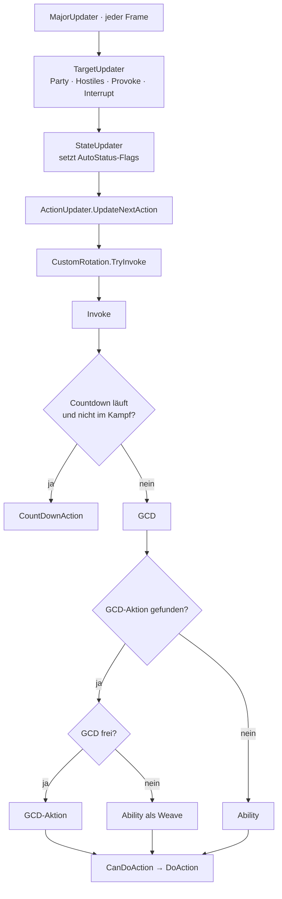

# 03 · Was bei allen Jobs identisch oder ähnlich ist

Diese Ebene beschreibt das, was *kein* Job selbst besitzt, sondern was ihm die
zentrale Maschinerie vorgibt — plus die Muster, die zwar in jedem Job einzeln
stehen, aber überall gleich aussehen.

**Die Reihenfolge der Zweige ist die umgesetzte Antwortordnung.** Was `08-mitigation-synergy.md`
als Vorgabe führt — Heilung vor Minderung —, steht hier als Dispatch-Reihenfolge: Die
Heilzweige werden vor den Verteidigungszweigen gefragt, und beide vor dem Angriff. Wer eine Regel
dieser Familie ändert, ändert entweder die Bedingung **in** einem Zweig oder die Reihenfolge der
Zweige selbst — das Zweite ist der teurere Eingriff und in C37 bereits einmal schiefgegangen.

---

## A · Der Rahmen: eine Entscheidung pro Frame



**Universelle Invariante:** Pro Frame entsteht genau *eine* Aktion. Kein Job
kann zwei Aktionen ausgeben, keiner kann die Reihenfolge des Rahmens ändern.
Jobs füllen ausschließlich Slots, sie steuern den Ablauf nicht.

**Zweite Invariante:** `StateUpdater` entscheidet *ob* ein Slot überhaupt
angefragt wird, der Job entscheidet nur *womit* er ihn füllt. Ein Job kann
eine Heilung nicht erzwingen, wenn `AutoStatus.HealSingleSpell` nicht gesetzt
ist — das ist die Ursache fast aller „warum feuert X nicht"-Fälle im
AUDIT_LOG.

**Dritte Invariante: Ein Objekt aus den Listen gilt für den Frame, in dem die Liste gebaut wurde (A309).** Gruppe,
Gegner, Flächenwirker und Ziele baut `TargetUpdater` in jedem Durchlauf neu; der Durchlauf läuft auf dem Spielthread
in einem Zug, dazwischen verschwindet kein Objekt. Über einen Frame hinaus taugt die Referenz nicht:
- Dalamud hält je Tabellenplatz und Objektart **ein** Objekt und setzt seine Adresse, sobald irgendein Plugin die
  Tabelle durchläuft (`ObjectTable.CachedEntry.Update`). Eine gehaltene Referenz zeigt danach auf den neuen Inhaber des
  Platzes; ist der Platz leer, behält sie die alte Adresse.
- `IsValid()` prüft nur, dass der Spieler geladen ist (`GameObject.IsValid`, Dalamud master, 15.10.2026), nicht das
  Objekt. Es schützt keine gehaltene Referenz; die 33 Prüfungen im Plugin sind Nullprüfungen mit dieser Zusatzbedingung.
- Spieler und Kampf-NPCs liegen in einem festen Speicherblock des Spiels (`CharacterManager.BattleCharaMemory`,
  FFXIVClientStructs). Eine veraltete Adresse liest deshalb vermutlich gültigen Speicher mit falschem Inhalt, keinen
  freigegebenen – Schluss aus dem Strukturlayout, nicht beobachtet. Upstream nennt in Kommentaren harte Abstürze an
  sterbenden Zielen (`6baba6a94`), ohne Beleg.

Was über Frames hinweg lebt, hält deshalb die Id und löst das Objekt im lesenden Frame aus der Tabelle auf
(`SearchById`): der Tankwechsel (`TankSwapWatch`), die Marker-Beobachtung, der Tankbuster-Plan für den Wirkenden des
geplanten Casts (seit A309; die Erhebung liest am Ende des Frames, der Plan im nächsten). Die Effekt-Hooks laufen zwischen
den Durchläufen und lesen die Gruppenliste des letzten; sie vergleichen erst die Id des aktuellen Inhalts mit dem Ziel
des Effekts und lesen nur dann LP oder Barriere – zeigt die Referenz auf einen anderen Spieler, passt die Id nicht. Die
Fenster lesen die Listen nur zur Anzeige.

### Was ein Frame kostet

Jeder Frame rechnet die ganze Entscheidung neu: Ziele, Flags, die GCD-Kette und im Einschiebefenster die
Fähigkeitenkette, je `CanUse` die Zielsuche über alle Kandidaten. Gemessen sind im Mittel 1,55 bis 3,63 ms je
Durchlauf, 7 bis 15 % der Framezeit, Spitzen bis 70 ms in einem Critical Engagement (Protokolle 16. und 17.10.2026,
A286, A299). Was davon trägt, sagt seit A310 die Kostenzeile je Schritt nach jedem Kampf.

Drei Regeln halten die Kosten eines Frames unabhängig davon, wie oft eine Frage gestellt wird (A325):
- **Keine Suche in der Objekttabelle pro Eintrag oder pro Lesen.** `SearchById` und `Status.SourceObject` laufen
  linear über jeden Platz der Tabelle (Dalamud, `ObjectTable.SearchById`); ein fehlendes Objekt kostet die ganze
  Tabelle. Was eine Schleife oder eine oft gelesene Abfrage von Objekten wissen muss, wird einmal je Frame erhoben
  (`StatusHelper.IsFromPlayer`: die Objekte des Spielers für die Prüfung „vom Spieler") oder nach dem billigen Test
  gefragt (`IsOwnPartyMarker` erst nach dem Pfad des Markers; „vom Spieler" erst für einen Status mit gesuchter Id, wie
  Upstream seit 7.5.7.10 fragt, A434).
- **Erkennen, wo die Tatsache entsteht.** Ein Effekt ist ein Marker oder keiner, wenn er entsteht; die Warteschlange
  nimmt nur auf, was ein Leser abfragen kann (`DataCenter.IsTrackedVfxPath`, seit 7.5.7.10 von Upstream: die vier
  Markerlisten und jeder Lock-on-Effekt; das Spiel legt jeden Marker des Blatts `Lockon` unter `vfx/lockon/eff/` ab,
  A434). Vorher standen dort alle Effekte aller Figuren fünf Sekunden lang, und jeder Leser lief bei jedem Lesen
  über alle – im Critical Engagement die Skill-Effekte von 48 Spielern.
- **Eine Antwort aus der Historie einmal je Frame und Mitglied.** Für ein Gruppenmitglied läuft `GetTTK` über die
  ganze Gesundheitshistorie der Gruppe (240 Proben); die Heilzielwahl fragt es mehrmals je Mitglied. Es merkt sich die
  Antwort für den Frame, eine neue Probe verwirft sie (`ObjectHelper.ForgetTimeToKill`). Für Gegner liest es seit
  Upstream 3c6ce9ee2 die Rate aus `TimeToKillTracker`, einen Wörterbuchzugriff ohne Lauf über eine Historie (A341).

Woher die Kosten kamen: Upstream speichert alle Effekte und prüft die Herkunft eines Status über die Objekttabelle; der
Fork hat beides vervielfacht – die Gruppenprüfung der Marker (A220) vor den Pfadvergleich gesetzt, jede Regel mit
Statusabfragen mehr Lesungen. Sein Verdacht, Sonderfälle als eigene Abfragen trieben die Rechenlast, trifft damit die
Form, nicht die Zahl der Regeln: Teuer war, was bei jedem Lesen neu sucht, nicht dass es viele Regeln gibt.

**Nicht umgestellt, mit Grund:**
- *Die Erkennungsabfragen von `DataCenter` je Frame merken* (`IsHostileCastingAOE`, `AreaHitAnnounced` und
  Verwandte): Nach dem Filter laufen sie über wenige Marker und die Wirkenden; A310 hat das Merken öffentlicher
  Eigenschaften ohne Beleg verworfen, und ein Beleg liegt nicht vor.
- *`HostileTarget` je Frame merken:* eine Suche bis zu den Gegnerplätzen je Lesen; eine zeitbasierte Merkhilfe könnte
  über die Frame-Grenze greifen, wovor die dritte Invariante warnt.
- *Dalamuds Statuslisten:* Jeder Zugriff legt eine Liste und je Status ein Objekt an. Kurzlebiger Müll, den die
  Bereinigung der jüngsten Generation räumt, ohne ihn weiterzureichen – Schluss aus der Lebensdauer, nicht gemessen; ob
  eine Bereinigung mit der langsamsten Runde zusammenfällt, zeigt die Kostenzeile.
- *Die Zielsuche je `CanUse`* (Upstreams Aufbau): ein Umbau des Kerns ohne Messung, welcher Teil trägt.

**Gemessen nach dem Umbau** (sein Protokoll vom 18.10.2026, Build 274ef44de, 84 Kämpfe in Vierer-Instanzen): im
Mittel 1,56 ms je Durchlauf, 9,2 % der Framezeit. Davon trägt die Hotbar-Anzeige („highlight") 1,04 ms, die
Rotationsentscheidung mit allen Sonderregeln 0,32 ms, die Flags 0,05 ms. Die Regeln sind damit nicht mehr der größte
Posten.

**Die Hotbar-Zeit war die Rotfärbung gesperrter Aktionen** (seine Protokolle vom 19.–22.10.2026, A334): Getrennt als
„hotbar tint" kostete sie 0,78 ms je Durchlauf (Build e012fbcd7, 225 Kämpfe, im Mittel 1,24 ms, 7,9 %). Sie baute
in jedem Bild die Aktionsliste der Rotation neu (`CustomRotation.AllActions` legt bei jedem Lesen eine neue Liste
an). Upstream 7.5.7.5 liest dort die einmal gebaute Liste (`RotationUpdater.CurrentRotationActions`). Seitdem kostet
sie 0,04 ms, und ein Durchlauf im Mittel 0,48 ms, 3,3 % der Framezeit (Build 01048265d, 59 Kämpfe). Den Rest trägt die
Rotationsentscheidung mit 0,22 ms. Einmalige Spitzen bis 474 ms fielen in den ersten Kampf nach dem Start („rotation
load" 397 ms), ohne Bereinigung. Eine Messung im Critical Engagement nach dem Umbau liegt nicht vor.

**Prüfgrad:** statisch am Code und an Dalamuds Quelltext (master, 17.10.2026); Compile im CI-Lauf; Kostenzeilen
seines Protokolls vom 18.10.2026. Die Annahme über die Zahl der Effekte im Critical Engagement ist ein Schluss, nicht
gemessen.

### „Vom Spieler" heißt auch: von einem Objekt, das ihm gehörte

**Sachstand:** `StatusHelper.IsFromPlayer` zählt einen Status als vom Spieler, wenn seine Quelle der Spieler ist oder
ein Objekt, das ihm in diesem Gebiet gehört hat, auch wenn es nicht mehr da ist. Die Ids erhebt
`StatusHelper.NoteOwnedObjects` einmal je Frame aus dem Update, direkt nach den Zielen (`MajorUpdater`), und behält sie
bis zum Gebietswechsel; eine Statusabfrage außerhalb des Updates erhebt selbst, wenn die letzte Erhebung älter als ein
Frame ist. Je Frame statt nur bei Bedarf, damit auch ein Begleiter gesehen wird, der nur zwischen zwei Statusabfragen
lebt. Eine Id, unter der die Tabelle ein Objekt eines anderen Besitzers zeigt, fällt heraus.

**Anlass, seine Meldung (03.11.2026):** „ich caste am anfang als smn schimmerschild und dann obwohl es noch da ist, vor
schadenseingang nochmal" – die Doppelzündung, die A9 als einen der ersten Fehler des Forks behoben hatte.

**Ursache, an seinem Mitschnitt belegt** (ACT und `DefenseTrace.log` vom 03.11.2026, Build a885b43bf): Den Schild legt
Karfunkel, nicht der Beschwörer; Quelle des Status Schimmerschild (2702) ist das Objekt Karfunkel. Jede Beschwörung
ersetzt Karfunkel durch ein neues Objekt mit neuer Id, die Demi (Sol-Bahamut) ebenso wie die Primae (Topas-Titan). Danach
gehört die Quelle des stehenden Schilds keinem Objekt des Spielers mehr: Die Prüfung `SourceObject?.OwnerId == playerId`
(Upstream; im Fork seit A325 über die Ids je Frame) findet das alte Karfunkel nicht und zählt den Schild als fremd.
Jede Frage „vom Spieler" sieht dann keinen Schild: die Sperre über `StatusProvide` in `CanUse`,
`RadiantAegisDueBeforeDemi` und `BMRShouldRefreshBefore`. Am 03.11.2026 dreimal:

| Kampf | Erster Schild | Karfunkel ersetzt | Zweiter Schild | Rest des ersten |
|---|---|---|---|---|
| Thordan (Extrem) | 18:09:16, BossModReborn-Raidwide | Topas-Titan 18:09:25, neues Karfunkel 18:09:30,9 | 18:09:31, Einzelabwehr | 15,2 s |
| Shinryu (Unreal), Lauf 1 | 19:00:41, vor der Demi | Sol-Bahamut 19:00:44, neues Karfunkel 19:00:59,6 | 19:01:00, Flächenabwehr, 0,8 s vor Gaias Zorn | 11,8 s |
| Shinryu (Unreal), Lauf 2 | 19:13:29, vor der Demi | Sol-Bahamut, neues Karfunkel vor dem zweiten Schild | 19:13:45, Flächenabwehr, 1,6 s vor Gaias Zorn | 14,3 s |

Im Kampf: Die zweite Ladung geht auf einen Schild, der noch steht, und fehlt bei der nächsten Gefahr – die Folge, die
A9 benennt („bei echter Gefahr war keine mehr da"). In beiden Shinryu-Läufen gemessen: 24 und 25 s nach dem zweiten
Schild kam Flutwelle, bewertet mit 68 und 79 % ungemindert, traf ihn mit 75 und 63 %, und die Flächenabwehr fand
keinen Schild („refused before: Schimmerschild (Cooldown)").

**Warum A9 das nicht traf:** A9 entfernte einen Zweig ohne Gefahrenbedingung. Hier ist die Gefahr echt, aber der Blick
auf den eigenen Schild blind. Die Lage entsteht durch den Wechsel des Begleiters, und der Schild vor der Demi (Konzept 12,
„Der Schimmerschild geht vor") macht sie zur Regel: Er geht genau vor dem Wechsel hinaus.

**Die Klasse:** jeder Status, den ein Begleiter, eine Beschwörung oder ein anderes Objekt des Spielers legt und der das
Objekt überdauert. Gemessen ist Schimmerschild. Gleich gebaut, nicht gemessen: die Status der Fee des Gelehrten, wenn
sie abgelöst wird, und die Begleiter des Beastmasters beim Wechsel. Die Korrektur sitzt deshalb an der einen Stelle, die
„vom Spieler" beantwortet, nicht beim Beschwörer.

**Wiederverwendung einer Id:** In beiden Mitschnitten stiegen die Ids der Begleiter innerhalb einer Instanz streng an;
dass das Spiel eine Id nie wiederverwendet, ist damit nicht belegt. Deshalb gilt die Erinnerung nur bis zum
Gebietswechsel, und eine Id, unter der die Tabelle das Objekt eines anderen Besitzers zeigt, wird gestrichen. Ein
fremder Status zählte nur dann als eigener, wenn seine Quelle eine wiederverwendete Id trägt und schon wieder
verschwunden ist, bevor eine Erhebung sie sah.

**Ausgeschlossen:**
- *Nur Schimmerschild umstellen* (`StatusFromSelf = false`): Auf dem Beschwörer kann nur sein eigenes Karfunkel den
  Schild legen, für diese eine Aktion wäre es richtig. Die Klasse bliebe offen.
- *Jeden Status ohne auffindbare Quelle als eigenen zählen:* Auch fremde Begleiter verschwinden; ein Debuff am Gegner
  von einem fremden, schon fortgerufenen Begleiter würde zum eigenen.

**Was im Kampf anders wird:** Nach einer Beschwörung sieht RSR den stehenden Schild weiter. Eine zweite Ladung geht erst,
wenn der Schild innerhalb der Auffrischungsspanne endet (`StatusRefreshGcdCount`) oder fehlt; die Ladung bleibt für die
nächste Gefahr. Schlechter wird nichts, was RSR vorher richtig sah: Die Erinnerung erweitert „vom Spieler" nur um
Objekte, die nachweislich seine waren. Kosten: ein Lauf über die Objekttabelle je Frame mit einem Mengenzugriff je
Objekt; vorher lief dieselbe Erhebung, sobald eine Abfrage einen Status fremder Quelle traf, in einem Kampf also
ebenfalls fast jeden Frame (Schluss).

**Messmittel:** Der nächste Mitschnitt zeigt es ohne neue Zeile. Steht im ACT-Mitschnitt ein zweiter Schimmerschild,
während der erste noch läuft, nennt die `DefenseTrace.log` den Pfad, der ihn gewählt hat.

**Prüfgrad:** Ursache am Mitschnitt (ACT: Quelle des Status, Wechsel der Objekte; `DefenseTrace.log`: Pfad der zweiten
Zündung) und am Code; die Korrektur statisch und im Compile, im Spiel noch nicht beobachtet.

---

## B · Die Slot-Kette (identisch für jeden Job)

```
GCD()                                    Ability()
─────────────────────────────────        ─────────────────────────────────
 1  CommandNextAction (GCD)               1  NoCasting-Sperre
 2  NoCasting-Sperre                      2  Einschiebesperre (GCD ≤ 0,5 s)
 3  Kanal-/Wirksperren (Orbonne, PLD,     3  Kanal-/Wirksperren (Orbonne, PLD,
    AST, BLU, NIN-Mudra, PvP)                AST, BLU)
 4  EmergencyGCD                          4  CommandNextAction (oGCD)
 5  MyInterruptGCD                        5  NIN-Mudra-, PvP-Sperre
 6  DispelGCD                             6  Befohlener Gegenstand
 7  ProvokeGCD                            7  UseAbility aus / Wirken läuft / Fesselung
 8  RaiseSpell   (wenn RaisePlayerFirst)  8  EmergencyAbility
 9  MoveForwardGCD                        9  Tankbuster-Plan (nur Tanks, Option):
10  HealAreaGCD                              Minderung nach Bedarf oder Unverwundbarkeit
11  HealSingleGCD                        10  Tankwechsel (nur Tanks, Option):
12  DefenseAreaGCD                           Shirk auf den Co-Tank, dann Zurückprovozieren
13  DefenseSingleGCD                     11  InterruptAbility
14  RaiseSpell   (sonst)                 12  DispelAbility
15  GeneralGCD                           13  Shirk (befohlen)
16  Heilung ohne Anlass                  14  TankStance
    (HealWhenNothingTodo)                15  AntiKnockback
                                         16  TrueNorth / Positional
                                         17  HealAreaAbility
                                         18  HealSingleAbility
                                         19  SpeedAbility (nur befohlen)
                                         20  ProvokeAbility
                                         21  DefenseAreaAbility
                                         22  DefenseSingleAbility
                                         23  MoveForward / MoveBack
                                         24  HP-Potion
                                         25  Phönixfeder
                                         26  AttackAbility
                                         27  GeneralAbility
                                         28  MP-Potion · GeneralUsing · Speed
```

**Befohlene Aktionen mit Ziel (Upstream 7.5.6.22, A264):** Ein DoActions-Befehl oder ein abgefangenes Makro kann ein
Ziel tragen – einen Platzhalter wie `<t>`, `<2>`, `<mo>` oder eine Zielart wie `<LowHP>`. Solange der Befehl in der
Warteschlange steht, gilt ein Objektziel für jede Zielsuche dieser Aktion, auch für einen Druck derselben Aktion aus
einem anderen Pfad und vor jeder Zielüberschreibung (`ActionTargetInfo.FindCommandObjectTarget`); ausgenommen sind
Aktionen ohne Reichweite und Wirkradius, die immer auf dich gehen. Eine Zielart ersetzt die Zielart der Aktion und eine
Zielüberschreibung, nicht aber „du selbst". Ist das Objektziel nicht erreichbar, sucht RSR wie bisher.

Der Tankbuster-Plan (9) und der Tankwechsel (10) sitzen hinter `EmergencyAbility`,
damit eine Unverwundbarkeit, die an ihrer Schwelle zündet, vorgeht, und vor allem anderen, weil beide an einem
Tankbuster hängen (Konzept 09, „Gemessener Tankbuster: das geringste Mittel" und „Tankwechsel nach einem
Tankbuster"). Der Plan drückt die Minderungen, die ein gemessener Tankbuster braucht, oder die Unverwundbarkeit, und
steht vor dem Wechsel, der hält, solange sie bereit ist. Beide haben keinen
befohlenen Eingang; Shirk (13) läuft weiterhin nur auf Befehl. Solange der Plan zurückhält (Konzept 09, „Wann
zurückgehalten wird") oder Heiliger Boden oder Meteoritenfall den Treffer abhalten, lehnt `BaseAction.CanUse` für Tanks
in jedem Slot bewertete Abwehr auf den Spieler ab, die der Plan nicht freigibt; frei bleiben die Heilslots, Hilfe für
andere, in der Flächenabwehr (21), was über ihn hinaus wirkt, und das Befohlene.

In jedem Slot fragt der Dispatcher zuerst die Duty-Rotation (`DataCenter.CurrentDutyRotation`), dann den Job. Die
Heil-, Abwehr-, Bewegungs- und Rückzugsslots haben je zwei Eingänge: zuerst den befohlenen (`CommandStatus`), dann
den automatischen (`AutoStatus` beziehungsweise `MergedStatus`).

Beide Ketten sind **fest verdrahtet** und für alle Jobs gleich. Zwei
Konsequenzen, die im ganzen AUDIT_LOG immer wieder auftauchen:

- Alles oberhalb von `GeneralGCD` kann `GeneralGCD` **aushungern**. Ein
  gesetztes Heil-Flag verhindert dauerhaft, dass ein Zweig in `GeneralGCD`
  jemals drankommt — unabhängig davon, wie wichtig er ist.
- Wer proaktive Logik in `GeneralGCD` platziert, muss sie in `HealAreaGCD` und
  `HealSingleGCD` **wiederholen**, sonst greift sie im Heilfall nicht. Genau
  das war die Ursache der „HoT wird nicht aufrechterhalten"-Meldungen.

### Status, unter denen nicht gehandelt werden soll („No-casting debuffs")

Die Liste `OtherConfiguration.NoCastingStatus` hat in der Oberfläche den Text „Do not take action if you have one of
these debuffs". Ihr Leser ist nicht die NoCasting-Sperre der Slot-Kette (die hängt an der Stopp-Liste gegnerischer
Casts), sondern der Druck selbst (`RSCommands_Actions`, `CancelCastUpdater`, `AutoAttackUpdater`). Die Liste enthält
zwei Arten, und RSR behandelt sie getrennt (A338):
- *Schaden bei jeder Aktion* (Pyretic in fünf Fassungen, seit Upstream 42cb3a7dd auch Causality, 514): kein Druck,
  solange der Status liegt, und ein laufender Zauber wird abgebrochen. Erkannt am eigenen Wirktext des Status im
  englischen Blatt des Clients, gleich welche Sprache er zeigt: „with every action" (Pyretic, alle sechs Zeilen des
  Spiels) oder „each time an action" (Causality) – in den Spielblättern vom 24.10.2026 trifft das genau diese sieben
  Zeilen (`NoCastingStatusHelper.DamagesEveryAction`). Kein Feld der Blätter trennt die Arten.
- *Strafe beim Ablauf* (Acceleration Bomb, Extreme Caution, Glossomorph, Flesh Forward und Back, Directed Grotesquerie,
  Buyer's Remorse): kein Druck und Abbruch erst, wenn der Status in weniger als 3 s endet
  (`NoCastingStatusHelper.ResolveWindow`, Upstream); ein Status ohne Restzeit zählt als endlos und sperrt so nie.
- Auto-Angriffe ruhen, solange irgendein gelisteter Status liegt. Daneben sperren eigene Wege den Druck für die ganze
  Dauer: Motion Tracker und BossModReborns Sondermodus Pyretic.

Im Kampf: Unter Pyretic oder Causality steht RSR, wie der Text der Liste sagt und wie die Mechanik es verlangt, auch ohne
BossModReborn-Modul. Ein Heiler heilt in dieser Zeit nicht; jede Heilung kostete ihn selbst Leben. Bis A338 drückte RSR
unter Pyretic bis 3 s vor dem Ende weiter, unter Causality und den Fassungen ohne Restzeit immer.

**Vor der Landung** (A439). Ein Status, der jede Aktion bestraft, kommt mit dem Treffer, und eine Aktion, die in diesem
Augenblick noch läuft, nimmt den Schaden sofort; die Sperren oben lesen den liegenden Status und kommen dafür zu spät.
`ActionPenaltyWatch` beantwortet die Zeit davor, für alle Jobs, außer im PvP:
- *Lernen:* Legt die Landung eines Wirkens einem Gruppenmitglied oder ihm einen solchen Status der Liste an (Effektart
  „Status auf Ziel“ mit der Status-Id, erkannt wie oben über `DamagesEveryAction`), ist das Wirken gelernt, gleich auf
  wen es fiel. `ActionPenaltyCasts.json` hält je Aktion den gelegten Status, über alle Sitzungen, gespeichert wie die
  übrigen gelernten Tabellen (Zusammenführung mit der Datei, nie ungeladen geschrieben, unlesbar als `.corrupt` beiseite).
  Die erste Sichtung schreibt „learned: …“ ins `DefenseTrace.log`, die Kopfzeile zählt die Einträge.
- *Widerlegen* (Konzept 13, „Stufe 4", 4c): Ein gelerntes Wirken hält Zauber, bis die laufende Spielversion es
  mindestens zweimal auf seinem Ziel, einem Mitglied, ohne den Status landen sah, öfter als es ihn früher legte, und nie
  mit ihm; dann hält es nichts mehr, bis es ihn wieder legt. `ActionPenaltySightings.json` hält die Zählungen.
- *Erkennen:* Jede gegnerische Figur, Helfer eingeschlossen, die ein gelerntes Wirken castet, dessen Status noch in der
  Liste steht – auf ihn oder in einer Gestalt, die ihn erreicht (`DataCenter.CastReachesPlayer`). Verschwindet der Balken
  mindestens eine Aktualisierung vor seinem Ende, war das Wirken gestoppt (unterbrochen, Wirker tot) und landet nicht.
  Endet er an seinem Ende, gilt die Landung als sofort, bis sie gesehen ist oder einen GCD danach ausbleibt; ein dort
  abgebrochenes Wirken ist von einer späten Landung nicht zu unterscheiden. Dazu BossModReborns bevorstehender Sondermodus Pyretic
  (`Hints.SpecialModeIn`).
- *Entscheiden:* Gemessen wird mit der Laufzeit eines Drucks bis zum Server (`TankbusterForecast.RoundTrip`). Kein Zauber
  wird gewählt, der bei der Landung noch liefe (`ActionBasicInfo.NeedsCasting`, Wirkzeit nach Zaubertempo und
  Spontaneität). Kein Druck, dessen Aktion samt Wirkzeit dann noch liefe (ein GCD wird vor seinem Druck gewählt, und die
  Landung ist seitdem näher), und kein Auto-Angriff innerhalb der Laufzeit. Ein laufender eigener Zauber, der dann noch
  liefe, wird abgebrochen (`CancelCastUpdater`). Was vorher fertig wird, läuft; sofort wirkende Aktionen gehen bis zur
  Laufzeit vor der Landung.

Im Kampf, am Fall vom 26.10.2026 (A427, ACT-Mitschnitt): „Heißes Herz“ (#43322, 4,7 s, Pilgerpfad) landete um 21:09 auf
einem Mitglied – die Landung trägt #960 als Effektart 0x0E – und tötete es; RSR hätte das Wirken dort gelernt. Um
21:15:51 begann es auf ihn, und RSR begann 0,8 s vor der Landung Wirbelströmung (3 s); Pyretisch traf mit rund 1,03 Mio.
Mit der Regel beginnt ab drei Sekunden und Laufzeit vor der Landung kein Wirbelströmung mehr, an seiner Stelle eine
sofort wirkende Aktion oder keine; nach der Landung hält die Sperre oben. Preis: je Landung höchstens die Wirkzeit eines
Zaubers ohne Zauber, und ein Wirken auf ihn, das erst am Balkenende abbricht, hält bis einen GCD danach alles an. Am
Abend galt das Wirken dreimal ihm: einmal gelandet, einmal am Balkenende abgebrochen, einmal nach 1,8 s unterbrochen –
das gibt sofort frei.

Grenzen: Die erste Landung eines unbekannten Wirkens trifft ungehindert, wenn kein BossModReborn-Modul den Sondermodus
meldet; gelernt wird aus ihr, auch auf einem Mitglied. Im Quelltext von BossModReborn (ae64e33 vom 20.10.2026, am
29.10.2026 der Stand des Remotes) setzt ein einziges Modul `SpecialMode.Pyretic` (Cloud of Darkness, Chaotic); die
Module des Pilgerpfads kennen „Heißes Herz“ nicht. Die Liste „No-casting debuffs“ ist der
Schalter: Ein Status, der aus ihr entfernt wird, wird weder gelernt noch erwartet; eine eigene Option gibt es nicht, weil
die Regel einen belegten Tod behebt.

Ausgeschlossen: die Stoppliste gegnerischer Casts (`DataCenter.IsHostileStop`, ab Werk aus, von Hand gepflegt; sie
hielte jede Aktion für die ganze Wirkdauer, auch sofort wirkende und solche, die vorher fertig sind); ein festes Fenster vor
der Landung wie `PyreticThreshold` in BossMod (ffxiv_bossmod, ab Werk 1,0 s, Stand 4707e49c2 vom 28.10.2026): Es kennt
die eigene Wirkzeit nicht, ein Zauber, der davor beginnt, wird im Fenster abgebrochen, und sein GCD ist verloren.

Die Liste lädt aus Upstreams Repository und nur, wenn die Datei im Konfigurationsordner fehlt oder die Liste
zurückgesetzt wird; ein neuer Eintrag von Upstream erreicht eine bestehende Datei nicht von selbst.

---

## C · Muster, die in jedem Job wiederkehren

### C1 · Level-Kette

Immer dieselbe Form:

```
if (  HöchsteStufe.EnoughLevel &&  HöchsteStufe.CanUse(out act)) return true;
if ( !HöchsteStufe.EnoughLevel &&  MittlereStufe.CanUse(out act)) return true;
if ( !MittlereStufe.EnoughLevel && Basisstufe.CanUse(out act))   return true;
```

Zwei eingebaute Fehlerquellen:

1. Der linke Teil `X.EnoughLevel && X.CanUse` ist **redundant** —
   `ActionBasicInfo.BasicCheck` prüft `EnoughLevel` bereits selbst und bricht
   ab. Gezählt am 02.10.2026: 56 Vorkommen, davon 44 außerhalb von `ExtraRotations`.
2. Der Ausschluss der höheren Stufe wird **von Hand** geschrieben und mal als
   `!X.EnoughLevel`, mal als `!X.Info.EnoughLevelAndQuest()` formuliert. Beide
   Varianten kommen nebeneinander vor. Genau hier entstand der bereits
   behobene RDM-Fehler `!EnoughLevel && EnoughLevel`.

### C2 · Sustain-Zweig (proaktives Aufrechterhalten)

Seit der Vereinheitlichung überall identisch aufgebaut:

```
Auslöser (BMR-Vorhersage ODER Gegneranzahl)  →  Dauer-Prüfung  →  CanUse
```

Zentral als `ShouldSustainMitigationDebuff(...)` für Addle/Feint/Reprisal,
job-eigen als `TrySustain…OnTank(...)` bei den Heilern. Vorher: 25 bzw. 9
Kopien.

### C3 · AoE-vs-ST-Verzweigung

**Die Schwelle steht an der AoE-Aktion selbst** (26.10.2026, A391): Die Jobs entscheiden über `AoeCount` im
Zielsystem; wo eine Rotation selbst zählt, liest sie Reichweite und AoE-Zahl der Aktion, deren Treffer die Frage
beantwortet, oder vergleicht die Potenzen aus den Tooltips.

| Ort | Jobs | Mechanik |
|---|---|---|
| implizit über `AoeCount` in `CanUse` | alle | Zielsystem entscheidet |
| Weiche über die AoE-Kombo | Samurai: AoE-Iaijutsu, wenn so viele Gegner im Radius von Fuko (darunter Fuga) stehen, wie dessen AoE-Zahl verlangt (`AoeComboReaches`); Ogi Namikiri im AoE-Zweig, wenn er selbst mehr als einen trifft | dieselbe Menge und Schwelle wie das Zielsystem der Kombo |
| Potenzvergleich | Dunkelritter: Abyssal Drain statt Carve and Spit, wo er auf den Getroffenen mehr bringt (`ActionTooltip.AreaOutdamagesSingle`, ab Werk ab 3); dazu Auto Crossbow, Hellfrog, Foul (A342–A345) | Tooltips zur Laufzeit, AoE-Zahl als Untergrenze |
| eigene Zählung mit Absicht | Monk: Perfect Balance für AoE ab zwei Gegnern in 3 Yalm („position yourself in the centre of the mobs") | bleibt; er spielt den Monk bislang nicht |

Vorher zählte der Samurai in Nahkampfreichweite (3 Yalm) statt im Radius seiner Kombo (5 Yalm), der Dunkelritter
verlangte drei Gegner um sich zusätzlich zu zwei um das Ziel von Abyssal Drain. Viper und Blaumagier zählen nicht mehr
selbst (nur noch „ein Gegner in Reichweite").

**Die Gestalt der Zählung im Zielsystem:** Ein Kreis zählt um das Ziel, ein Kegel vom Spieler zum Ziel hin (Halbwinkel
60°, das Spiel nennt ihn nicht), eine Linie mit Ziel vom Spieler zum Ziel hin, so breit wie ihr `XAxisModifier` – der
Einsatz dreht den Spieler zum Ziel, und BossMods Autorotation misst sie ebenso (A399). Eine Gestalt ohne Ziel, die der
Spieler vor sich wirft (Reichweite 0: Flamethrower, Surpanakha, Apokalypsis), zählt in seiner Blickrichtung. Betroffen
von der Linie: Doom Spike, Draconian Fury und Coerthan Torment (Dragoon), Chain Saw (Maschinist), Apex Arrow und Blast
Arrow (Barde), Shadowbringer (Dunkelritter), Enlightenment (Monk) – mit gleicher AoE-Zahl nimmt die Zielwahl dann das
Ziel, dessen Linie die meisten trifft.

### C4 · Ranged-Fallback am Ende von `GeneralGCD`

Tanks und Nahkämpfer: letzter Zweig vor `base.GeneralGCD`. Gezählt am 02.10.2026 in neun Reborn-Rotationen; der
Mönch hat keinen. Bei den vier Tanks und beim Schnitter gilt nur das eigene `CanUse`. Eigene Bedingungen haben der
Samurai (nicht in den ersten 15 GCDs eines High-End-Kampfs, `CombatElapsedLessGCD(15)`), der Ninja (nicht während Mudra), der Dragoon (nicht direkt nach
`WingedGlidePvE`) und die Viper (Option `UFGhosting`).

### C5 · Kurzschluss ganz oben

Heiler: Swiftcast+Raise. Melee: Combo-Rettung. Struktur identisch — *verlasse
die Methode, bevor Rotationslogik läuft* —, Formulierung jedes Mal neu.

---

## D · Was tatsächlich zentral gelöst ist (Positivliste)

Damit der Umbauvorschlag in `04-concept.md` nicht Dinge „zentralisiert", die
es schon sind:

| Bereich | zentraler Ort |
|---|---|
| Zielauswahl inkl. AoE-Zählung | `ActionTargetInfo.FindTarget` |
| Nutzbarkeitsprüfung (Level, MP, Combo, Status, Cooldown, TTK) | `BaseAction.CanUse` → `ActionBasicInfo.BasicCheck` |
| Flag-Erzeugung (wann wird geheilt/mitigiert) | `StateUpdater` |
| Statusdauer-Rechnung | `StatusHelper.WillStatusEnd*` |
| BMR-Vorhersage-Zugriff | `CustomRotation_OtherInfo.BMR*` |
| Rollen-Standards (Interrupt, Anti-Knockback, True North, Potions) | `CustomRotation_Ability` |
| Mitigations-Sustain | `ShouldSustainMitigationDebuff` |

**Das Ziel einer Aktion stammt aus ihrem `CanUse`.** `CanUse` sucht das Ziel und legt es in `X.Target` ab; eine
Lesung von `X.Target` ohne `X.CanUse` in derselben Entscheidung bekäme das Ziel des letzten Erfolgs, anfangs keines.
Gemessen am 26.10.2026 (A415), jede Lesung im Baum außer Churin: In `RebornRotations` und `RotationSolver.Basic` liest
jede Stelle das Ziel eines `CanUse` derselben Entscheidung, meist im Zweig gleich danach; einzige Ausnahme ist die
Anzeige des Gelehrten (`ScholarRotation.DisplayBaseStatus`), ohne Wirkung im Kampf. Der Tänzer überschreibt das Ziel
von Closed Position nach `CanUse` bewusst mit dem benannten Partner. Vor `CanUse` lesen nur die fremden Heiler
BeirutaAST, BeirutaWHM und BeirutaSGE, an 17 Stellen (TODO, technische Schuld). Eine seiteneffektfreie Zielabfrage
braucht der eigene Code deshalb nicht.

---

**Burst-Arznei nur im Kampf oder im Countdown** (`CustomRotation.UseBurstMedicine`, A433): Außerhalb des Kampfes
verweigert die Methode jede Tinktur, solange kein Countdown läuft. Im Kampf: Wartet die Gruppe ohne Countdown am Boss
oder zwischen zwei Rudeln, trinkt keine Rotation die Tinktur. Vorher konnte sie es, wo ihr Auslöser nur fragt, ob eine
Burst-Fähigkeit bereit ist – Presence of Mind, Divination, Serpent's Ire, Technical Step –, denn bereit ist sie außerhalb
des Kampfes ebenso; die Tinktur hielte dann nicht bis in den Burst und sperrte jede Arznei für ihre Wiederverwendung. Die Tinktur im Countdown (Restzeit unter der Schwelle der Rotation) geht
wie vorher, weil der Countdown dieselbe Uhr liest (`Service.CountDownTime`). Upstream hat die Lücke in drei Rotationen
geschlossen (Weißmagier, Viper, Tänzer, f1ef35ea1); die Methode trägt die Regel für jeden Aufrufer, auch für Astrologe,
Weiser, Gelehrter, Schwarzmagier und die fremden Rotationen, die ohne Kampfprüfung riefen.

**Tinktur nur in schwierigen Kämpfen, dort in jeder Burstphase, in der sie nutzbar und vorhanden ist** (seine Vorgabe
und Präzisierung, 03.11.2026, A500, A501). *Wozu:* Eine Tinktur soll helfen, einen schwierigen Kampf zu überstehen und
merklich schneller zu beenden; sie kostet Geld, und sie für einen gewöhnlichen Kampf zu verschwenden, ist nicht klug
(seine Worte). Daraus folgen zwei Fragen mit getrennten Antworten:
- *Wo:* „Tincture usage" je Job – nie, nur High-End (ab Werk), überall. High-End ist, was das Spiel so markiert
  (`ContentFinderCondition.HighEndDuty`, xivapi 03.11.2026): 14 Inhalte – die Ultimates, der Chaotic-Raid, die vier
  Savage-Kämpfe der laufenden Stufe, die laufende Extreme- und Unreal-Prüfung. Das trifft „schwierig": Ältere Savage- und
  Extreme-Kämpfe gleichen die Gegenstandsstufe nicht an (`ItemLevelSync` 0 bei allen Savage- und Extreme-Kämpfen von
  7.x außerhalb der laufenden Stufe; Mindeststufe etwa 690 bis 740), also kämpft man dort mit der heutigen Ausrüstung,
  und der Kampf ist leichter, als er gedacht war; Ultimates und Unreal gleichen an und bleiben schwer. Dungeons, Prüfungen
  und Raids der normalen Stufe, die offene Welt und die Trainingspuppe sind gewöhnliche Kämpfe: keine Tinktur. Upstreams
  Ausnahme für die Trainingspuppe unter „nur High-End" ist entfernt (A501) – auf ihr wird nichts überstanden und nichts
  beendet; wer einen Burst mit Tinktur an der Puppe üben will, stellt „überall" ein. *Grenze:* Die Savage-Dungeons
  („Criterion") trägt das Spiel nicht als High-End; dort trinkt RSR ab Werk keine Tinktur.
- *Wann:* in jeder Burstphase des Jobs, in der sie nutzbar und vorhanden ist. Im Kampf: In einem Savage-Kampf von
  acht bis zehn Minuten sind das zwei Tinkturen (Pull und sechste Minute; Wiederverwendung 300 s). Revolverklinge,
  Dunkelritter und Barde tranken dort nur die im Countdown, die zweite nie; Maschinist und Viper tranken gar keine, weil
  ihr eigener Schalter ab Werk aus stand. Gerade dort, wo die Tinktur ihr Geld wert ist, fehlte sie also.
- *Entfernt* sind die Schalter der Rotationen, die dieselbe Frage ein zweites Mal stellten: beim Beschwörer „Use potion",
  „Potion timing" und „Only use potion during a big summon" (Upstream 444388102), beim Weißmagier „Use Tincture/Gemdraught
  when about to use Presence of Mind", bei der Viper „Experimental Pot Usage", beim Maschinisten „Use burst medicine in
  countdown". Mit Viper und Maschinist ab Werk aus trank keiner von beiden je eine Tinktur. „Ab dem zweiten Searing
  Light" brachte nie mehr Tinkturen ins Fenster als das erste (Wiederverwendung 300 s, Item 44165 `Cooldowns`: Fenster
  bei 0, 6, 12 Minuten gegen 2, 8, 14).
- *Neu im Kampf*, wo die Rotation sie nur im Countdown trank: Revolverklinge unter No Mercy, Dunkelritter im
  Zwei-Minuten-Fenster (`InTwoMIsBurst`), Barde unter seinen Buffs (`InBurstStatus`), Maschinist unter Wildfire; die Viper
  weiter 5 s vor Serpent's Ire, jetzt mit erlaubtem Burst („Auto Burst"). Die Tinktur im Countdown bleibt, wo die Rotation
  sie hatte, beim Maschinisten unter „Auto Burst" wie vorher.
- *Begriffe* (sein Hinweis, 03.11.2026): Im Spiel heißen Heiltränke „Potion" (Kategorie „Medicine"), die Schadensbuffs
  „Gemdraught" oder „Tincture"; „pot" im englischen Spielerjargon meint die Tinktur. Upstreams „Use potion" meinte die
  Tinktur und las sich wie ein Heiltrank – auch deshalb entfernt.
- *Eine Wiederverwendung für alle Arzneien* (Spielblätter, xivapi 03.11.2026: `ItemAction.Action.CooldownGroup` 59 bei
  Tinkturen, Super- und Hyper-Potion, Super-Ether, Elixier und Phönixfeder; `Item.Cooldowns` 300, 75, 300, 300, 360 s).
  Die Arznei, die zuerst geht, sperrt die anderen für ihre eigene Zeit: eine Tinktur Heiltrank und Äther für 300 s, ein
  Heiltrank die Tinktur für 75 s. Ab Werk trinkt RSR Heil- und Manatränke nie („Use HP potions below this HP", „Use MP
  potions below this MP", aus) und Tinkturen nur in High-End-Inhalten. Die drei Einstellungstexte nennen die gemeinsame
  Wiederverwendung. Ein Tank, der in einem Dungeon mit „überall" eine Tinktur trinkt, hat bis zu fünf Minuten keinen
  Heiltrank.
- *Vorrang: Tränke warten auf die Tinktur* (Einstellung je Job „Hold HP and MP potions for the tincture", ab Werk aus;
  A502). Schaden gegen Heilung und Mana entscheidet jeder Spieler selbst (sein Hinweis und seine Präzisierung,
  03.11.2026: „die Entscheidung Sicherheit vor Schaden ist meine. andere Spieler können anders entscheiden").
  - *Aus (seine Regel):* Es geht die Arznei, deren Auslöser zuerst greift – im Burst die Tinktur, unter der Schwelle der
    Trank, auch wenn die Tinktur dann ihren Burst verpasst.
  - *An:* Heil- und Manatränke warten, solange die Tinktur käme. Das heißt: Die Rotation hat in diesem Kampf schon eine
    verlangt (`UseBurstMedicine` im Kampf gerufen), „Tincture usage" erlaubt sie hier (`CustomRotation.TinctureAllowedHere`),
    und eine Tinktur vom Typ des Jobs ist eingeschaltet und im Inventar. Ein Trank gegen einen Tankbuster auf den Spieler
    geht trotzdem: Ein Tod kostet mehr Schaden, als die Tinktur bringt, also spricht auch die Schadensabwägung für ihn.
  - *Warum ohne Burstvorhersage:* Trank und Tinktur sind nur gemeinsam frei, wenn die letzte Tinktur 300 s zurückliegt.
    Im Zwei-Minuten-Zyklus kommt der nächste Burst dann spätestens 60 s später (Tinktur bei 0, frei ab 5:00, Burst 6:00).
    Ein Heiltrank sperrt 75 s, ein Äther 300 s; jeder Trank in diesem Fenster schiebt die Tinktur also aus ihrem Burst.
    Halten, solange die Tinktur bereit ist, ist deshalb genau die Lage, in der ein Trank sie kostet. Über das Ziel hinaus
    hält die Regel nur, wo eine Pause den Burst über 75 s hinausschiebt.
  - *Nicht gehalten:* Phönixfeder (Wiederbelebung, Konzept 11) und die Sondertränke aus Eureka und den Tiefen Gewölben
    (Eurekan-, Pilgrim's- und Sustaining Potion, eigene Abklinggruppe 60, Spielblätter 03.11.2026; sie sperren die
    Tinktur nicht).
  - *Die Gegenrichtung* – die Tinktur zurückhalten, weil ein Trank nötig werden könnte – ist nicht gebaut: Sie nähme eine
    Gefahr ohne Messung an. Wer keine Tinktur will, stellt „Tincture usage" auf „nie".

**Pause im Kampf** (`CustomRotation.InCombatPause`): im Kampf, kein Gegner in 25 Yalm. Die allgemeine
Hälfte der Pausenregel; was ein Job in der Pause wirkt, ist seine Regel (Konzept 14, „Pausen und
Phasenenden"). Die vorhergesagte Pause liest `BMRDowntimeWithin`, nur mit Modul.

## Wahl des DoT-Ziels

**Vorgabe des Auftraggebers (16.10.2026), wörtlich:** „bei der dot-verteilung sollte immer geschaut werden, welcher
gegner die aktuell höchsten hp hat, so dass der maximale effekt beim schaden erzielt werden kann. danach immer der
reihe nach wie die dots auslaufen." Seine Präzisierung (16.10.2026): „dots werden bei mehrern gegnern nicht nur auf
einen gelegt, sondern auf alle anwesenden. es geht hier um die initiale reihenfolge. deswegen ist die standardzielart
hier uninteressant. das gilt eher bei einzelzielangriffen, bei aoe angriffen ist es eh egal, weil mehrere gegner in der
auswahlfläche stehen. bei direkten einzelzielangriffen (ohne dot) gilt die gewählte vorgabe (High HP, Low HP etc.)
weiterhin."

**Geltende Regel** (`ActionTargetInfo.DotSpreadOrder`, Einstellung „Spread damage over time by HP, then by
expiry", ab Werk an, A295): Kann ein Schadens-DoT auf mehrere Gegner, geht er auf den, dessen eigener DoT zuerst
ausläuft, und bei gleicher Restzeit auf den mit der höchsten aktuellen Gesundheit (absolut, nicht in Prozent). Ein
Gegner ohne den DoT zählt als ausgelaufen, ein gerade gesendeter als nie auslaufend. In einem frischen Pull erhalten
die Gegner den DoT damit in der Reihenfolge ihrer HP, der mit den meisten zuerst (seine Formulierung, 16.10.2026);
tragen ihn alle, wird er in der Reihenfolge erneuert, in der er abläuft. Die Regel sitzt auf der Stufe „alle" in der zentralen Gegnerwahl und gilt für jeden Job
mit DoT; keine Stufe darunter braucht eine eigene, weil die Frage für jeden DoT dieselbe ist.

**Was vorher entschied:** Den DoT erhalten ohnehin alle anwesenden Gegner; die Reihenfolge folgte der allgemeinen
Zielart (`DataCenter.TargetingType`). Ab Werk ist das „Low HP" (der erste Eintrag der Standardliste): Der schwächste
Gegner erhielt den ersten DoT, der stärkste den letzten; auf ihm fehlte der DoT damit am längsten. Für direkte
Einzelzielangriffe ohne DoT bleibt die Zielart, wie er sie wählt, außer die Aktion bringt eine eigene Sortierung mit
(Upstream f1ef35ea1): Corps-a-corps des Rotmagiers springt auf den nächsten Gegner im Bewegungsradius statt auf den nach
seiner Zielart, also den kürzesten Weg; vorher galt die Sortierung der Aktion nur für Ziele in der Gruppe. Die
DoT-Verteilung und ein Befehl gehen ihr vor. Bei Flächenangriffen spielt die Reihenfolge keine Rolle,
weil mehrere Gegner in der Fläche stehen, und auch ein Flächen-DoT wie High Thunder II wird unter den Zielen mit der
größten Abdeckung nur zusätzlich geordnet.

**Wer Kandidat ist, entscheidet die Statusprüfung** (`CheckStatus`, `CheckTimeToKill`): Gegner, denen der eigene DoT
fehlt oder bald ausläuft, mit einer Zeit bis zum Tod über der Schwelle der Aktion, nicht unverwundbar, nicht auf der
Liste eingeschränkter DoTs. „Bald" heißt bei einem DoT mit Potenzangaben (`ActionSetting.Dot`, Upstream 3c6ce9ee2 für
Weißmagier, Astrologe, Gelehrter, Weiser, Schwarzmagier und Schnitter) und an „Time DoT refreshes from DoT ticks and
time to kill (Experimental)": auf dem letzten GCD, der keinen Tick des Ziels verliert, und gar nicht, wenn das Ziel
stirbt, bevor der DoT mehr bringt als der Füller (`DotPlanner`, Tickuhr des Ziels aus `ActorControl` 0x605). Ab Werk
an, anders als bei Upstream – seine Regel für Voreinstellungen (A341). Sonst und bei den übrigen DoTs: in `Number of
GCDs before the DOT/Status effect is reapplied` GCDs. Die Rangfolge davor bleibt ebenfalls: ein Befehl, die
Stopmarker, die Gegner mit Vorrang (Angriffsmarker, Gegnerteile, Schatzkarten-Symbole). Erst unter dem, was danach
übrig ist, ordnet die Regel.

**Wann sie nicht ordnet:**

- Eine Rotation wirkt die Aktion ohne Statusprüfung — dann ist es keine Verteilung: Chaotic Spring und Chaos Thrust als
  Kombo-Abschluss des Dragoons, Iron Jaws des Barden, Dia/Aero im Upkeep-Modus des Weißmagiers. Ebenso, wenn die
  Statusprüfung der Aktion abgeschaltet ist.
- Eine Rotation oder ein Befehl gibt das Ziel vor (Zielüberschreibung, Befehlsziel). Die Zielüberschreibung eines
  Pfads gilt nur in ihrem Lauf: Seit A305 setzt der Fähigkeitenlauf sie zu Beginn zurück, sodass Befehl,
  Notfallfähigkeiten, Tankbuster-Plan und Tankwechsel nach ihrer eigenen Zielart suchen, nicht nach der der Heil-,
  Reinigungs-, Provoke-, Wiederbelebungs- oder Abwehr-GCD davor.
- Der Status macht keinen Schaden. Death's Design des Schnitters erhöht nur dessen eigenen Schaden auf diesem Ziel und
  gehört auf den Gegner, den er angreift.
- Im manuellen Modus ist ohnehin nur das eigene Ziel Kandidat.

**Erkannt wird der DoT am eigenen Text des Status** in der englischen Statustabelle des Clients („Sustaining damage
over time.", „Toxins are causing damage over time.", „Sustaining lightning damage over time."; `StatusHelper.IsDamageOverTime`).
Die vorhandene Kennzeichnung `IsRestrictedDOT` trägt nur 19 Aktionen der Heiler, des Barden und des Schnitters; Thunder
und High Thunder des Schwarzmagiers, Higanbana, Chaotic Spring, Sonic Break und Bow Shock fehlen darin. Ist die Tabelle
nicht lesbar, ordnet die Regel nicht, und die Zielart entscheidet wie vorher.

**Meine Ableitung, nicht sein Wortlaut:** Ein Gegner ohne DoT kommt vor einer fälligen Erneuerung, weil er als
ausgelaufen zählt. Seine Worte stellen die höchsten HP an den Anfang und die Ablaufreihenfolge danach; beides fällt in
dieser einen Ordnung zusammen. Folge: Ein neues Add ohne DoT erhält ihn vor der Erneuerung auf dem Boss. Liegt dessen
Restzeit unter einem GCD, fehlt der DoT dort höchstens einen GCD lang; Kandidat für die Erneuerung ist er ohnehin
erst, wenn er in höchstens zwei GCDs ausläuft (Voreinstellung).

**Wann DoTs überhaupt auf mehreren Gegnern fallen** (sein Hinweis, 16.10.2026): im Wall-to-Wall, solange der Tank
zieht; in der Stun-Streckung des Weißmagiers zwischendurch; bei weniger als drei Gegnern, dann auf alle. Ab drei Gegnern
stehen Flächenangriffe an (RSR: Fläche vor DoT, Konzept 02). The Balance deckt sich damit: „When doing trash pulls, Aero
the mobs as your tank moves to gather everything up and use Stone when they stop", und auf Stufe 94 gilt „holy is still
only a gain on 3+ targets" (White Mage Leveling Guide, abgerufen 16.10.2026).

**Gegenposition, geprüft — sie trägt nicht.** Erwogen war, die Zeit bis zum Tod statt der Gesundheit als Reihenfolge zu
nehmen, weil ein DoT tickt, solange das Ziel lebt. In den Lagen, in denen DoTs verteilt werden, haben die Gegner eines
Pulls ihre volle Gesundheit und nehmen denselben Flächenschaden; die Reihenfolge ihrer HP ist dann die ihrer Lebensdauer
(Schluss). Die Zeit bis zum Tod fehlt zudem zu Beginn eines Pulls, weil sie erst aus dem Verlauf entsteht. Die Schwelle
von The Balance (Astrologe, Leveling-Leitfaden: Combust vor Malefic, wenn der Gegner mindestens 15 s lebt) ist eine
andere Frage: ob der DoT einen Füllzauber ersetzen soll. Beim Laufen ersetzt er keinen, weil der Füllzauber eine Wirkzeit
hat. Im Stand rechnet sich Dia gegen Glare III ab dem vierten Tick, also nach etwa 12 s (Job-Guide: Dia 85 sofort und 85
je 3 s, Glare III 350). Darunter liegt nur ein Gegner, der gleich stirbt; dafür gibt es die Schwelle „Time to kill" je
Aktion, ab Werk 0. Für Einzelzielangriffe ohne DoT gilt die gewählte Zielart; „Low HP" verkleinert den Pulk von unten, und
der DoT tickt am längsten auf dem, der am längsten lebt. Beides ergänzt sich.

**Prüfgrad:** statisch (Code, Statustexte über xivapi v2); Compile über die CI. Im Kampf: Bei mehreren Gegnern zeigt
sich die Regel daran, wer zuerst und wer zuletzt einen DoT trägt.

## Zielart ohne Tank und Heiler

**Vorgabe des Auftraggebers (04.11.2026), wörtlich:** „da beim beastmaster kein tank bereitsteht und kein healer, ist das
zielverhalten auf gegner mit niedrigen hp zu priorisieren, egal wie die einstellungen der ui sind." Sein Grund, im
selben Zug: „weniger gegener machen weniger schaden, besser als möglichst viele gegner gleichmäßig runterzubringen, wie
es damagedealer in gruppen machen, um möglichst effizient zu sein." Seine Präzisierung (04.11.2026): „ich habe über
beastmaster gesprochen, nicht über andere jobs. der einzige job, bei dem das ebenfalls passen könnte, wäre der
bluemage" – den Blaumagier als sein Vorschlag, geprüft unten.

**Geltende Regel** (`DataCenter.TargetingType`, A525, A526): Spielt er den Beastmaster oder den Blaumagier und lebt
neben ihm in der Gruppe kein Tank und kein Heiler (`DataCenter.NoTankNoHealerBeside`), gilt die Zielart „Low HP": unter
den Gegnern, die eine Aktion erreichen kann, der mit den wenigsten LP in Punkten. Seine eingestellte Zielart gilt dann
nicht, auch ohne Option. Lebt ein Tank oder ein Heiler neben ihm, gilt wieder seine Zielart. Ein Blaumagier neben ihm
zählt in der Rolle seiner Mimikry (Status „Aetheric Mimicry: Tank" oder „: Healer"); Job-Rolle allein machte ihn zum
Damage Dealer. Für alle anderen Jobs gilt seine Zielart, wie er sie am 16.10.2026 für Einzelzielangriffe festgelegt hat.
- *Was vorgeht, wie bisher:* eine Zielart, die ein anderes Plugin über IPC setzt (AutoDuty, PvP-Modus), ein Befehl mit
  Zielart, die eigene Sortierung einer Aktion (etwa Bewegung), die DoT-Verteilung (oben), die Stopmarker und die Gegner
  mit Vorrang. Flächenangriffe wählen weiter das Ziel mit den meisten Treffern; nur bei Gleichstand ordnet die Zielart.
- *Warum Punkte, nicht Prozent:* Weniger Gegner heißt: den zuerst, der am wenigsten Schaden bis zum Tod braucht. Das
  sind seine LP in Punkten; ein Boss bei 10 % hat meist mehr als ein voller Gegner aus dem Rudel.
- *Warum „neben ihm":* Sein Grund ist, dass niemand die Gegner hält und niemand heilt. Ein toter Tank oder Heiler hält
  und heilt nicht; einer, der lebt, tut es, und dann trägt sein Grund nicht.
- *Lage, die er spielt* (sein Mitschnitt vom 04.11.2026): keine Gruppe (keine Zeile 11), Kupferglocken-Mine und offene
  Welt allein; das Protokoll meldet „no healer alive, an enemy attacks you". Ein Beastmaster kann zwar mit einer Gruppe
  ohne Stufenbeschränkung in Inhalte (eorzeantavern, Gemeinschaftsquelle); dann gilt mit Tank oder Heiler seine Zielart.

**Erfüllt eine andere Regel seinen Grund besser?** (seine Frage vom 05.11.2026: „die entscheidung wenigste hp zuerst
hatte einen grund. wenn der grund bei anderer entscheidung besser erfüllt wird, wäre das möglich. ist dem so?") Ja.
- *Sein Grund:* weniger Schaden. „Wenigste LP zuerst" erreicht ihn über die Zahl der Gegner: Es lässt die meisten
  Gegner am schnellsten fallen. Das ist der kleinste Schaden nur, wenn alle Gegner gleich hart treffen.
- *Die bessere Regel:* zuerst der Gegner mit dem größten Schaden je Sekunde im Verhältnis zur Zeit bis zu seinem Fall
  (Regel von Smith, Ablaufplanung: Sie macht die Summe aus Schaden je Sekunde mal Lebensdauer über alle Gegner am
  kleinsten). Bei gleichem Schaden aller Gegner ist sie „wenigste LP zuerst"; treffen sie verschieden hart, ist sie
  besser, nie schlechter.
- *Im Kampf, sein Tod in Sägerschrei (04.11.2026, gemessen):* Myrmidonen-Wache etwa 23 bis 39 LP/s bei 606 LP, sechs
  Soldaten je 3 bis 7 LP/s bei 227 LP, Myrmidonen-Marschall 39 LP/s bei 2.424 LP, die Prinzessin 30 LP/s bei 25.452 LP.
  „Wenigste LP" schlägt erst die sechs Soldaten (je etwa 2,5 s), die Wache trifft so rund 15 s länger; die bessere Regel
  schlägt erst die Wache (etwa 7 s). Gerechnet, nicht gemessen: etwa 250 LP weniger Schaden, ein Zehntel seiner LP; er
  starb bei 135 LP.
- *Gegenthese 1 – zu Beginn ist der Schaden je Gegner unbekannt:* Bis zur Messung gilt gleicher Schaden, also „wenigste
  LP"; ein angekündigter Treffer (Vorhersage der gegnerischen Zauber) zählt sofort. Widerlegt: nie schlechter als heute.
- *Gegenthese 2 – Messrauschen lässt das Ziel springen:* Gewechselt wird nur, wenn der Unterschied über der
  Messunsicherheit liegt. Widerlegt.
- *Gegenthese 3 – ein Gegner, der lädt und spät hart trifft, wirkt harmlos:* Teilweise: Seine Ankündigung zählt, sobald
  er zaubert; ein Treffer ohne Ankündigung erst nach dem ersten Mal.
- *Gegenthese 4 – Wechsel kosten Laufwege:* wie bisher nur Gegner in Reichweite der Aktion.
- *Seine Präzisierung des Grundes* (05.11.2026): „wenigste hp zuerst hatte hintergrund, dass besiegte gegner keinen
  schaden mehr machen, spieler sicherer ist. wenn ein heilergegner andere gegner heilt und so diese länger leben, machen
  sie mehr schaden, damit größeres risiko für spieler. wenn ein gegner besonders viel schaden macht, gefährdet er auch.
  das ist ein abwägen, was aktuell am sinnvollsten ist, was optimal den spieler schützt." Maß ist also der Schutz des
  Spielers, im Augenblick neu abgewogen. Die Regel rechnet deshalb als Gefahr eines Gegners: seinen eigenen Schaden je
  Sekunde, angekündigte Treffer sofort; bei einem Heiler dazu den Schaden, den die Geheilten durch die längere Lebenszeit
  machen (geheilte LP durch deinen Schaden auf ihnen, mal ihr Schaden je Sekunde), gemessen an seinen Heilungen; bei
  einem Wiederbeleber den Schaden des Zurückgeholten über dessen neue Lebenszeit. Schaden an Begleitern zählt, soweit er
  dich schützt: der Heiler unter ihnen, der dich deckende, im Crucible der Bedarf über das Brett (Konzept 01, K3, K11).
- *Gilt* nach seiner Bedingung für Beastmaster und Blaumagier ohne lebenden Tank und Heiler, wie bisher. Umsetzung mit K3 (TODO
  „Beastmaster und Blaumagier allein: Ziel nach Schaden je Sekunde bis zum Fall"); bis dahin gilt „wenigste LP" (A537).

**Was im Kampf anders wird:** In einem Rudel aus fünf Gegnern fällt der schwächste zuerst, dann der nächste. Mit jedem
toten Gegner schlägt einer weniger auf ihn ein; vorher verteilten sich Einzelzielangriffe nach seiner Zielart, bei „High
HP" auf den stärksten. Flächenangriffe treffen weiter alle. Gegen einen Boss allein ändert sich nichts.
- *Preis:* Wechselt das Ziel mit jedem Tod, verliert ein Nahkämpfer Weg zum nächsten, wenn der nicht schon in seiner
  Reichweite steht; Kandidaten sind ohnehin nur Gegner in Reichweite der Aktion. Sonst kostet die Reihenfolge keinen
  Schaden: Ein Einzelzielangriff macht auf jedem Ziel denselben (Schluss; DoTs ordnet die Verteilung oben).
- *Anfreunden:* Es sucht sein Ziel selbst (A1); die Zielart ordnet nur, wenn mehrere Bestien zugleich fällig sind.

**Blaumagier (sein Vorschlag, geprüft; A526):**
- *Wo dieselbe Lage:* Allein in der offenen Welt oder beim Lernen von Zaubern in einem Inhalt: kein Tank, kein
  Heiler, das Rudel schlägt auf ihn. Mit „Aetheric Mimicry: Tank" und
  Mighty Guard ist er selbst der Tank; auch dann nimmt jeder tote Gegner Schaden von ihm.
- *Wo nicht:* In einer Gruppe mit Tank oder Heiler, auch mit Blaumagiern in deren Mimikry (eine Gruppe nur aus
  Blaumagiern), gilt seine Zielart: Ein Tank hält die Gegner. Ohne die Mimikry zählte der Blaumagier-Tank der Gruppe
  nicht, und die Regel griff, wo sein Grund nicht trägt.
- *Masked Carnivale:* Die Stufen geben die Gegner vor. Manche reagieren auf den Tod eines anderen; welche, kennt RSR
  nicht, und das gilt für jede Zielart gleich. Gegen einen Gegner allein ändert sich nichts.
- *DoTs und Flächen:* Song of Torment, Bad Breath und die übrigen DoTs ordnet die Verteilung oben; Flächen treffen
  weiter das größte Rudel.
- *Kein Defekt?* Sein Grund trägt beim Blaumagier allein ebenso. *Option falsch?* Nur, wo ein Blaumagier-Tank neben
  ihm hält; das fängt die Mimikry. *Ausgeliefert, und nichts ändert sich?* Wenn er den Blaumagier nur in Gruppen oder in
  Stufen mit einem Gegner spielt; dann bleibt seine Zielart, und die Spurzeile sagt es.

**Gegenposition, geprüft:**
- *Nach Schaden je LP ordnen* (wer am härtesten schlägt und am schnellsten fällt, zuerst): Weniger Gegner heißt nicht
  weniger Schaden, wenn einer allein so viel austeilt wie drei andere. RSR misst den Schaden je Gegner auf den Spieler
  nicht zentral, und seine Vorgabe nennt die LP. Nicht übernommen; im Rudel gleicher Gegner fällt es zusammen.
- *Für alle Jobs:* von ihm verworfen (Präzisierung oben); für Einzelzielangriffe gilt seine Zielart.

**Spur:** Wechselt die Regel zwischen „gilt" und „gilt nicht", schreibt RSR eine Zeile ins `DefenseTrace.log`; die
Zustandszeile des Beastmasters nennt es ebenfalls.

**Prüfgrad:** statisch am Code; Compile über die CI. Im Kampf: Im Rudel greift er den Gegner mit den wenigsten LP an;
die Spurzeile nennt, ob die Regel gilt.

## E · Universelle Strukturschwächen

| # | Schwäche | Beleg | Stand |
|---|---|---|---|
| U1 | `GeneralGCD` ist Sammelbecken ohne Untergliederung | 7–81 Zweige auf einer Ebene, Median ~19 | für die fünf größten Dateien behoben (`04` A4a); MCH bewusst ausgelassen |
| U2 | Proaktive Logik steht in drei Methoden | Heiler-Sustain | **keine Schwäche.** Die Bedingung liegt in genau einem Helfer je Job; dreifach steht nur die **Position**, und die ist je Dispatch-Slot eine eigene Prioritätsaussage. Herleitung in `04-concept.md` unter A1 |
| U3 | Level-Ketten von Hand | 2 Schreibweisen, 1 realer Bug daraus | Fehlerklasse durch den Wächter A2′ geschlossen; die Ketten selbst bleiben |
| U4 | Hook-Belegung ohne Regel | Dragoon und Viper ohne `CountDownAction` | keine Lücke: The Balance sieht keinen Vorlauf vor, den seine Regeln zulassen (`04`, „Countdown und Notfallslot"); die Slot-Lücken der Fernkämpfer und der Heilslot des Mönchs sind geschlossen (`04` B4/B5); ohne eigenen Notfall sind Schnitter und Samurai, und das ist keine Lücke (`04`, „Countdown und Notfallslot") |
| U5 | Gleiche Rolle, verschiedene Orte | AoE-Schwelle an drei Orten (C3) | erledigt (A391): die Schwelle steht an der AoE-Aktion; keine Laufzeitfrage (A325); die Platzierung der Reflexion ist vereinheitlicht (`04` B3) |
| U6 | Kein Job kann sagen „ich bin fertig" | jede Ebene muss `base.X` aufrufen; Vergessen oder Vertauschen war mit neun Fällen die häufigste Fehlerklasse im AUDIT_LOG | Fehlerklasse durch den Wächter A3 in der CI geschlossen; die Kette selbst bleibt |

U6 war der unauffälligste und teuerste Punkt: Die Kette wird über
`return base.Methode(out act)` fortgesetzt, und ein falscher Methodenname im
`base`-Aufruf ist syntaktisch korrekt, kompiliert und im Diff unsichtbar. Genau
deshalb ist er nicht durch Sorgfalt, sondern durch eine CI-Prüfung zu schließen.

## Offene Punkte zu diesem Konzept

Sie stehen in `TODO.md` und sind dort unter der Überschrift des Eintrags mit **Konzept:** auf dieses
Dokument gekennzeichnet — an **einer** Stelle statt in zweien, damit keine Kopie altert.
`.github/scripts/audit/check_concept_links.py` listet sie je Konzept und nennt zugleich, wie viele
Einträge überhaupt keinem Konzept zugeordnet sind.
