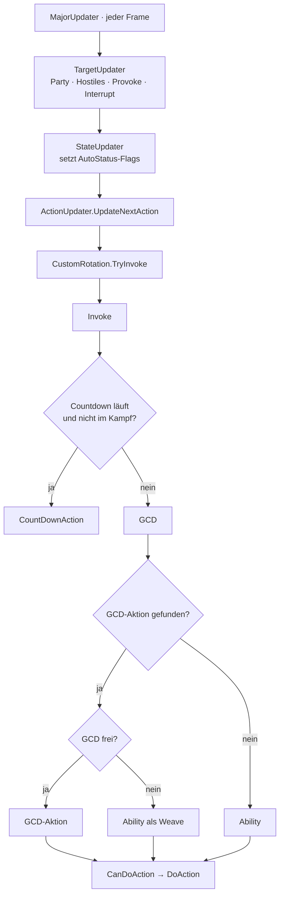

# 03 · Was bei allen Jobs identisch oder ähnlich ist

Diese Ebene beschreibt das, was *kein* Job selbst besitzt, sondern was ihm die
zentrale Maschinerie vorgibt — plus die Muster, die zwar in jedem Job einzeln
stehen, aber überall gleich aussehen.

**Die Reihenfolge der Zweige ist die umgesetzte Antwortordnung.** Was `08-mitigation-synergy.md`
als Vorgabe führt — Heilung vor Minderung —, steht hier als Dispatch-Reihenfolge: Die
Heilzweige werden vor den Verteidigungszweigen gefragt, und beide vor dem Angriff. Wer eine Regel
dieser Familie ändert, ändert entweder die Bedingung **in** einem Zweig oder die Reihenfolge der
Zweige selbst — das Zweite ist der teurere Eingriff und in C37 bereits einmal schiefgegangen.

---

## A · Der Rahmen: eine Entscheidung pro Frame



**Universelle Invariante:** Pro Frame entsteht genau *eine* Aktion. Kein Job
kann zwei Aktionen ausgeben, keiner kann die Reihenfolge des Rahmens ändern.
Jobs füllen ausschließlich Slots, sie steuern den Ablauf nicht.

**Zweite Invariante:** `StateUpdater` entscheidet *ob* ein Slot überhaupt
angefragt wird, der Job entscheidet nur *womit* er ihn füllt. Ein Job kann
eine Heilung nicht erzwingen, wenn `AutoStatus.HealSingleSpell` nicht gesetzt
ist — das ist die Ursache fast aller „warum feuert X nicht"-Fälle im
AUDIT_LOG.

**Dritte Invariante: Ein Objekt aus den Listen gilt für den Frame, in dem die Liste gebaut wurde (A309).** Gruppe,
Gegner, Flächenwirker und Ziele baut `TargetUpdater` in jedem Durchlauf neu; der Durchlauf läuft auf dem Spielthread
in einem Zug, dazwischen verschwindet kein Objekt. Über einen Frame hinaus taugt die Referenz nicht:
- Dalamud hält je Tabellenplatz und Objektart **ein** Objekt und setzt seine Adresse, sobald irgendein Plugin die
  Tabelle durchläuft (`ObjectTable.CachedEntry.Update`). Eine gehaltene Referenz zeigt danach auf den neuen Inhaber des
  Platzes; ist der Platz leer, behält sie die alte Adresse.
- `IsValid()` prüft nur, dass der Spieler geladen ist (`GameObject.IsValid`, Dalamud master, 15.10.2026), nicht das
  Objekt. Es schützt keine gehaltene Referenz; die 33 Prüfungen im Plugin sind Nullprüfungen mit dieser Zusatzbedingung.
- Spieler und Kampf-NPCs liegen in einem festen Speicherblock des Spiels (`CharacterManager.BattleCharaMemory`,
  FFXIVClientStructs). Eine veraltete Adresse liest deshalb vermutlich gültigen Speicher mit falschem Inhalt, keinen
  freigegebenen – Schluss aus dem Strukturlayout, nicht beobachtet. Upstream nennt in Kommentaren harte Abstürze an
  sterbenden Zielen (`6baba6a94`), ohne Beleg.

Was über Frames hinweg lebt, hält deshalb die Id und löst das Objekt im lesenden Frame aus der Tabelle auf
(`SearchById`): der Tankwechsel (`TankSwapWatch`), die Marker-Beobachtung, der Tankbuster-Plan für den Wirkenden des
geplanten Casts (seit A309; die Erhebung liest am Ende des Frames, der Plan im nächsten). Die Effekt-Hooks laufen zwischen
den Durchläufen und lesen die Gruppenliste des letzten; sie vergleichen erst die Id des aktuellen Inhalts mit dem Ziel
des Effekts und lesen nur dann LP oder Barriere – zeigt die Referenz auf einen anderen Spieler, passt die Id nicht. Die
Fenster lesen die Listen nur zur Anzeige.

### Was ein Frame kostet

Jeder Frame rechnet die ganze Entscheidung neu: Ziele, Flags, die GCD-Kette und im Einschiebefenster die
Fähigkeitenkette, je `CanUse` die Zielsuche über alle Kandidaten. Gemessen sind im Mittel 1,55 bis 3,63 ms je
Durchlauf, 7 bis 15 % der Framezeit, Spitzen bis 70 ms in einem Critical Engagement (Protokolle 16. und 17.10.2026,
A286, A299). Was davon trägt, sagt seit A310 die Kostenzeile je Schritt nach jedem Kampf.

Drei Regeln halten die Kosten eines Frames unabhängig davon, wie oft eine Frage gestellt wird (A325):
- **Keine Suche in der Objekttabelle pro Eintrag oder pro Lesen.** `SearchById` und `Status.SourceObject` laufen
  linear über jeden Platz der Tabelle (Dalamud, `ObjectTable.SearchById`); ein fehlendes Objekt kostet die ganze
  Tabelle. Was eine Schleife oder eine oft gelesene Abfrage von Objekten wissen muss, wird einmal je Frame erhoben
  (`StatusHelper.IsFromPlayer`: die Objekte des Spielers für die Prüfung „vom Spieler") oder nach dem billigen Test
  gefragt (`IsOwnPartyMarker` erst nach dem Pfad des Markers).
- **Erkennen, wo die Tatsache entsteht.** Ein Effekt ist ein Marker oder keiner, wenn er entsteht; die Warteschlange
  nimmt nur auf, was ein Leser abfragt (`DataCenter.IsReadVfxPath`: die vier Markerlisten und die Lock-on-Effekte der
  Fehlersuche). Vorher standen dort alle Effekte aller Figuren fünf Sekunden lang, und jeder Leser lief bei jedem Lesen
  über alle – im Critical Engagement die Skill-Effekte von 48 Spielern.
- **Eine Antwort aus der Historie einmal je Frame und Objekt.** `GetTTK` läuft über die ganze Gesundheitshistorie
  (240 Proben); die Zielsuche fragt es für jeden feindlichen Kandidaten bei jedem geprüften Angriff. Es merkt sich
  die Antwort für den Frame, eine neue Probe verwirft sie (`ObjectHelper.ForgetTimeToKill`).

Woher die Kosten kamen: Upstream speichert alle Effekte und prüft die Herkunft eines Status über die Objekttabelle; der
Fork hat beides vervielfacht – die Gruppenprüfung der Marker (A220) vor den Pfadvergleich gesetzt, jede Regel mit
Statusabfragen mehr Lesungen. Sein Verdacht, Sonderfälle als eigene Abfragen trieben die Rechenlast, trifft damit die
Form, nicht die Zahl der Regeln: Teuer war, was bei jedem Lesen neu sucht, nicht dass es viele Regeln gibt.

**Nicht umgestellt, mit Grund:**
- *Die Erkennungsabfragen von `DataCenter` je Frame merken* (`IsHostileCastingAOE`, `AreaHitAnnounced` und
  Verwandte): Nach dem Filter laufen sie über wenige Marker und die Wirkenden; A310 hat das Merken öffentlicher
  Eigenschaften ohne Beleg verworfen, und ein Beleg liegt nicht vor.
- *`HostileTarget` je Frame merken:* eine Suche bis zu den Gegnerplätzen je Lesen; eine zeitbasierte Merkhilfe könnte
  über die Frame-Grenze greifen, wovor die dritte Invariante warnt.
- *Dalamuds Statuslisten:* Jeder Zugriff legt eine Liste und je Status ein Objekt an. Kurzlebiger Müll, den die
  Bereinigung der jüngsten Generation räumt, ohne ihn weiterzureichen – Schluss aus der Lebensdauer, nicht gemessen; ob
  eine Bereinigung mit der langsamsten Runde zusammenfällt, zeigt die Kostenzeile.
- *Die Zielsuche je `CanUse`* (Upstreams Aufbau): ein Umbau des Kerns ohne Messung, welcher Teil trägt.

**Gemessen nach dem Umbau** (sein Protokoll vom 18.10.2026, Build 274ef44de, 84 Kämpfe in Vierer-Instanzen): im
Mittel 1,56 ms je Durchlauf, 9,2 % der Framezeit. Davon trägt die Hotbar-Anzeige („highlight") 1,04 ms, die
Rotationsentscheidung mit allen Sonderregeln 0,32 ms, die Flags 0,05 ms. Die Regeln sind damit nicht mehr der größte
Posten.

**Die Hotbar-Zeit war die Rotfärbung gesperrter Aktionen** (seine Protokolle vom 19.–22.10.2026, A334): Getrennt als
„hotbar tint" kostete sie 0,78 ms je Durchlauf (Build e012fbcd7, 225 Kämpfe, im Mittel 1,24 ms, 7,9 %). Sie baute
in jedem Bild die Aktionsliste der Rotation neu (`CustomRotation.AllActions` legt bei jedem Lesen eine neue Liste
an). Upstream 7.5.7.5 liest dort die einmal gebaute Liste (`RotationUpdater.CurrentRotationActions`). Seitdem kostet
sie 0,04 ms, und ein Durchlauf im Mittel 0,48 ms, 3,3 % der Framezeit (Build 01048265d, 59 Kämpfe). Den Rest trägt die
Rotationsentscheidung mit 0,22 ms. Einmalige Spitzen bis 474 ms fielen in den ersten Kampf nach dem Start („rotation
load" 397 ms), ohne Bereinigung. Eine Messung im Critical Engagement nach dem Umbau liegt nicht vor.

**Prüfgrad:** statisch am Code und an Dalamuds Quelltext (master, 17.10.2026); Compile im Prüflauf; Kostenzeilen
seines Protokolls vom 18.10.2026. Die Annahme über die Zahl der Effekte im Critical Engagement ist ein Schluss, nicht
gemessen.

---

## B · Die Slot-Kette (identisch für jeden Job)

```
GCD()                                    Ability()
─────────────────────────────────        ─────────────────────────────────
 1  CommandNextAction (GCD)               1  NoCasting-Sperre
 2  NoCasting-Sperre                      2  Einschiebesperre (GCD ≤ 0,5 s)
 3  Kanal-/Wirksperren (Orbonne, PLD,     3  Kanal-/Wirksperren (Orbonne, PLD,
    AST, BLU, NIN-Mudra, PvP)                AST, BLU)
 4  EmergencyGCD                          4  CommandNextAction (oGCD)
 5  MyInterruptGCD                        5  NIN-Mudra-, PvP-Sperre
 6  DispelGCD                             6  Befohlener Gegenstand
 7  ProvokeGCD                            7  UseAbility aus / Wirken läuft / Fesselung
 8  RaiseSpell   (wenn RaisePlayerFirst)  8  EmergencyAbility
 9  MoveForwardGCD                        9  Tankbuster-Plan (nur Tanks, Option):
10  HealAreaGCD                              Minderung nach Bedarf oder Unverwundbarkeit
11  HealSingleGCD                        10  Tankwechsel (nur Tanks, Option):
12  DefenseAreaGCD                           Shirk auf den Co-Tank, dann Zurückprovozieren
13  DefenseSingleGCD                     11  InterruptAbility
14  RaiseSpell   (sonst)                 12  DispelAbility
15  GeneralGCD                           13  Shirk (befohlen)
16  Heilung ohne Anlass                  14  TankStance
    (HealWhenNothingTodo)                15  AntiKnockback
                                         16  TrueNorth / Positional
                                         17  HealAreaAbility
                                         18  HealSingleAbility
                                         19  SpeedAbility (nur befohlen)
                                         20  ProvokeAbility
                                         21  DefenseAreaAbility
                                         22  DefenseSingleAbility
                                         23  MoveForward / MoveBack
                                         24  HP-Potion
                                         25  Phönixfeder
                                         26  AttackAbility
                                         27  GeneralAbility
                                         28  MP-Potion · GeneralUsing · Speed
```

**Befohlene Aktionen mit Ziel (Upstream 7.5.6.22, A264):** Ein DoActions-Befehl oder ein abgefangenes Makro kann ein
Ziel tragen – einen Platzhalter wie `<t>`, `<2>`, `<mo>` oder eine Zielart wie `<LowHP>`. Solange der Befehl in der
Warteschlange steht, gilt ein Objektziel für jede Zielsuche dieser Aktion, auch für einen Druck derselben Aktion aus
einem anderen Pfad und vor jeder Zielüberschreibung (`ActionTargetInfo.FindCommandObjectTarget`); ausgenommen sind
Aktionen ohne Reichweite und Wirkradius, die immer auf dich gehen. Eine Zielart ersetzt die Zielart der Aktion und eine
Zielüberschreibung, nicht aber „du selbst". Ist das Objektziel nicht erreichbar, sucht RSR wie bisher.

Der Tankbuster-Plan (9) und der Tankwechsel (10) sitzen hinter `EmergencyAbility`,
damit eine Unverwundbarkeit, die an ihrer Schwelle zündet, vorgeht, und vor allem anderen, weil beide an einem
Tankbuster hängen (Konzept 09, „Gemessener Tankbuster: das geringste Mittel" und „Tankwechsel nach einem
Tankbuster"). Der Plan drückt die Minderungen, die ein gemessener Tankbuster braucht, oder die Unverwundbarkeit, und
steht vor dem Wechsel, der hält, solange sie bereit ist. Beide haben keinen
befohlenen Eingang; Shirk (13) läuft weiterhin nur auf Befehl. Solange der Plan zurückhält (Konzept 09, „Wann
zurückgehalten wird") oder Heiliger Boden oder Meteoritenfall den Treffer abhalten, lehnt `BaseAction.CanUse` für Tanks
in jedem Slot bewertete Abwehr auf den Spieler ab, die der Plan nicht freigibt; frei bleiben die Heilslots, Hilfe für
andere, in der Flächenabwehr (21), was über ihn hinaus wirkt, und das Befohlene.

In jedem Slot fragt der Dispatcher zuerst die Duty-Rotation (`DataCenter.CurrentDutyRotation`), dann den Job. Die
Heil-, Abwehr-, Bewegungs- und Rückzugsslots haben je zwei Eingänge: zuerst den befohlenen (`CommandStatus`), dann
den automatischen (`AutoStatus` beziehungsweise `MergedStatus`).

Beide Ketten sind **fest verdrahtet** und für alle Jobs gleich. Zwei
Konsequenzen, die im ganzen AUDIT_LOG immer wieder auftauchen:

- Alles oberhalb von `GeneralGCD` kann `GeneralGCD` **aushungern**. Ein
  gesetztes Heil-Flag verhindert dauerhaft, dass ein Zweig in `GeneralGCD`
  jemals drankommt — unabhängig davon, wie wichtig er ist.
- Wer proaktive Logik in `GeneralGCD` platziert, muss sie in `HealAreaGCD` und
  `HealSingleGCD` **wiederholen**, sonst greift sie im Heilfall nicht. Genau
  das war die Ursache der „HoT wird nicht aufrechterhalten"-Meldungen.

### Status, unter denen nicht gehandelt werden soll („No-casting debuffs")

Die Liste `OtherConfiguration.NoCastingStatus` hat in der Oberfläche den Text „Do not take action if you have one of
these debuffs". Ihr Leser ist nicht die NoCasting-Sperre der Slot-Kette (die hängt an der Stopp-Liste gegnerischer
Casts), sondern der Druck selbst (`RSCommands_Actions`, `CancelCastUpdater`, `AutoAttackUpdater`). Die Liste enthält
zwei Arten, und RSR behandelt sie getrennt (A338):
- *Schaden bei jeder Aktion* (Pyretic in fünf Fassungen, seit Upstream 42cb3a7dd auch Causality, 514): kein Druck,
  solange der Status liegt, und ein laufender Zauber wird abgebrochen. Erkannt am eigenen Wirktext des Status im
  englischen Blatt des Clients, gleich welche Sprache er zeigt: „with every action" (Pyretic, alle sechs Zeilen des
  Spiels) oder „each time an action" (Causality) – in den Spielblättern vom 24.10.2026 trifft das genau diese sieben
  Zeilen (`NoCastingStatusHelper.DamagesEveryAction`). Kein Feld der Blätter trennt die Arten.
- *Strafe beim Ablauf* (Acceleration Bomb, Extreme Caution, Glossomorph, Flesh Forward und Back, Directed Grotesquerie,
  Buyer's Remorse): kein Druck und Abbruch erst, wenn der Status in weniger als 3 s endet
  (`NoCastingStatusHelper.ResolveWindow`, Upstream); ein Status ohne Restzeit zählt als endlos und sperrt so nie.
- Auto-Angriffe ruhen, solange irgendein gelisteter Status liegt. Daneben sperren eigene Wege den Druck für die ganze
  Dauer: Motion Tracker und BossModReborns Sondermodus Pyretic.

Im Kampf: Unter Pyretic oder Causality steht RSR, wie der Text der Liste sagt und wie die Mechanik es verlangt, auch ohne
BossModReborn-Modul. Ein Heiler heilt in dieser Zeit nicht; jede Heilung kostete ihn selbst Leben. Bis A338 drückte RSR
unter Pyretic bis 3 s vor dem Ende weiter, unter Causality und den Fassungen ohne Restzeit immer.

Die Liste lädt aus Upstreams Repository und nur, wenn die Datei im Konfigurationsordner fehlt oder die Liste
zurückgesetzt wird; ein neuer Eintrag von Upstream erreicht eine bestehende Datei nicht von selbst.

---

## C · Muster, die in jedem Job wiederkehren

### C1 · Level-Kette

Immer dieselbe Form:

```
if (  HöchsteStufe.EnoughLevel &&  HöchsteStufe.CanUse(out act)) return true;
if ( !HöchsteStufe.EnoughLevel &&  MittlereStufe.CanUse(out act)) return true;
if ( !MittlereStufe.EnoughLevel && Basisstufe.CanUse(out act))   return true;
```

Zwei eingebaute Fehlerquellen:

1. Der linke Teil `X.EnoughLevel && X.CanUse` ist **redundant** —
   `ActionBasicInfo.BasicCheck` prüft `EnoughLevel` bereits selbst und bricht
   ab. Gezählt am 02.10.2026: 56 Vorkommen, davon 44 außerhalb von `ExtraRotations`.
2. Der Ausschluss der höheren Stufe wird **von Hand** geschrieben und mal als
   `!X.EnoughLevel`, mal als `!X.Info.EnoughLevelAndQuest()` formuliert. Beide
   Varianten kommen nebeneinander vor. Genau hier entstand der bereits
   behobene RDM-Fehler `!EnoughLevel && EnoughLevel`.

### C2 · Sustain-Zweig (proaktives Aufrechterhalten)

Seit der Vereinheitlichung überall identisch aufgebaut:

```
Auslöser (BMR-Vorhersage ODER Gegneranzahl)  →  Dauer-Prüfung  →  CanUse
```

Zentral als `ShouldSustainMitigationDebuff(...)` für Addle/Feint/Reprisal,
job-eigen als `TrySustain…OnTank(...)` bei den Heilern. Vorher: 25 bzw. 9
Kopien.

### C3 · AoE-vs-ST-Verzweigung

Jeder Job hat sie, aber an **drei verschiedenen Orten**:

| Ort | Jobs | Mechanik |
|---|---|---|
| implizit über `AoeCount` in `CanUse` | die meisten | Zielsystem entscheidet |
| explizit über `NumberOfHostilesInRange >= n` | SAM, früher 26 Stellen | Job entscheidet |
| über eigene Zählhilfen | BLU, VPR | Job zählt selbst |

### C4 · Ranged-Fallback am Ende von `GeneralGCD`

Tanks und Nahkämpfer: letzter Zweig vor `base.GeneralGCD`. Gezählt am 02.10.2026 in neun Reborn-Rotationen; der
Mönch hat keinen. Bei den vier Tanks und beim Schnitter gilt nur das eigene `CanUse`. Eigene Bedingungen haben der
Samurai (nicht in den ersten 15 GCDs eines High-End-Kampfs, `CombatElapsedLessGCD(15)`), der Ninja (nicht während Mudra), der Dragoon (nicht direkt nach
`WingedGlidePvE`) und die Viper (Option `UFGhosting`).

### C5 · Kurzschluss ganz oben

Heiler: Swiftcast+Raise. Melee: Combo-Rettung. Struktur identisch — *verlasse
die Methode, bevor Rotationslogik läuft* —, Formulierung jedes Mal neu.

---

## D · Was tatsächlich zentral gelöst ist (Positivliste)

Damit der Umbauvorschlag in `04-concept.md` nicht Dinge „zentralisiert", die
es schon sind:

| Bereich | zentraler Ort |
|---|---|
| Zielauswahl inkl. AoE-Zählung | `ActionTargetInfo.FindTarget` |
| Nutzbarkeitsprüfung (Level, MP, Combo, Status, Cooldown, TTK) | `BaseAction.CanUse` → `ActionBasicInfo.BasicCheck` |
| Flag-Erzeugung (wann wird geheilt/mitigiert) | `StateUpdater` |
| Statusdauer-Rechnung | `StatusHelper.WillStatusEnd*` |
| BMR-Vorhersage-Zugriff | `CustomRotation_OtherInfo.BMR*` |
| Rollen-Standards (Interrupt, Anti-Knockback, True North, Potions) | `CustomRotation_Ability` |
| Mitigations-Sustain | `ShouldSustainMitigationDebuff` |

---

**Pause im Kampf** (`CustomRotation.InCombatPause`): im Kampf, kein Gegner in 25 Yalm. Die allgemeine
Hälfte der Pausenregel; was ein Job in der Pause wirkt, ist seine Regel (Konzept 14, „Pausen und
Phasenenden"). Die vorhergesagte Pause liest `BMRDowntimeWithin`, nur mit Modul.

## Wahl des DoT-Ziels

**Vorgabe des Auftraggebers (16.10.2026), wörtlich:** „bei der dot-verteilung sollte immer geschaut werden, welcher
gegner die aktuell höchsten hp hat, so dass der maximale effekt beim schaden erzielt werden kann. danach immer der
reihe nach wie die dots auslaufen." Seine Präzisierung (16.10.2026): „dots werden bei mehrern gegnern nicht nur auf
einen gelegt, sondern auf alle anwesenden. es geht hier um die initiale reihenfolge. deswegen ist die standardzielart
hier uninteressant. das gilt eher bei einzelzielangriffen, bei aoe angriffen ist es eh egal, weil mehrere gegner in der
auswahlfläche stehen. bei direkten einzelzielangriffen (ohne dot) gilt die gewählte vorgabe (High HP, Low HP etc.)
weiterhin."

**Geltende Regel** (`ActionTargetInfo.DotSpreadOrder`, Einstellung „Spread damage over time by HP, then by
expiry", ab Werk an, A295): Kann ein Schadens-DoT auf mehrere Gegner, geht er auf den, dessen eigener DoT zuerst
ausläuft, und bei gleicher Restzeit auf den mit der höchsten aktuellen Gesundheit (absolut, nicht in Prozent). Ein
Gegner ohne den DoT zählt als ausgelaufen, ein gerade gesendeter als nie auslaufend. In einem frischen Pull erhalten
die Gegner den DoT damit in der Reihenfolge ihrer HP, der mit den meisten zuerst (seine Formulierung, 16.10.2026);
tragen ihn alle, wird er in der Reihenfolge erneuert, in der er abläuft. Die Regel sitzt auf der Stufe „alle" in der zentralen Gegnerwahl und gilt für jeden Job
mit DoT; keine Stufe darunter braucht eine eigene, weil die Frage für jeden DoT dieselbe ist.

**Was vorher entschied:** Den DoT erhalten ohnehin alle anwesenden Gegner; die Reihenfolge folgte der allgemeinen
Zielart (`DataCenter.TargetingType`). Ab Werk ist das „Low HP" (der erste Eintrag der Standardliste): Der schwächste
Gegner erhielt den ersten DoT, der stärkste den letzten; auf ihm fehlte der DoT damit am längsten. Für direkte
Einzelzielangriffe ohne DoT bleibt die Zielart, wie er sie wählt; bei Flächenangriffen spielt die Reihenfolge keine Rolle,
weil mehrere Gegner in der Fläche stehen, und auch ein Flächen-DoT wie High Thunder II wird unter den Zielen mit der
größten Abdeckung nur zusätzlich geordnet.

**Wer Kandidat ist, bleibt unverändert** (`CheckStatus`, `CheckTimeToKill`): Gegner, denen der eigene DoT fehlt oder in
`Number of GCDs before the DoT is reapplied` GCDs ausläuft, mit einer Zeit bis zum Tod über der Schwelle der Aktion,
nicht unverwundbar, nicht auf der Liste eingeschränkter DoTs. Die Rangfolge davor bleibt ebenfalls: ein Befehl, die
Stopmarker, die Gegner mit Vorrang (Angriffsmarker, Gegnerteile, Schatzkarten-Symbole). Erst unter dem, was danach
übrig ist, ordnet die Regel.

**Wann sie nicht ordnet:**

- Eine Rotation wirkt die Aktion ohne Statusprüfung — dann ist es keine Verteilung: Chaotic Spring und Chaos Thrust als
  Kombo-Abschluss des Dragoons, Iron Jaws des Barden, Dia/Aero im Upkeep-Modus des Weißmagiers. Ebenso, wenn die
  Statusprüfung der Aktion abgeschaltet ist.
- Eine Rotation oder ein Befehl gibt das Ziel vor (Zielüberschreibung, Befehlsziel). Die Zielüberschreibung eines
  Pfads gilt nur in ihrem Lauf: Seit A305 setzt der Fähigkeitenlauf sie zu Beginn zurück, sodass Befehl,
  Notfallfähigkeiten, Tankbuster-Plan und Tankwechsel nach ihrer eigenen Zielart suchen, nicht nach der der Heil-,
  Reinigungs-, Provoke-, Wiederbelebungs- oder Abwehr-GCD davor.
- Der Status macht keinen Schaden. Death's Design des Schnitters erhöht nur dessen eigenen Schaden auf diesem Ziel und
  gehört auf den Gegner, den er angreift.
- Im manuellen Modus ist ohnehin nur das eigene Ziel Kandidat.

**Erkannt wird der DoT am eigenen Text des Status** in der englischen Statustabelle des Clients („Sustaining damage
over time.", „Toxins are causing damage over time.", „Sustaining lightning damage over time."; `StatusHelper.IsDamageOverTime`).
Die vorhandene Kennzeichnung `IsRestrictedDOT` trägt nur 19 Aktionen der Heiler, des Barden und des Schnitters; Thunder
und High Thunder des Schwarzmagiers, Higanbana, Chaotic Spring, Sonic Break und Bow Shock fehlen darin. Ist die Tabelle
nicht lesbar, ordnet die Regel nicht, und die Zielart entscheidet wie vorher.

**Meine Ableitung, nicht sein Wortlaut:** Ein Gegner ohne DoT kommt vor einer fälligen Erneuerung, weil er als
ausgelaufen zählt. Seine Worte stellen die höchsten HP an den Anfang und die Ablaufreihenfolge danach; beides fällt in
dieser einen Ordnung zusammen. Folge: Ein neues Add ohne DoT erhält ihn vor der Erneuerung auf dem Boss. Liegt dessen
Restzeit unter einem GCD, fehlt der DoT dort höchstens einen GCD lang; Kandidat für die Erneuerung ist er ohnehin
erst, wenn er in höchstens zwei GCDs ausläuft (Voreinstellung).

**Wann DoTs überhaupt auf mehreren Gegnern fallen** (sein Hinweis, 16.10.2026): im Wall-to-Wall, solange der Tank
zieht; in der Stun-Streckung des Weißmagiers zwischendurch; bei weniger als drei Gegnern, dann auf alle. Ab drei Gegnern
stehen Flächenangriffe an (RSR: Fläche vor DoT, Konzept 02). The Balance deckt sich damit: „When doing trash pulls, Aero
the mobs as your tank moves to gather everything up and use Stone when they stop", und auf Stufe 94 gilt „holy is still
only a gain on 3+ targets" (White Mage Leveling Guide, abgerufen 16.10.2026).

**Gegenposition, geprüft — sie trägt nicht.** Erwogen war, die Zeit bis zum Tod statt der Gesundheit als Reihenfolge zu
nehmen, weil ein DoT tickt, solange das Ziel lebt. In den Lagen, in denen DoTs verteilt werden, haben die Gegner eines
Pulls ihre volle Gesundheit und nehmen denselben Flächenschaden; die Reihenfolge ihrer HP ist dann die ihrer Lebensdauer
(Schluss). Die Zeit bis zum Tod fehlt zudem zu Beginn eines Pulls, weil sie erst aus dem Verlauf entsteht. Die Schwelle
von The Balance (Astrologe, Leveling-Leitfaden: Combust vor Malefic, wenn der Gegner mindestens 15 s lebt) ist eine
andere Frage: ob der DoT einen Füllzauber ersetzen soll. Beim Laufen ersetzt er keinen, weil der Füllzauber eine Wirkzeit
hat. Im Stand rechnet sich Dia gegen Glare III ab dem vierten Tick, also nach etwa 12 s (Job-Guide: Dia 85 sofort und 85
je 3 s, Glare III 350). Darunter liegt nur ein Gegner, der gleich stirbt; dafür gibt es die Schwelle „Time to kill" je
Aktion, ab Werk 0. Für Einzelzielangriffe ohne DoT gilt die gewählte Zielart; „Low HP" verkleinert den Pulk von unten, und
der DoT tickt am längsten auf dem, der am längsten lebt. Beides ergänzt sich.

**Prüfgrad:** statisch (Code, Statustexte über xivapi v2); Compile über die CI. Im Kampf: Bei mehreren Gegnern zeigt
sich die Regel daran, wer zuerst und wer zuletzt einen DoT trägt.

## E · Universelle Strukturschwächen

| # | Schwäche | Beleg | Stand |
|---|---|---|---|
| U1 | `GeneralGCD` ist Sammelbecken ohne Untergliederung | 7–81 Zweige auf einer Ebene, Median ~19 | für die fünf größten Dateien behoben (`04` A4a); MCH bewusst ausgelassen |
| U2 | Proaktive Logik steht in drei Methoden | Heiler-Sustain | **keine Schwäche.** Die Bedingung liegt in genau einem Helfer je Job; dreifach steht nur die **Position**, und die ist je Dispatch-Slot eine eigene Prioritätsaussage. Herleitung in `04-concept.md` unter A1 |
| U3 | Level-Ketten von Hand | 2 Schreibweisen, 1 realer Bug daraus | Fehlerklasse durch den Wächter A2′ geschlossen; die Ketten selbst bleiben |
| U4 | Hook-Belegung ohne Regel | Dragoon und Viper ohne `CountDownAction` | offen (TODO „Vorlauf: Dragoon und Viper"); die Slot-Lücken der Fernkämpfer und der Heilslot des Mönchs sind geschlossen (`04` B4/B5); ohne eigenen Notfall sind Schnitter und Samurai, und das ist keine Lücke (`04`, „Was offen bleibt") |
| U5 | Gleiche Rolle, verschiedene Orte | AoE-Schwelle an drei Orten (C3) | offen (TODO „AoE-Schwelle an drei Orten“); keine Laufzeitfrage – je Lesen eine Zählung über die Gegnerliste, ohne Suche in der Objekttabelle (A325); die Platzierung der Reflexion ist vereinheitlicht (`04` B3) |
| U6 | Kein Job kann sagen „ich bin fertig" | jede Ebene muss `base.X` aufrufen; Vergessen oder Vertauschen war mit neun Fällen die häufigste Fehlerklasse im AUDIT_LOG | Fehlerklasse durch den Wächter A3 in der CI geschlossen; die Kette selbst bleibt |

U6 war der unauffälligste und teuerste Punkt: Die Kette wird über
`return base.Methode(out act)` fortgesetzt, und ein falscher Methodenname im
`base`-Aufruf ist syntaktisch korrekt, kompiliert und im Diff unsichtbar. Genau
deshalb ist er nicht durch Sorgfalt, sondern durch eine CI-Prüfung zu schließen.

## Offene Punkte zu diesem Konzept

Sie stehen in `TODO.md` und sind dort unter der Überschrift des Eintrags mit **Konzept:** auf dieses
Dokument gekennzeichnet — an **einer** Stelle statt in zweien, damit keine Kopie altert.
`.github/scripts/audit/check_concept_links.py` listet sie je Konzept und nennt zugleich, wie viele
Einträge überhaupt keinem Konzept zugeordnet sind.
